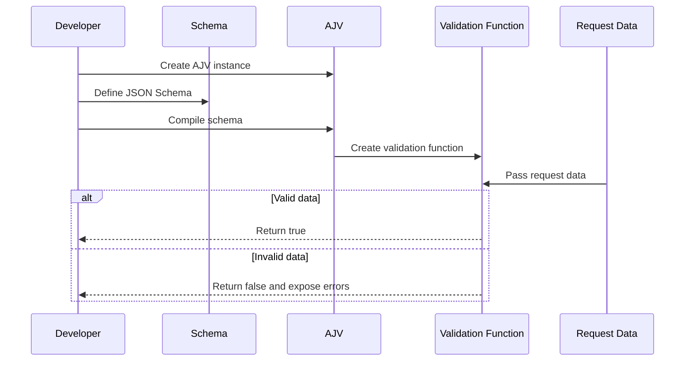

# Level 2

## Table of Contents: Validation and Error Handling

- [Introducing AJV](#introducing-ajv)
- [Schema-Based Request Validation](#schema-based-request-validation)
- [Creating Custom AJV Validators](#creating-custom-ajv-validators)
- [Customizing AJV Validation Errors](#customizing-ajv-validation-errors)

**Validation and Error Handling Level 2** builds on manual request validation by introducing **AJV**, a JSON Schema validator for JavaScript. It uses reusable schemas to validate request bodies, route parameters, and query parameters, then extends those schemas with custom rules, format checks through `ajv-formats`, and clearer messages through `ajv-errors`. These techniques keep validation logic separate from Express routes while preserving the existing error-handling flow.

## Introducing AJV

AJV validates JavaScript data against JSON Schema, which describes the structure and requirements that data must satisfy. It compiles each schema into a reusable function that returns `true` for valid data or `false` for invalid data, with details of any failures available through the function's `errors` property.



As the diagram illustrates, schemas are compiled during application setup, while incoming requests use the resulting functions without recompiling them. This approach differs from other JavaScript validation libraries. [express-validator](https://express-validator.github.io/docs/) provides validation and sanitization middleware for Express, [Joi](https://joi.dev/api/) defines schemas through a JavaScript API, and [Zod](https://zod.dev/) offers schema validation with TypeScript-oriented type inference. This module uses AJV for its JSON Schema support and separation of validation rules from route handlers; the [AJV Why use AJV](https://ajv.js.org/guide/why-ajv.html) documentation describes its standards support and compilation model in more detail.

Install AJV using the project's package manager, following the [AJV Getting Started](https://ajv.js.org/guide/getting-started.html) documentation. The optional packages covered later are installed separately when needed. To share configuration across schema modules, create `src/config/ajv.js` within the application structure.

```text
src/
├── config/
│   └── ajv.js
├── routes/
└── schemas/
```

The module exports a single AJV instance that can be configured with additional validation features as the application develops.

```js
import Ajv from "ajv";

const ajv = new Ajv();

export default ajv;
```

With the instance available for import, schemas can define the expected values of incoming Express requests without placing those rules inside route handlers.

## Schema-Based Request Validation

Express exposes incoming data through `req.body`, `req.params`, and `req.query`. Each can be checked against a JSON Schema, so the user routes define their requirements together in `src/schemas/user.js`, alongside the shared AJV configuration.

```text
src/
├── config/
│   └── ajv.js
├── routes/
└── schemas/
    └── user.js
```

JSON Schema provides standard keywords such as `type`, `properties`, `required`, `pattern`, and `additionalProperties` describe which values are accepted; their behavior is documented in the [AJV JSON Schema Reference](https://ajv.js.org/json-schema.html).

```js
import ajv from "../config/ajv.js";

const userBodySchema = {
    type: "object",
    properties: {
        email: {
            type: "string",
            minLength: 1,
        },
    },
    required: ["email"],
    additionalProperties: false,
};

const userParamsSchema = {
    type: "object",
    properties: {
        id: {
            type: "string",
            pattern: "^[0-9]+$",
        },
    },
    required: ["id"],
    additionalProperties: false,
};

const usersQuerySchema = {
    type: "object",
    properties: {
        limit: {
            type: "string",
            pattern: "^[0-9]+$",
        },
    },
    additionalProperties: false,
};

export const validateUserBody = ajv.compile(userBodySchema);
export const validateUserParams = ajv.compile(userParamsSchema);
export const validateUsersQuery = ajv.compile(usersQuerySchema);
```

The body schema requires a nonempty `email` string, the parameter schema requires an `id` made of digits, and the query schema accepts an optional `limit` made of digits. Each compiled function can then validate its corresponding request object before the route processes it.

!!! note "Compile Schemas Once"

    Define and compile schemas outside request handlers so incoming requests reuse the same validation functions.

The routes import these functions and pass invalid requests to Express with status `400` and the AJV error details attached.

```js
import {
    validateUserBody,
    validateUserParams,
    validateUsersQuery,
} from "../schemas/user.js";

app.post("/users", (req, res, next) => {
    if (!validateUserBody(req.body)) {
        const error = new Error("Invalid user data");
        error.status = 400;
        error.details = validateUserBody.errors;

        return next(error);
    }

    return res.status(201).json(req.body);
});

app.get("/users/:id", (req, res, next) => {
    if (!validateUserParams(req.params)) {
        const error = new Error("Invalid user ID");
        error.status = 400;
        error.details = validateUserParams.errors;

        return next(error);
    }

    return res.status(200).json({
        id: req.params.id,
    });
});

app.get("/users", (req, res, next) => {
    if (!validateUsersQuery(req.query)) {
        const error = new Error("Invalid query parameters");
        error.status = 400;
        error.details = validateUsersQuery.errors;

        return next(error);
    }

    return res.status(200).json({
        limit: req.query.limit,
    });
});
```

For example, `{"email": "vardenis@example.com"}`, `GET /users/42`, and `GET /users?limit=10` satisfy their respective schemas. Missing required fields, unexpected properties, and values that fail a defined pattern instead produce validation errors. More specialized requirements, such as checking password strength, can be added without moving validation logic into these handlers.

## Creating Custom AJV Validators

AJV supports application-specific validation through `ajv.addKeyword()`, as described in the [AJV User-Defined Keywords](https://ajv.js.org/guide/user-keywords.html) documentation. A registration form, for example, might require a password of at least eight characters containing uppercase and lowercase letters and a number. The application can define this rule once as `strongPassword` in `src/config/strong-password.js`.

```js
export function registerStrongPassword(ajv) {
    ajv.addKeyword({
        keyword: "strongPassword",
        type: "string",
        schemaType: "boolean",

        validate(enabled, password) {
            if (!enabled) {
                return true;
            }

            const hasUppercase = password.match(/[A-Z]/) !== null;
            const hasLowercase = password.match(/[a-z]/) !== null;
            const hasNumber = password.match(/[0-9]/) !== null;

            return (
                password.length >= 8 &&
                hasUppercase &&
                hasLowercase &&
                hasNumber
            );
        },
    });
}
```

The `keyword` property names the rule, `type: "string"` restricts it to string data, and `schemaType: "boolean"` allows schemas to enable it with `strongPassword: true`. AJV passes that setting and the submitted value to `validate()`, which returns whether the password meets the rule. This example demonstrates custom validation rather than a complete password-security policy.

Before compiling a schema that uses the keyword, register it in `src/config/ajv.js`. The configuration also enables `$data`, which lets supported schema keywords refer to other values in the validated data.

```js
import Ajv from "ajv";
import { registerStrongPassword } from "./strong-password.js";

const ajv = new Ajv({
    $data: true,
});

registerStrongPassword(ajv);

export default ajv;
```

The `src/schemas/registration.js` module can now enforce password strength and confirm that `repeatPassword` matches `password`. The custom keyword handles strength, while the standard `const` keyword uses a `$data` reference to compare the two fields.

```js
import ajv from "../config/ajv.js";

const registrationSchema = {
    type: "object",
    properties: {
        password: {
            type: "string",
            strongPassword: true,
        },
        repeatPassword: {
            type: "string",
            const: { $data: "1/password" },
        },
    },
    required: ["password", "repeatPassword"],
    additionalProperties: false,
};

export const validateRegistration = ajv.compile(registrationSchema);
```

The reference `"1/password"` retrieves the sibling `password` value from the containing object, which `const` then compares with `repeatPassword`. The [AJV $data Reference](https://ajv.js.org/guide/combining-schemas.html#data-reference) explains this syntax. Calling `validateRegistration(req.body)` accepts `{"password": "Example123", "repeatPassword": "Example123"}` but rejects weak passwords or mismatched confirmation values. As with the user routes, failed checks are available through `validateRegistration.errors` and can be forwarded as `400` errors. These errors can also be made easier for API clients to understand by customizing their messages.

## Customizing AJV Validation Errors

AJV supplies default messages for failed rules, but `ajv-errors` lets schemas replace them through `errorMessage`. The `ajv-formats` package adds checks for recognized string formats such as `email`, `date`, and `uri`. Both extend the shared instance and are documented in the [ajv-errors](https://ajv.js.org/packages/ajv-errors.html) and [ajv-formats](https://ajv.js.org/packages/ajv-formats.html) references.

Update `src/config/ajv.js` to register these packages alongside the existing custom keyword and `$data` option.

```js
import Ajv from "ajv";
import ajvErrors from "ajv-errors";
import addFormats from "ajv-formats";
import { registerStrongPassword } from "./strong-password.js";

const ajv = new Ajv({
    allErrors: true,
    $data: true,
});

addFormats(ajv);
ajvErrors(ajv);
registerStrongPassword(ajv);

export default ajv;
```

The `allErrors: true` option allows AJV to collect multiple validation failures and is required by `ajv-errors`. Calling `addFormats(ajv)` registers the predefined formats, while `ajvErrors(ajv)` enables the `errorMessage` keyword. These extensions are registered before schemas are compiled so their validation rules and messages are available throughout the application.

The existing `userBodySchema` in `src/schemas/user.js` can now validate email formatting and provide specific messages for different failures. The route parameter and query parameter schemas remain unchanged.

```js
const userBodySchema = {
    type: "object",
    properties: {
        email: {
            type: "string",
            minLength: 1,
            format: "email",
            errorMessage: {
                type: "Email must be a string",
                minLength: "Email must not be empty",
                format: "Email must be valid",
            },
        },
    },
    required: ["email"],
    additionalProperties: false,
    errorMessage: {
        required: {
            email: "Email is required",
        },
        additionalProperties: "Unexpected property",
    },
};

export const validateUserBody = ajv.compile(userBodySchema);
```

The `format: "email"` check recognizes an email-address structure with a local part, an `@` symbol, and a domain. For example, `"vardenis@example.com"` passes, while `"vardenis.example.com"` fails because it lacks `@`. This validates syntax, not whether the mailbox exists. The `minLength: 1` rule rejects an empty string, and `errorMessage` supplies descriptions for invalid types, formats, missing fields, and unexpected properties. It does not reject whitespace-only strings through `minLength` alone.

The `POST /users` handler can use the first AJV message when forwarding a failed request, while retaining the complete error details.

```js
app.post("/users", (req, res, next) => {
    if (!validateUserBody(req.body)) {
        const error = new Error(validateUserBody.errors[0].message);
        error.status = 400;
        error.details = validateUserBody.errors;

        return next(error);
    }

    return res.status(201).json(req.body);
});
```

A missing `email` produces `"Email is required"`, while an empty value can produce `"Email must not be empty"` and a malformed address can produce `"Email must be valid"`. Because `allErrors: true` may report several failures, the first message is not always predictable; `error.details` retains the full set. The route still forwards the error through `next(error)`, leaving response handling to the existing Express error flow.

With reusable schemas, custom rules, format checks, and descriptive messages in place, **Validation and Error Handling Level 3** develops centralized Express error handling for validation, application, and database errors.
