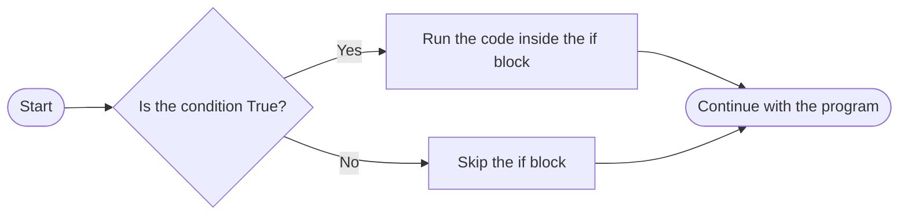
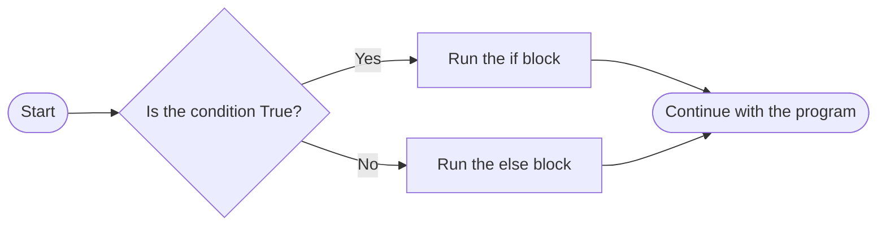
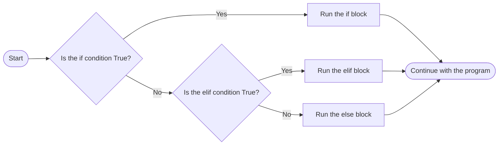
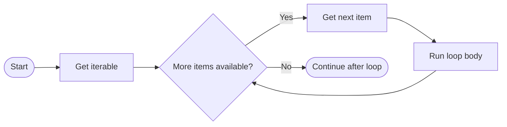
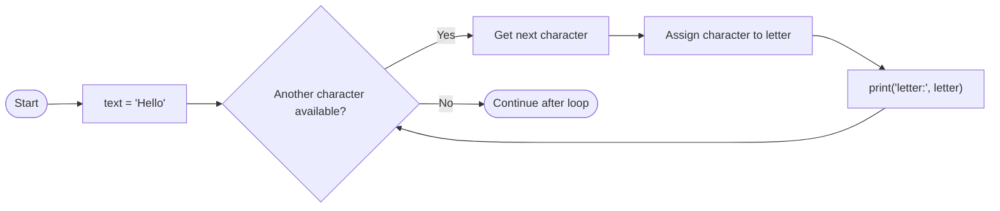
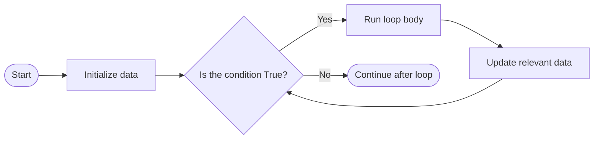
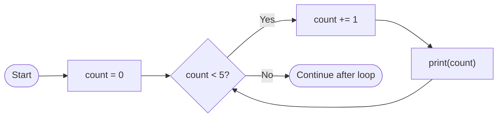

# Level 1

## Table of Contents: Control Flow

- [If Statement](#if-statement)
- [If-Else Statement](#if-else-statement)
- [If-Elif-Else Statement](#if-elif-else-statement)
- [Loops Overview](#loops-overview)
- [For Loop](#for-loop)
- [Enumerate Function](#enumerate-function)
- [Range Function](#range-function)
- [While Loop](#while-loop)

Python programs often need to make decisions and repeat actions. **Control flow** determines which statements run and how many times they run. It allows a program to respond to different conditions and repeat work without writing the same instructions again.

In this **Python Control Flow Level 1**, we begin with conditional statements using `if`, `elif`, and `else`, then move to the basic `for` and `while` loops. We will start with the simplest conditional structure, the `if` statement.

## If Statement

An `if` statement runs a block of code only when its condition evaluates to `True`. It begins with the `if` keyword, followed by a condition and the required colon. The indented statements below it form the code block controlled by that condition.



The basic syntax is shown below.

```py
if condition:
    # code block executed if the condition is True
```

For example, a program can check a temperature before displaying a message.

```py
temperature = 25

if temperature > 20:
    print("It's warm outside") # It's warm outside
```

Because `temperature > 20` is `True`, the indented `print()` call runs. If the condition were `False`, Python would skip that block and continue with the next statement after it. This approach is useful when an action should happen only under one condition, such as displaying a warning, processing a valid record, or enabling a feature for an eligible user.

Python also allows a simple `if` statement to be written on one line, although the normal indented form is usually easier to read and is preferred throughout this course.

```py
if condition: print("Condition is True") # Condition is True
```

Conditions can also combine multiple boolean expressions with logical operators such as `and` and `or`. In the following example, both comparisons must evaluate to `True` because they are joined with `and`.

```py
temperature = 25
humidity = 45

if (temperature > 20) and (humidity < 50):
    print("It's warm and not too humid") # It's warm and not too humid
```

An `if` statement is enough when a program only needs to act when a condition is true. Many decisions, however, require an alternative action when the condition is false. For that situation, Python combines `if` with `else`.

## If-Else Statement

An `if` statement can be combined with `else` when a program needs one action for a true condition and another action for a false condition. This creates two possible branches, but only one of them runs.



The syntax is shown below.

```py
if condition:
    # code block executed if the condition is True
else:
    # code block executed if the condition is False
```

For example, a temperature check can display one message when the condition is true and another when it is false.

```py
temperature = 15

if temperature > 20:
    print("It's warm outside") # It's warm outside
else:
    print("It's not warm outside") # It's not warm outside
```

Because `temperature > 20` is `False`, Python skips the `if` block and runs the `else` block. Use `if-else` when exactly one of two actions should happen, such as accepting or rejecting input, showing an available or unavailable state, or choosing between two processing paths. When a program needs to distinguish between several possible situations, additional conditions can be introduced with `elif`.

## If-Elif-Else Statement

When a program needs to choose between more than two possibilities, one or more `elif` branches can be placed between `if` and `else`. The keyword `elif` means **else if**. Python checks each condition in order until it finds the first one that evaluates to `True`.



The general structure is shown below.

```py
if condition1:
    # code executed if condition1 is True
elif condition2:
    # code executed if condition1 is False
    # and condition2 is True
else:
    # code executed if all previous conditions are False
```

The following example classifies a temperature into one of several ranges.

```py
temperature = 15

if temperature > 30:
    print("It's very hot outside") # Not printed for temperature = 15
elif temperature > 20:
    print("It's warm outside") # Not printed for temperature = 15
elif temperature > 10:
    print("It's cool outside") # It's cool outside
else:
    print("It's cold outside") # Not printed for temperature = 15
```

Python evaluates the conditions from top to bottom. With `temperature` set to `15`, the first two conditions are `False`, while `temperature > 10` is `True`, so Python prints `"It's cool outside"` and skips the final `else` block. Use `if-elif-else` when one result must be selected from several ordered possibilities, such as assigning a category, choosing a status, or applying different rules to different value ranges.

!!! note "First Matching Branch"

    Python runs only the first branch whose condition is `True`. Once a branch is selected, the remaining `elif` and `else` branches are skipped.

Conditional statements allow a program to choose what should happen. The next part of control flow addresses a different problem. Instead of choosing between branches, programs often need to perform the same kind of work repeatedly. Python handles this with loops.

## Loops Overview

A **loop** is a control structure that repeatedly executes a block of code. Instead of writing the same instructions multiple times, a loop allows a program to repeat the same logic as needed. Python provides two main loop statements, `for` and `while`. A `for` loop processes values from an iterable, while a `while` loop repeats work as long as a condition remains `True`.

Python also provides tools commonly used with `for` loops. The `enumerate()` function adds a counter while iterating, and `range()` provides a sequence of numbers that can control repetition. To understand how these tools support iteration, we will first explore how a `for` loop processes values from an iterable.

## For Loop

A `for` loop takes one value at a time from an **iterable** and runs the loop body for each value. An iterable provides values for iteration, such as the characters of a string or the elements of a list. Use a `for` loop when you want to process each item in a collection or perform work for each value in a sequence. Python stops the loop automatically when the iterable is exhausted, even when it contains no items, and then continues with the statement after the loop.



The loop variable receives the current item before the indented body runs. This is the general syntax.

```py
for item in collection:
    # code block to execute for each item
```

A **string** is iterable because Python can process its characters one at a time. The following diagram traces a loop through the characters in `"Hello"`.



In the code, `letter` receives each character in order. The final statement runs after all characters have been processed.

```py
text = "Hello"

for letter in text:
    print("letter:", letter) # letter: H, then letter: e, letter: l, letter: l, letter: o

print("Done") # Done
```

A **list** is also iterable. Unlike a string, its elements can be complete values such as numbers or names. The loop below processes each number without manually accessing its index.

```py
scores = [8, 9, 10]

for score in scores:
    print("Score:", score)  # Score: 8, then Score: 9, then Score: 10
```

A **tuple** works similarly when reading its elements in order, although its contents cannot be changed after creation.

```py
location = (40.7128, -74.0060)

for coordinate in location:
    print(coordinate) # 40.7128, then -74.006
```

A **set** contains unique elements and is iterable, but its iteration order is not guaranteed. A loop can therefore examine every distinct value without relying on which value appears first.

```py
categories = {"books", "games", "music"}

for category in categories:
    if category == "games":
        print("Games category found") # Games category found
```

A **dictionary** stores key-value pairs. Iterating over it directly visits its keys, just like `.keys()`. The `.values()` method provides values, while `.items()` provides key-value pairs that can be unpacked. These are dictionary methods, not separate loop statements.

```py
students = {"Example1": 9, "Example2": 8}

for name in students:
    print("Student:", name) # Student: Example1, then Student: Example2

for grade in students.values():
    print("Grade:", grade) # Grade: 9, then Grade: 8

for name, grade in students.items():
    print(f"{name} scored {grade}") # Example1 scored 9, then Example2 scored 8
```

These examples cover common built-in iterable types, including **strings, lists, tuples, sets, and dictionaries**. Python also supports other iterables, such as `range` objects and open files. The **Range Function** section explains how `range()` supplies numbers for repetition. A `for` loop can work with any iterable, regardless of its specific data type.

Once the basic iterable types are familiar, a `for` loop can work with collections that contain other collections. Each iteration still receives one item from the outer iterable, whether that item is a list, tuple, dictionary, or set.

A list can contain other collections. When a list contains inner lists, each iteration receives one complete inner list. Here, each `day` contains temperature measurements that can be averaged using `sum()` and `len()`.

```py
temperatures = [
    [18, 21, 23],
    [17, 20, 22],
    [19, 22, 24]
]

for day in temperatures:
    average = sum(day) / len(day)
    print(f"Average temperature: {round(average, 2)}") # 20.67, then 19.67, then 21.67
```

A list can also contain dictionaries representing records with named fields. Each iteration receives one record, and its keys identify the values to read.

```py
users = [
    {"name": "Example1", "age": 25},
    {"name": "Example2", "age": 30}
]

for user in users:
    print(f"{user['name']} is {user['age']} years old") # Example1 is 25 years old, then Example2 is 30 years old
```

A list of tuples is useful when each item holds a fixed group of related values. When a list contains tuples of the same shape, **unpacking** assigns each tuple's parts to separate loop variables. For example, a product tuple can hold a name and price together.

```py
products = [("Laptop", 1200), ("Mouse", 30), ("Monitor", 350)]

for name, price in products:
    if price >= 100:
        print(f"{name} costs {price}")  # Laptop costs 1200, then Monitor costs 350
```

A practical use of sets is checking which required permissions are missing. The following loop examines each required permission and reports any permission missing from the user's set. The result does not depend on iteration order.

```py
required_permissions = {"read", "write", "delete"}
user_permissions = {"read", "write"}

for permission in required_permissions:
    if permission not in user_permissions:
        print("Missing permission:", permission)  # Missing permission: delete
```

Sets can also be stored as dictionary values. This is useful when each user has a unique collection of permissions, and the loop needs to check those permissions without iterating over every permission individually.

```py
user_permissions = {
    "Jonas": {"read", "write"},
    "Antanas": {"read"},
    "Petras": {"read", "admin"}
}

for name, permissions in user_permissions.items():
    if "admin" in permissions:
        print("Administrator:", name) # Administrator: Petras
```

Dictionary keys can also be tuples when their elements are hashable. A tuple key can represent a combination, such as a city and product, and `.items()` lets the loop unpack both the key and its associated value.

```py
stock = {
    ("Vilnius", "Laptop"): 4,
    ("Kaunas", "Laptop"): 2
}

for (city, product), quantity in stock.items():
    print(city, product, quantity) # Vilnius Laptop 4, then Kaunas Laptop 2
```

Beyond reading values, loops can perform calculations and build results. A **summation algorithm** uses a running total that changes during each iteration. Python's `sum()` can add numeric values directly, but writing the loop shows how accumulation works and allows additional rules to be introduced.

```py
prices = [12, 8, 15]
total = 0

for price in prices:
    total += price

print(total) # 35
```

A loop can also convert values before adding them. This is useful when numeric data is stored as strings and must be converted with `float()` before calculation.

```py
prices = ["12.50", "8.00", "15.25"]
total = 0

for price in prices:
    total += float(price)

print(round(total, 2))  # 35.75
```

A related pattern is **conditional counting**, which increases a counter only when an item meets a requirement. Unlike summation, it counts matching items rather than adding their values.

```py
numbers = [10, -5, 20, 0, 30]
positive_count = 0

for number in numbers:
    if number > 0:
        positive_count += 1

print(positive_count) # 3
```

Conditional statements inside loops can also classify or filter items. The following example checks each email address independently using the same `if` and `else` branches.

```py
emails = ["user@example.com", "admin", "contact@site.com"]

for email in emails:
    if "@" in email:
        print(f"Valid email: {email}") # Valid email: user@example.com, then Valid email: contact@site.com
    else:
        print(f"Invalid email: {email}") # Invalid email: admin
```

!!! info "Simplified Validation"

    Checking only for `"@"` is a teaching example, not complete email validation. Real addresses require more careful checks.

The same conditional pattern can use `not` to reverse a Boolean value and `not in` to test whether an item is absent from a collection. Neither operator creates a separate kind of loop.

```py
users = [
    {"name": "Ana", "active": True},
    {"name": "Ben", "active": False}
]

for user in users:
    if not user["active"]:
        print("Inactive:", user["name"]) # Inactive: Ben

requested = ["Laptop", "Tablet", "Mouse"]
warehouse = {"Laptop": 5, "Mouse": 2}

for product in requested:
    if product not in warehouse:
        print("Missing:", product) # Missing: Tablet
```

When multiple requirements must hold for the same item, combine them with `and`. Here, an order is ready only when it has been paid for and its product is in stock. Operators such as `or` can also be used in loop conditions just as they are elsewhere.

```py
orders_to_check = [
    {"id": 1, "paid": True, "in_stock": True},
    {"id": 2, "paid": False, "in_stock": True},
    {"id": 3, "paid": True, "in_stock": False}
]

for order in orders_to_check:
    if order["paid"] and order["in_stock"]:
        print("Ready:", order["id"]) # Ready: 1
    else:
        print("Not ready:", order["id"]) # Not ready: 2, then Not ready: 3
```

Unlike a single counter, a **frequency-counting algorithm** keeps a separate count for each distinct value. A dictionary stores the counts and is updated whenever a product appears again.

```py
purchases = ["apple", "banana", "apple", "orange", "banana"]
counts = {}

for product in purchases:
    if product in counts:
        counts[product] += 1
    else:
        counts[product] = 1

print(counts) # {'apple': 2, 'banana': 2, 'orange': 1}
```

Another common pattern is **finding a maximum by iteration**. The loop compares each number with the largest value found so far. Starting with `None` avoids accessing a nonexistent first element when the list is empty.

```py
numbers = [20, 50, 10, 90]
highest = None

for number in numbers:
    if highest is None or number > highest:
        highest = number

print(highest) # 90
```

For an empty list, `highest` remains `None`. Python's `max()` can find the largest value in a nonempty collection directly, but an explicit loop helps illustrate or customize the comparison process.

Finally, a `for` loop can appear inside a conditional branch when repeated work should happen only in a selected situation. Earlier examples placed `if` inside `for`; here, the outer condition determines which loop runs.

```py
orders = [
    {"id": "ORD-1001", "status": "pending"},
    {"id": "ORD-1002", "status": "shipped"},
    {"id": "ORD-1003", "status": "pending"}
]

mode = "pending"

if mode == "pending":
    for order in orders:
        if order["status"] == "pending":
            print("Processing pending order:", order["id"]) # Processing pending order: ORD-1001, then ORD-1003
elif mode == "shipped":
    for order in orders:
        if order["status"] == "shipped":
            print("Processing shipped order:", order["id"])
else:
    print("Unknown mode")
```

A loop can also contain another loop, but **nested loops** are explored in **Control Flow Level 3**. So far, each iteration has worked with the current item. When the position of that item is also needed, Python provides `enumerate()`.

## Enumerate Function

The `enumerate()` function lets a `for` loop receive both a counter and the current value from an iterable. It is useful when the program needs to know an item's position while processing it, without managing a separate counter manually. By default, counting begins at `0`.

```py
products = ["Laptop", "Mouse", "Monitor"]

for index, product in enumerate(products):
    print(index, product) # 0 Laptop, then 1 Mouse, then 2 Monitor
```

On each iteration, `index` receives the current counter and `product` receives the corresponding list element. The two variables are assigned together through **unpacking**. When numbering should begin at `1`, pass `1` as the second argument.

```py
stops = ["Station A", "Station B", "Station C"]

for number, stop in enumerate(stops, 1):
    print(f"Stop {number}: {stop}") # Stop 1: Station A, then Stop 2: Station B, then Stop 3: Station C
```

The second argument sets the starting counter, but it does not change the positions of elements in the original list. You may also see `enumerate(stops, start=1)`. Here, `start` is a **keyword argument**, a concept covered in **Functions Level 2**. For now, passing `1` directly is sufficient.

`enumerate()` also works when each element is a more complex value, such as a dictionary. The counter can identify a record's position while a condition checks its contents. In this example, the loop reports the positions of employees whose salaries meet a requirement.

```py
employees = [
    {"name": "Jonas", "salary": 2500},
    {"name": "Antanas", "salary": 5000},
    {"name": "Petras", "salary": 4000}
]

for index, employee in enumerate(employees):
    if employee["salary"] >= 4000:
        print(index, employee["name"]) # 1 Antanas, then 2 Petras
```

Unlike numbering a list for display, this example uses the counter to identify where matching records appear in the original collection. The loop still visits every employee. If the iterable is empty, the loop body does not run.

Use a regular `for` loop when only the values are needed. Use `enumerate()` when both the values and their positions or display numbers matter. When a program needs a sequence of numbers rather than counters attached to items, Python provides `range()`.

## Range Function

The `range()` function represents a sequence of integers and is commonly used with a `for` loop when an action must repeat a specific number of times or when the numbers themselves are needed. A `range` object does not display all its numbers when printed directly.

```py
print(range(5))  # range(0, 5)
```

Printing this value displays `range(0, 5)`, which represents numbers beginning at `0` and stopping before `5`. A common use of `range()` is repeating an action a fixed number of times.

```py
for i in range(5):
    print(i) # 0, then 1, then 2, then 3, then 4
```

Because counting starts at `0`, this loop runs five times. When the numbers are not needed, `_` is a conventional variable name indicating that the current value is intentionally ignored.

```py
for _ in range(3):
    print("Saving data...") # Saving data... printed three times
```

The numbers can also be used in calculations. Here, a running total accumulates the values supplied by `range(5)`.

```py
total = 0

for i in range(5):
    total += i

print(total) # 10
```

To choose where counting begins, provide both a starting value and a stopping value. The stop value is always excluded.

```py
for number in range(1, 4):
    print(number) # 1, then 2, then 3
```

A third argument controls the **step**, or the difference between consecutive numbers. The default step is `1`, but a larger step can skip values. A negative step counts backward, provided the starting and stopping values are arranged accordingly.

```py
for number in range(2, 11, 2):
    print(number)  # 2, then 4, then 6, then 8, then 10

for number in range(5, 0, -1):
    print(number)  # 5, then 4, then 3, then 2, then 1
```

The three common forms are `range(stop)`, `range(start, stop)`, and `range(start, stop, step)`. A step of `0` is invalid. If the start, stop, and step do not allow any values, the loop simply runs zero times.

In practical programs, `range()` can also generate **list indexes**. An index identifies a position in a list, beginning at `0`. Combining `range()` with `len()` is useful when a program needs to access corresponding positions in several lists. For example, the following code compares old and new product prices. The length check ensures the lists contain the same number of elements before their indexes are used.

```py
products = ["Laptop", "Mouse", "Monitor"]
old_prices = [900, 25, 200]
new_prices = [1000, 20, 250]

if len(products) == len(old_prices) == len(new_prices):
    for i in range(len(products)):
        change = new_prices[i] - old_prices[i]

        if change > 0:
            print(products[i], "increased by", change) # Laptop increased by 100, then Monitor increased by 50
        elif change < 0:
            print(products[i], "decreased by", -change) # Mouse decreased by 5
        else:
            print(products[i], "stayed the same")
else:
    print("The lists must have matching lengths")
```

Another reason to work with indexes is to compare **adjacent elements**. A route with four cities has three connections between neighboring cities. Using `len(route) - 1` prevents the code from trying to access an element beyond the end of the list.

```py
route = ["Vilnius", "Kaunas", "Klaipėda", "Palanga"]

for i in range(len(route) - 1):
    print(route[i], "->", route[i + 1])  # Vilnius -> Kaunas, then Kaunas -> Klaipėda, then Klaipėda -> Palanga
```

Use `range()` for a fixed number of repetitions, numeric progressions, or index-based operations. If a loop only needs each item in a collection, direct iteration is simpler. If it needs both an item's position and its value, `enumerate()` is generally clearer than `range(len(collection))`. Index-based access remains useful when positions must be used to look up related or neighboring elements.

Both `range()` and `enumerate()` provide values to a `for` loop. Some programs instead need to keep repeating work only while a changing condition remains true. That kind of repetition is handled by a `while` loop.

## While Loop

A `while` loop repeats a block of code **as long as its condition is `True`**. Unlike a `for` loop, which usually processes values from an iterable, `while` is most useful when the number of repetitions is not known in advance and the program must check a changing condition. Examples include waiting for a particular input, saving until a target is reached, or continuing transactions while an account remains active.



Python checks the condition **before** each iteration, so the body may not run at all if the condition starts as `False`. The general syntax is shown below.

```py
while condition:
    # code executed while the condition is True
```

A counter makes the relationship between the condition and its update visible. In the diagram, the program checks `count < 5` before each repetition, increases the counter, and prints its new value.



The code follows the same steps. Notice that increasing `count` **before** printing produces the numbers from `1` through `5`.

```py
count = 0

while count < 5:
    count += 1
    print(count) # 1, then 2, then 3, then 4, then 5
```

After printing `5`, Python checks the condition again. Since `5 < 5` is `False`, the loop ends. The starting value, condition, and update must work together; otherwise, a loop may run too many times, too few times, or indefinitely.

Sometimes the stopping condition depends on input rather than a counter. The following loop keeps asking until the user enters `"q"`, so the number of iterations cannot be determined beforehand.

```py
choice = ""

while choice != "q":
    choice = input("Enter 'q' to quit: ")

print("Exiting program")  # Exiting program
```

If a condition never becomes `False`, a loop can run indefinitely. For example, `while True` has no condition-based stopping point on its own.

```py
while True:
    print("Infinite loop")  # Repeats until the program is interrupted
```

!!! tip "Stopping a Running Program"

    Press **Ctrl + C** in the terminal to interrupt a running program. The `break` statement offers another way to stop a loop and is introduced in **Control Flow Level 2**.

A `while` loop can update several related values. In a savings plan, the total saved determines when to stop, while a separate counter records how many months have passed. Checking that the monthly contribution is positive prevents a loop that can never reach the target.

```py
target = 500
monthly_saving = 120
saved = 0
months = 0

if monthly_saving > 0:
    while saved < target:
        saved += monthly_saving
        months += 1

    print("Months needed:", months)  # Months needed: 5
    print("Total saved:", saved)  # Total saved: 600
else:
    print("Monthly saving must be positive")
```

The loop stops when `saved` reaches or exceeds the target. This is a natural use of `while` because the stopping condition is more important than a predetermined number of repetitions.

A `while` loop can also process a list by tracking an **index**. Although a `for` loop is usually simpler for visiting every item, manual indexing is useful when the program needs to manage its position or combine it with another stopping rule. Here, only positive payments contribute to the total.

```py
payments = [100, -20, 200, 0, 300]
index = 0
paid_total = 0

while index < len(payments):
    amount = payments[index]

    if amount > 0:
        paid_total += amount

    index += 1

print("Accepted payments:", paid_total) # Accepted payments: 600
```

The index advances **on every iteration**, including when a payment is not positive. Placing `index += 1` only inside the `if` branch would cause the loop to get stuck when it encounters `-20`.

More complex stopping rules can combine conditions with `and`. This ATM example processes withdrawal requests only while requests remain and the account is active. An unaffordable request changes `active` to `False`, stopping further processing without using `break`.

```py
balance = 500
withdrawals = [100, 200, 300, 50]
index = 0
active = True

while index < len(withdrawals) and active:
    amount = withdrawals[index]

    if amount <= 0:
        print("Invalid withdrawal amount")
    elif amount > balance:
        print("Insufficient funds:", amount) # Insufficient funds: 300
        active = False
    else:
        balance -= amount
        print("Withdrawn:", amount) # Withdrawn: 100, then Withdrawn: 200

    index += 1

print("Remaining balance:", balance) # Remaining balance: 200
```

A `while` loop can also appear **inside a `for` loop**, or a `for` loop can appear **inside a `while` loop**. These combinations are introduced briefly here to show how different stopping rules can work together.

When each customer has a different amount to pay, `for` can select one customer at a time while `while` processes installments until that customer's debt reaches zero.

```py
orders = [
    {"customer": "Ana", "debt": 150},
    {"customer": "Ben", "debt": 80}
]

for order in orders:
    debt = order["debt"]

    while debt > 0:
        payment = min(100, debt)
        debt -= payment
        print(order["customer"], "paid", payment)
        # Ana paid 100, then Ana paid 50, then Ben paid 80
```

The reverse arrangement is also possible. A `while` loop can control how many rounds occur, while a `for` loop processes every item during each round.

```py
products = ["Laptop", "Mouse"]
round_number = 1

while round_number <= 2:
    for product in products:
        print("Round", round_number, product)
        # Round 1 Laptop, Round 1 Mouse, Round 2 Laptop, Round 2 Mouse

    round_number += 1
```

These are **nested loops**. For now, focus on which loop controls the overall repetition and which loop handles the work inside it. **Control Flow Level 3** explores nested `for` loops, nested `while` loops, and mixed nesting in greater depth.

**Choosing between `for` and `while`** depends on what controls repetition. Use `for` when processing items from an iterable or repeating work over a known range. Choose `while` when the program must continue until a condition changes, especially when the number of iterations is not known in advance. If a `while` loop accesses a list by index, ensure that the index advances and remains within the list's bounds. In every `while` loop, identify what can eventually make its condition `False`.

With `while`, the **Control Flow Level 1** foundation is complete. You can choose between branches using `if`, `elif`, and `else`, process iterable values with `for`, track positions with `enumerate()`, generate numeric sequences with `range()`, and repeat work while a condition remains true using `while`. **Control Flow Level 2** builds on these foundations with `break`, `continue`, `pass`, and other ways to control execution.
