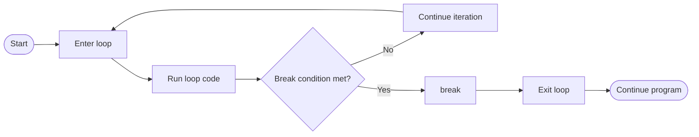
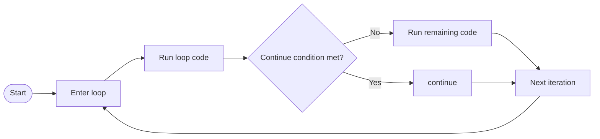

# Level 2

## Table of Contents: Control Flow

- [The `break` Statement](#the-break-statement)
- [The `continue` Statement](#the-continue-statement)
- [The `pass` Statement](#the-pass-statement)

Python loops normally continue until every value has been processed or a `while` condition becomes `False`. Sometimes a program needs more direct control over what happens during an iteration. This level introduces `break`, `continue`, and `pass`. They behave differently. `break` exits a loop, `continue` skips the remaining work in the current iteration, and `pass` does nothing. We will begin with `break`, then examine how the other statements affect execution.

## The `break` Statement

The `break` statement stops the current `for` or `while` loop immediately, even if more iterations would normally follow. It is useful when a search has found its target, a user requests that a process stop, or continuing would no longer be useful. Execution resumes with the first statement after the loop.



The diagram follows the usual pattern of checking a condition inside the loop and exiting early when that condition is met. The general structure follows this pattern.

```py
for item in collection:
    if condition:
        break
```

For example, `range(10)` supplies the numbers from `0` through `9`, but the following loop stops as soon as it reaches `5`.

```py
for i in range(10):
    print(f"Iteration {i}") # Iteration 0 through Iteration 5

    if i == 5:
        break
```

The value `5` is printed because `print()` runs before the condition is checked. Once `i == 5` becomes `True`, the loop exits and never reaches `6` through `9`. If the `break` check came before `print()`, the value `5` would not be printed. This illustrates why the position of a statement inside a loop matters.

A `while` loop can also use `break`, particularly when the stopping command comes from user input and the number of repetitions is unknown.

```py
while True:
    command = input("Type 'exit' to stop: ")

    if command == "exit":
        print("Program stopped") # Program stopped
        break

    print("Command received:", command) # Prints the entered command
```

Here, `while True` would keep repeating unless something inside the loop stops it. Entering `"exit"` triggers `break`, so the final `print()` is skipped. For any other command, the message is printed and another iteration begins. In **Control Flow Level 1**, a changing `while` condition was used to stop a loop; `break` provides an alternative when the decision to exit is made inside the body.

!!! note "Loop-Only Statement"

    `break` must appear inside a `for` or `while` loop. Using it outside a loop causes a `SyntaxError`.

Searching a collection is another practical reason to exit early. Once the target order has been found, there is no need to inspect the remaining orders.

```py
orders = ["ORD-1001", "ORD-1002", "ORD-1003", "ORD-1004"]
target_order = "ORD-1003"

for order in orders:
    if order == target_order:
        print(f"Order found: {order}") # Order found: ORD-1003
        break
```

This works when the target exists, but the code does not yet report what happens when it is missing. Python provides a loop `else` clause for exactly this kind of distinction.

An `else` block attached to a `for` or `while` loop runs when the loop finishes **without executing `break`**. It is not an alternative branch of an `if` statement, and it does not mean that the loop condition was false on every iteration. In a search, the `else` block can handle the case where no match was found.

```py
orders = ["ORD-1001", "ORD-1002", "ORD-1003"]
target_order = "ORD-1004"

for order in orders:
    if order == target_order:
        print(f"Order found: {order}") # Not printed
        break
else:
    print("Order not found") # Order not found
```

Because the target is absent, the loop checks every order and then runs `else`. If the target were present, `break` would skip `else`. The same rule applies to `while`. When its condition eventually becomes `False`, `else` runs unless the loop was exited with `break`.

```py
attempts = 0
while attempts < 3:
    attempts += 1
    print(f"Attempt {attempts}") # Attempt 1, then Attempt 2, then Attempt 3
else:
    print("All attempts completed") # All attempts completed
```

The `while` condition eventually becomes `False`, so this example completes normally and prints the final message. Loop `else` is most useful when the difference between *completed normally* and *stopped early* matters; it is not necessary for every loop.

Inside a function, `return` can stop a search too, but it has a broader effect. While `break` exits only the current loop, `return` exits the **entire function** and can send a value back to the caller. This connects loop control to the function behavior introduced in **Functions Level 1**.

```py
def find_order(orders, target):
    for order in orders:
        if order == target:
            return True

    return False


orders = ["ORD-1001", "ORD-1002", "ORD-1003"]
target_order = "ORD-1003"

if find_order(orders, target_order):
    print("Search successful") # Search successful
else:
    print("Order not found") # Not printed
```

If a match is found, `return True` ends the function immediately. If no match is found, execution reaches `return False` after the loop. Use `break` when only the current loop should end, and `return` when the function itself should finish. When the goal is to skip just one iteration rather than stop the loop, use `continue`.

## The `continue` Statement

The `continue` statement skips the remaining statements in the **current iteration** and moves on to the next iteration of the same loop. Unlike `break`, it does not exit the loop. This is useful for ignoring invalid records, filtering out unwanted values, or skipping work that does not apply to a particular item.



The key point is that code after `continue` is skipped **only for that iteration**. The general structure follows this pattern.

```py
for item in collection:
    if condition:
        continue
```

A `while` loop demonstrates why the order of its updates matters. In this example, the counter increases before `continue` can skip the print statement.

```py
i = 0

while i < 10:
    i += 1

    if i % 2 == 0:
        continue # Skip the rest of the loop for even numbers

    print(f"Odd number: {i}") # Skip the rest of the loop for even numbers
```

When `i` is even, `continue` skips the `print()` statement and Python checks the `while` condition again. Because `i += 1` happens first, the counter still advances on every iteration. Placing that update after `continue` could cause an infinite loop when the counter reaches an even number.

!!! warning "Updating a `while` Loop"

    Before using `continue` in a `while` loop, check that every possible path still allows the stopping condition to be reached. A skipped update can leave the condition permanently `True`.

A practical use is skipping records with missing information. The following example processes only records whose email field is not empty.

```py
records = [
    {"name": "Example1", "email": "example1@example.com"},
    {"name": "Example2", "email": ""},
    {"name": "Example3", "email": "example3@example.com"}
]

def process_valid_emails(records):
    for record in records:
        if record["email"] == "":
            continue

        print("Sending email to:", record["email"]) # Prints each non-empty email

process_valid_emails(records)
```

The second record is skipped, but the loop still processes the third. This checks only whether the field is empty; it does not validate an email address or actually send an email. For straightforward conditions, an `if` statement without `continue` may be just as readable. Use `continue` when skipping early makes the remaining processing easier to follow.

!!! note "Loop-Only Statement"

    Like `break`, `continue` must appear inside a `for` or `while` loop. Using it outside a loop causes a `SyntaxError`.

Sometimes Python requires a statement even though no action should happen yet. For that situation, Python provides `pass`.

## The `pass` Statement

The `pass` statement differs from both `break` and `continue` because it performs **no action**. Python requires a statement inside an `if` block, loop, function, or class definition, even when the body has not been implemented yet. The `pass` statement keeps the code syntactically valid until the intended behavior is added, making it useful for marking an unfinished conditional branch, as shown in the following example.

```py
if condition:
    pass # Implement this later
```

The same placeholder works when a function has been defined but its implementation is not ready.

```py
def my_function():
    pass # Implement this later
```

A class definition can also use `pass` when its body will be added later.

```py
class MyClass:
    pass # Add class behavior later
```

In all three structures, `pass` is only a placeholder. Inside a loop, this distinction becomes especially important because `pass` does not behave like `continue`.

```py
for number in range(3):
    if number == 1:
        pass # Placeholder, execution continues normally

    print(number) # 0, then 1, then 2
```

Even when `number` equals `1`, the `print()` statement still runs. Replacing `pass` with `continue` would skip that print and produce only `0` and `2`. Replacing it with `break` would stop the loop when `number` reaches `1`, producing only `0`. This comparison captures the practical difference among the three statements.

The distinction is based on what should happen next. Use `break` when further iterations are unnecessary, `continue` when the current iteration should be skipped, and `pass` when Python needs a statement but no behavior is required yet. Together, these statements complete the core loop-control tools for **Control Flow Level 2**. In **Control Flow Level 3**, we will build on them through nested loops and explore how loop-control statements behave when loops are combined.
