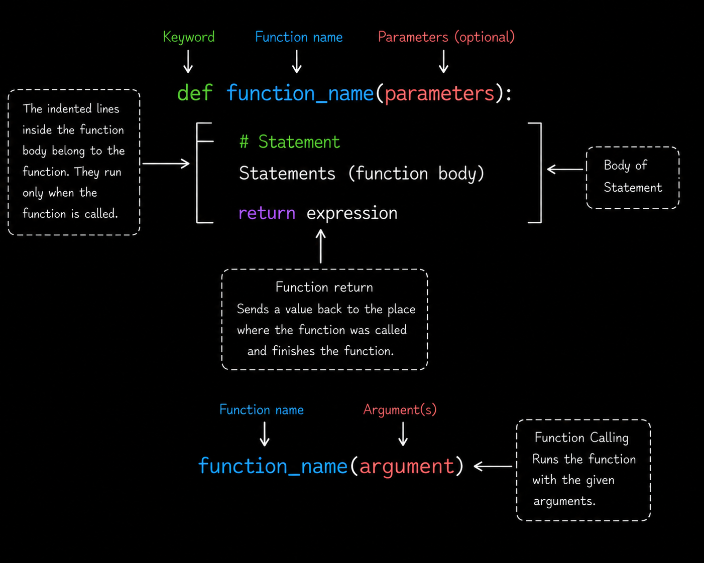

# Level 1

## Table of Contents: Functions

- [Defining and calling functions](#defining-and-calling-functions)
- [Return vs print](#return-vs-print)
- [Control flow inside functions](#control-flow-inside-functions)
- [Functions with collections](#functions-with-collections)
- [Function composition](#function-composition)

**Python Functions Level 1** introduces how to define and call functions, pass arguments, and return results. You will then use conditions and loops inside functions, work with collections, and combine functions so that one returned result becomes another function's input.

## Defining and calling functions

A **function** is a reusable block of code that performs a specific task. Python uses `def` to create a **function definition**. Defining a function does not execute its body. A **function call** runs the function by using its name followed by parentheses. A definition can include **parameters**, which receive values supplied as **arguments** when the function is called.



The diagram distinguishes the definition from the call. In a definition, `def` introduces the function, its name identifies it, and the indented statements form its **body**. Parameters appear in parentheses after the name. As introduced in **Python Documentation and Code Style Level 1**, function names containing multiple words should normally use `snake_case`.

```py
def greet(name):
    print("Hello", name)

greet("Jonas") # Hello Jonas
greet("Ieva") # Hello Ieva
```

Here, `name` is a parameter, while `"Jonas"` and `"Ieva"` are arguments supplied in separate calls. Each call runs the same body with a different value and displays a greeting.

!!! info "Function docstrings"

    As introduced with module docstrings in **Python Documentation and Code Style Level 1**, a function can have a **docstring** as its first statement. It briefly describes what the function does.

    ```py
    def greet(name):
        """Display a greeting for the supplied name."""
        print("Hello", name)
    ```

    For now, focus on recognizing its placement. Function documentation is explored further in **Python Documentation and Code Style Level 2**.

Functions can also receive multiple arguments and use `return` to send a value back to the calling code.

```py
def add_numbers(a, b):
    return a + b

result = add_numbers(10, 20)
print(result) # 30
```

In this example, arguments are matched to parameters **by position**. The first argument, `10`, is assigned to `a`, and the second, `20`, to `b`. The function adds the values and returns `30`, which is stored in `result`.

!!! warning "Incorrect number of arguments"

    `add_numbers()` requires two arguments. Calling it with only one raises a `TypeError`.

    ```py
    add_numbers(10)
    # TypeError: add_numbers() missing 1 required positional argument: 'b'
    ```

    Supply both required arguments, as in `add_numbers(10, 20)`.

!!! info "Local scope"

    Parameters and variables created inside a function are **local** to that function. Their names are not directly accessible outside it. This is called **local scope** and is explored in **Python Under the Hood Level 1**.

The examples so far have used both `print()` and `return`. Although they may appear similar when a result is displayed, they have different purposes.

## Return vs print

**`print()` displays a value**, while **`return` sends a value back to the caller** so it can be stored or reused. Consider a function that prints a sum.

```py
def add_numbers(a, b):
    print(a + b)

add_numbers(10, 20) # 30
```

This displays `30` but does not return the number for another calculation. Returning the sum makes it available to the rest of the program.

```py
def add_numbers(a, b):
    return a + b

result = add_numbers(10, 20)
doubled_result = result * 2

print(result) # 30
print(doubled_result) # 60
```

The returned value is stored in `result` and reused to calculate `doubled_result`. It could also be passed as an argument to another function.

A function that finishes without executing `return` automatically returns `None`. **`None` is Python's value for representing the absence of a result.** Printing something does not change that behavior.

```py
def show_total(a, b):
    print(a + b)

result = show_total(10, 20) # Displays 30
print(result) # None
```

The call displays `30`, but `result` receives `None` because `show_total()` does not return the sum.

!!! question "Predict the output"

    Before running the `show_total()` example, predict what appears on each output line. Why does the second line show `None` rather than `30`?

!!! tip "Choosing between return and print"

    Use `print()` to display information. Use `return` when other code needs to receive and reuse a value.

Executing `return` also ends the current function call. Statements after an executed `return` in the same execution path are not reached.

```py
def get_message():
    return "Hello"
    print("This line is not executed")

print(get_message()) # Hello
```

Because a function can return different results depending on its input, `return` becomes especially useful when combined with conditions.

## Control flow inside functions

Functions can use **control flow** to decide what happens for different inputs. An `if` statement works inside a function just as it does elsewhere in a program. Combined with `return`, it allows a function to produce different results depending on a condition. For example, a function can check whether a password meets a minimum length requirement.

```py
def check_password_length(password):
    if len(password) < 8:
        return "Password too short"

    return "Password length is OK"

print(check_password_length("1234")) # Password too short
print(check_password_length("securepass123")) # Password length is OK
```

If the password has fewer than eight characters, the first `return` ends the call. Otherwise, execution reaches the final `return`. This keeps the decision in one reusable function, which a loop can call for several inputs.

```py
passwords = ["1234", "mypassword", "securepass123"]

for password in passwords:
    result = check_password_length(password)
    print(result)
```

Here, the loop handles repetition, while the function handles the validation rule. Instead of calling a function repeatedly with individual values, we can also pass a collection directly into a function.

## Functions with collections

Lists, dictionaries, and other collections can be passed to functions just like individual values. A function can inspect their contents, perform calculations, or make decisions. For example, a program can check whether a username appears in a list of allowed users.

```py
def is_allowed_user(username, allowed_users):
    return username in allowed_users

allowed_users = ["Jonas", "Ieva", "Mantas"]

print(is_allowed_user("Jonas", allowed_users)) # True
print(is_allowed_user("Tomas", allowed_users)) # False
```

The `username` parameter receives the name to check, while `allowed_users` receives the list. The expression `username in allowed_users` is a **membership test** that returns `True` or `False`.

A function can also calculate a result from several values in a list.

```py
def calculate_average(scores):
    return sum(scores) / len(scores)

test_scores = [8, 9, 10, 7]

average = calculate_average(test_scores)

print(average) # 8.5
```

The function uses `sum()` to calculate the total and `len()` to count the scores, then divides the total by the count. The calling code only needs to provide the list.

!!! warning "Empty lists and averages"

    This version assumes that `scores` is not empty. Otherwise, `len(scores)` is `0`, and division raises a `ZeroDivisionError`. A guard can return `None` to indicate that no average is available.

    ```py
    def calculate_average(scores):
        if len(scores) == 0:
            return None

        return sum(scores) / len(scores)
    ```

    The caller should check for `None` before using the result in a calculation.

A function can also contain a loop to process every item in a collection. This example counts scores that meet a passing threshold of `5`.

```py
def count_passing_scores(scores):
    count = 0

    for score in scores:
        if score >= 5:
            count = count + 1

    return count

print(count_passing_scores([4, 7, 9, 3])) # 2
```

The loop runs inside `count_passing_scores()` and examines each score. It increases `count` when a score meets the threshold, then returns the total after the loop finishes. Unlike the earlier password example, the function itself performs the repetition.

Dictionaries can also be passed as arguments when several related values describe one item or person.

```py
def get_user_status(user):
    if user["active"]:
        return f"{user['name']} is active"

    return f"{user['name']} is inactive"


user = {
    "name": "Austėja",
    "active": True
}

print(get_user_status(user))  # Austėja is active
```

The function reads `"active"` to choose a result and `"name"` to construct the message. Across these examples, functions have received different kinds of input and returned useful results. The final section shows how one function's result can become another function's input.

## Function composition

**Function composition** means using the value returned by one function as the input to another. This can first be written in separate steps so that the intermediate value is visible.

```py
def add_tax(price):
    return price + (price * 0.21)

def add_shipping(price):
    return price + 5

price = 20
taxed_price = add_tax(price)
result = add_shipping(taxed_price)

print(result) # 29.2
```

The first call returns `24.2`, which is stored in `taxed_price`. The second receives that value and adds `5`, producing `29.2`. When the intermediate value does not need to be stored separately, the calls can be nested.

```py
def add_tax(price):
    return price + (price * 0.21)

def add_shipping(price):
    return price + 5

price = 20
result = add_shipping(add_tax(price))

print(result) # 29.2
```

Python evaluates the inner call `add_tax(price)` first, then passes its returned value to `add_shipping()`. Both approaches produce the same result, but the nested version avoids an intermediate variable. This example uses the functions defined in the preceding code block.

!!! question "Trace the function calls"

    Before running the nested example, identify which function executes first, what it returns, and what value is passed to the outer function.

!!! note "Function calls and returned values"

    Composition here uses the **value returned by a function call**. Passing a function itself without calling it is a separate concept explored at a later level.

You have now learned how to define and call functions, work with their inputs and returned values, use control flow and collections, and combine function calls. **Python Functions Level 2** builds on these foundations by introducing **default parameter values** and **keyword arguments**, which give you more flexibility when supplying arguments. It then explores **arbitrary positional arguments (`*args`)** and **arbitrary keyword arguments (`**kwargs`)**, which allow functions to receive varying numbers of arguments.
