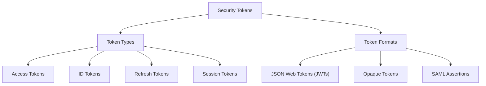

# Overview

**Security tokens** are pieces of information used by software systems to represent or communicate security-related information, such as authenticated identity, session state, or access permissions. They support secure interactions between users, applications, and services by allowing security information to be presented and evaluated without requiring credentials such as passwords to be provided with every request.

Security tokens serve several purposes in modern software systems. They can help maintain authenticated sessions, provide access to protected resources, and support **delegated access**, where an application receives permission to access resources on behalf of a user. For example, after a user successfully authenticates, an application may receive an **access token** that it presents when requesting data from a protected API. The receiving system evaluates the token and determines whether the requested operation is permitted.

Security tokens can be classified according to their **type** and **format**. A token type describes the purpose a token serves, while a token format describes how the token is represented and how its information can be interpreted or verified. Common token types include **access tokens**, **ID tokens**, **refresh tokens**, and **session tokens**. Token representations include **JSON Web Tokens (JWTs)**, **opaque tokens**, and **Security Assertion Markup Language (SAML) assertions**. These classifications describe different aspects of security tokens. For example, an access token may be represented as a JWT or an opaque string, depending on the system's design and security requirements.

The use of security tokens generally follows a **token lifecycle**. A token is issued by a trusted component and presented when an application or user requests access to a protected resource. The receiving system validates the token according to the applicable security requirements before accepting or rejecting the request. Tokens may also have limited validity periods and mechanisms for expiration, renewal, rotation, or revocation. The exact lifecycle depends on the token type and the security protocol being used.

Because security tokens may provide access to sensitive resources, their protection is an important part of **software security**. Stolen or improperly handled tokens can potentially be used to gain unauthorized access, while inadequate validation may allow expired, invalid, or incorrectly scoped tokens to be accepted. Secure token handling therefore involves appropriate protection during transmission and storage, reliable validation, and suitable restrictions on token validity and use.

The following topics explore security tokens in greater detail. [Token Types](token_types/overview.md) examines the different purposes security tokens serve, including access, identity, refresh, and session management. [Token Formats](token_formats/overview.md) introduces the representations used for security tokens, including JWTs, opaque tokens, and SAML assertions. Together, these topics establish a foundation for understanding how security tokens are used, represented, and managed in software systems.
