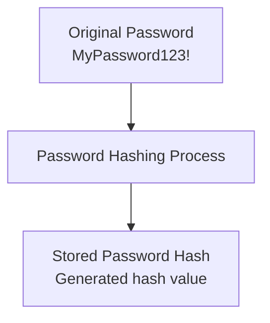
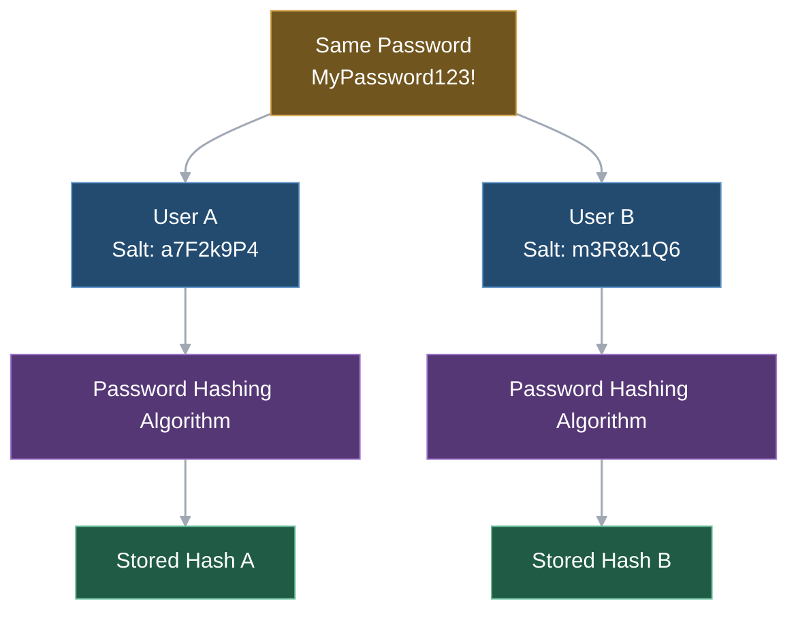

# Level 1

## Table of Contents: Password Hashing

- [Password Hashing and Secure Storage](#password-hashing-and-secure-storage)
- [Salting and Password Hashing Algorithms](#salting-and-password-hashing-algorithms)

**Password Hashing Level 1** introduces how applications protect user passwords during storage and verify them during authentication. It covers the purpose of password hashing, the role of salts and specialized hashing algorithms, and fundamental practices for handling password credentials securely.

## Password Hashing and Secure Storage

When users create accounts, they typically provide passwords that applications must later verify during authentication. Storing these passwords in plaintext would expose them if the database were compromised, potentially allowing attackers to access user accounts or reuse the credentials on other services. To reduce this risk, applications use **password hashing** to transform passwords into values that can be stored for verification without retaining the original passwords.

Unlike encryption, which allows encrypted data to be restored to its original form, **password hashing is designed to be a one-way process**. Applications therefore do not need to recover users' original passwords to authenticate them. Instead, when a user creates a password, the application processes it using a specialized password hashing algorithm and stores the resulting hash along with any additional information required for verification. For example, an application receiving the password `MyPassword123!` would process it as illustrated below rather than storing it directly.

The resulting hash may have different formats depending on the hashing algorithm and its configuration. During login, the application uses the stored verification information to check the submitted password. For example, entering `MyPassword123!` would produce a successful verification result, while entering `WrongPassword123!` would fail, assuming the account was registered with the original password and the stored credentials have not changed.

!!! note "Password Verification and Authentication"

    A successful password verification does not automatically establish an authenticated session or grant access to protected resources. Depending on the application's design, additional checks may be required before a session is created or an authentication token is issued.

Alongside password hashing, **secure credential handling** is essential throughout authentication. Applications should use HTTPS to protect passwords during transmission, avoid including credentials in URLs or logs, and prevent passwords from appearing in error messages. Plaintext passwords should also be retained only as long as necessary to process an authentication attempt, reducing the risk of accidental exposure.

Even with secure password storage and credential handling, attackers who obtain stored hashes may attempt to discover the original passwords by testing possible guesses. Protecting against such attacks requires additional measures, particularly unique salts and appropriately configured password hashing algorithms.

## Salting and Password Hashing Algorithms

While password hashing protects against storing passwords in plaintext, the way hashes are generated also affects their security. When two users choose the same password, hashing it without a salt produces identical results if the same algorithm and configuration are used. This can reveal shared passwords and allow attackers to test common password guesses against multiple accounts more efficiently.

To address this problem, applications use a **salt**, a randomly generated value that is unique to each password hash. For example, two users might choose the password `MyPassword123!`, but the application could generate a salt such as `a7F2k9P4` for one user and `m3R8x1Q6` for the other. Incorporating these different salts into the hashing process produces different results despite the passwords being identical, as illustrated in the following diagram.

These salt values are simplified examples. In practice, salts are generated using a cryptographically secure random number generator and may contain arbitrary bytes rather than readable characters. They do not need to be secret and are typically stored alongside the resulting hashes for password verification. By ensuring that identical passwords produce different hashes, salts prevent attackers from identifying shared passwords through direct hash comparisons and reduce the usefulness of precomputed password-hash lookup tables.

!!! warning "Salts Do Not Prevent Password Guessing"

    Although unique salts make precomputed attacks less practical, attackers who obtain stored hashes can still test possible passwords. An appropriate password hashing algorithm is therefore necessary to make these attempts more costly.

General-purpose cryptographic hash functions, such as SHA-256, are designed for efficient processing, which is useful for tasks such as integrity verification but makes them unsuitable for password storage when used alone. Their speed allows attackers to test large numbers of password guesses quickly. In contrast, **specialized password hashing algorithms** deliberately require additional computational resources to make guessing attacks more expensive. Several established algorithms achieve this through different approaches, as outlined below.

| Algorithm    | Description                                                                   |
| ------------ | ----------------------------------------------------------------------------- |
| **Argon2id** | A modern algorithm with configurable memory and computational requirements.   |
| **bcrypt**   | An established algorithm that uses a configurable computational cost.         |
| **scrypt**   | An algorithm designed to require substantial memory and computation.          |

**Argon2id is generally preferred for new applications**, while bcrypt and scrypt remain established alternatives when appropriately configured. Although these algorithms are independent of programming languages, libraries and frameworks may provide different functions, configuration options, and stored hash formats. Applications should therefore use trusted password hashing libraries to generate and verify hashes rather than implementing the underlying algorithms themselves.

With these fundamentals established, [**Password Hashing Level 2**](../2_level/2_level_password_hashing.md) explores more advanced security considerations, including configuring hashing parameters, strengthening password protection, and maintaining secure password storage as application requirements and security practices evolve.
