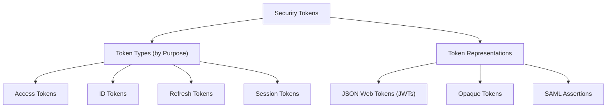

# Overview

Security tokens developed alongside changing requirements for authentication and authorization. During the 1990s, web applications increasingly used HTTP cookies to maintain authenticated sessions across requests. A common approach, known as **server-managed sessions**, involved storing session information on the server while the browser retained a session identifier, typically in a cookie. When the browser made subsequent requests, the server used this identifier to retrieve the corresponding session information without requiring the user to authenticate again.

During the 2000s and 2010s, the growth of web APIs, distributed applications, and the need to share identity information across organizations increased the importance of standardized security mechanisms. SAML 2.0 (2005) and OpenID Connect (2014) supported federated authentication, allowing applications to rely on trusted identity providers. OAuth 2.0 (2012) established a framework for delegated authorization, while JWT (2015) standardized a compact format for representing claims. These developments expanded how security information could be exchanged and managed, while server-managed sessions continued to be widely used.

**Security tokens** are digital artifacts used by software systems to convey security-related claims or reference security state, such as authenticated identity, session information, or access permissions. Depending on their representation, tokens may contain security information directly or reference information maintained by another system. Their validity and intended use depend on the issuing authority, applicable security mechanisms, and trust relationships between participating systems.

Security tokens can help maintain authenticated sessions, support access to protected resources, and enable **delegated access**, where an application is authorized to access resources on behalf of a user. For example, an application may obtain an **access token** and present it when requesting data from a protected API. The receiving system validates the token, checks whether it is intended for that system and use, and evaluates the applicable authorization requirements before permitting the requested operation. **Token validation** and **authorization** are distinct decisions. A valid token does not automatically grant permission to perform every requested operation.

Security tokens can be classified according to their **type** and **representation**. A token type describes its intended purpose, while its representation describes how security-related information is expressed and processed. These characteristics are independent, meaning that a token's purpose does not necessarily determine its format. For example, an access token may be represented as a JWT or an opaque value, depending on the system's design and security requirements.

The use of security tokens generally follows a **token lifecycle**. A token is issued by an authorized component and presented when an application or user needs to establish or demonstrate a security-related state or permission. The receiving system evaluates the token according to the applicable security requirements before accepting or rejecting its use. Depending on the token type and security protocol, the lifecycle may also involve expiration, renewal, rotation, or revocation.

Because security tokens can represent authentication state or enable access to sensitive resources, their protection is an important part of **software security**. Stolen or improperly handled tokens may be misused to impersonate an authenticated entity or obtain unauthorized access, while inadequate validation may allow expired, invalid, or incorrectly scoped tokens to be accepted. Secure token handling therefore involves appropriate protection during transmission and storage, reliable validation, and suitable restrictions on token validity and use.

The following topics examine the purposes and representations of security tokens. [Token Types](token_types/overview.md) explains their different roles, including access, identity, refresh, and session management. [Token Formats](token_formats/overview.md) introduces representations such as JWTs, opaque tokens, and SAML assertions. Together, these topics establish a foundation for understanding how security tokens are used, represented, and managed in software systems.
