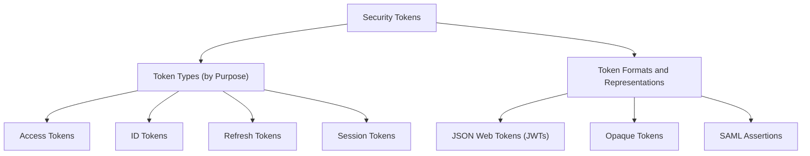

# Overview

Security tokens developed alongside changing requirements for authentication and authorization. During the 1990s, web applications increasingly used HTTP cookies to maintain sessions across requests. A common approach involved storing session information on the server while the browser retained a session identifier, allowing the application to recognize returning users without requiring them to sign in again.

As web applications expanded and communication between systems became more common, security tokens began serving purposes beyond session management. They became useful for sharing identity information and supporting access to protected resources across applications and services. These changing needs led to different ways of creating, representing, and using tokens.

**Security tokens** are digital values used by software systems to represent or reference information related to identity, access permissions, or an established session. For example, an application may use a token to recognize a signed-in user or request access to a protected API. How a token is issued, interpreted, and accepted depends on its purpose, the systems involved, and any applicable authentication or authorization protocol.

Security tokens can be examined from two perspectives. **Token types** describe what tokens are used for, while **token formats and representations** describe how their information is organized or represented. These characteristics are separate, meaning that tokens with the same purpose may use different formats. The following diagram introduces the main categories covered in this module.

The following topics examine these categories in greater detail. [Token Types](token_types/overview.md) introduces access, ID, refresh, and session tokens and explains their different purposes. [Token Formats](token_formats/overview.md) introduces JWTs, opaque tokens, and SAML assertions, including how their representations differ.
