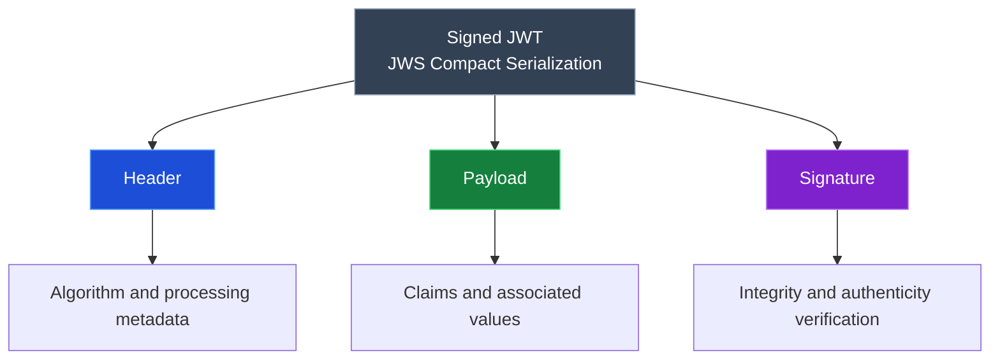
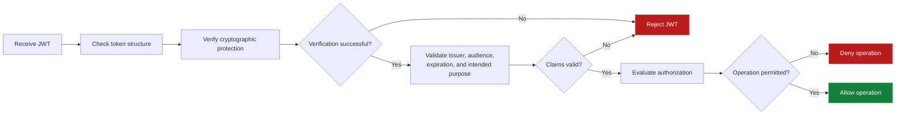

# Summary

This summary brings together the key concepts from **JWT Level 1** and provides a concise reference for reviewing JWT structure, encoding, claims, cryptographic protection, validation, and security considerations.

## Table of Contents: JWT Summary

- [JWT Level 1](#jwt-level-1)
- [Knowledge Check](#knowledge-check)

## JWT Level 1

**JWT Level 1** introduces how **JSON Web Tokens (JWTs)** are structured, interpreted, and validated within software systems. A signed JWT commonly uses **JSON Web Signature (JWS) Compact Serialization**, which consists of three components separated by periods (`.`) in the format `header.payload.signature`. The following diagram illustrates these components and their responsibilities.

The **header** contains metadata about the token, including the signing algorithm, while the **payload** contains claims describing the token, an entity, or its intended use. The **signature** provides cryptographic protection for the signed header and payload, allowing the receiving system to verify their integrity and authenticity using the appropriate key.

The header and payload are encoded using **Base64url**, which converts JSON data into a URL-safe textual representation. Their encoded values are joined to form the signing input, and the resulting signature is appended as the third component. **Base64url is not encryption**, meaning that anyone who obtains a signed, unencrypted JWT can decode and read its header and payload without a cryptographic key.

**JWT claims** are name-value pairs that communicate information about the token and its intended use. Common claims identify who issued the token, which user or entity it concerns, which service should accept it, and when it expires. Applications may also use custom claims, such as `role`, when making authorization decisions.

| Claim  | Meaning                    | Purpose                                                   |
|--------|----------------------------|-----------------------------------------------------------|
| `iss`  | Issuer                     | Identifies the entity that issued the JWT                 |
| `sub`  | Subject                    | Identifies the user or entity the token concerns          |
| `aud`  | Audience                   | Identifies the intended recipient                         |
| `exp`  | Expiration time            | Specifies when the JWT must no longer be accepted         |
| `role` | Application-specific claim | Provides role information for authorization decisions     |

**JWT validation** ensures that a token is trustworthy and appropriate for its intended use. A receiving system must check its structure, verify the required cryptographic protection using a trusted key and an allowed algorithm, and validate relevant claims, including the issuer, audience, and expiration time. Even a correctly signed JWT may be unsuitable if it has expired or was issued for another application. The following diagram illustrates this process.

The diagram highlights the distinction between **cryptographic verification, claim validation, and authorization**. Cryptographic verification checks the token's protection, claim validation checks whether the token meets the application's requirements, and authorization determines whether the requested operation is permitted. A valid JWT therefore does not automatically grant access to every protected resource.

**JWT security** depends on correct validation and careful token handling. Applications should use trusted signing algorithms and verification keys, enforce appropriate expiration times, transmit and store tokens securely, and avoid including unnecessary sensitive information in unencrypted payloads. Signing protects integrity and authenticity but does not provide confidentiality; encryption is required when token contents must be protected from unauthorized reading.

The central principle is that **a JWT must be both cryptographically valid and appropriate for its intended use**. Decoding a token does not establish trust, successful signature verification does not guarantee that its claims are acceptable, and a validated token does not automatically authorize every requested operation.

## Knowledge Check

Test your understanding of the key concepts covered in JWT Level 1. Select one answer for each question to receive feedback and an explanation.

  

    
<strong>JWT Structure</strong>

    
Which structure represents a typical signed JWT?

    

      <button type="button" data-option="A">A. payload.header.signature</button>
      <button type="button" data-option="B">B. header.payload.signature</button>
      <button type="button" data-option="C">C. header.signature.payload</button>
      <button type="button" data-option="D">D. signature.payload.header</button>
    

    

  

  

    
<strong>JWT Claims</strong>

    
Which claim helps an API determine whether a JWT was intended for it?

    

      <button type="button" data-option="A">A. iss</button>
      <button type="button" data-option="B">B. sub</button>
      <button type="button" data-option="C">C. aud</button>
      <button type="button" data-option="D">D. exp</button>
    

    

  

  

    
<strong>Encoding and Encryption</strong>

    
Which statement about Base64url encoding is correct?

    

      <button type="button" data-option="A">A. It represents data without providing confidentiality</button>
      <button type="button" data-option="B">B. It encrypts JWT claims using a secret key</button>
      <button type="button" data-option="C">C. It guarantees that the JWT has not been modified</button>
      <button type="button" data-option="D">D. It prevents anyone who obtains the JWT from reading its payload</button>
    

    

  

  

    
<strong>JWT Validation</strong>

    
Why is verifying a JWT's signature alone insufficient when processing an API request?

    

      <button type="button" data-option="A">A. A signature cannot protect the integrity of a JWT</button>
      <button type="button" data-option="B">B. Every signed JWT must also be encrypted</button>
      <button type="button" data-option="C">C. A valid signature automatically authorizes every operation</button>
      <button type="button" data-option="D">D. The JWT may be expired, intended for another API, or unsuitable for the requested operation</button>
    

    

  

  

    
<strong>JWT Security and Expiration</strong>

    
A user signs out of a web application, but their previously issued JWT has not expired. Which statement is correct?

    

      <button type="button" data-option="A">A. Signing out automatically invalidates every JWT issued to the user</button>
      <button type="button" data-option="B">B. The JWT may still be accepted unless additional revocation or authorization checks prevent its use</button>
      <button type="button" data-option="C">C. The JWT becomes encrypted when the user signs out</button>
      <button type="button" data-option="D">D. Removing a JWT from a browser cookie guarantees that no other copy can be reused</button>
    

    

  

