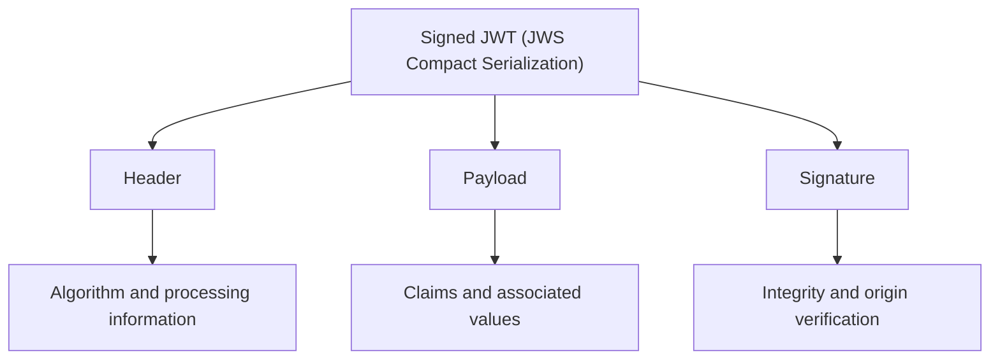
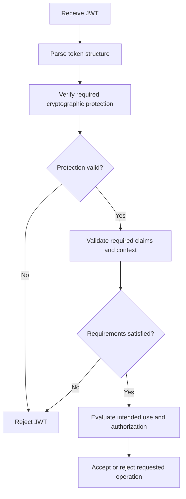

# Summary

This summary brings together the key concepts from **JWT Level 1** and provides a concise reference for reviewing JWT structure, claims, cryptographic protection, validation, and common security considerations.

## Table of Contents: JWT Summary

- [JWT Level 1](#jwt-level-1)
- [Knowledge Check](#knowledge-check)

## JWT Level 1

Level 1 establishes how **JSON Web Tokens (JWTs)** are structured, exchanged, and evaluated within software systems. A commonly encountered JWT uses **JSON Web Signature (JWS) Compact Serialization**, which consists of three Base64url-encoded segments separated by periods in the form `header.payload.signature`. These segments represent the **header**, **payload**, and **signature**.

The **header** contains processing information, including the algorithm indicated by `alg`, while the **payload** contains claims describing information such as the issuer, subject, audience, and validity period. The **signature**, or message authentication code, allows the receiving system to verify the integrity and origin of the protected content using an appropriate cryptographic key. The following diagram illustrates these components and their responsibilities.



**JWT claims** are name-value pairs used to communicate information within a token. They may be registered, public, or private, depending on their definition and intended use. Common registered claims help receiving systems identify the token's issuer, determine its intended recipient, and evaluate applicable time restrictions. The following table summarizes several frequently encountered claims.

| Claim | Meaning         | Purpose                                                 |
|-------|-----------------|---------------------------------------------------------|
| `iss` | Issuer          | Identifies the entity that issued the JWT               |
| `sub` | Subject         | Identifies the principal the claims concern             |
| `aud` | Audience        | Identifies the intended recipient or recipients         |
| `exp` | Expiration time | Specifies when the JWT must no longer be accepted       |
| `nbf` | Not-before time | Specifies when the JWT may begin to be accepted         |
| `iat` | Issued-at time  | Indicates when the JWT was issued                       |

**Base64url encoding is not encryption** because it represents data in a form suitable for transmission without preventing the information from being decoded and read. Consequently, the header and payload of a signed, unencrypted JWT should not be considered confidential. Cryptographic protection serves a different purpose. **Digital signatures** and **message authentication codes** support integrity verification and authentication of origin, while **encryption** protects confidentiality. The mechanism used determines which security properties the JWT provides.

**JWT validation** involves more than decoding a token or verifying its signature. The receiving system must verify the required cryptographic protection, evaluate relevant claims, and confirm that the token is appropriate for its intended recipient and purpose. A JWT with a valid signature may still be expired, intended for another application, or unsuitable for the requested operation. The following diagram illustrates a simplified validation process.



The diagram illustrates why **cryptographic verification, claim validation, and authorization are separate decisions**. Successful cryptographic verification establishes that the required protection checks have passed, but the token must also satisfy the receiving system's validity and usage requirements before authorization determines whether the requested operation is permitted. The following table summarizes these checks.

| Validation area              | Purpose                                                                                          |
| ---------------------------- | ------------------------------------------------------------------------------------------------ |
| **Structure**                | Confirm that the JWT follows the expected format                                                 |
| **Cryptographic protection** | Verify the required signature, message authentication code, or authenticated encryption          |
| **Issuer**                   | Confirm that the JWT originates from an accepted issuer                                          |
| **Audience**                 | Confirm that the JWT is intended for the receiving system                                        |
| **Time-based claims**        | Enforce expiration and other applicable time restrictions                                        |
| **Token purpose**            | Confirm that the JWT is appropriate for the intended use                                         |
| **Authorization**            | Determine whether the requested operation is permitted                                           |

**JWT security** depends on correct validation and appropriate handling throughout the token's lifetime. Common risks include accepting unexpected algorithms, using inappropriate verification keys, failing to validate relevant claims, exposing sensitive information in unencrypted payloads, and allowing stolen tokens to be reused. These risks can be reduced through trusted cryptographic configuration, secure transmission and storage, appropriate token lifetimes, and validation rules that reflect the receiving system's requirements. The central principle is that **a JWT must be evaluated according to both its cryptographic protection and its intended security context**. A correctly encoded token is not necessarily trustworthy, a valid signature does not guarantee that every claim is acceptable, and a successfully validated JWT does not automatically authorize every requested operation.

## Knowledge Check

Test your understanding of the key concepts covered in the JWT module. Select one answer for each question to receive feedback and an explanation.

```html
<div class="knowledge-check">

  <div class="knowledge-question" data-answer="B" data-explanation="A signed JWT using JWS Compact Serialization commonly consists of three Base64url-encoded segments representing the header, payload, and signature.">
    <p><strong>JWT Structure</strong></p>
    <p>Which structure represents a signed JWT using JWS Compact Serialization?</p>
    <div class="quiz-options">
      <button type="button" data-option="A">A. payload.header.signature</button>
      <button type="button" data-option="B">B. header.payload.signature</button>
      <button type="button" data-option="C">C. header.signature.payload</button>
      <button type="button" data-option="D">D. signature.payload.header</button>
    </div>
    <p class="quiz-feedback" role="status" aria-live="polite"></p>
  </div>

  <div class="knowledge-question" data-answer="C" data-explanation="The aud claim identifies the intended audience of the JWT. Receiving systems use it to determine whether the token is intended for them.">
    <p><strong>JWT Claims</strong></p>
    <p>Which registered JWT claim identifies the intended recipient or recipients of a token?</p>
    <div class="quiz-options">
      <button type="button" data-option="A">A. iss</button>
      <button type="button" data-option="B">B. sub</button>
      <button type="button" data-option="C">C. aud</button>
      <button type="button" data-option="D">D. iat</button>
    </div>
    <p class="quiz-feedback" role="status" aria-live="polite"></p>
  </div>

  <div class="knowledge-question" data-answer="A" data-explanation="Base64url is an encoding mechanism, not encryption. The header and payload of a signed, unencrypted JWT can be decoded and read without a decryption key.">
    <p><strong>Encoding and Encryption</strong></p>
    <p>Which statement about Base64url encoding is correct?</p>
    <div class="quiz-options">
      <button type="button" data-option="A">A. It represents data without providing confidentiality</button>
      <button type="button" data-option="B">B. It encrypts JWT claims using a secret key</button>
      <button type="button" data-option="C">C. It guarantees that the JWT has not been modified</button>
      <button type="button" data-option="D">D. It prevents unauthorized users from reading the payload</button>
    </div>
    <p class="quiz-feedback" role="status" aria-live="polite"></p>
  </div>

  <div class="knowledge-question" data-answer="D" data-explanation="A valid signature confirms the required cryptographic verification, but the receiving system must also validate relevant claims, including expiration, audience, and intended use.">
    <p><strong>JWT Validation</strong></p>
    <p>Why is verifying a JWT signature alone insufficient?</p>
    <div class="quiz-options">
      <button type="button" data-option="A">A. Signatures do not provide integrity protection</button>
      <button type="button" data-option="B">B. Every JWT must be encrypted before it can be validated</button>
      <button type="button" data-option="C">C. Signature verification automatically grants unrestricted access</button>
      <button type="button" data-option="D">D. The token may still be expired, intended for another recipient, or unsuitable for the requested operation</button>
    </div>
    <p class="quiz-feedback" role="status" aria-live="polite"></p>
  </div>

  <div class="knowledge-question" data-answer="B" data-explanation="JWT security requires appropriate cryptographic configuration, trusted keys, relevant claim validation, secure handling, and enforcement of the token's intended purpose.">
    <p><strong>JWT Security</strong></p>
    <p>Which practice best supports secure JWT processing?</p>
    <div class="quiz-options">
      <button type="button" data-option="A">A. Accept any algorithm declared in the JWT header</button>
      <button type="button" data-option="B">B. Verify cryptographic protection and validate claims according to the intended use</button>
      <button type="button" data-option="C">C. Assume all Base64url-encoded claims are confidential</button>
      <button type="button" data-option="D">D. Accept every correctly signed JWT regardless of its issuer or audience</button>
    </div>
    <p class="quiz-feedback" role="status" aria-live="polite"></p>
  </div>

</div>
