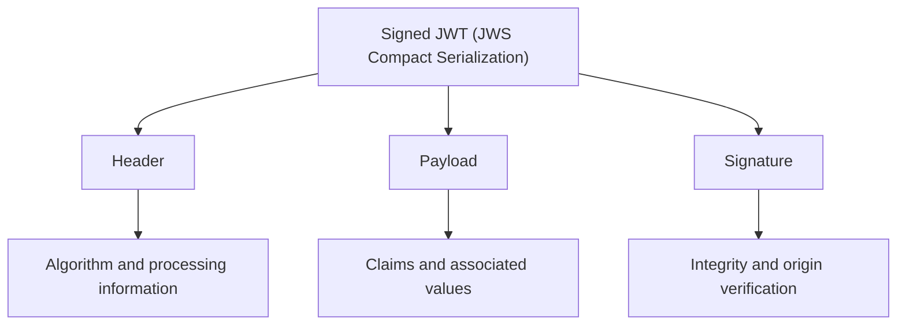
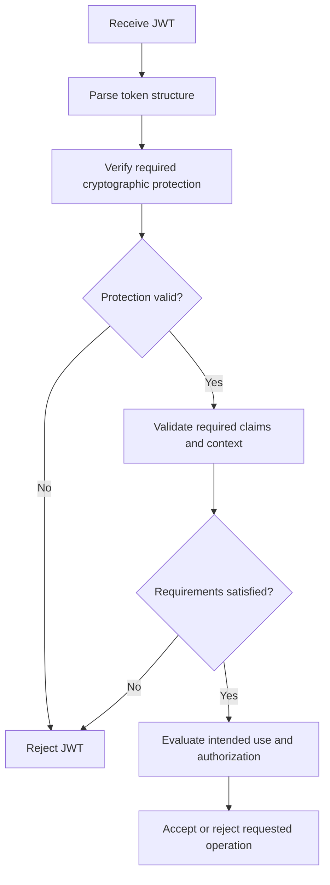

# Summary

This summary brings together the key concepts from **JWT Level 1** and provides a concise reference for reviewing JWT structure, claims, cryptographic protection, validation, and common security considerations.

## Table of Contents: JWT Summary

- [JWT Level 1](#jwt-level-1)

## JWT Level 1

Level 1 establishes how **JSON Web Tokens (JWTs)** are structured, exchanged, and evaluated within software systems. A commonly encountered JWT uses **JSON Web Signature (JWS) Compact Serialization**, which consists of three Base64url-encoded segments separated by periods in the form `header.payload.signature`. These segments represent the **header**, **payload**, and **signature**.

The **header** contains processing information, including the algorithm indicated by `alg`, while the **payload** contains claims describing information such as the issuer, subject, audience, and validity period. The **signature**, or message authentication code, allows the receiving system to verify the integrity and origin of the protected content using an appropriate cryptographic key. The following diagram illustrates these components and their responsibilities.

**JWT claims** are name-value pairs used to communicate information within a token. They may be registered, public, or private, depending on their definition and intended use. Common registered claims help receiving systems identify the token's issuer, determine its intended recipient, and evaluate applicable time restrictions. The following table summarizes several frequently encountered claims.

| Claim | Meaning         | Purpose                                                 |
|-------|-----------------|---------------------------------------------------------|
| `iss` | Issuer          | Identifies the entity that issued the JWT               |
| `sub` | Subject         | Identifies the principal the claims concern             |
| `aud` | Audience        | Identifies the intended recipient or recipients         |
| `exp` | Expiration time | Specifies when the JWT must no longer be accepted       |
| `nbf` | Not-before time | Specifies when the JWT may begin to be accepted         |
| `iat` | Issued-at time  | Indicates when the JWT was issued                       |

**Base64url encoding is not encryption** because it represents data in a form suitable for transmission without preventing the information from being decoded and read. Consequently, the header and payload of a signed, unencrypted JWT should not be considered confidential. Cryptographic protection serves a different purpose. **Digital signatures** and **message authentication codes** support integrity verification and authentication of origin, while **encryption** protects confidentiality. The mechanism used determines which security properties the JWT provides.

**JWT validation** involves more than decoding a token or verifying its signature. The receiving system must verify the required cryptographic protection, evaluate relevant claims, and confirm that the token is appropriate for its intended recipient and purpose. A JWT with a valid signature may still be expired, intended for another application, or unsuitable for the requested operation. The following diagram illustrates a simplified validation process.

The diagram illustrates why **cryptographic verification, claim validation, and authorization are separate decisions**. Successful cryptographic verification establishes that the required protection checks have passed, but the token must also satisfy the receiving system's validity and usage requirements before authorization determines whether the requested operation is permitted. The following table summarizes these checks.

| Validation area              | Purpose                                                                                          |
| ---------------------------- | ------------------------------------------------------------------------------------------------ |
| **Structure**                | Confirm that the JWT follows the expected format                                                 |
| **Cryptographic protection** | Verify the required signature, message authentication code, or authenticated encryption          |
| **Issuer**                   | Confirm that the JWT originates from an accepted issuer                                          |
| **Audience**                 | Confirm that the JWT is intended for the receiving system                                        |
| **Time-based claims**        | Enforce expiration and other applicable time restrictions                                        |
| **Token purpose**            | Confirm that the JWT is appropriate for the intended use                                         |
| **Authorization**            | Determine whether the requested operation is permitted                                           |

**JWT security** depends on correct validation and appropriate handling throughout the token's lifetime. Common risks include accepting unexpected algorithms, using inappropriate verification keys, failing to validate relevant claims, exposing sensitive information in unencrypted payloads, and allowing stolen tokens to be reused. These risks can be reduced through trusted cryptographic configuration, secure transmission and storage, appropriate token lifetimes, and validation rules that reflect the receiving system's requirements. The central principle is that **a JWT must be evaluated according to both its cryptographic protection and its intended security context**. A correctly encoded token is not necessarily trustworthy, a valid signature does not guarantee that every claim is acceptable, and a successfully validated JWT does not automatically authorize every requested operation.
