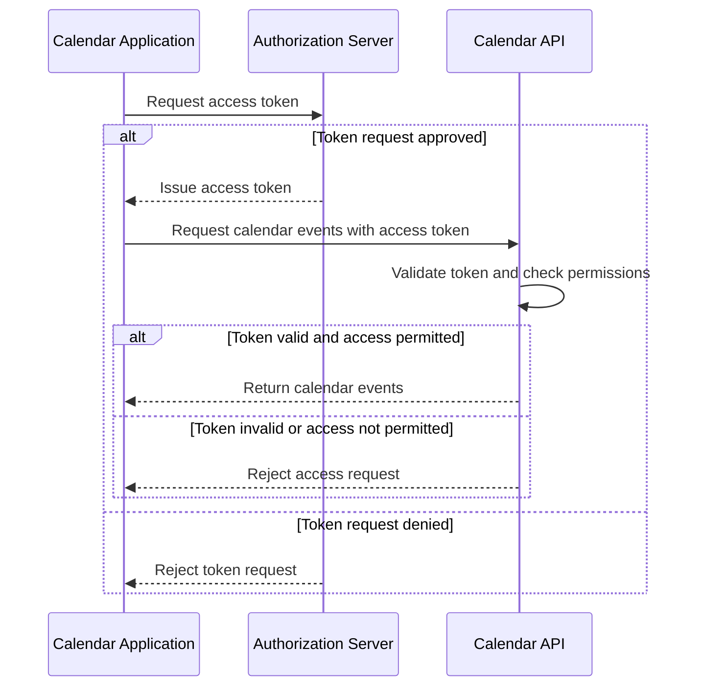
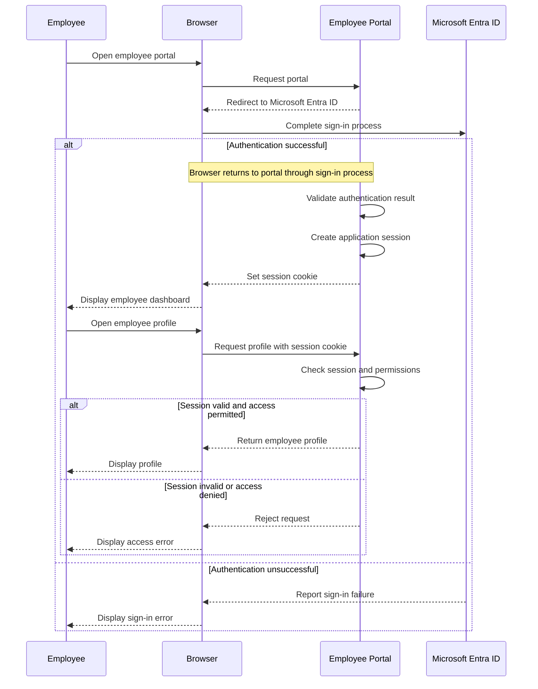
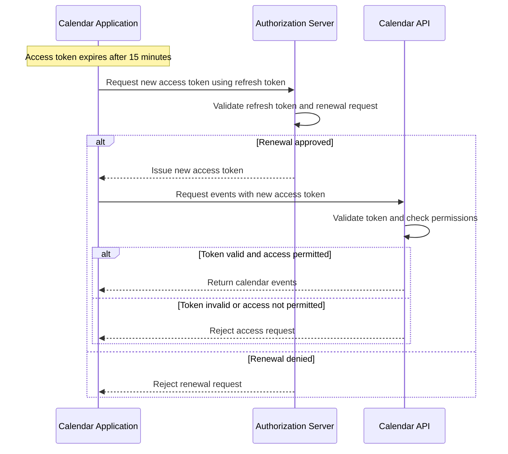
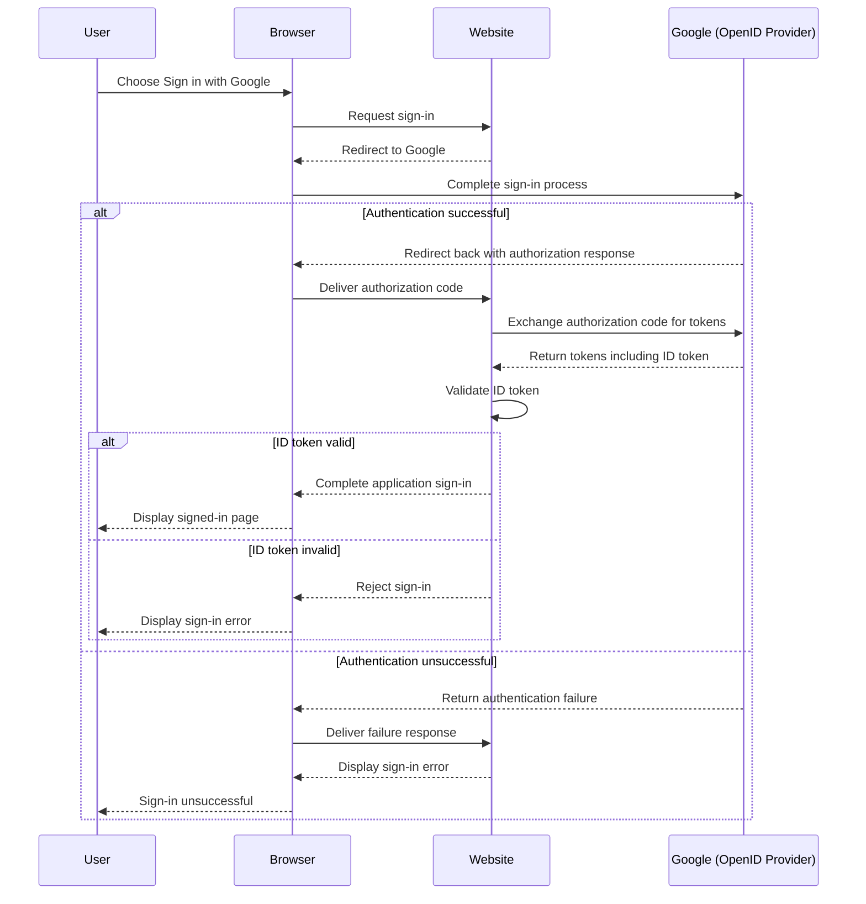

# Level 1

## Table of Contents: Token Types

- [Access Tokens](#access-tokens)
- [Session Tokens](#session-tokens)
- [Refresh Tokens](#refresh-tokens)
- [ID Tokens](#id-tokens)

**Token Types Level 1** introduces four common security token types, including **access tokens**, **session tokens**, **refresh tokens**, and **ID tokens**. Each serves a distinct purpose within authentication, authorization, or session management. The following sections explore their roles, intended recipients, and practical usage through examples and diagrams, while also showing how these token types may be used independently or together within an application. The discussion begins with **access tokens** and their role in requesting access to protected resources.

## Access Tokens

An **access token** is a security token issued by an **authorization server** that allows a client application to request access to protected resources, such as APIs. The client presents the token to a **resource server**, which validates it and determines whether the requested access is permitted.

Consider a calendar application that retrieves events from a protected calendar API. The application obtains an access token from the authorization server and presents it when requesting calendar events. The API checks the token and the applicable permissions before returning the requested data or rejecting the request. The following diagram illustrates this interaction and its possible outcomes.

An access token may be used for multiple requests while it remains valid and the requested access is permitted. Applications can also use **session tokens** to recognize established application sessions. Although both can support authenticated interactions, they serve different purposes, as explored in the following section.

## Session Tokens

A **session token** is a security token or identifier that allows an application to recognize an established session across multiple requests without requiring the user to sign in repeatedly. In a common **server-managed session**, the application stores session information on the server and provides the browser with a **session identifier**, usually through a cookie. When the browser sends this identifier with later requests, the server uses it to locate the session, verify that it remains valid, and check whether the requested operation is permitted.

Session tokens and access tokens can both support authenticated requests, but they serve different purposes. Session tokens identify or represent established application sessions, while access tokens represent authorization to access protected resources. Depending on the application's design, either may be used without requiring both.

Consider an employee portal that uses **Microsoft Entra ID** for authentication and maintains its own server-managed sessions. When an employee signs in, Microsoft Entra ID verifies their identity through the configured sign-in process. After validating the authentication result, the portal creates a session and sends a session cookie to the browser. When the employee later opens their profile, the portal uses the cookie to recognize the existing session and determine whether the requested information can be accessed. The following diagram illustrates this approach and its possible outcomes.

While session tokens represent established application sessions, maintaining access to protected resources may involve a different mechanism. **Refresh tokens** support this by allowing client applications to obtain replacement access tokens when needed.

## Refresh Tokens

A **refresh token** is a security token that a client application presents to an **authorization server** to obtain a new access token without requiring the user to authenticate again. It is typically used when an existing access token expires or needs to be replaced, provided that the authorization server approves the renewal request.

Refresh tokens allow access tokens to have shorter lifetimes while reducing the need for repeated user authentication. Unlike access tokens, refresh tokens are not intended for requesting protected resources directly. They are presented to the authorization server, which determines whether a replacement access token can be issued. Because refresh tokens may remain valid for longer periods, they require appropriate protection against unauthorized use.

Consider a mobile calendar application that has received an access token and a refresh token following a successful sign-in. In this example, the access token is configured to expire after 15 minutes. Once it expires, the application presents its refresh token to the authorization server to request a replacement. If the request is approved, the application receives a new access token and can continue accessing the calendar API. The following diagram illustrates this process and its possible outcomes.

While refresh tokens support the renewal of access tokens, other tokens communicate information about a user's authentication. The following section introduces **ID tokens** and their role in this process.

## ID Tokens

An **ID token** is a security token defined by **OpenID Connect (OIDC)** and issued by an **OpenID Provider** as part of the authentication process. It contains claims about the authenticated user and the authentication event. Unlike access tokens, ID tokens are intended for the **client application**, such as a website where the user is signing in, rather than for requesting access to protected APIs.

Consider a website that offers **Sign in with Google**. When a user selects this option, Google authenticates the user through OpenID Connect. After the required sign-in interactions, the website receives an ID token and validates its claims to identify the authenticated user. The following diagram illustrates this simplified interaction and its possible outcomes.

The examples throughout this topic illustrate how security tokens support different aspects of authentication, authorization, and session management. **Access tokens** allow applications to request protected resources, while **session tokens** can help recognize established application sessions. **Refresh tokens** support access-token renewal, and **ID tokens** communicate authentication information to client applications. These roles may also complement one another within the same system. For example, an application might process an ID token during authentication, establish its own session for subsequent requests, and use access tokens to communicate with protected APIs. If needed and available, a refresh token can support continued access without requiring repeated authentication. The combination of tokens depends on the application's design and security requirements.

[Token Types Level 2](../2_level/2_token_types.md) builds on these concepts by examining token relationships, lifecycle management, usage constraints, and security considerations.
