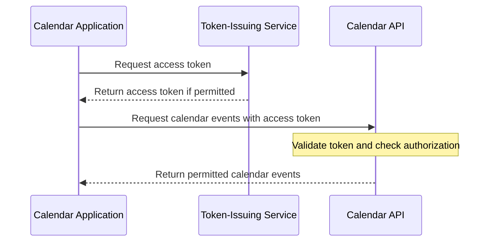
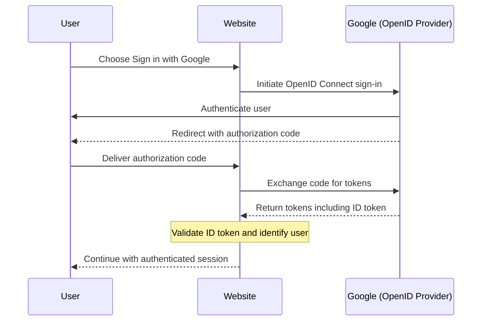
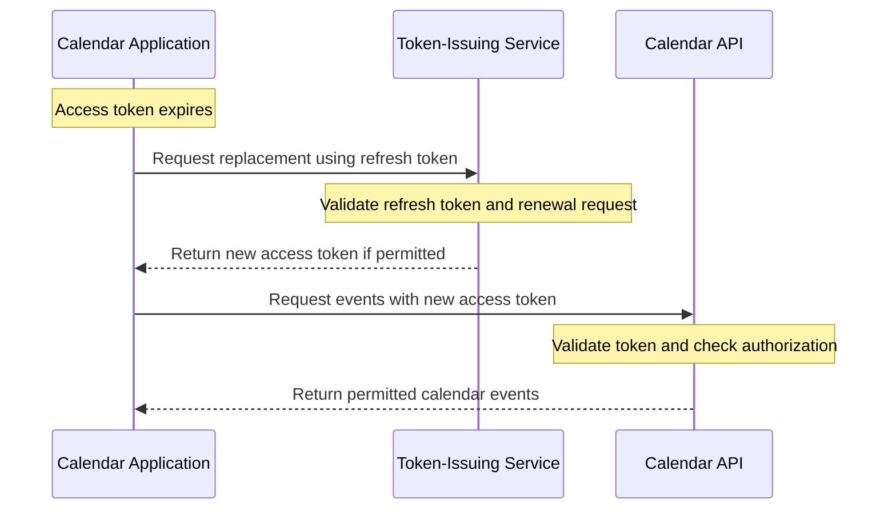
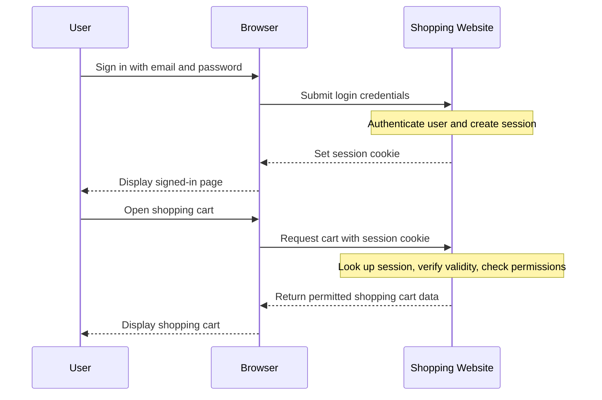

# Level 1

## Table of Contents: Token Types

- [Access Tokens](#access-tokens)
- [ID Tokens](#id-tokens)
- [Refresh Tokens](#refresh-tokens)
- [Session Tokens](#session-tokens)
- [Comparison of Token Types](#comparison-of-token-types)

**Token Types Level 1** builds on the introductory overview by examining the practical use of each token type. The following sections explain when tokens are issued, which systems receive and process them, and how they support common application workflows through examples. A final comparison brings together their key characteristics and usage requirements.

## Access Tokens

An **access token** is a security token that a client presents when requesting access to a protected resource. It represents authorization granted under particular conditions, allowing the receiving system to determine whether the requested operation is permitted. An access token does not necessarily authorize every resource or operation.

Access tokens are issued by a trusted component, such as a **token-issuing service**, and presented to a **resource server**, such as a protected API. The resource server validates the token and evaluates the request against applicable authorization rules. For example, a token might permit reading calendar events without allowing them to be modified or deleted.

Consider a calendar application that retrieves events from a calendar API. The application obtains an access token and includes it when requesting events. If the token is valid and the request is authorized, the API returns the permitted data. The following diagram illustrates this simplified interaction.

Access tokens support authorization to protected resources, but they do not communicate authentication results to a client application. In OpenID Connect, that responsibility belongs to ID tokens.

## ID Tokens

An **ID token** is a security token defined by **OpenID Connect (OIDC)**, an identity protocol built on OAuth 2.0. It communicates claims about an authenticated user and their authentication event to a client application. Authentication itself does not require OIDC or OAuth 2.0; applications using other authentication approaches, such as locally managed email-and-password sign-in, do not need to issue OIDC ID tokens.

An **OpenID Provider** issues ID tokens to a **client application**. The client validates the token and uses its claims to identify the authenticated user in the provider's identity system and obtain information about the authentication event. An ID token is intended for the client, not for accessing protected APIs.

Consider a website that offers **Sign in with Google**. The website initiates an OIDC sign-in process, and Google authenticates the user. In the Authorization Code Flow, the website receives an authorization code through a browser redirect and exchanges it for tokens, including an ID token. After validating the ID token, the website can identify the user and may establish its own application session. The following diagram simplifies this process by abbreviating the browser redirects and interactions.

ID tokens and access tokens may be issued during the same OpenID Connect process, but they serve different purposes. An ID token communicates authentication information to the client, while an access token is used to request protected resources. When access tokens expire, applications may use refresh tokens to request replacements without requiring users to authenticate again.

## Refresh Tokens

A **refresh token** is a security token that a client uses to request a new access token when an existing one expires or needs to be replaced. It supports continued access without requiring the user to authenticate again each time an access token expires. Refresh tokens can be used in different token-based systems, independently of the authentication method or access-token format.

When a system supports refresh tokens, the client presents one to a **token-issuing service**, rather than to the API serving protected resources. The service checks whether the refresh token is valid and whether renewal is permitted. It may reject a request if the token has expired, been revoked, or otherwise fails the system's requirements.

Consider a mobile calendar application with its own email-and-password sign-in. After authentication, its backend issues an access token and a refresh token. When the access token expires, the application requests a replacement using the refresh token. If renewal is permitted, it can continue accessing calendar events without another sign-in. The following diagram illustrates this interaction.

Refresh tokens support access-token renewal, whereas session tokens help applications maintain continuity across requests within an established session.

## Session Tokens

A **session token** is a security token or identifier used to associate incoming requests with an established application session. It allows a system to recognize an existing session across requests without requiring the user to authenticate for every interaction. A common implementation uses a **session identifier** that refers to session information stored on a server, although other designs are possible.

In a **server-managed session**, the application creates a session after successful authentication and stores its associated information on the server. It provides the client with a session identifier, often in a **session cookie**. When the browser's cookie transmission conditions are met, it sends the cookie with later requests. The server uses the identifier to find the session, verify that it remains valid, and evaluate the request. The cookie carries the identifier; the session information remains on the server.

Consider an online shopping website. After a customer signs in with an email address and password, the website creates a session and sets a session cookie in the browser. When the customer opens the shopping cart, the browser includes the cookie, allowing the website to locate the existing session and return the permitted cart information without another sign-in.

Unlike an access token, whose primary purpose is to convey authorization for requests to protected resources, a session token primarily identifies or represents an application session. The application uses the session information to determine the user's authentication state and evaluate applicable permissions. A system may use both kinds of token, or it may use session-based authentication without separate access tokens.

## Comparison of Token Types

Although these token types may be used together, they perform different responsibilities within a software system. The following table summarizes their primary purposes and typical recipients.

| Token type        | Primary purpose                                | Typical recipient                        |
|-------------------|----------------------------------------------- |----------------------------------------- |
| **Access token**  | Request access to protected resources          | Resource server or API                   |
| **ID token**      | Communicate authentication information         | Client application                       |
| **Refresh token** | Request new access tokens                      | Token-issuing service                    |
| **Session token** | Associate requests with an established session | Session-managing application or server   |

!!! important "Use tokens for their intended purposes"

    These token types are not interchangeable simply because they may appear in the same application. In particular, an **ID token** is not a substitute for an **access token** when calling a protected API, and a **refresh token** should be sent to the service responsible for token renewal rather than to a resource API.

These distinctions establish the fundamental roles of each token type. [Token Types Level 2](../2_level/2_token_types.md) builds on this foundation by examining how tokens interact, the constraints governing their use, and their lifecycle and security considerations.
