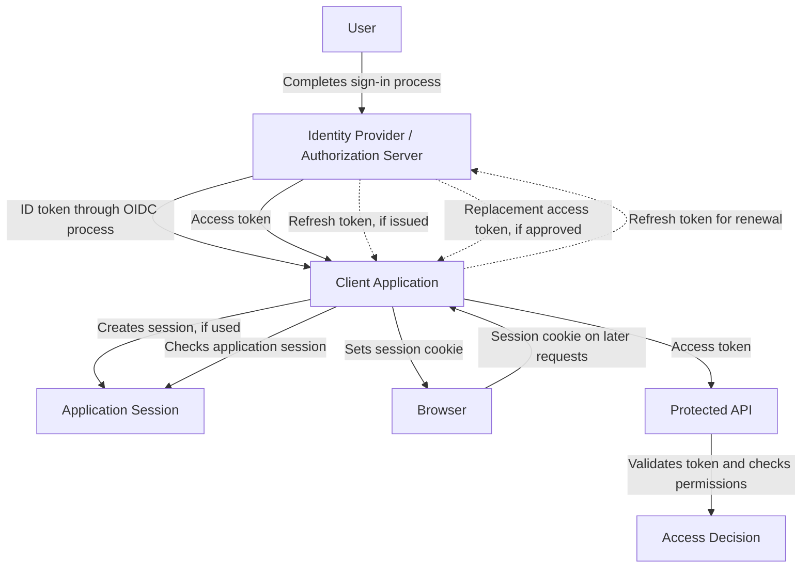

# Summary

This summary brings together the key concepts from the **Token Types** topic, providing a reference for reviewing the purposes, usage, and relationships of common security tokens. It covers the foundations introduced in **Level 1**, alongside the lifecycle management, usage constraints, and security considerations explored in **Level 2**.

## Table of Contents: Token Types Summary

- [Token Types Level 1](#token-types-level-1)
- [Knowledge Check](#knowledge-check)

## Token Types Level 1

**Access tokens**, **session tokens**, **refresh tokens**, and **ID tokens** support different aspects of authentication, authorization, and session management. Although each serves a distinct purpose, several may be used together within the same application.

For example, a website may receive and validate an ID token during an OpenID Connect authentication process, then establish its own application session to recognize the user across subsequent requests. The application may also use access tokens to request protected API resources and, if a refresh token is issued, request replacement access tokens when needed. The following diagram illustrates this possible arrangement.

This example demonstrates how the token types can complement one another without being interchangeable. **ID tokens** communicate authentication information, **session tokens** represent established application sessions, **access tokens** support requests to protected resources, and **refresh tokens** support access-token renewal. Not every application requires all four, and each token must be processed according to its intended purpose and the system's security requirements.

## Knowledge Check

Test your understanding of the key concepts covered in the Token Types topic. Select one answer for each question to receive feedback and an explanation.

  

    
<strong>Access Tokens</strong>

    
How is an access token used when accessing a protected API?

    

      <button type="button" data-option="A">A. It automatically grants access to every operation supported by the API</button>
      <button type="button" data-option="B">B. It is presented to the API, which validates it and checks whether the requested access is permitted</button>
      <button type="button" data-option="C">C. It is exchanged directly with the browser to establish a server-managed session</button>
      <button type="button" data-option="D">D. It replaces the need for the API to perform authorization checks</button>
    

    

  

  

    
<strong>Session Tokens</strong>

    
What is the role of a session token in a server-managed application session?

    

      <button type="button" data-option="A">A. It authorizes access to any protected API without further checks</button>
      <button type="button" data-option="B">B. It obtains replacement access tokens from an authorization server</button>
      <button type="button" data-option="C">C. It allows the application to recognize and validate an established session across requests</button>
      <button type="button" data-option="D">D. It communicates an OpenID Connect authentication result to the client application</button>
    

    

  

  

    
<strong>Refresh Tokens</strong>

    
What happens when a client application uses a refresh token?

    

      <button type="button" data-option="A">A. It requests a replacement access token from the authorization server, subject to approval</button>
      <button type="button" data-option="B">B. It gains direct access to protected resources without an access token</button>
      <button type="button" data-option="C">C. It automatically receives a new access token regardless of the refresh token's validity</button>
      <button type="button" data-option="D">D. It establishes an application session on the resource server</button>
    

    

  

  

    
<strong>ID Tokens</strong>

    
Which statement correctly describes the purpose of an ID token?

    

      <button type="button" data-option="A">A. It grants the client permission to perform any operation on a protected API</button>
      <button type="button" data-option="B">B. It allows a resource server to renew expired access tokens</button>
      <button type="button" data-option="C">C. It replaces application session management in every authentication system</button>
      <button type="button" data-option="D">D. It communicates authentication information to the intended client application, which must validate it</button>
    

    

  

  

    
<strong>Token Types and Their Relationships</strong>

    
Which statement correctly describes how different token types may be used within an application?

    

      <button type="button" data-option="A">A. Every application must use all four token types to support authentication</button>
      <button type="button" data-option="B">B. Different token types may work together, but each must be processed according to its intended purpose</button>
      <button type="button" data-option="C">C. Access tokens and session tokens are interchangeable because both can be used across multiple requests</button>
      <button type="button" data-option="D">D. A valid ID token can always replace an access token when requesting protected API resources</button>
    

    

  

