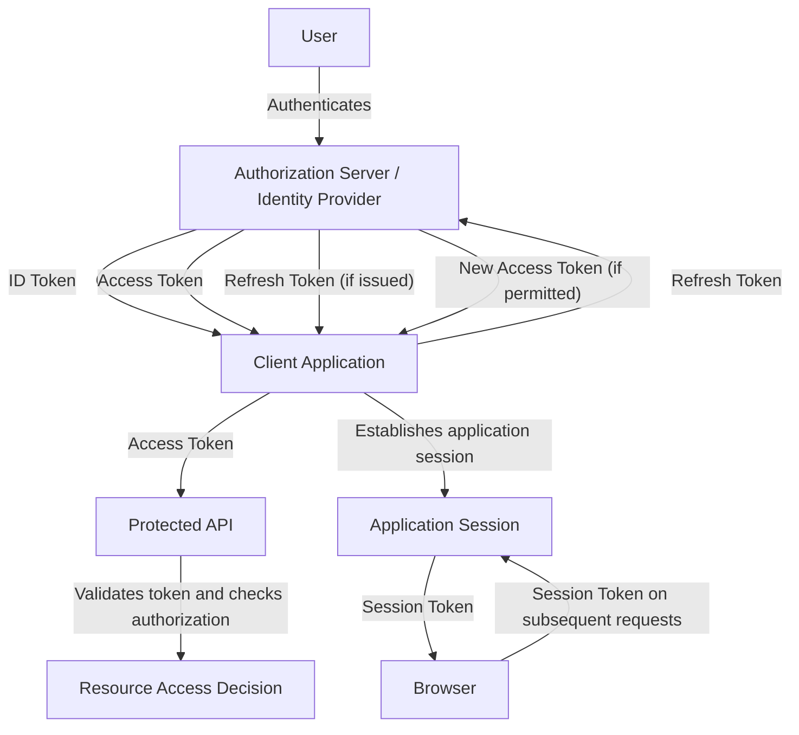

# Summary

This summary brings together the key concepts from the **Token Types** module. It provides a concise reference for reviewing the purposes, usage, relationships, and security requirements of different security tokens. The material is divided into **Level 1**, which establishes the practical foundations of access, ID, refresh, and session tokens, and **Level 2**, which examines their relationships, lifecycle management, usage constraints, and security considerations.

## Table of Contents: Token Types Summary

- [Token Types Level 1](#token-types-level-1)

## Token Types Level 1

Level 1 establishes the fundamental distinctions between **access tokens**, **ID tokens**, **refresh tokens**, and **session tokens**. Each serves a particular purpose within authentication, authorization, or session management, and the systems receiving them must interpret them according to their intended use.

**Access tokens** are credentials presented to protected resources, such as APIs, to request access. They represent an authorization granted under the applicable protocol and may carry or reference information about the client, authorized permissions, and other relevant conditions. A resource server must validate the token and determine whether the requested operation is permitted. **A valid access token does not automatically authorize every operation.**

**ID tokens** are used in **OpenID Connect (OIDC)** to communicate information about an authentication event and the authenticated user to the intended client application. They are JWTs containing claims such as the issuer, subject, audience, and relevant authentication information. An ID token helps the client establish information about the authenticated user, but **it is not a substitute for an access token when requesting protected API resources**.

**Refresh tokens** allow eligible clients to obtain new access tokens without requiring the user to repeat the entire authorization process. They are generally presented to an authorization server rather than a resource server. Refresh tokens may be long-lived relative to access tokens, making their secure storage, restricted use, and lifecycle management particularly important. Their issuance and use depend on the applicable authorization flow and security policy.

**Session tokens** identify or represent an established session, allowing an application to maintain authenticated state across multiple requests. In server-managed sessions, a session identifier commonly refers to information stored on the server. Session tokens are often carried in browser cookies, although a cookie is a transport and storage mechanism rather than a token type itself. The application must associate the presented token with an active, valid session before accepting it.

These token types can work together within the same application, although not every system uses all four. The following diagram illustrates a simplified workflow in which a client receives tokens after authentication, uses an access token to request protected resources, renews access when permitted, and maintains a separate application session.

The diagram shows that **token issuance, resource access, renewal, and session management are distinct operations**. An ID token communicates authentication information to the client, an access token is presented to a protected resource, a refresh token supports obtaining new access tokens, and a session token maintains continuity within the application. The exact sequence and tokens issued depend on the protocol and system architecture.

The following table summarizes their fundamental differences.

| Token type        | Primary purpose                        | Typical recipient                      | Common usage                                                     |
| ----------------- | -------------------------------------- | -------------------------------------- | ---------------------------------------------------------------- |
| **Access token**  | Request access to protected resources  | Resource server or API                 | Accessing an authorized endpoint                                 |
| **ID token**      | Communicate authentication information | Client application                     | Processing an OpenID Connect sign-in                             |
| **Refresh token** | Obtain new access tokens               | Authorization server                   | Renewing access without repeating the full authorization process |
| **Session token** | Maintain an established session        | Session-managing application or server | Recognizing an authenticated browser session                     |

These tokens may participate in the same application workflow, but **their purposes are not interchangeable**. A client may receive an ID token after authentication, use an access token to request API resources, and later use a refresh token to obtain renewed access. Separately, an application may establish a session to maintain the user's authenticated state across browser requests. Understanding these distinctions helps explain why each token must be issued, processed, and accepted according to its intended purpose.
