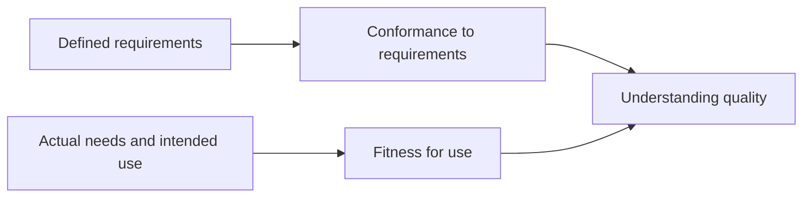
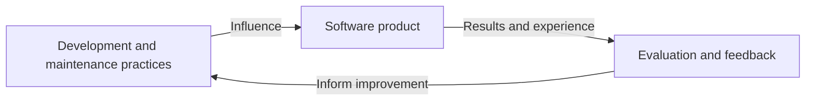
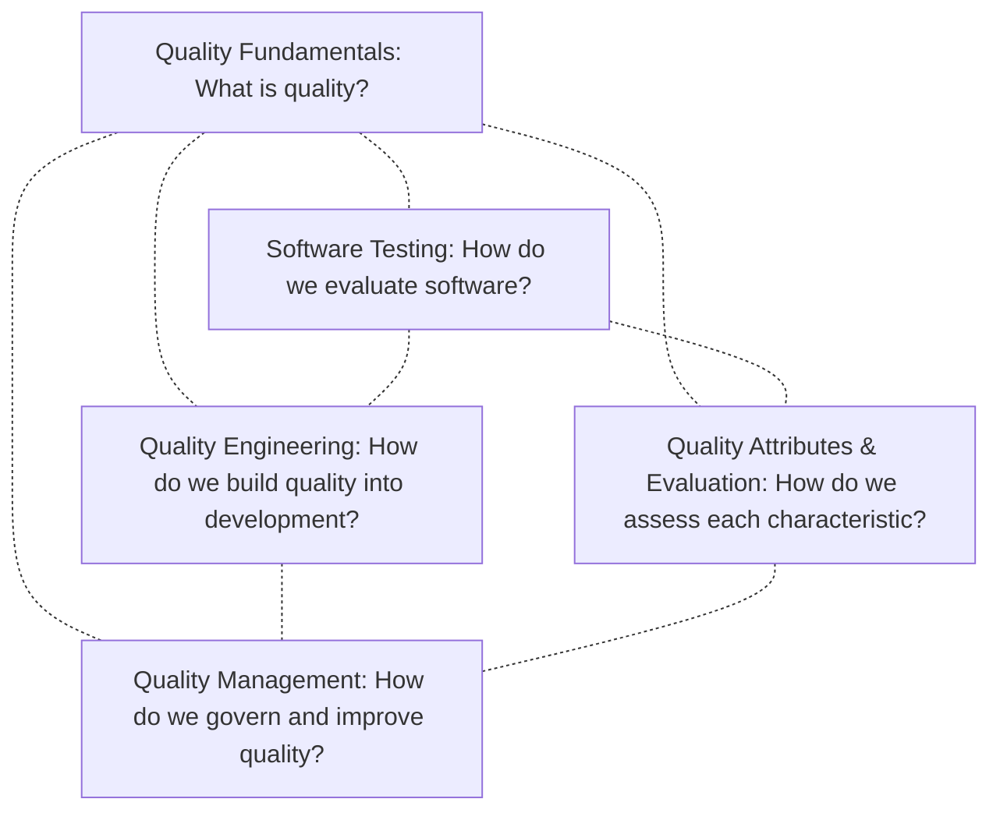

# Software Quality

## Table of Contents: Introduction

- [How the Understanding of Quality Developed](#how-the-understanding-of-quality-developed)
- [Quality Depends on Context](#quality-depends-on-context)
- [Product Quality and Process Quality](#product-quality-and-process-quality)
- [The Five Areas of Software Quality](#the-five-areas-of-software-quality)
- [Where to Go Next](#where-to-go-next)
- [References](#references)

**Software quality** concerns how well software satisfies the needs and expectations of the people and organizations that depend on it. Correct behavior matters, but it is not the only consideration. Software may perform its intended tasks and still be too slow, difficult to use, unreliable, or difficult to change. Consider two applications that provide the same functionality. Both produce correct results, but one frequently becomes unavailable while the other remains dependable. Their functionality may be similar, yet their quality is not experienced in the same way. Quality therefore involves more than checking whether a feature works. It also concerns the characteristics that make software suitable for its intended purpose.

Understanding why software quality involves more than correct functionality requires considering how the concept of quality has developed over time.

## How the Understanding of Quality Developed

Different perspectives have shaped what it means for a product to be satisfactory. Some approaches emphasize whether a product meets established requirements, while others consider whether it fulfills the needs of the people who use it. **Philip Crosby (1979)** emphasized *conformance to requirements*, which concerns whether a product meets the requirements established for it. Clearly defined requirements provide a basis for determining whether the delivered product corresponds to what was specified.

However, meeting requirements does not necessarily mean that a product is suitable for its intended use. A banking application might calculate balances correctly and perform transactions according to its specification while making everyday tasks unnecessarily difficult. The application may conform to its documented requirements even though those requirements do not adequately reflect the needs of its users. **Joseph Juran**, whose work with Frank Gryna is cited here as **Juran and Gryna (1988)**, emphasized *fitness for use*, which considers whether a product is suitable for the purposes and circumstances in which people use it.

These perspectives are complementary. Conformance to requirements helps establish whether defined expectations have been satisfied, while fitness for use encourages consideration of whether those expectations reflect actual needs. Together, they show why understanding quality requires attention to both what has been specified and what people need from the product.

In software engineering, quality must also be examined through the different **characteristics of a software product**. These characteristics help teams understand and evaluate aspects such as functional suitability, performance, reliability, security, and maintainability. A product may satisfy expectations in some respects while falling short in others, so quality cannot be represented by a single measure.

The perspectives of **Philip B. Crosby** and **Joseph M. Juran** help explain quality in relation to requirements, fitness for use, and stakeholder expectations. Software quality characteristics provide another perspective by helping teams identify which aspects of a product matter and how they can be evaluated. The importance of each characteristic depends on the software's purpose, operating environment, and stakeholder needs.

## Quality Depends on Context

Different people may expect different things from the same application. Customers of an online shop may value simplicity and quick purchases, while the organization operating it may prioritize dependable service and customer trust. Developers may be concerned with how safely the application can be changed, while operators may focus on keeping it available and recovering from failures. None of these perspectives is automatically more important than the others, as their relative importance depends on the software's purpose. A medical system, an online game, and a personal note-taking application may all need to be reliable and usable, but the consequences of failure and acceptable trade-offs differ.

Quality decisions also involve constraints such as time, resources, cost, and risk. Improving one characteristic may require additional effort or affect another characteristic. The goal is therefore not to maximize every possible characteristic, but to achieve a suitable balance between the value software provides, the cost of achieving that value, and the risks involved.

Achieving this balance depends not only on the characteristics of the software product but also on the practices used to develop and maintain it. This relationship introduces two closely connected perspectives on software quality.

## Product Quality and Process Quality

Software quality can be considered through both the product people receive and the work involved in producing it. These perspectives are connected because development and maintenance practices influence the product, while experience with the product can reveal opportunities to improve those practices. The following diagram illustrates that continuing relationship.

**Software product quality** concerns the characteristics and behavior of the software itself, including whether it is dependable, usable, secure, and suitable for its purpose. **Software process quality** concerns how effectively the activities used to develop and maintain software support the intended results. Good processes can improve the likelihood of a good product, but they cannot guarantee it. Likewise, a product may appear successful even when the practices needed to maintain it are fragile. Evaluating the result and improving the work behind it are both important.

A related concept is **software quality requirements**, which express expectations or constraints concerning characteristics such as response time, availability, security, or resource use. These requirements complement functional requirements by specifying how well the software must perform or what conditions it must satisfy. Evaluating conformance therefore involves considering all applicable requirements, not only those describing functionality.

Together, these distinctions show why software quality cannot be addressed through testing alone. Understanding expectations, building software, evaluating results, and improving practices involve different responsibilities that need to work together.

## The Five Areas of Software Quality

The responsibilities involved in software quality can be organized into **five complementary areas**. Each has a distinct focus, but the areas are closely connected and share concepts and practices. The following diagram illustrates these relationships without implying a fixed sequence of activities.

The dotted connections show how the five areas share knowledge and support one another rather than representing separate steps in a process. **Quality Fundamentals** begins with the question *What is quality?* It establishes the meaning of software quality and introduces the concepts needed to understand expectations, recognize quality concerns, and interpret evidence. **Software Testing** explores *How do we evaluate software?* It covers different testing levels, types, and techniques used to check software behavior, identify defects, and determine whether expectations are met.

**Quality Engineering** considers *How do we build quality into development?* It focuses on preventing problems through good development practices, automation, continuous integration, and feedback throughout development and delivery. **Quality Management** examines *How do we govern and improve quality?* It focuses on setting quality objectives, coordinating responsibilities, measuring results, and improving quality-related practices across teams and organizations.

**Quality Attributes & Evaluation** explores *How do we assess each characteristic?* It examines characteristics such as reliability, performance, usability, and security, along with the measurements and evidence used to evaluate them. Together, these five areas provide a connected understanding of software quality, showing how quality is defined, developed, evaluated, and improved throughout the software lifecycle.

## Where to Go Next

The five areas introduced above provide a starting point for exploring Software Quality in greater depth. Begin with **[Quality Fundamentals](quality_fundamentals/index.md)** to establish the shared concepts and terminology. From there, continue with **[Software Testing](software_testing/index.md)**, **[Quality Engineering](quality_engineering/index.md)**, **[Quality Management](quality_management/index.md)**, or **[Quality Attributes & Evaluation](quality_attributes_and_evaluation/index.md)**, depending on which aspects of software quality you want to explore.

The remaining areas can be explored in any order, with each providing an introduction and modules covering related topics. Together, they build on shared concepts and practices drawn from established quality management and software engineering literature, as reflected in the following references.

## References

- **Crosby, P. B.** (1979). *[Quality Is Free: The Art of Making Quality Certain](https://books.google.com/books/about/Quality_is_Free.html?id=0RxtAAAAMAAJ)*. McGraw-Hill.
- **IEEE Computer Society.** (2024). *[Guide to the Software Engineering Body of Knowledge (SWEBOK Guide)](https://ieeecs-media.computer.org/media/education/swebok/swebok-v4.pdf)*, Version 4.0a. Software Quality knowledge area.
- **Juran, J. M., & Gryna, F. M.** (1988). *[Juran's Quality Control Handbook](https://books.google.com/books/about/Juran_s_Quality_Control_Handbook.html?id=dj-aAAAAIAAJ)* (4th ed.). McGraw-Hill.
