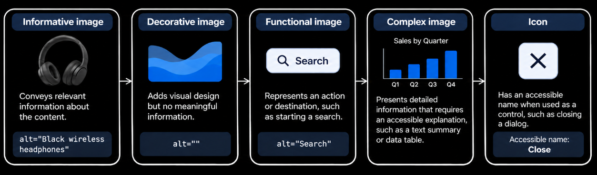

# Level 2

## Table of Contents: Accessibility Testing

- [Accessibility Testing Tools](#accessibility-testing-tools)
- [Text Alternatives and Non-Text Content](#text-alternatives-and-non-text-content)
- [Color Contrast and Visual Presentation](#color-contrast-and-visual-presentation)
- [Text Resizing, Zoom, and Reflow](#text-resizing-zoom-and-reflow)
- [Semantic Structure and Accessible Components](#semantic-structure-and-accessible-components)
- [Keyboard Accessibility and Focus Management](#keyboard-accessibility-and-focus-management)
- [Accessible Forms and Error Handling](#accessible-forms-and-error-handling)
- [Motion, Animation, and Time Limits](#motion-animation-and-time-limits)
- [Screen Reader Accessibility](#screen-reader-accessibility)

**Accessibility Testing Level 2** focuses on evaluating web applications against accessibility requirements through practical checks of content, presentation, interaction, and assistive technology support. The course begins with testing tools, then examines individual accessibility concerns and the evidence needed to document findings.

## Accessibility Testing Tools

**Accessibility testing tools** help identify implementation problems and inspect the information browsers expose to assistive technologies. They support an evaluation but cannot replace judgments about whether people can understand and operate an interface.

**WAVE**, developed by WebAIM, is available as a [browser extension](https://wave.webaim.org/extension/) and an online evaluation tool. It displays errors, contrast errors, alerts, and structural information alongside a page. For example, WAVE may flag a registration field without a detectable label. Inspect the field to determine whether its accessible name is appropriate. An alert is a prompt for investigation, not necessarily a failure.

**Browser developer tools** in Chrome, Firefox, and Edge allow inspection of HTML, computed accessibility information, and the **accessibility tree**, which represents information exposed to assistive technologies. Developer tools can usually be opened with `F12` or `Ctrl + Shift + I` on Windows and Linux, or by selecting **Inspect** from an element's context menu. An element's **accessible name** identifies it to assistive technologies, while its **role** describes what kind of element it is, such as a button, link, or checkbox. Its **state** communicates information such as whether a checkbox is checked or a panel is expanded. Accessibility inspection features help determine whether these properties match the visible interface. **Lighthouse**, available in Chrome DevTools, can run an automated accessibility audit, but its score is not a measure of complete WCAG conformance.

**Color contrast analyzers**, including the [WebAIM Contrast Checker](https://webaim.org/resources/contrastchecker/), calculate contrast ratios for specified foreground and background colors. They help compare colors with applicable thresholds but cannot determine whether an interface conveys information through color alone.

| Automated checks can help identify           | Manual evaluation is needed to determine                      |
| -------------------------------------------- | ------------------------------------------------------------- |
| Missing accessible names in detectable cases | Whether names accurately describe controls                    |
| Images without text alternatives             | Whether alternatives convey the intended meaning              |
| Detectable contrast failures                 | Whether information depends on color alone                    |
| Certain structural and semantic errors       | Whether the page's organization makes sense                   |
| Some rule violations in markup               | Whether keyboard and assistive technology interaction works   |

An audit can report no detectable errors even when a user cannot reach a form's submit button with the keyboard. Use automated findings to guide manual checks, beginning with whether non-text content communicates its purpose.

## Text Alternatives and Non-Text Content

**Text alternatives** convey the meaning or function of images, icons, and other non-text content to users who cannot perceive them visually. **WCAG 2.2 Success Criterion 1.1.1 Non-text Content (Level A)** requires appropriate text alternatives, subject to exceptions and requirements for different kinds of content. For HTML images, the `alt` attribute is a common way to provide them, but the correct wording depends on the image's purpose and surrounding context.



**Informative images** need alternatives that convey relevant information without repeating adjacent text, while **decorative images** generally need no announcement. The following HTML demonstrates how the `alt` attribute distinguishes these purposes.

```html


```

Check whether the first alternative accurately conveys the map's relevant message and whether the divider is genuinely decorative. Automated tools can detect certain missing attributes, but they cannot reliably judge the suitability of the description.

**Functional images and icon-only controls** need names that identify actions or destinations rather than merely their appearance. An icon-only close button can use `aria-label` to provide its accessible name, while `aria-hidden="true"` prevents the decorative icon from being announced separately.

```html
<button type="button" aria-label="Close dialog">
  <svg aria-hidden="true" viewBox="0 0 24 24" width="24" height="24">
    <path d="M5 5L19 19M19 5L5 19"
          stroke="currentColor" stroke-width="2" fill="none" />
  </svg>
</button>
```

Verify that the button is identified as **Close dialog** and that the icon does not create an additional announcement. Icons conveying instructions or status must likewise expose essential information, while redundant decorative graphics should not create extra announcements.

**Complex images**, such as charts and diagrams, may need an accessible explanation or data table because a brief alternative such as **Sales chart** does not convey the underlying values and relationships. Non-text content also includes **audio and video**, which have additional accessibility requirements. Audio-only recordings may require transcripts, while prerecorded video with audio generally requires captions and, where applicable, audio description or another appropriate alternative. Verify that these resources convey essential information accurately and that time-based alternatives remain synchronized where required.

## Color Contrast and Visual Presentation

**Color contrast** is the difference in relative luminance between foreground and background colors. **WCAG 2.2 Success Criterion 1.4.3 Contrast (Minimum) (Level AA)** sets minimum ratios for text and images of text, subject to specified exceptions.

| Text type       | Minimum contrast ratio | Example                                  |
| --------------- | ---------------------- | ---------------------------------------- |
| **Normal text** | **4.5:1**              | Paragraphs, form labels, button text     |
| **Large text**  | **3:1**                | Text at least 18 pt, or 14 pt when bold  |

A **contrast ratio** ranges from **1:1**, for identical luminance, to **21:1**, for black against white. It is calculated as \((L_1 + 0.05)/(L_2 + 0.05)\), where \(L_1\) and \(L_2\) are the relative luminances of the lighter and darker colors. For WCAG purposes, large text is generally at least **18 points** (approximately 24 CSS pixels) in regular weight or **14 points** (approximately 18.7 CSS pixels) in bold weight. These CSS pixel equivalents are approximations, and whether text qualifies as bold depends on the font's characteristics. Contrast ratios can be measured ratios with the [WebAIM Contrast Checker](https://webaim.org/resources/contrastchecker/) instead of calculating them manually.

**WCAG 2.2 Success Criterion 1.4.11 Non-text Contrast (Level AA)** generally requires **3:1** contrast for visual information necessary to identify interface components, their states, and essential graphical objects. For example, an input whose boundary is communicated only by a faint border may be difficult to recognize. Assess the relevant component and its visual states rather than measuring decorative details that do not convey essential information.

**WCAG 2.2 Success Criterion 1.4.1 Use of Color (Level A)** also prohibits color from being the only visual means of conveying information, indicating actions, prompting responses, or distinguishing elements. A form should not identify errors solely through red borders. It needs an additional visual cue, such as text. Charts may require labels, patterns, or different line styles. Record the colors, contrast ratios, affected states, and information that cannot be distinguished when reporting failures.

## Text Resizing, Zoom, and Reflow

**Text resizing**, **browser zoom**, and **reflow** affect presentation in different ways. Text resizing enlarges text without necessarily enlarging surrounding elements, browser zoom scales the page, and reflow rearranges content to fit the available space. Examine each behavior where applicable rather than assuming that success with one guarantees success with the others.

**WCAG 2.2 Success Criterion 1.4.4 Resize Text (Level AA)** requires text to remain available and functional when resized up to **200%** without assistive technology, apart from captions and images of text. A form that works at its default size may clip labels or overlap error messages when text is enlarged. Inspect headings, instructions, fields, and controls for clipping or lost functionality.

**WCAG 2.2 Success Criterion 1.4.10 Reflow (Level AA)** generally requires content to remain usable without two-dimensional scrolling at a width equivalent to **320 CSS pixels** for vertically scrolling content, or a height of **256 CSS pixels** for horizontally scrolling content. Exceptions apply where a two-dimensional layout is essential, such as certain tables and maps. At **400% zoom** on a page originally viewed at 1280 CSS pixels wide, the effective viewport width is 320 CSS pixels. Check whether menus, forms, dialogs, and submission controls remain available without unnecessary horizontal scrolling.

**WCAG 2.2 Success Criterion 1.4.12 Text Spacing (Level AA)** requires content to remain available when users apply specified spacing values, including line height of at least **1.5 times** the font size, paragraph spacing of at least **2 times** the font size, letter spacing of at least **0.12 times** the font size, and word spacing of at least **0.16 times** the font size. These values can be applied these values through developer tools or a bookmarklet and look for overlapping, clipped, or hidden content. Reports should identify the exact viewport, zoom, or spacing settings that reproduce the problem.

Visual accessibility also depends on more than how content appears on screen. Its structure and relationships must be communicated correctly to assistive technologies so that users can understand and navigate the information.

## Semantic Structure and Accessible Components

**Semantic structure** describes how HTML communicates the organization and purpose of content. **WCAG 2.2 Success Criterion 1.3.1 Info and Relationships (Level A)** requires information and relationships conveyed visually to be programmatically determinable or available in text. Check that the structure reflects the content rather than merely reproducing its appearance.

Heading elements from `<h1>` through `<h6>` establish a hierarchy, and their levels should reflect the relationship between sections rather than their default font sizes. HTML landmarks such as `<header>`, `<nav>`, `<main>`, and `<footer>` identify major page regions. Where multiple landmarks of the same type need to be distinguished, they should have meaningful accessible names. Data table headers must also be associated with the cells they describe. **WCAG 2.2 Success Criterion 2.4.6 Headings and Labels (Level AA)** requires headings and labels to describe their topic or purpose.

**WCAG 2.2 Success Criterion 2.4.1 Bypass Blocks (Level A)** requires a mechanism for bypassing content repeated across multiple pages. A skip link can provide direct access to the main content, allowing users to avoid navigating through repeated elements such as site navigation. The following HTML demonstrates a skip link alongside a labeled navigation landmark.

```html
<a href="#main-content">Skip to main content</a>

<nav aria-label="Primary navigation">
  <a href="/products">Products</a>
  <a href="/support">Support</a>
</nav>

<main id="main-content">
  <h1>Products</h1>
</main>
```

The skip link references the `id` of the `<main>` element, while `aria-label` provides a distinguishable name for the navigation region. Activate the link and verify that users can proceed to the main content without traversing the repeated navigation. Also inspect the page's headings and landmarks to confirm that the regions are identifiable.

Native controls such as `<button>`, `<a>`, `<input>`, and `<select>` expose built-in semantics. **WCAG 2.2 Success Criterion 4.1.2 Name, Role, Value (Level A)** requires user interface components to expose their accessible names, roles, and applicable states, properties, and values. **ARIA**, or Accessible Rich Internet Applications, provides attributes that can supplement native HTML when additional information is needed, but it does not implement a component's behavior. An expandable panel can use `aria-expanded` to communicate whether it is open or closed and `aria-controls` to identify the associated content. JavaScript must keep these attributes consistent with the panel's actual visibility.

```html
<button type="button" id="details-toggle"
        aria-expanded="false" aria-controls="details-panel">
  Delivery details
</button>
<div id="details-panel" hidden>
  Delivery takes two to four working days.
</div>

<script>
  const toggle = document.getElementById("details-toggle");
  const panel = document.getElementById("details-panel");

  toggle.addEventListener("click", () => {
    const expanded = toggle.getAttribute("aria-expanded") === "true";
    toggle.setAttribute("aria-expanded", String(!expanded));
    panel.hidden = expanded;
  });
</script>
```

The native button provides built-in keyboard activation, while JavaScript updates the panel's visibility and its `aria-expanded` state. Confirm that the panel opens and closes correctly and that assistive technologies communicate the corresponding expanded or collapsed state.

**WCAG 2.2 Success Criterion 1.3.2 Meaningful Sequence (Level A)** additionally requires a programmatically determinable reading sequence when order affects meaning. This matters when CSS visually rearranges content, such as displaying instructions before a form even though the form appears first in document order. Inspect the underlying sequence and determine whether it remains understandable with assistive technology.

Correct semantic structure allows assistive technologies to interpret content and component states, but users must also be able to operate those components. This makes keyboard accessibility and focus management an essential part of evaluating interactive behavior.

## Keyboard Accessibility and Focus Management

**Keyboard accessibility** enables people to navigate and operate an application without a pointing device. **Keyboard focus** identifies the element currently receiving input, while **focus management** concerns where focus moves during navigation and interface changes. **WCAG 2.2 Success Criterion 2.1.1 Keyboard (Level A)** requires functionality to be operable through a keyboard interface without timing-dependent individual keystrokes, except for functions dependent on the path of movement rather than its endpoints.

Navigate using **Tab** and **Shift + Tab**, activate links and buttons with **Enter** where supported, activate buttons with **Space**, and use **arrow keys** where the component's interaction pattern requires them. A custom dropdown that opens only on mouse click may prevent users from making a selection. **WCAG 2.2 Success Criterion 2.1.2 No Keyboard Trap (Level A)** requires users to be able to move focus away from components using standard keyboard commands or to be informed when another method is necessary. Enter and leave menus, widgets, and dialogs using only the keyboard. A modal dialog may intentionally keep focus inside while it is open, but users must still have an accessible way to close it and continue navigating.

The HTML `tabindex` attribute affects focus navigation. `tabindex="0"` places an otherwise unfocusable element in the normal Tab sequence, while `tabindex="-1"` permits programmatic focus without adding a Tab stop. Positive values should generally be avoided because they can produce unexpected navigation orders. Neither `tabindex` nor an ARIA role supplies keyboard activation behavior. A generic element with `role="button"` and `tabindex="0"` still needs explicit Enter and Space handling, which is why native `<button>` elements should be preferred when possible.

**WCAG 2.2 Success Criterion 2.4.3 Focus Order (Level A)** requires sequential focus to preserve meaning and operability when its order matters. A registration form should generally move through its fields and associated controls in a sensible sequence. Visual and keyboard orders do not have to match exactly, but differences must not make the interface confusing or unusable. **WCAG 2.2 Success Criterion 2.4.7 Focus Visible (Level AA)** requires a visible focus indicator, while **WCAG 2.2 Success Criterion 2.4.11 Focus Not Obscured (Minimum) (Level AA)** requires that focused components are not entirely hidden by author-created content, such as a sticky header. Examine both the indicator and the focused element's visibility as they navigate.

**WCAG 2.2 Success Criterion 1.4.13 Content on Hover or Focus (Level AA)** applies when hovering over or focusing on an element reveals additional content, such as a tooltip or popover. Where applicable, that content must be **dismissible** without moving pointer hover or keyboard focus, **hoverable** when users need to move the pointer onto it, and **persistent** until the hover or focus trigger ends, the user dismisses it, or the information becomes invalid. Open the content with both pointer hover and keyboard focus, try to dismiss it without moving focus, and check that it remains available while the pointer moves onto it. Exceptions apply to certain content controlled by the user agent or content that does not obscure other information.

**WCAG 2.2 Success Criterion 2.5.8 Target Size (Minimum) (Level AA)** addresses pointer interaction rather than keyboard focus. It generally requires targets to be at least **24 by 24 CSS pixels** or sufficiently spaced, subject to exceptions. Inspect closely grouped icons and links, particularly on touch interfaces, for accidental activation of neighboring targets. This complements keyboard checks but evaluates a distinct input method.

Focus management becomes particularly important when a dialog opens or closes. The native `<dialog>` element supports modal behavior through `showModal()`, while JavaScript can select an appropriate initial focus target and restore focus when the dialog closes. The following example demonstrates these behaviors using a modal order-review dialog.

```html
<button type="button" id="open-dialog">Review order</button>

<dialog id="order-dialog" aria-labelledby="dialog-title">
  <h2 id="dialog-title" tabindex="-1">Review your order</h2>
  <p>Confirm your details before submitting.</p>
  <button type="button" id="close-dialog">Close</button>
</dialog>

<script>
  const openButton = document.getElementById("open-dialog");
  const closeButton = document.getElementById("close-dialog");
  const dialog = document.getElementById("order-dialog");
  const title = document.getElementById("dialog-title");

  openButton.addEventListener("click", () => {
    dialog.showModal();
    title.focus();
  });

  closeButton.addEventListener("click", () => dialog.close());
  dialog.addEventListener("close", () => openButton.focus());
</script>
```

The `tabindex="-1"` attribute allows the heading to receive initial focus without adding it to normal Tab navigation, while `aria-labelledby` gives the dialog its accessible name. Verify that focus enters the modal, stays within it during navigation, and returns to the opening control after closing, including when using **Escape**. When reporting failures, record the triggering key, affected element, and unexpected focus location.

These checks establish whether users can navigate and operate interactive components through the keyboard. The same attention to clear interaction and predictable feedback is necessary when users enter information, submit forms, and correct errors.

## Accessible Forms and Error Handling

**Accessible forms** need understandable labels, instructions, validation feedback, and safeguards that let users complete tasks reliably. **WCAG 2.2 Success Criterion 3.3.2 Labels or Instructions (Level A)** requires labels or instructions for user input. Labels should describe the expected information rather than relying solely on placeholders, and related radio buttons should have an identifiable group label, typically using `<fieldset>` and `<legend>`. Required fields must be indicated in a way users can understand without depending only on color or unexplained symbols. The native `required` attribute communicates required status and enables native validation, while `aria-required="true"` communicates the state without providing that validation.

**WCAG 2.2 Success Criterion 2.5.3 Label in Name (Level A)** requires an accessible name to contain the visible text label when one is present. A button labeled **Save changes**, for example, should not expose an unrelated name such as **Submit form**. Compare visible labels with accessible names in developer tools, especially for controls that may be operated by speech input.

**WCAG 2.2 Success Criterion 3.3.1 Error Identification (Level A)** requires detected input errors to be identified and described in text. **WCAG 2.2 Success Criterion 3.3.3 Error Suggestion (Level AA)** requires helpful correction suggestions when they are known, unless doing so would compromise security or the purpose of the content. A red border alone is insufficient to explain an invalid email address, and **Enter a valid email address** is more useful than **Invalid input**. The following example uses a persistent instruction, adds an error description only when needed, and shows a confirmation for a valid submission.

```html
<form id="signup-form" novalidate>
  <label for="signup-email">Email address (required)</label>
  <p id="email-hint">Use an address you can access.</p>
  <input type="email" id="signup-email" name="email" required
         aria-describedby="email-hint">
  <p id="email-error" aria-live="polite"></p>
  <button type="submit">Create account</button>
  <p id="signup-status" role="status"></p>
</form>

<script>
  const form = document.getElementById("signup-form");
  const email = document.getElementById("signup-email");
  const error = document.getElementById("email-error");
  const status = document.getElementById("signup-status");

  form.addEventListener("submit", (event) => {
    event.preventDefault();
    status.textContent = "";

    if (!email.validity.valid) {
      error.textContent = email.validity.valueMissing
        ? "Enter your email address."
        : "Enter a valid email address.";
      email.setAttribute("aria-invalid", "true");
      email.setAttribute("aria-describedby", "email-hint email-error");
      email.focus();
      return;
    }

    error.textContent = "";
    email.removeAttribute("aria-invalid");
    email.setAttribute("aria-describedby", "email-hint");
    status.textContent = "Email validated. This demonstration does not create an account.";
  });

  email.addEventListener("input", () => {
    error.textContent = "";
    status.textContent = "";
    email.removeAttribute("aria-invalid");
    email.setAttribute("aria-describedby", "email-hint");
  });
</script>
```

The `novalidate` attribute permits custom validation, `aria-invalid` communicates an invalid state, and `aria-describedby` connects the field to its instruction and, when needed, its error text. The live error region can announce updated feedback, while `role="status"` identifies the nonurgent confirmation. This example demonstrates client-side validation only and does not create an account or send data to a server. Submit missing, malformed, and valid values, check that the appropriate messages appear and are announced where supported, and verify that errors clear appropriately when users edit the field.

Some submissions require additional safeguards. **WCAG 2.2 Success Criterion 3.3.4 Error Prevention (Legal, Financial, Data) (Level AA)** applies to legal commitments, financial transactions, changes or deletions of user-controllable stored data, and user test responses. At least one applicable safeguard must be provided, such as reversibility, validation with an opportunity to correct mistakes, or review and confirmation before submission. Exercise the safeguard rather than merely confirm that a review screen exists.

**WCAG 2.2 Success Criterion 3.3.8 Accessible Authentication (Minimum) (Level AA)** generally prevents authentication from requiring a cognitive function test unless an allowed alternative or assistance mechanism is available. Check support for mechanisms such as password-manager autofill and copy and paste, and examine any CAPTCHA against the applicable exceptions. **WCAG 2.2 Success Criterion 3.3.7 Redundant Entry (Level A)** also limits repeated entry of information already supplied within the same process, subject to exceptions. In checkout, for example, users should generally be able to reuse their shipping address as their billing address. Verify that the option works and that reused values remain correct when users move between steps.

Beyond clear instructions and error handling, accessible task completion also depends on giving users sufficient time and control over moving or automatically updating content.

## Motion, Animation, and Time Limits

**Motion, animation, and time limits** can make content difficult to read, trigger vestibular symptoms, or prevent users from completing tasks at their own pace. Different requirements apply to automatic movement, interaction-triggered effects, flashing, and restrictions on available time.

**WCAG 2.2 Success Criterion 2.2.2 Pause, Stop, Hide (Level A)** requires a way to pause, stop, or hide moving, blinking, or scrolling content that starts automatically, lasts more than **five seconds**, and appears alongside other content, unless the movement is essential. Automatically updating information that starts without user interaction and appears alongside other content must also allow pausing, stopping, hiding, or controlling the update frequency unless essential. Check operate the controls on carousels, tickers, and updating panels and confirm that the content remains stable while paused.

**WCAG 2.2 Success Criterion 2.3.3 Animation from Interactions (Level AAA)** requires a way to disable nonessential motion animation triggered by interaction. One approach is to respect the operating system's reduced-motion preference through the `prefers-reduced-motion` media query. In the following CSS, a panel normally uses an animated transition, but the transition is disabled when the user requests reduced motion.

```css
.panel {
  transition: transform 300ms ease;
}

@media (prefers-reduced-motion: reduce) {
  .panel {
    transition: none;
  }
}
```

Compare the panel's behavior with reduced motion enabled and disabled, checking that the transition is removed without breaking the interaction. The Level AAA requirement applies when included in the application's accessibility target. **WCAG 2.2 Success Criterion 2.3.1 Three Flashes or Below Threshold (Level A)** separately restricts content that flashes more than three times in any one-second period unless it remains below the specified flash thresholds. Suspected flashing should be evaluated with appropriate analysis tools rather than deliberately triggering repeated effects.

**WCAG 2.2 Success Criterion 2.2.1 Timing Adjustable (Level A)** generally requires a way to turn off, adjust, or extend content-imposed time limits, subject to exceptions. For example, a session warning may offer an **Extend session** button before an application form expires. Confirm that the action actually extends the session and that users retain their work. An HTML button without implemented behavior is not sufficient. **WCAG 2.2 Success Criterion 2.2.6 Timeouts (Level AAA)** additionally requires advance information about the duration of inactivity that could cause data loss, unless data is preserved for more than 20 hours of inactivity. Compare the stated duration with the application's behavior and check whether entered information survives the timeout.

These checks help establish whether users can control movement and complete tasks without unexpected interruptions. Accessibility testing must also examine how changes in the interface are communicated to people who rely on screen readers rather than visual feedback.

## Screen Reader Accessibility

**Screen readers** communicate content through synthesized speech or braille output. They rely on semantic information exposed through browsers and operating system accessibility APIs, but the announcements users hear can vary between products and browsers. Common options include **[NVDA](https://www.nvaccess.org/)** and **[JAWS](https://www.freedomscientific.com/products/software/jaws/)** on Windows, **[VoiceOver](https://support.apple.com/guide/voiceover/welcome/mac)** on macOS and iOS, and **[TalkBack](https://support.google.com/accessibility/android/answer/6283677?hl=en)** on Android. Use combinations relevant to the application's supported environments.

Screen reader navigation commands allow users to move among headings, landmarks, links, and form controls. Check whether the page's structure is understandable when encountered through these commands rather than visually. **WCAG 2.2 Success Criterion 2.4.4 Link Purpose (In Context) (Level A)** requires a link's purpose to be determinable from its text or programmatically determined context, subject to exceptions. A link labeled **Click here** may be unclear when encountered in a list of links, whereas **View delivery options** identifies its destination more directly.

**WCAG 2.2 Success Criterion 4.1.3 Status Messages (Level AA)** requires certain messages to be identifiable through roles or properties so assistive technologies can announce them without moving focus. A shopping cart can communicate confirmation through a status region already present on the page. In the following example, selecting **Add to cart** updates the message without changing keyboard focus.

```html
<button type="button" id="add-to-cart">Add to cart</button>
<p id="cart-status" role="status"></p>

<script>
  const button = document.getElementById("add-to-cart");
  const status = document.getElementById("cart-status");

  button.addEventListener("click", () => {
    status.textContent = "Item added to cart.";
  });
</script>
```

The `role="status"` attribute identifies the message as a status update that assistive technologies can announce without moving keyboard focus. Verify that the confirmation is announced without unexpectedly interrupting the user's task, including after repeated interactions. More urgent messages may warrant `role="alert"`, but ordinary confirmations should not interrupt other announcements.

The earlier sections establish how labels, component states, error messages, and focus changes should work. Screen reader testing determines how that information is actually presented to users. Record the screen reader and browser combination, the action performed, the announcement observed, and the expected result. Consult product documentation when behavior differs across supported combinations rather than assuming every difference is an application defect.

These practical checks prepare learners for [**Accessibility Testing Level 3**](../3_level/3_accessibility_testing.md), which covers testing strategies, assistive technology coverage, coordination, prioritization, and retesting fixes.
