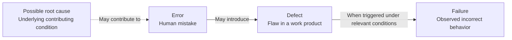
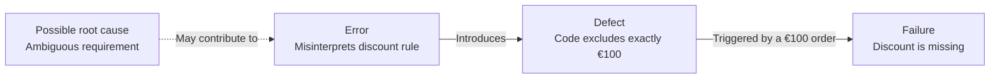
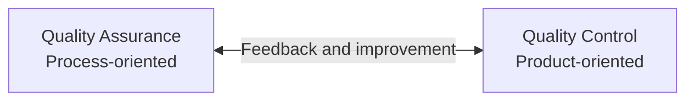
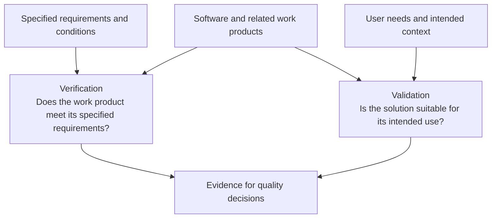
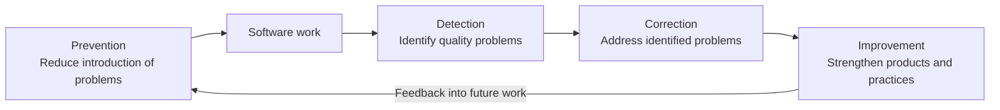

# Fundamentals of Software Quality

## Table of Contents: Fundamentals of Software Quality

- [Testing and Debugging](#testing-and-debugging)
- [Errors, Defects, Failures, and Root Causes](#errors-defects-failures-and-root-causes)
- [Quality Assurance and Quality Control](#quality-assurance-and-quality-control)
- [Verification and Validation](#verification-and-validation)
- [Quality Activities and Their Purposes](#quality-activities-and-their-purposes)

Understanding software quality involves knowing how problems arise, how teams investigate them, and how quality is evaluated and improved. This module introduces testing and debugging, errors and defects, quality assurance and quality control, verification and validation, and the purposes of quality activities. We begin with testing and debugging, two related activities that serve different purposes.

## Testing and Debugging

Testing and debugging both help teams address software problems, but their purposes differ.

**Testing** evaluates software and related work products to identify defects, reveal failures, assess quality, and provide information about the system. When testing that involves software execution exposes unexpected behavior, the observed failure can be investigated further.

**Debugging**, in contrast, involves investigating a problem, locating and analyzing its cause, and correcting the underlying defect. After a correction, additional testing is normally performed to check that the original problem has been resolved and that the change has not introduced unwanted effects elsewhere.

These activities are not restricted to particular job titles. Depending on the team and development approach, developers, testers, and other team members may contribute to testing, while debugging is commonly performed by developers or others responsible for correcting the affected software. Detailed software testing techniques are covered in [Software Testing](../../software_testing/index.md), while debugging techniques are addressed in the relevant software development and maintenance topics. To understand the problems these activities identify and address, we next examine how software problems originate and become observable.

## Errors, Defects, Failures, and Root Causes

Software problems can originate in human mistakes, become defects in work products, and eventually produce observable failures. Understanding the underlying causes of these problems can also help prevent similar issues in the future.



An **error**, also called a **mistake**, is a human action that produces an incorrect result. Errors can be made by anyone involved in software development, including requirements specialists, designers, developers, and testers. A **defect**, often called a **bug** in software, is a flaw in a work product such as a requirement, design, or source code. A **failure** occurs when a system or component does not behave as required or produces a result outside the acceptable limits defined by its requirements. Failures may be observed by testers, users, or other stakeholders during software operation. A **root cause** is an underlying reason why a problem occurred, such as an ambiguous requirement, an incorrect design assumption, or an inadequate review process. Investigating root causes may require collaboration between different team members to identify the conditions that contributed to the problem.

Consider an online shop that should apply a discount to orders of **€100 or more**. A developer interprets the rule as applying only above €100 and implements the wrong condition. When a customer places an order for exactly €100, the discount is missing.



**A defect does not always produce an observable failure.** For orders below or above €100, the correct and incorrect conditions produce the same result. It becomes observable when an order is exactly €100, although the defect might instead be found through a review before the software runs. The diagrams therefore illustrate possible relationships, not an inevitable sequence for every problem.

These distinctions help teams describe and investigate problems precisely. Testing may reveal failures or identify defects, debugging may locate and correct defects, and root cause analysis may identify underlying conditions that contributed to problems. Systematic root cause analysis techniques are covered in [Quality Management](../../quality_management/index.md).

Recognizing and correcting problems is only part of achieving software quality. Teams also need practices that help prevent defects and activities that evaluate work products, leading to the distinction between quality assurance and quality control.

## Quality Assurance and Quality Control

**Quality assurance (QA)** and **quality control (QC)** are related aspects of quality management. QA addresses *How do we establish confidence in the processes used to develop software?*, while QC addresses *How do we evaluate the quality of the work produced?* Both help teams fulfill quality requirements, but they focus on different parts of the work. The diagram illustrates their typical focuses and how they support one another.



**Quality assurance (QA)** commonly emphasizes a **process-oriented perspective**, focusing on how software is developed and maintained. It aims to provide confidence that development processes and practices are suitable for fulfilling quality requirements and are being followed. For example, a team may establish a requirements review practice, agree on how reviews should be conducted, and check that the practice is used. This helps reduce the likelihood of misunderstandings and defects before implementation begins.

**Quality control (QC)** commonly emphasizes a **product-oriented perspective**, focusing on evaluating work products and development results against requirements and other agreed criteria. For example, a team may review a requirement for inconsistencies, inspect source code, or test a feature to compare its actual behavior with the expected result. These activities provide evidence about the quality of the work produced. QC can take place throughout development, not only when the software is complete.

!!! info "QA terminology in software development"

    In software development, **QA** is sometimes used broadly to describe testing, defect reporting, and other activities that fall under **quality control**. For example, software testers may be called “QA engineers” even when their work primarily involves evaluating the product. This naming convention does not change the distinction between QA and QC, which often support one another because findings from product evaluation can inform improvements to development processes.

**Testing is an important form of quality control**, but QC also includes activities that do not require software execution, such as reviews and inspections. Detailed approaches to organizing assurance and control are covered in [Quality Management](../../quality_management/index.md), while detailed testing practices are addressed in [Software Testing](../../software_testing/index.md). Evaluating work products also requires clarity about what is being checked, leading to the distinction between verification and validation.

## Verification and Validation

**Verification** and **validation** are complementary approaches to evaluating software and related work products. Verification asks *Does the work product meet its specified requirements?*, while validation asks *Is the product suitable for its intended use?* The following diagram illustrates these perspectives and shows how both contribute evidence to quality decisions.



**Verification** examines whether a work product satisfies specified requirements and conditions. It commonly emphasizes a **requirements-oriented perspective**, focusing on conformity with established specifications. Verification may also involve a **rules-oriented perspective** when applicable standards, regulations, or organizational policies establish criteria that the work product must satisfy. For example, verification may involve reviewing a design against its requirements, checking source code against a design, comparing software behavior with a specification, or examining compliance with applicable product-related rules. It does not necessarily require executing software because requirements, designs, source code, and other work products can also be examined.

**Validation** examines whether a product is suitable for its intended use and meets relevant stakeholder needs. It commonly emphasizes a **user-oriented perspective**, considering the needs, tasks, and circumstances of the people who will use or depend on the software. A product may conform to its written specification yet still be unsuitable if that specification does not adequately reflect actual needs.

!!! example "Verification and validation in a banking application"

    Consider a banking application whose specification requires customers to transfer money through a particular sequence of screens. The team implements the sequence correctly, and checks confirm that the specified steps work as described. **This provides verification evidence.**

    However, if customers cannot clearly identify the destination account or tell whether a transfer succeeded, the application may still be unsuitable for its intended use. **This raises a validation concern**, even though the documented sequence was implemented correctly.

    ```mermaid
    flowchart TB
        B["Banking application<br/>Money transfer feature"]
        B --> V["Verification<br/>Conformity with specified requirements"]
        B --> A["Validation<br/>Suitability for intended use"]
        V --> V1["Specified screen sequence<br/>is implemented correctly"]
        V1 --> V2["Verification evidence<br/>Specified steps work as described"]
        A --> A1["Destination account<br/>may be unclear"]
        A --> A2["Transfer success<br/>may be unclear"]
        A1 --> A3["Validation concern<br/>User needs may not be met"]
        A2 --> A3
    ```

Neither verification nor validation is limited to a single technique. The activities used depend on the work product, its risks, and its intended context. Detailed testing techniques are addressed in [Software Testing](../../software_testing/index.md). The next section examines the broader purposes of quality activities and the place of testing among them.

## Quality Activities and Their Purposes

Quality activities serve four related purposes. **Prevention** reduces the likelihood of introducing problems, **detection** identifies defects, failures, and other quality problems, **correction** addresses problems that have been found, and **improvement** uses evidence and experience to strengthen products and development practices. These purposes support one another, as the following diagram illustrates.



In practice, **prevention** may involve clarifying requirements or establishing suitable development practices. **Detection** may involve reviewing requirements, inspecting code, or testing software. **Correction** may involve fixing a defect or resolving an inconsistency in a requirement, while **improvement** may involve refining a review practice after recurring misunderstandings. These purposes can overlap: a requirements review, for example, may identify an ambiguity before it leads to an implementation defect, while repeated findings may prompt changes to the review process. The diagram shows feedback between activities, not a fixed sequence of stages.

Quality considerations apply throughout the software life cycle, from requirements and design through implementation, evaluation, deployment, and maintenance. Addressing concerns early can reduce the effort required to correct problems later. **Software quality is a shared responsibility** among developers, testers, designers, requirements specialists, maintainers, managers, and other relevant stakeholders. QA and QC support these responsibilities rather than assigning quality to a single role or department.

Testing can expose failures and reveal defects, but it cannot replace clear requirements, suitable development practices, or the correction of identified problems. Even extensive testing cannot examine every possible condition or guarantee that no defects remain. Software quality therefore depends on the combined contributions of prevention, detection, correction, and improvement, with their emphasis depending on the product, its risks, and its intended use.

[Software Testing](../../software_testing/index.md) explores evaluation techniques, [Quality Engineering](../../quality_engineering/index.md) addresses development practices and automation that support quality, and [Quality Management](../../quality_management/index.md) examines how quality activities and improvement are coordinated. Continue with the [Summary](summary.md) to review the key distinctions introduced here.
