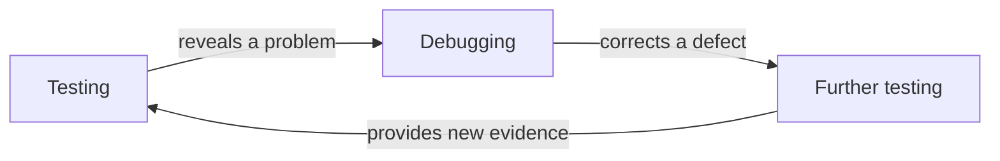
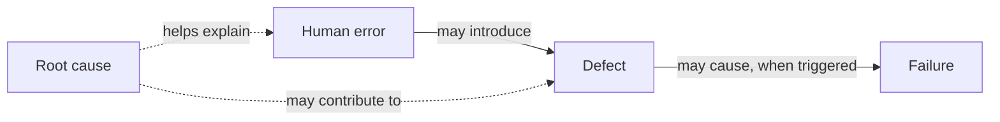

# Summary

The **Fundamentals of Software Quality** module introduces essential distinctions used to recognize quality problems, investigate their causes, and understand how different quality activities contribute to reliable software. This summary brings those relationships together for revision.

## Testing and Debugging

**Testing** evaluates software and related work products to identify defects, reveal failures, assess quality, and provide information for decisions. It can involve executing software or examining work products without execution.

When testing reveals a problem, **debugging** may follow to investigate its cause and correct the underlying defect. Further testing helps determine whether the correction worked and whether it introduced other problems.

The distinction is **evaluation and detection** versus **investigation and correction**. Both activities may involve developers, testers, and other team members.

## Errors, Defects, Failures, and Root Causes

An **error** or **mistake** is a human action that produces an incorrect result. A **defect** or **bug** is a flaw in a work product, such as a requirement, design, or source code. A **failure** occurs when a system or component does not behave as required or produces a result outside acceptable limits. A **root cause** is an underlying reason a problem occurred.

These relationships are **possible, not inevitable**. A defect may remain unnoticed if the conditions needed to trigger it never occur. **Root cause analysis** investigates the underlying conditions that contributed to a problem, helping prevent similar problems rather than addressing only their visible effects.

## Quality Assurance and Quality Control

Quality can be managed through two complementary perspectives. **Quality assurance (QA)** focuses primarily on establishing and maintaining suitable processes, while **quality control (QC)** focuses primarily on evaluating work products and results against agreed criteria.

| Perspective   | Quality assurance (QA)                                     | Quality control (QC)                                            |
|---------------|------------------------------------------------------------|-----------------------------------------------------------------|
| Main emphasis | Process-oriented                                           | Product-oriented                                                |
| Main concern  | Are suitable practices established and followed?           | Does the work product satisfy agreed criteria?                  |
| Examples      | Establishing and monitoring a requirements review practice | Reviewing requirements, inspecting code, testing a feature      |

**Testing is one form of QC**, but QC also includes reviews and inspections that do not require software execution. Findings from QC can also help improve QA practices by revealing weaknesses in existing processes.

In everyday software development, **QA** is sometimes used more broadly to describe testing and related QC work. This usage does not eliminate the conceptual distinction between quality assurance and quality control.

## Verification and Validation

**Verification** examines whether a work product satisfies specified requirements and applicable conditions. It asks, *Does the work product meet its specified requirements?* **Validation** examines whether the product is suitable for its intended use. It asks, *Does the product meet relevant user needs in its intended context?*

| Verification                                         | Validation                                        |
| ---------------------------------------------------- | ------------------------------------------------- |
| Focuses on conformity with specified requirements    | Focuses on suitability for intended use           |
| Can examine requirements, designs, code, and behavior| Considers user tasks, needs, and context          |
| Can be performed without executing software          | May involve realistic user scenarios and feedback |

For example, a banking application might implement a specified money-transfer sequence correctly, providing **verification evidence**. If customers cannot clearly identify the destination account or determine whether the transfer succeeded, this raises a **validation concern**. Meeting the specification does not automatically establish fitness for use.

## Quality Activities and Their Purposes

Quality activities serve different but related purposes. They help teams prevent problems, identify existing problems, correct what has been found, and improve products and practices over time. These purposes often overlap, and a single activity may contribute to more than one.

| Purpose         | Meaning                                                   | Example                                                      |
|-----------------|-----------------------------------------------------------|--------------------------------------------------------------|
| **Prevention**  | Reduce the likelihood of introducing problems             | Clarifying ambiguous requirements                            |
| **Detection**   | Identify defects, failures, and other quality problems    | Reviews, inspections, and testing                            |
| **Correction**  | Address problems that have been found                     | Fixing a defect or inconsistent requirement                  |
| **Improvement** | Strengthen products and practices using evidence          | Refining a review practice after recurring misunderstandings |

These purposes complement one another rather than forming a mandatory sequence. For example, reviewing requirements can detect inconsistencies while also preventing defects from reaching later stages of development. Findings from testing can guide corrections and reveal opportunities to improve development practices.

**Software quality is a shared responsibility** among those creating, evaluating, and maintaining software. Testing supplies important evidence, but it cannot examine every possible condition or guarantee that no defects remain. Quality depends on prevention, evaluation, correction, and continuing improvement working together.

After reviewing this module, you should be able to **distinguish testing from debugging**, **explain errors, defects, failures, and root causes**, **compare QA with QC**, **differentiate verification from validation**, and **describe prevention, detection, correction, and improvement**. You should also be able to explain why testing contributes to software quality without guaranteeing it on its own.

## Knowledge Check

Test your understanding of the key concepts covered in this module. Select one answer for each question to receive immediate feedback and an explanation.

<strong>Testing and Debugging</strong>

What is the main purpose of debugging?

<button type="button" data-option="A">A. To establish quality assurance processes</button>
<button type="button" data-option="B">B. To investigate and correct defects</button>
<button type="button" data-option="C">C. To guarantee that software has no defects</button>
<button type="button" data-option="D">D. To replace software testing</button>

<strong>Errors, Defects, and Failures</strong>

Which statement correctly describes the relationship between defects and failures?

<button type="button" data-option="A">A. Every defect immediately causes a failure</button>
<button type="button" data-option="B">B. A failure is always the same thing as a human error</button>
<button type="button" data-option="C">C. A defect may cause a failure when triggered under certain conditions</button>
<button type="button" data-option="D">D. Defects can exist only in source code</button>

<strong>Root Cause Analysis</strong>

Why is root cause analysis important?

<button type="button" data-option="A">A. It helps identify underlying conditions and prevent similar problems</button>
<button type="button" data-option="B">B. It guarantees that all defects will be discovered</button>
<button type="button" data-option="C">C. It eliminates the need for testing</button>
<button type="button" data-option="D">D. It focuses only on correcting visible symptoms</button>

<strong>Quality Assurance and Quality Control</strong>

Which statement best describes the difference between QA and QC?

<button type="button" data-option="A">A. QA and QC are completely unrelated activities</button>
<button type="button" data-option="B">B. QA focuses only on testing, while QC focuses on debugging</button>
<button type="button" data-option="C">C. QA evaluates only finished software, while QC defines development processes</button>
<button type="button" data-option="D">D. QA focuses primarily on processes, while QC focuses primarily on evaluating work products</button>

<strong>Verification and Validation</strong>

A banking application follows its specified transfer procedure, but customers cannot easily confirm the destination account. What does this illustrate?

<button type="button" data-option="A">A. Successful verification automatically guarantees validation</button>
<button type="button" data-option="B">B. A product may satisfy specifications while still having validation concerns</button>
<button type="button" data-option="C">C. Validation concerns only source code correctness</button>
<button type="button" data-option="D">D. Verification cannot be performed without executing software</button>

<strong>Quality Activities</strong>

Which statement best reflects how software quality activities work together?

<button type="button" data-option="A">A. Testing alone guarantees software quality</button>
<button type="button" data-option="B">B. Prevention, detection, correction, and improvement must always happen in a fixed order</button>
<button type="button" data-option="C">C. Quality activities complement one another and may serve overlapping purposes</button>
<button type="button" data-option="D">D. Software quality is exclusively the responsibility of testers</button>

