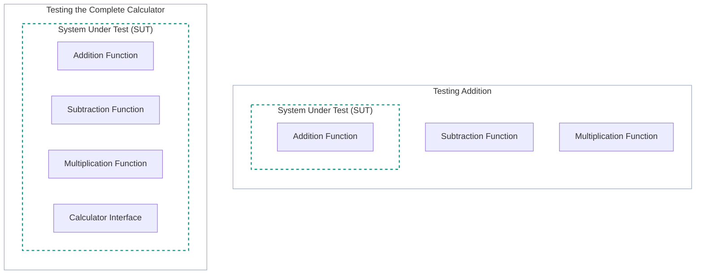
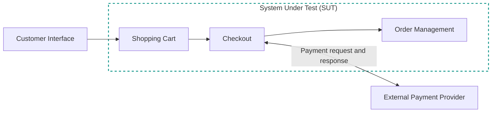
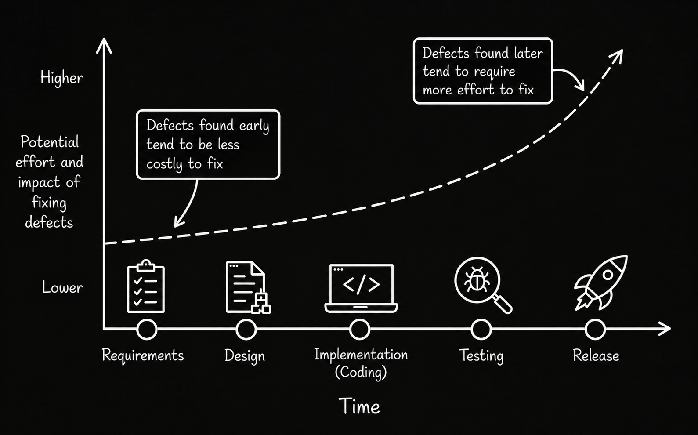
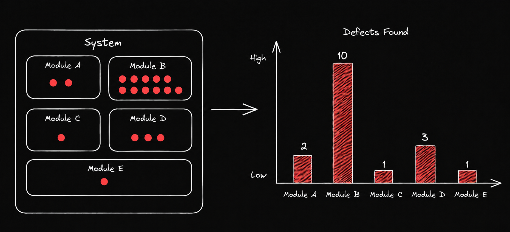
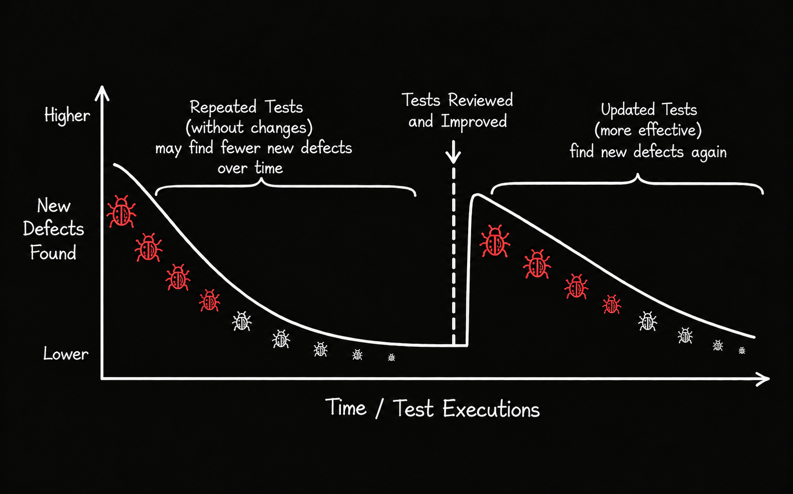
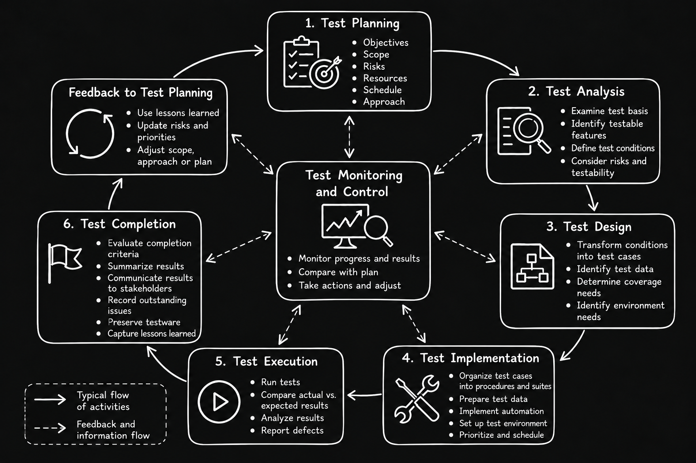
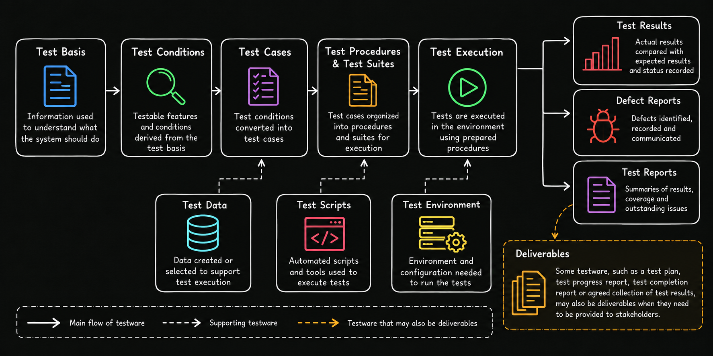
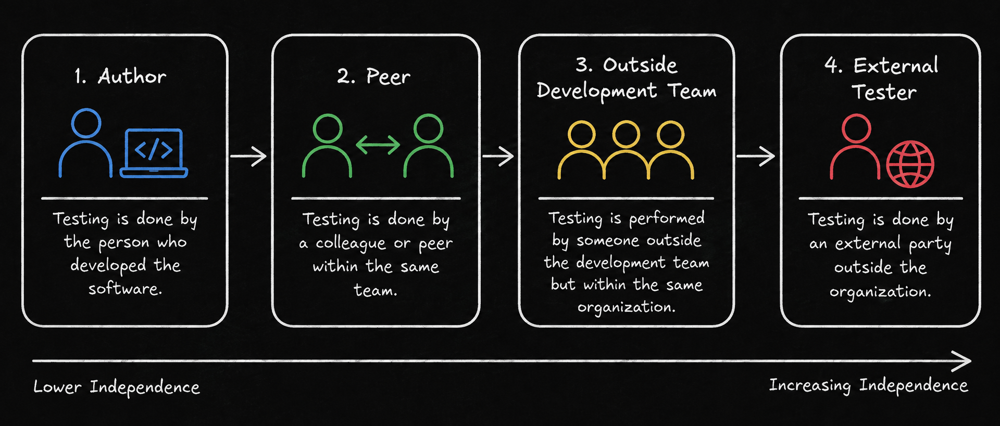
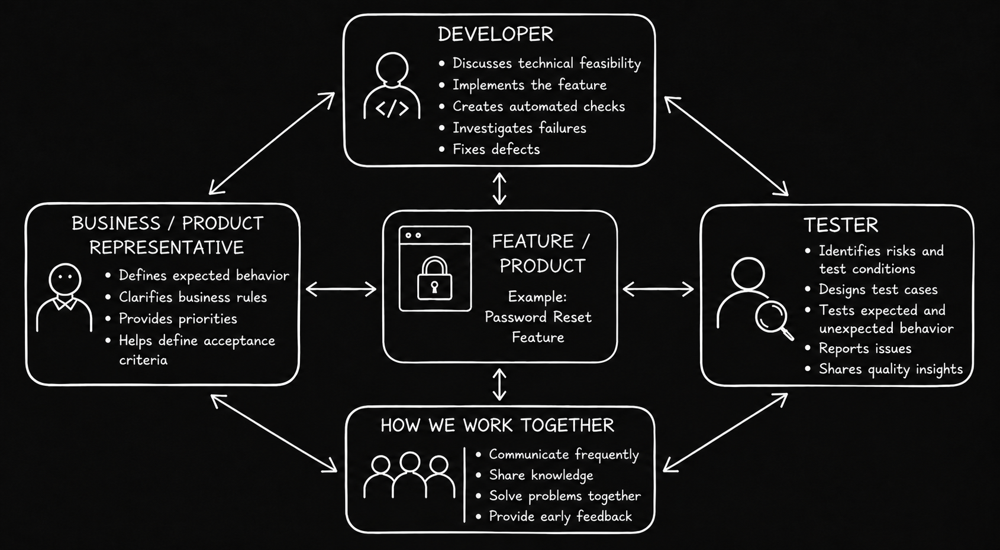

# Level 1

## Table of Contents: Fundamentals of Testing

- [System Under Test (SUT)](#system-under-test-sut)
- [Test Objectives](#test-objectives)
- [Principles of Testing](#principles-of-testing)
- [Test Roles and Responsibilities](#test-roles-and-responsibilities)
- [Test Process and Activities](#test-process-and-activities)
- [Testware and Deliverables](#testware-and-deliverables)
- [Independence of Testing](#independence-of-testing)
- [Whole Team Approach](#whole-team-approach)

**Fundamentals of Testing Level 1** focuses on the foundational knowledge needed to understand how testing decisions are made and how testing work is carried out. It begins by identifying what is being tested before examining the objectives that testing is intended to achieve.

## System Under Test (SUT)

The **System Under Test (SUT)** is the software or system whose behavior or characteristics are being evaluated during testing. It identifies **what is being tested**, whether that is an individual function, component, service, application, or complete system. The SUT is identified as part of establishing the **testing scope**, often during [test planning](../../test_management/overview.md). This involves determining which parts of the software will be evaluated, which components remain outside the SUT boundary, and which interactions are relevant. The SUT may also be identified before formal planning or refined as testing progresses.

Defining the SUT may involve **testers and other relevant stakeholders**, such as developers, product owners, or business representatives. Depending on the project, they help clarify the purpose of testing and determine which components or systems should be evaluated. These decisions may be documented in the test plan or other project documentation and used to guide the testing work.

For example, consider a calculator application with addition, subtraction, and multiplication functions. If testing focuses on addition operations, only the addition function may be the SUT. If the purpose is to evaluate the entire calculator, the complete application becomes the SUT. The following diagram illustrates how the **same application can have different SUTs** depending on the testing scope.

!!! tip "Understanding SUT Boundaries"

    The dashed lines indicate which components are included in the evaluation. Components outside these boundaries are not necessarily irrelevant to testing, because their interactions with the SUT may still influence its behavior.

In larger applications, the SUT may interact with components outside its boundary, such as databases, external services, hardware, or other applications. When the SUT relies on these components to perform certain functions, they are considered **dependencies**. Although their internal functionality may not be part of the evaluation, their responses or failures can affect the SUT's behavior and may need to be considered during testing.

Consider an online shopping application where the team decides to evaluate the shopping cart, checkout, and order management components. Together, these form the SUT, while the customer interface and external payment provider remain outside its boundary. The following diagram illustrates these components and their interactions.

During testing, testers evaluate the behavior of the components included in the SUT, such as whether the shopping cart updates product quantities correctly, checkout handles payment results appropriately, and order management records completed orders. Some of these functions depend on external components. For example, checkout relies on the payment provider to process a payment request and return a result. Testers therefore examine how checkout responds to successful or declined payments, while the payment provider's internal functionality remains outside the evaluation.

Testers may use the real payment provider or replace it with a **test double**, a simulated component that provides predefined payment responses. This allows them to evaluate checkout under different payment conditions without relying on the real payment service.

Understanding the SUT and its dependencies establishes **what software is being evaluated**. The next consideration is **what testing is intended to achieve**.

## Test Objectives

**Test objectives** describe what testing is intended to achieve and guide the selection of test cases, testing approaches, and evaluation criteria. They vary depending on the System Under Test (SUT), product development stage, risks, and project needs. For example, testing an individual component may focus on its correctness, while testing an integrated system may emphasize interactions between components or the satisfaction of broader system requirements.

Clearly defined objectives help teams select appropriate tests and testing approaches. For example, evaluating functional correctness may require different tests and approaches from assessing performance or reliability. Although objectives depend on the testing context, several are common across software projects.

One objective is to **evaluate work products and help prevent defects** by examining software requirements, design documentation, and source code to identify defects, inconsistencies, ambiguities, or missing information before they cause further problems. Testing also aims to **trigger failures and identify defects** by executing software under different conditions and examining its behavior. When failures occur, they can provide evidence of underlying defects that require further investigation.

Another objective is to **achieve specified coverage** by testing the requirements, components, conditions, or other areas identified as important. Since testing every possible situation is generally impractical, teams establish coverage targets to guide testing efforts and assess the extent to which the selected areas have been covered.

Testing also aims to **reduce risk** by identifying potential problems and providing information that helps teams address them. By evaluating whether requirements are satisfied and whether the software meets stakeholder needs, testing provides evidence about product quality, increases confidence in the software without guaranteeing the absence of defects, and supports decisions about readiness for release or use.

Testing can support several objectives at once, such as identifying defects, evaluating requirements, contributing to coverage, and providing information about risks. Achieving these objectives also requires understanding the possibilities and limitations of testing.

## Principles of Testing

Seven fundamental **testing principles** provide this understanding by explaining the limitations of testing and the factors that influence its effectiveness. They help teams make informed decisions about how to select, prioritize, and perform tests across different software projects.

**Testing shows the presence of defects, not their absence.** Testing can reveal defects through the examination of work products or by exposing failures during execution. However, finding no defects does not prove that the software is defect-free. This understanding is consistent with **Glenford J. Myers**, who emphasized the importance of designing tests to reveal errors in *The Art of Software Testing* (Myers, 2004). Testing provides evidence about software quality and reduces uncertainty, but it cannot guarantee absolute correctness.

**Exhaustive testing is impossible.** For most software, testing every possible combination of inputs, conditions, configurations, and execution paths is impractical. Teams must therefore select and prioritize tests based on factors such as risk, importance, and available resources rather than attempting to examine every possible situation.

**Early testing saves time and effort.** Testing activities should begin as early as possible in the development process. Evaluating requirements, designs, and other work products early can reveal problems before they affect subsequent development activities, reducing the effort and cost required to correct them.

**Defect clustering.** Defects are often distributed unevenly across a system, with a relatively small number of components containing a large proportion of discovered defects or contributing to many operational failures. This pattern is commonly associated with the **Pareto principle**, or **80/20 rule**, which illustrates how many problems may originate from a small portion of a system. Although the 80/20 ratio is not an exact rule and actual distributions vary, recognizing defect clustering helps teams identify components that may require additional testing, particularly those with a history of defects or a higher likelihood of failure.

**Pesticide paradox.** Repeatedly executing the same tests without reviewing or modifying them may become less effective at revealing new defects. **Boris Beizer** (1990) used the pesticide paradox analogy in *Software Testing Techniques* to explain why repeatedly applying the same testing approaches may fail to reveal different kinds of defects. This highlights why existing tests should be reviewed and updated, and new tests introduced when necessary to address software changes, emerging risks, or previously unexamined conditions.

**Testing is context dependent.** No single testing approach is suitable for every product or project. For example, testing an online store, mobile game, banking platform, or safety-critical system requires different priorities and techniques because these systems differ in their users, technologies, requirements, and risks. Testing approaches should therefore be adapted to the specific context.

**Absence of errors is a fallacy.** Finding and correcting defects does not guarantee that software will satisfy its users or achieve its intended purpose. A product may function according to its specifications yet still fail to meet actual user needs or business objectives. This highlights the importance of both **verification**, which examines whether specified requirements are satisfied, and **validation**, which considers whether the product is suitable for its intended use.

!!! tip "Applying the Testing Principles"

    The seven testing principles are not steps that must be followed in order. They are general guidelines that help testers make decisions throughout testing. Several principles may apply to the same situation, and their relevance depends on the testing context.

Together, these principles emphasize that effective testing involves more than executing tests and finding defects. It requires understanding limitations, selecting appropriate approaches, and focusing effort where it can provide the most value.

## Test Roles and Responsibilities

**Test roles** describe responsibilities within the testing process rather than specific professional positions or job titles. How these responsibilities are assigned depends on the organization, development approach, project needs, and available skills. Following the ISTQB classification, testing responsibilities can be grouped into two principal roles, the **test management role** and the **testing role**.

The **test management role** primarily focuses on organizing, coordinating, and overseeing testing, including responsibilities associated with **test planning**, **test monitoring and control**, and **test completion**. This may involve establishing test objectives, selecting testing approaches, estimating effort, allocating resources, monitoring progress, taking corrective actions when necessary, managing risks, and communicating results to stakeholders.

The **testing role** primarily focuses on evaluating work products and software behavior, including responsibilities associated with **test analysis**, **test design**, **test implementation**, and **test execution**. This may involve examining requirements and other sources of information, identifying what needs to be tested, designing test cases, preparing test data and environments, executing tests, evaluating actual results against expected results, and reporting identified defects.

!!! note "Roles Are Not Job Titles"

    The **test management role** and **testing role** do not necessarily belong to different people. One person may perform both roles, or responsibilities may be distributed among several team members. The distinction describes **what work is performed**, not who must perform it.

Testing can involve testers, quality engineers, developers, business analysts, product owners, users, and other stakeholders. The distribution of responsibilities may change throughout the project as testing needs evolve.

Clearly assigning responsibilities establishes who is accountable for different aspects of testing, while ensuring that those involved have the necessary knowledge and skills enables them to perform their work effectively. These responsibilities are carried out through the **test process** and its interconnected activities.

## Test Process and Activities

The **test process** consists of interconnected **test activities** that help teams achieve their testing objectives. It provides an overall structure for organizing testing work, while the activities describe the specific tasks performed within that structure. The process is adapted to the needs of each project, with **test planning** helping determine which activities are required, how they will be performed, and when they will take place. The main activities are **test planning**, **test monitoring and control**, **test analysis**, **test design**, **test implementation**, **test execution**, and **test completion**, as described in the **ISTQB Certified Tester Foundation Level Syllabus** (v4.0.1, Section 1.4).

!!! important "The Test Process Is Not Strictly Linear"

    Although the diagram shows a typical progression, testing activities may **overlap**, **repeat**, and provide feedback to one another. **Test monitoring and control** continues throughout the process, while findings from later activities may require earlier work to be revisited. For example, unexpected results during test execution may lead to additional analysis or revised test cases.

The way these activities are performed depends on the **project context**, including stakeholder needs, team skills, available tools, time, budget, and technical constraints. The **software development lifecycle** and identified **risks** also influence how testing is organized and which activities require greater attention.

**Test planning** answers *"What do we want to achieve, and how will testing be organized?"* It establishes the objectives, scope, priorities, resources, and approach for testing. Planning also considers risks and defines criteria for determining when testing is sufficiently complete.

**Test monitoring and control** answers *"Are we making progress, and what needs to change?"* **Monitoring** evaluates progress and results against the plan, while **control** involves taking action when adjustments are needed. This may include changing priorities, reallocating resources, or revising the schedule.

**Test analysis** answers *"What should be tested?"* Testers examine the **test basis**, such as requirements, user stories, and designs, to identify **test conditions**. These describe aspects of the software that need to be checked, including relevant behavior, requirements, and risks.

**Test design** answers *"How should it be tested?"* Testers develop test conditions into **test cases** with suitable inputs and expected results. They also identify the necessary test data, environment requirements, and coverage needs. Connections between the test basis, conditions, and cases support **traceability**, allowing testers to understand which requirements or conditions are addressed by particular tests.

**Test implementation** answers *"What must be prepared before testing?"* Testers organize test cases into **test procedures** and **test suites**, prepare test data, configure the test environment, and develop automated tests when appropriate. These preparations help ensure that tests can be executed as intended.

**Test execution** answers *"What happened, and does it match expectations?"* Testers run tests, record actual results, and compare them with expected results. Unexpected behavior is investigated, and defects are reported when appropriate. Findings may also lead to changes in earlier testing activities.

**Test completion** answers *"What have we learned, and what remains unresolved?"* The team evaluates completion criteria, communicates testing results, documents outstanding issues, and preserves useful testing materials. Lessons learned can also inform future testing work.

Consider a team testing a new **login feature**. During test analysis, the team identifies conditions such as successful login, incorrect passwords, and locked accounts. Test design turns these conditions into test cases, while implementation prepares the required accounts and environment. During execution, the team discovers that a locked account can still sign in. This unexpected result may lead to a defect report, additional investigation, and revised tests. The example demonstrates how findings from one activity can influence others rather than following a strictly one-way sequence.

Together, these activities support a coordinated **test process** and produce information that guides testing decisions. They also create and use work products that support further testing and communication with stakeholders. These materials, including **testware** and **deliverables**, are examined in the next section.

## Testware and Deliverables

Testing produces and uses various **work products** to organize activities, prepare and execute tests, record findings, and communicate results. Two related concepts are **testware** and **deliverables**.

**Testware** refers to work products created or used to support testing activities. It includes materials such as **test plans**, **test conditions**, **test cases**, **test procedures**, **test suites**, **test data**, **test scripts**, **test results**, **defect reports**, and **test reports**.

**Deliverables** are agreed outputs that must be provided, made available, or communicated to **stakeholders**, such as clients, project managers, or development teams. They may serve reporting, review, approval, or handover purposes. Examples include a **test plan**, **test progress report**, **test completion report**, or an agreed collection of test results.

!!! note "A Work Product Can Serve Both Purposes"

    The same work product can be both **testware** and a **deliverable**. For example, a **test plan** supports the organization of testing activities and also becomes a deliverable when stakeholders require it for review or approval. Its classification depends on how it is used and what has been agreed with stakeholders.

Different work products are created and used throughout the **test process**. The following diagram illustrates their relationships, beginning with the **test basis**, which provides information for identifying **test conditions** and developing **test cases**. The test basis may include **requirements**, **design information**, and other work products describing the software's expected behavior and characteristics. These materials may originate outside the testing process rather than being produced by the testing team.

The diagram shows how work products support one another throughout testing. For example, **test conditions** guide the development of **test cases**, while **test execution** produces results that may lead to **defect reports**. Some work products become **deliverables** when they are required by stakeholders. Supporting resources, including **test data**, **test scripts**, and the **test environment**, help teams prepare and execute tests.

During **test planning**, a test plan may be produced. **Test analysis** identifies test conditions, which are developed into test cases during **test design**. **Test implementation** prepares test procedures, test suites, test data, and automated scripts where needed. **Test execution** produces test results and defect reports, while **test monitoring and control** uses progress information and may produce progress reports. During **test completion**, the team may prepare a completion report and preserve useful testware for future testing.

The types of testware and deliverables, their level of detail, and how they are maintained depend on the **project context**, testing approach, risks, and stakeholder needs. Some materials are maintained in documents, while others are managed through testing tools or automated systems. Proper management of these work products includes **version control** and **configuration management**, which help maintain correct versions and track changes, as well as **traceability**, which connects related work products such as requirements, test conditions, test cases, and test results. These practices are discussed further in [Test Management](../../test_management/overview.md).

Together, **testware and deliverables** support consistent testing, preserve useful information, and communicate findings to stakeholders. However, the effectiveness of testing also depends on the objectivity of those evaluating the software. This leads to **independence of testing**, which examines how separation between development and testing responsibilities can influence testing effectiveness.

## Independence of Testing

**Independence of testing** describes the degree of separation between those performing testing and those responsible for creating the work product being tested. This separation may exist within a development team, between teams, or between organizations. Although people can and should test their own work, familiarity with its implementation and underlying assumptions may make certain defects difficult to recognize. Independent testers can bring different perspectives and challenge these assumptions. The **levels of independence** are illustrated in the diagram.

At the lowest level, the **author** tests their own work, benefiting from detailed technical knowledge and rapid feedback despite the lack of independence. Testing by a **peer or another team member** introduces greater independence while maintaining close collaboration with the development team.

Testing by someone **outside the development team but within the same organization**, such as a separate testing team, provides a higher level of independence while retaining familiarity with the organization's processes and objectives. **External testers or organizations** offer greater organizational separation and may provide an additional independent perspective, particularly when external assessment is required in regulated or safety-critical environments.

The degree of independence may also vary across **testing activities**. For example, developers may design and execute tests for their own components, while other team members review requirements, evaluate test cases, or perform additional testing. Different levels can therefore coexist within the same project without requiring complete separation between development and testing.

!!! important "Greater Independence Does Not Guarantee Better Testing"

    Independent testing can help identify defects that the creators might overlook, but **greater independence does not automatically mean more effective testing**. Effectiveness also depends on testers' skills, product knowledge, communication, and the testing approach. Excessive separation can create communication barriers, delay feedback, and encourage the mistaken belief that quality is solely the responsibility of testers.

The appropriate level of independence depends on the **project context**, **risks**, **development approach**, and applicable regulatory requirements. Teams must therefore determine how independent evaluation fits alongside collaboration. This leads to the **whole team approach**, where people with different responsibilities contribute to achieving the desired level of product quality.

## Whole Team Approach

The **whole team approach** means that team members share responsibility for quality and collaborate to achieve the desired level of product quality. Quality is not considered the responsibility of testers alone. **Developers**, **testers**, **business representatives**, and other team members contribute their knowledge and expertise throughout development.

Different team members contribute in different ways. **Developers** bring technical knowledge, implement features, perform testing, investigate failures, and correct defects. They may also create automated checks to support testing. **Testers** contribute testing expertise, risk awareness, critical thinking, and knowledge of testing techniques. **Business representatives** provide knowledge of user needs, business rules, priorities, and expected product behavior. Combining these perspectives helps teams clarify requirements and acceptance criteria, identify risks early, and resolve questions before they become more difficult or costly to address. This collaboration extends across the **development lifecycle**, from discussing requirements and acceptance criteria to implementing features, testing their behavior, investigating problems, and evaluating results.

The following diagram illustrates how these roles collaborate around a shared feature, using a password reset function as an example. Each role contributes different knowledge and responsibilities, while communication and feedback connect their work.

The whole team approach encourages **knowledge sharing** and continuous collaboration. Testers can help others develop their testing skills, while developers and business representatives help testers strengthen their technical and domain knowledge. This collaboration can take place in person or remotely, provided that team members communicate effectively, share information, and solve problems together. Although commonly associated with **Agile development**, the whole team approach can also be applied in other development approaches. Agile and other development approaches are introduced in the [Software Development Lifecycle](../../software_development_lifecycle/overview.md) module.

!!! important "Shared Responsibility Does Not Mean Identical Responsibilities"

    Everyone contributes to product quality, but team members continue to have different responsibilities based on their skills and expertise. The whole team approach also does not eliminate the need for **independent testing**. Projects involving higher risks, regulatory requirements, or safety-critical systems may require additional independent evaluation. The appropriate balance between collaboration and independence depends on the **project context**.

Together, the topics covered in **Fundamentals of Testing Level 1** establish a foundation for understanding **software testing**, including its purpose, activities, work products, and shared responsibilities. The next step is to review these concepts in the [Fundamentals of Testing Summary](../summary.md) before continuing to [Fundamentals of Testing Level 2](../2_level/2_fundamentals_of_testing.md), which explores **testability** and **test oracles**.
