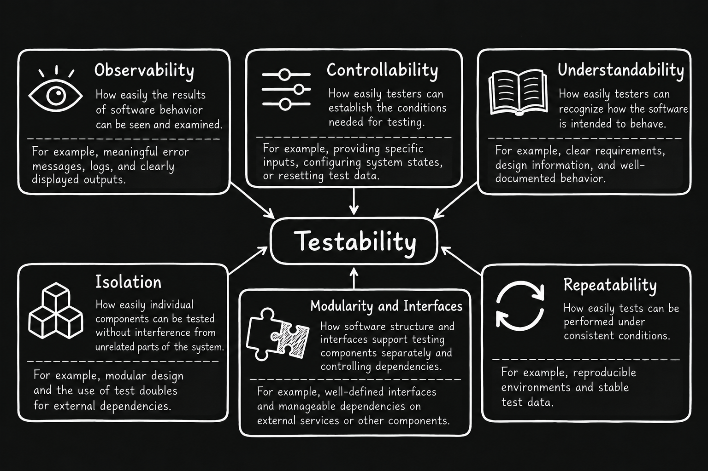
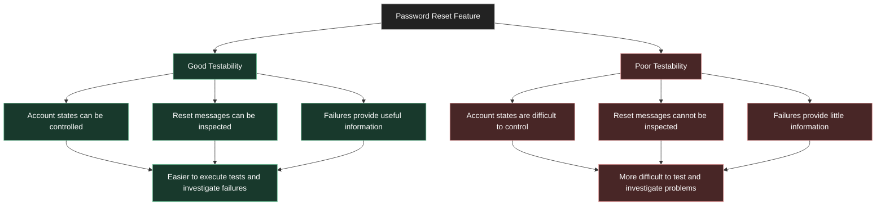
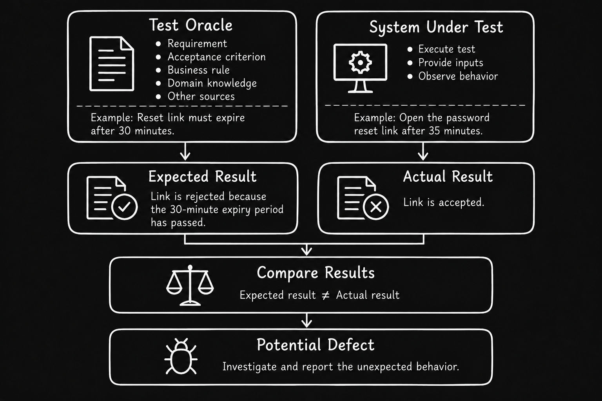

# Level 2

## Table of Contents: Fundamentals of Testing

- [Testability](#testability)
- [Test Oracles](#test-oracles)

**Fundamentals of Testing Level 2** builds on the concepts introduced in **Fundamentals of Testing Level 1** by focusing on **testability** and **test oracles**. These concepts help testers understand how software can be made easier to test and how expected results are established to evaluate its behavior.

## Testability

**Testability** describes how easily and effectively software can be tested. It influences the effort required to establish test conditions, design and execute tests, observe behavior, evaluate results, and investigate defects. Software with good testability allows testers to obtain useful information about its behavior with less effort, while poor testability may require additional time, tools, or resources. For example, testing a login feature may involve successful logins, incorrect passwords, and locked accounts. If testers can create and examine these situations easily, the feature has better testability. Otherwise, testing becomes more challenging, and some problems may remain undetected.

Several characteristics of software and its environment influence testability. The following diagram illustrates six important characteristics and provides practical examples of each.

These characteristics work together to help testers establish suitable conditions, examine software behavior, reproduce failures, and test individual components with fewer dependencies. For example, the **test doubles** introduced in the [System Under Test (SUT)](../1_level/1_fundamentals_of_testing.md#system-under-test-sut) section can improve testability by replacing external dependencies with controlled substitutes, allowing components to be tested under specific conditions. Considering these characteristics during software design can make testing more efficient and problems easier to investigate.

A password reset feature provides a practical example of how testability affects testing. Depending on how the feature is designed, testers may find it easy or difficult to control account states, inspect reset messages, and investigate failures. The following diagram compares these situations.

Improving testability is a **shared responsibility**. **Developers** can provide clear interfaces, useful diagnostic information, and mechanisms for controlling system states. **Testers** can identify obstacles and communicate their needs early, while **business representatives** can clarify expected behavior and acceptance criteria. Addressing these needs during design and development helps make software easier to test.

!!! important "Testability Does Not Guarantee Correctness"

    Software that is easy to test is not necessarily correct or free of defects. Good testability makes it easier to establish test conditions, observe behavior, and investigate failures, but the effectiveness of testing still depends on the tests performed and how their results are evaluated.

Determining whether observed behavior is correct requires more than the ability to test software. Testers also need a reliable basis for evaluating the results. This leads to the concept of **test oracles**.

## Test Oracles

A **test oracle** is a source of information used to determine whether the actual results of a test are correct. It provides the basis for establishing expected results, which testers compare with the behavior observed during test execution. Differences between these results may indicate defects that require further investigation. The **ISTQB Certified Tester Foundation Level Syllabus** (ISTQB, 2024, Section 1.4.1) identifies test oracles as sources used to determine expected results.

Test oracles can come from different sources depending on the software being tested and the information available. **Requirements and specifications** describe intended behavior, while **acceptance criteria** define conditions that a feature must satisfy. **Business rules** establish constraints and decisions that the software must follow. **Existing systems**, **reference implementations**, and **domain knowledge** may also help testers determine expected results.

The following diagram demonstrates this process using a password reset feature of the [**System Under Test (SUT)**](../1_level/1_fundamentals_of_testing.md#system-under-test-sut). It shows how a requirement is used to establish the expected result, which is then compared with the observed behavior to identify a potential defect.

Test oracles are not always written documents. **Subject matter experts**, **business representatives**, and other knowledgeable stakeholders can help determine expected behavior when requirements are incomplete or unclear. Established standards, mathematical properties, and comparisons between implementations may also provide useful reference information. The appropriate source depends on the **testing context** and the behavior being examined.

An important challenge is the **test oracle problem**, which occurs when determining the correct expected result is difficult or impossible for a particular test. For example, software that performs complex calculations may produce results that cannot easily be verified independently. This makes it more difficult for testers to determine whether the software is behaving correctly.

!!! note "Expected Results Are Not Always Known"

    When the exact expected result cannot be determined, testers may use known properties, constraints, or relationships to evaluate the software's behavior. These checks can provide useful evidence or reveal potential defects without requiring an exact expected value.

The reliability of a test oracle matters because **an incorrect or incomplete oracle can lead to incorrect conclusions**. If the expected result is wrong, correctly functioning software may appear defective, or an actual defect may go unnoticed. Testers should therefore evaluate the sources used to establish expected results and clarify ambiguities with relevant stakeholders.

**Testability and test oracles work together** to support effective testing. Testability influences how easily testers can establish conditions and observe software behavior, while test oracles provide the basis for evaluating that behavior. Together, these concepts help testers design meaningful tests, interpret results reliably, and communicate their findings. The [Fundamentals of Testing Summary](../summary.md) brings together the key concepts explored throughout this module.
