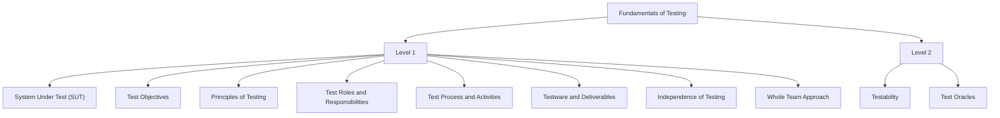

# Overview

**Fundamentals of Testing** develops the principles, processes, and responsibilities needed to understand how software testing is organized and performed. Building on the [Quality Fundamentals introduction](../../quality_fundamentals/index.md) and the [Software Testing introduction](../index.md), this module moves from understanding what is being tested to the objectives, principles, activities, work products, and collaborative practices that support effective testing.

The discussion begins by introducing the **System Under Test (SUT)**, which identifies the software component, application, service, or system being evaluated. It then examines test objectives and principles, followed by the roles and responsibilities involved in testing. Next, it introduces the test process, examines the main test activities, and explains the testware and deliverables created and used throughout testing. The module also explores independence of testing and the whole-team approach, highlighting the importance of objectivity and collaboration. Finally, it introduces testability and test oracles, explaining how software characteristics influence the ease of testing and how expected results are determined and evaluated.

Together, these topics establish a foundation for understanding testing as a structured, collaborative, and evidence-based activity. [Fundamentals of Testing Level 1](1_level/1_fundamentals_of_testing.md) introduces the scope, objectives, principles, activities, work products, and responsibilities involved in testing. [Fundamentals of Testing Level 2](2_level/2_fundamentals_of_testing.md) builds on this foundation by exploring testability and test oracles. The [Fundamentals of Testing Summary](summary.md) brings together the key concepts from both levels for revision.
