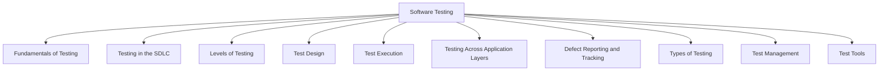

# Software Testing

## Table of Contents: Introduction

- [Scope of Software Testing](#scope-of-software-testing)
- [References](#references)

**Software testing** is a set of activities used to evaluate software and related work products, identify defects, and provide information about quality. Testing helps determine whether software meets specified requirements and supports the needs of its intended users. It involves more than executing a program and checking its results. Requirements, designs, and other work products can also be examined to identify potential problems before the software is executed.

An important purpose of testing is to discover problems that might otherwise remain unnoticed. **Glenford J. Myers** emphasized this perspective in *The Art of Software Testing*, encouraging testers to seek errors rather than simply demonstrate that software works. Testing cannot establish that software is free from defects, but it can provide evidence that supports decisions about its quality and associated risks.

Building on [Quality Fundamentals](../quality_fundamentals/index.md), this area explores the principles, processes, techniques, and practices used in software testing. It examines how testing is organized, designed, performed, supported, and managed throughout software development and maintenance.

## Scope of Software Testing

The scope of software testing extends from its fundamental objectives and principles to the activities, responsibilities, and collaborative practices involved in the test process. This includes test independence and the whole-team approach to testing, alongside the broader subjects illustrated in the following diagram.

Testing takes place within different software development lifecycles, including sequential, iterative, incremental, and Agile approaches. The way testing is organized depends on the development context, the scope of the work being evaluated, and the risks involved. Testing can be performed at different levels, from individual components and their interactions to complete systems, external integrations, and acceptance testing. It can also be approached through different technical layers, such as user interfaces, APIs, and databases.

Testing can be classified and approached in different ways depending on its purpose and how it is performed. Static testing examines work products without executing software, using approaches such as reviews and static analysis. Dynamic testing evaluates software through execution. Both approaches can contribute to evaluating functional and non-functional aspects of software. Other approaches, including smoke, sanity, confirmation, and regression testing, support the evaluation of builds and software changes. While this area introduces non-functional testing at a general level, the detailed evaluation of individual software quality attributes is covered in [Quality Attributes & Evaluation](../quality_attributes_and_evaluation/index.md).

Effective testing requires systematic test design and execution. Test design involves identifying test conditions, preparing test cases and data, and applying appropriate techniques. Test execution focuses on preparing environments, performing tests, comparing actual and expected results, and recording outcomes.

Defect reporting and tracking provide a structured way to document, communicate, and follow up on problems identified during testing. Testing tools support various activities, including test preparation, execution, and result analysis. The development of automation frameworks and the integration of testing practices into software delivery workflows are explored in [Quality Engineering](../quality_engineering/index.md).

Testing activities also require planning, coordination, and oversight. Test management covers test-specific planning, estimation, prioritization, risk-based testing, monitoring and control, test completion, and reporting. These activities help teams organize their work, evaluate progress, and communicate testing results and remaining risks. Broader organizational quality planning, governance, and continuous improvement are addressed in [Quality Management](../quality_management/index.md).

Together, these topics explain how software testing contributes to quality through systematic evaluation, timely feedback, defect identification, risk reduction, and evidence-based decisions. The following modules examine these subjects more closely, beginning with [Fundamentals of Testing](fundamentals_of_testing/overview.md).

## References

- **Beizer, B.** (1990). *[Software Testing Techniques](https://books.google.com/books/about/Software_Testing_Techniques.html?id=kZJQAAAAMAAJ)* (2nd ed.). Van Nostrand Reinhold.
- **IEEE Computer Society.** (2024). *[Guide to the Software Engineering Body of Knowledge (SWEBOK Guide)](https://ieeecs-media.computer.org/media/education/swebok/swebok-v4.pdf)*, Version 4.0a.
- **International Software Testing Qualifications Board (ISTQB).** (2024). *[Certified Tester Foundation Level Syllabus](https://istqb.org/wp-content/uploads/2024/11/ISTQB_CTFL_Syllabus_v4.0.1.pdf)*, Version 4.0.1.
- **Myers, G. J.** (2004). *[The Art of Software Testing](https://openlibrary.org/search?q=The+Art+of+Software+Testing+Myers+2004)* (2nd ed., revised and updated by T. Badgett and T. M. Thomas, with C. Sandler). John Wiley & Sons. [Read PDF](https://else.fcim.utm.md/pluginfile.php/154828/mod_resource/content/2/The%20Art%20of%20Software%20Testing.pdf).
- **Royce, W. W.** (1970). *[Managing the Development of Large Software Systems](https://agilecrossing.com/wp-content/uploads/2011/10/Royce-Waterfall.pdf)*. Proceedings of IEEE WESCON.
