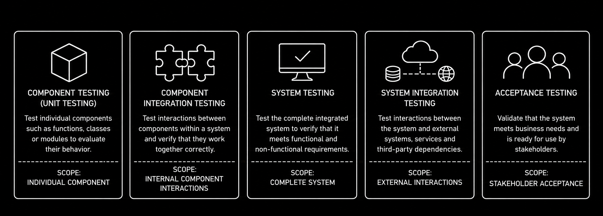

# Overview

So far, we have explored why testing is necessary, how testing activities are organized, and how testing contributes to software quality. The next step is to understand why software must be examined at different levels. Different problems can become visible depending on what is being tested. For example, a login feature may correctly check a username and password but still fail to let users sign in because it cannot communicate with the database. Testing at different levels helps identify problems that might not be discovered by examining only one part of the software.

To address these concerns, software testing is organized into **testing levels**, each distinguished by its test objects, objectives, test bases, typical defects or failures, and testing approaches and responsibilities. The five testing levels described in the ISTQB Foundation Level syllabus are **Component Testing**, **Component Integration Testing**, **System Testing**, **System Integration Testing**, and **Acceptance Testing** **(ISTQB, 2024, Section 2.2.1)**.

The diagram illustrates the different perspectives provided by these levels rather than a mandatory sequence of testing activities. Each level examines software with different objectives and may reveal problems that other levels do not. Successful testing at one level therefore does not guarantee success at another. Depending on the development approach, testing at different levels may also overlap or repeat rather than follow a fixed order.

Responsibilities vary across testing levels as well. **Component Testing** and **Component Integration Testing** are often performed by developers because they require knowledge of the code and internal interactions. At other levels, testing may involve software testers, developers, business representatives, or end users, depending on the testing objectives and project context. Understanding these responsibilities helps software testers recognize how their work relates to testing performed by others.

The following topics explore each testing level individually. You can start with whichever level is most relevant to the software being tested and the testing objectives, without following a particular order. The available topics are [Component Testing](./component_testing/component_testing.md), [Component Integration Testing](./component_integration_testing/component_integration_testing.md), [System Testing](./system_testing/system_testing.md), [System Integration Testing](./system_integration_testing/system_integration_testing.md), and [Acceptance Testing](./acceptance_testing/acceptance_testing.md).
