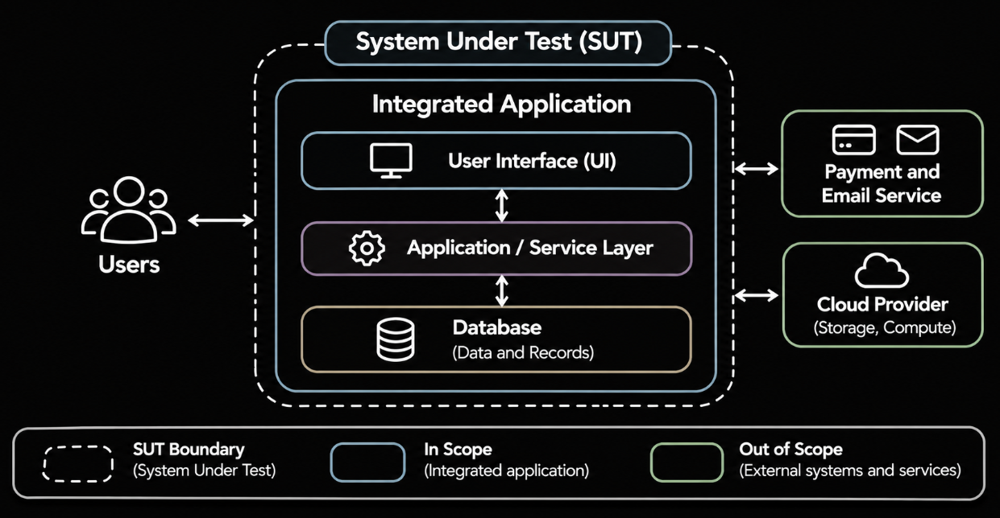
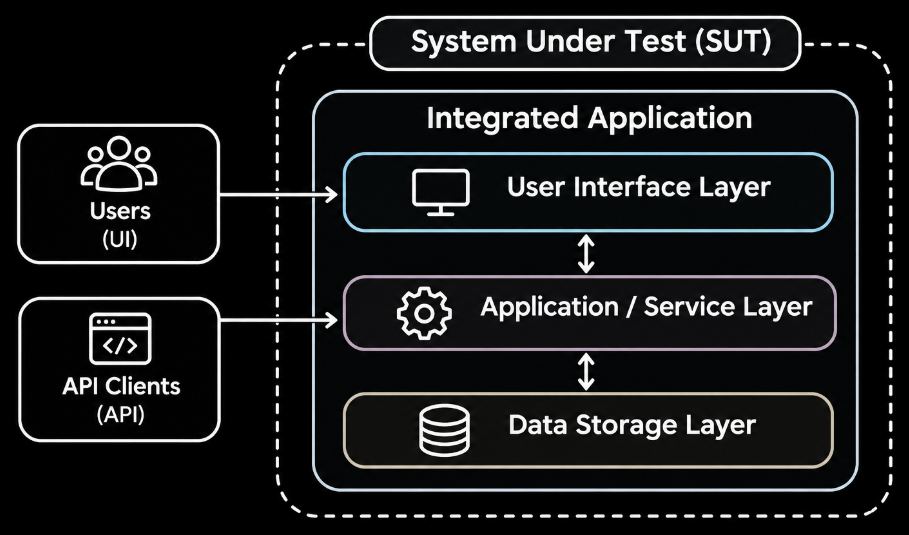

# System Testing

## Table of Contents: System Testing

- [Objectives and Scope of System Testing](#objectives-and-scope-of-system-testing)
- [System Testing Across Layers](#system-testing-across-layers)
- [Test Execution Approaches](#test-execution-approaches)
- [Roles and Responsibilities](#roles-and-responsibilities)
- [Test Environment and Data](#test-environment-and-data)

After individual components and their interactions have been tested, the complete integrated system can be evaluated. **System testing** is a level of software testing that examines whether an integrated application behaves correctly as a whole. Unlike component testing, which focuses on individual parts, or component integration testing, which examines interactions between components, system testing considers the overall behavior of the application. By evaluating complete workflows under conditions that reflect intended use, it helps identify defects that may not become apparent during earlier testing levels and provides confidence in the functionality and overall quality of the integrated system.

## Objectives and Scope of System Testing

System testing addresses a fundamental question. **Does the entire system behave correctly according to requirements?** Its primary objective is to determine whether the integrated application satisfies its specified requirements and supports the functionality and user workflows for which it was developed.

System testing evaluates both **functional** and **non-functional requirements**. Functional system testing verifies that the application performs its required operations correctly, including application rules, calculations, data processing, and user workflows. Non-functional system testing examines relevant quality characteristics such as performance, security, usability, accessibility, compatibility, and reliability. The specific characteristics evaluated depend on the application's requirements and intended operating conditions.

The **scope of system testing** is defined by the boundaries of the system under test. Testing focuses on the collective behavior of the integrated system rather than verifying its individual components in isolation. System tests may involve external services when they are necessary for evaluating complete workflows. However, **system integration testing** specifically examines the interfaces and interactions between the system under test and external systems or services. The two testing levels can use similar scenarios, but they differ in their primary objectives.

The diagram illustrates the **System Under Test (SUT) boundary**, which separates the integrated application from external systems and services. The user interface, application or service layer, and database are shown within the boundary, while payment and email services and a cloud provider are shown outside it. The connections indicate interactions that may be relevant to system workflows and system integration testing.

System test coverage should reflect the requirements and risks within the defined scope. **Requirements traceability** connects requirements to test conditions and test cases, making it easier to identify missing coverage and assess the impact of changes. Risk-based prioritization helps focus testing effort on critical workflows, important quality characteristics, and areas where failures could have significant consequences.

Defining these objectives, boundaries, and coverage priorities helps establish what needs to be verified. The integrated system can then be evaluated through different interfaces while maintaining the same system-level focus.

## System Testing Across Layers

System testing can evaluate the behavior of a complete integrated application through different interfaces and observe results across multiple architectural layers. The testing level is determined by the scope of the system under test rather than whether a test is executed through a user interface, API, or another entry point.

The diagram illustrates an **integrated application within the System Under Test (SUT) boundary**, consisting of a user interface layer, an application or service layer, and a data storage layer. Users interact with the application through its **user interface (UI)**, while API clients can communicate directly with the **application or service layer**. Both entry points can exercise functionality that involves multiple layers of the same integrated system.

At the **user interface (UI) layer**, complete user workflows and visible application behavior can be verified. Through **APIs or service interfaces**, system-level operations and their results can be evaluated without necessarily interacting with the graphical interface. **Database records and application logs** can provide supporting evidence that information has been processed, stored, and updated correctly. Direct database access is not required for every system test.

**End-to-end testing** can validate workflows that span multiple layers, confirming that the integrated application behaves correctly as users or other systems interact with it. Examining results across layers also supports defect investigation. When a system test fails, application logs, service responses, and database records may help identify where the problem originated.

Although different interfaces provide different ways to interact with the application, the objective remains the same. System testing verifies the behavior of the complete integrated system rather than treating each architectural layer as a separate testing level. The selected workflows and interfaces also influence which execution approaches are appropriate.

## Test Execution Approaches

System testing can be performed through both **manual testing** and **automated testing**, depending on the application and the scenarios being evaluated. Manual testing supports exploratory investigation and the assessment of workflows that require human observation or judgment. Automated testing uses tools and scripts to execute repeatable scenarios, making it particularly useful for regression testing and stable end-to-end workflows that require frequent verification.

Combining both approaches helps balance flexibility, repeatability, and execution efficiency. Depending on the application's requirements, system testing may also include **cross-browser and cross-platform validation** across supported environments. Scenarios involving long-running workflows or delayed processing may require additional execution time, making scheduling and risk-based prioritization important for maintaining timely feedback.

The effectiveness of these approaches depends on reliable test conditions and clear responsibilities. Coordinating execution, defect investigation, and environment support helps ensure that results can be interpreted and acted upon.

## Roles and Responsibilities

System testing requires collaboration among different team members to ensure that the application is evaluated thoroughly and identified defects are addressed effectively. Responsibilities vary depending on the project's organization, testing strategy, and available resources.

**QA engineers and testers** design, execute, and maintain system tests, verify requirements, and report defects. **Developers** investigate failures, correct defects, and check that changes do not introduce additional problems. **Test leads or test managers** coordinate testing activities, monitor progress, and ensure that testing remains aligned with the project's requirements and quality objectives.

Other specialists may contribute when their expertise is needed. **Requirements analysts** help clarify expected application behavior and resolve ambiguities in requirements, while **DevOps engineers or environment specialists** support deployments, infrastructure, and the environments required for reliable testing. Together, these responsibilities support consistent test execution, particularly when workflows depend on specific configurations, external services, or prepared data.

## Test Environment and Data

System testing requires a stable **test environment** and representative **test data** to evaluate the behavior of the integrated application reliably. The environment should resemble intended production conditions where relevant, including application configurations, infrastructure, internal services, and required dependencies. Differences between testing and production environments should be understood and documented because they may affect test results or prevent certain defects from being detected.

External dependencies may be accessed through real integrations or represented by controlled alternatives such as **stubs**, **service virtualization**, or **sandbox environments**. These approaches can reduce the influence of unpredictable external services and help maintain consistent testing conditions. However, simulated dependencies may not reproduce every behavior of the real service, so their limitations must be considered when interpreting results. The appropriate choice depends on the application's requirements and the interactions being evaluated.

**Test data** should represent realistic application scenarios, including typical inputs, invalid values, boundary conditions, and unusual combinations of data. Some tests require specific application states, such as configured user accounts, permissions, or stored records. Preparing these conditions consistently and cleaning up afterward helps keep tests repeatable and independent. When production-like data is used, sensitive information must also be protected according to applicable privacy and security requirements.

Reliable environments and representative data help evaluate system behavior accurately and identify defects before release. While system testing focuses on verifying the integrated application's behavior against specified requirements, **[acceptance testing](../acceptance_testing/acceptance_testing.md)** evaluates whether the system satisfies acceptance criteria and is suitable for its intended use. These testing activities may occur sequentially or overlap, depending on the project's testing strategy.
