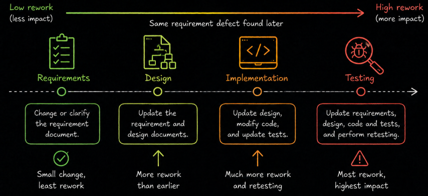
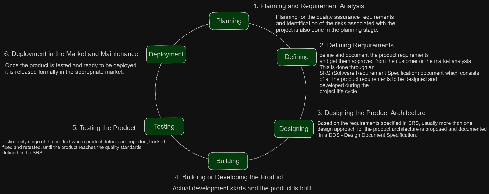
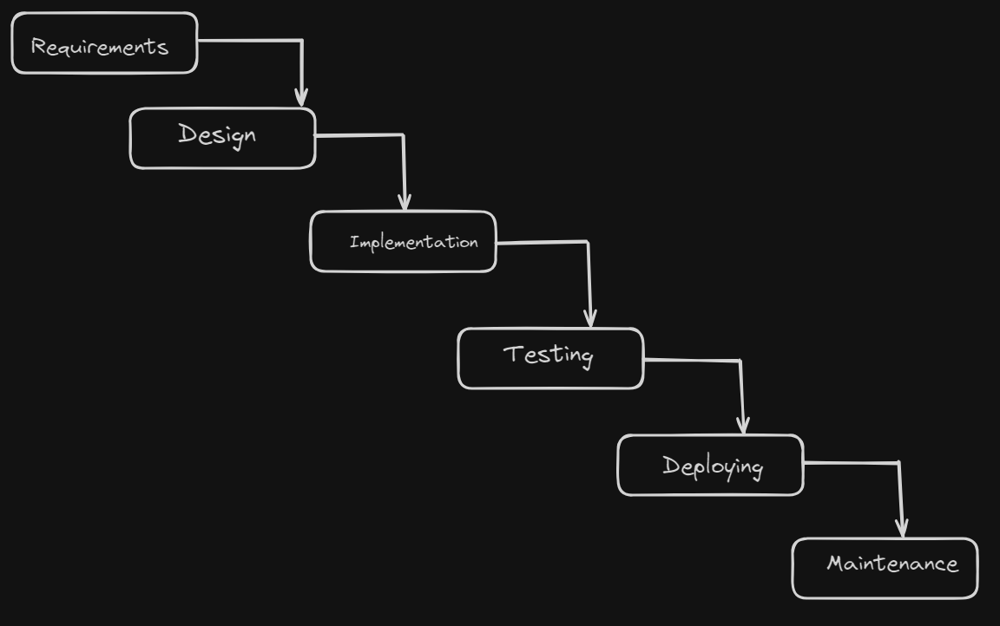
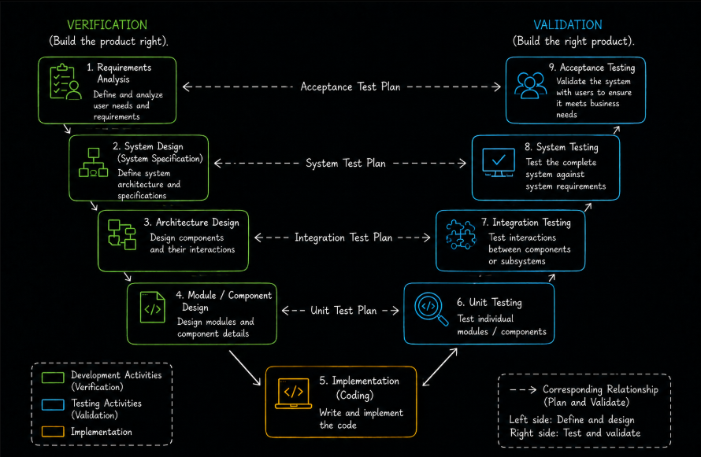

# Level 1

## Table of Contents: Software Development Lifecycle & Testing

- [What is SDLC and Why It Exists](#what-is-sdlc-and-why-it-exists)
- [SDLC Phases, Deliverables, and Completion Criteria](#sdlc-phases-deliverables-and-completion-criteria)
- [Testing Throughout the SDLC](#testing-throughout-the-sdlc)
- [Waterfall Model](#waterfall-model)
- [V-Model](#v-model)
- [Comparing Waterfall and V-Model](#comparing-waterfall-and-v-model)

**SDLC Level 1** introduces the foundations of the **Software Development Life Cycle (SDLC)** and explains how software development activities are organized and coordinated. It begins with the purpose of SDLC, its main phases, and the deliverables and completion criteria associated with development activities. It then examines how testing contributes throughout the lifecycle before introducing two **sequential SDLC models**, the **Waterfall model** and the **V-Model**, and comparing how they organize development and testing.

## What is SDLC and Why It Exists

The **Software Development Life Cycle (SDLC)** is a structured approach to organizing software development from an initial idea through requirements, design, implementation, testing, deployment, and ongoing maintenance. It helps teams understand what work needs to be performed, how different activities relate to one another, and how responsibilities and progress can be coordinated. SDLC is not a single development model. Instead, it provides a general lifecycle framework that can be organized through different **SDLC models**, which determine how activities are sequenced, repeated, and connected.

Software projects involve many people, activities, and decisions that must work together. Without an organized approach, teams may encounter unclear requirements, communication problems, uncontrolled changes, and increased risks of defects or delays. SDLC helps address these challenges by establishing a common understanding of development activities, expected outputs, responsibilities, and progress. It also supports earlier identification of problems, reducing the likelihood that issues in one activity will affect later work.

Identifying problems early can reduce the effort required to correct them. For example, an unclear requirement discovered during a requirements review may only require updating the specification. If the same problem is discovered after design and implementation, the team may also need to modify the architecture, change code, update tests, and retest affected functionality.

The cost and effort of correcting defects depend on their nature and the project context, but problems that spread into later work can create additional rework. Early reviews, communication, and test planning therefore help teams identify and address issues before they become more difficult to resolve.

## SDLC Phases, Deliverables, and Completion Criteria

Although the exact structure varies between projects and development models, the software lifecycle is commonly described through six main phases. Each phase represents a type of development activity and may produce **deliverables** that support later work or provide evidence of progress.

| SDLC phase | Main purpose | Examples of deliverables |
|------------|--------------|--------------------------|
| **Requirements analysis** | Identify what the software must do, including stakeholder needs, expectations, and constraints. | Requirements specifications, user stories, acceptance criteria |
| **System design** | Determine how the software will be structured and how requirements will be implemented. | Architecture diagrams, design specifications, interface descriptions |
| **Implementation** | Develop the software according to the requirements and design. | Source code, software components, application builds |
| **Testing** | Evaluate software and related work products to identify defects and provide information about quality. | Test cases, test results, defect reports |
| **Deployment** | Release the software into its intended environment and make it available for use. | Released software, deployment records, configuration information |
| **Maintenance** | Correct defects, adapt the software, and improve it after release. | Updates, patches, maintenance records |

These phases describe the main activities involved in developing and maintaining software, but they do not necessarily occur only once or in a strictly linear order. Their sequence, overlap, and repetition depend on the selected SDLC model. Testing, for example, may involve reviewing requirements and designs before executable software is available, even when a lifecycle diagram shows testing as a separate phase.

In addition to deliverables, teams may establish **entry criteria** and **exit criteria** to determine when activities can begin and when they are sufficiently complete. Entry criteria describe conditions that should be satisfied before an activity starts, while exit criteria describe conditions that should be satisfied before it is considered complete. For example, test execution may require an available software build, a suitable test environment, and prepared test cases. Its exit criteria may include completing the planned tests, evaluating their results, and confirming that remaining defects meet agreed conditions.

Deliverables and completion criteria help teams make informed decisions about progress rather than assuming that an activity is complete simply because time has passed. The exact outputs and criteria depend on the project, its risks, and the development approach being used.

## Testing Throughout the SDLC

Testing is not limited to executing software after implementation. As introduced in the Fundamentals of Testing module, testing activities can begin with early development work products and continue throughout the software lifecycle. This allows teams to identify problems in requirements, designs, and implementation before they affect later activities.

Two important approaches are **static testing** and **dynamic testing**.

| Testing approach | Explanation | Examples |
|------------------|-------------|----------|
| **Static testing** | Evaluates work products without executing the software. | Reviewing requirements, examining design documents, analyzing source code |
| **Dynamic testing** | Evaluates software by executing it and observing its behavior. | Executing component, integration, system, and acceptance tests |

During **requirements analysis**, static testing can help identify requirements that are unclear, inconsistent, incomplete, or difficult to test. During **system design**, reviews can reveal problems with interfaces, architecture, and proposed solutions before implementation begins. These activities support the principle of early testing by identifying defects before they propagate into later work.

Once executable software is available, **dynamic testing** can evaluate individual components, interactions between components, and the behavior of the integrated system. Testing also continues during deployment and maintenance, where teams may verify changes, investigate reported problems, and perform regression testing to check that modifications have not unintentionally affected existing behavior.

The activities used and their timing depend on the selected SDLC model. The **Waterfall model** and **V-Model** provide two examples of sequential development approaches. Both organize development through defined stages, but the V-Model makes the relationships between development work products and corresponding test levels more explicit.

## Waterfall Model

The **Waterfall model** is a sequential SDLC model in which development progresses through defined phases in a planned order. Each phase is generally completed before the next begins, and its outputs provide input for subsequent work. This creates a structured development process with clearly identified activities and deliverables.

A traditional Waterfall project begins with **requirements analysis**, where stakeholder needs and system requirements are identified and documented. It then proceeds to **system design**, where the proposed solution is defined, followed by **implementation**, where developers create the software. After implementation, the project enters a formal **testing phase** to evaluate the completed software against its requirements. Successful testing supports progression toward deployment and maintenance.

Although testing is commonly shown as a separate phase after implementation, this does not mean that all testing activities must wait until coding is complete. Requirements and designs can still be reviewed, and tests can be planned earlier. The defining characteristic of Waterfall is its predominantly sequential organization, not the complete absence of early testing.

The model provides a straightforward way to organize development because responsibilities, deliverables, and phase progression can be clearly defined. It can be appropriate when requirements are stable, well understood, and unlikely to change significantly. However, its sequential structure can make changes more difficult to accommodate. A requirement problem discovered during testing, for example, may require revisiting specifications, designs, implementation, and test cases, creating additional rework.

## V-Model

The **V-Model**, also known as the **Verification and Validation (V&V) model**, is a sequential SDLC model that explicitly connects development activities with corresponding levels of testing. It builds on the structured progression of sequential development while emphasizing that testing should be considered during requirements analysis and design, rather than planned only after implementation.

The model is commonly represented by the letter **V**. The left side contains requirements, specification, and design activities, implementation appears at the bottom, and the right side contains the corresponding levels of dynamic testing.

Two important concepts associated with the model are **verification** and **validation**. Verification evaluates whether work products satisfy their specified requirements, while validation evaluates whether a product satisfies the needs of its intended users and stakeholders. Reviews of requirements and designs are examples of activities that support verification, while acceptance testing is particularly concerned with validation. However, verification is not limited to static testing, and validation is not limited to dynamic testing.

A defining feature of the V-Model is the relationship between development work products and the tests used to evaluate the resulting software. These relationships encourage teams to consider test conditions and expected results while requirements and designs are being developed.

| Development activity | Corresponding test level | Main focus |
|----------------------|--------------------------|------------|
| **Requirements analysis** | **Acceptance testing** | Evaluate whether the system satisfies stakeholder needs and acceptance conditions. |
| **System specification** | **System testing** | Evaluate the complete system against specified system requirements. |
| **Architecture design** | **Integration testing** | Evaluate interfaces and interactions between components or subsystems. |
| **Component design** | **Component testing (unit testing)** | Evaluate individual components against their detailed design and expected behavior. |

At the bottom of the V, **implementation** produces the executable software. Dynamic testing then proceeds through the relevant test levels, commonly beginning with component testing, followed by integration testing, system testing, and acceptance testing. Each level examines the software from a different perspective and provides evidence about the behavior associated with the corresponding development work products.

The V-Model does not imply that executable tests can run before the software exists. Instead, requirements and design documents can be used early to identify test conditions, develop test cases, and prepare other testing activities. This supports **traceability** between what has been specified and what is later tested, while reviews and early planning can help identify problems before implementation.

The model is particularly useful when projects require clear documentation, traceability, and defined testing responsibilities. Like Waterfall, however, it remains a predominantly sequential approach and can be less flexible when requirements change frequently.

## Comparing Waterfall and V-Model

Both the **Waterfall model** and the **V-Model** organize software development through defined stages and are commonly associated with projects where requirements are relatively stable. Their main difference is how explicitly they organize testing in relation to development activities.

| Aspect | Waterfall model | V-Model |
|--------|-----------------|---------|
| **Development approach** | Progresses through sequential development phases. | Uses sequential development activities linked to corresponding test levels. |
| **Testing organization** | Commonly presents testing as a distinct phase after implementation. | Explicitly connects test levels with requirements and design activities. |
| **Early testing activities** | Reviews and test planning may occur before implementation. | Early reviews and test planning are emphasized as part of the model. |
| **Traceability** | Can be established between requirements and tests. | Development-to-testing relationships are explicitly represented. |
| **Main advantage** | Provides a straightforward and structured development process. | Provides clear relationships between development work products and testing. |
| **Main limitation** | Changes or late discoveries may require revisiting completed phases. | Also has limited flexibility when requirements change frequently. |

The V-Model can be particularly appropriate when **traceability, verification activities, and documented testing evidence** are important. Waterfall may be suitable when a simpler sequential structure is sufficient and the project does not require the same explicit mapping between development activities and test levels. Neither model automatically guarantees software quality, and both can include early testing practices.

The appropriate model depends on factors such as requirement stability, project risks, documentation needs, and stakeholder expectations. Both models provide a foundation for understanding sequential development, while later SDLC topics introduce approaches that support more frequent feedback, incremental delivery, and changing requirements.
