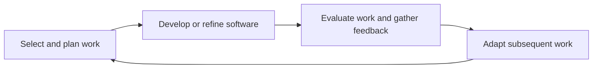
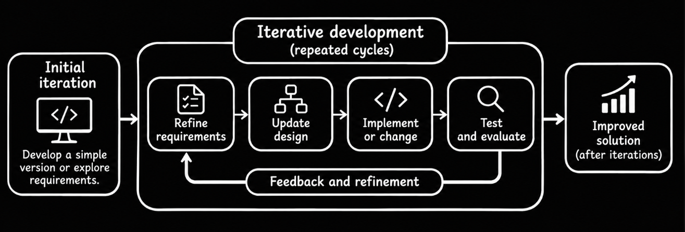
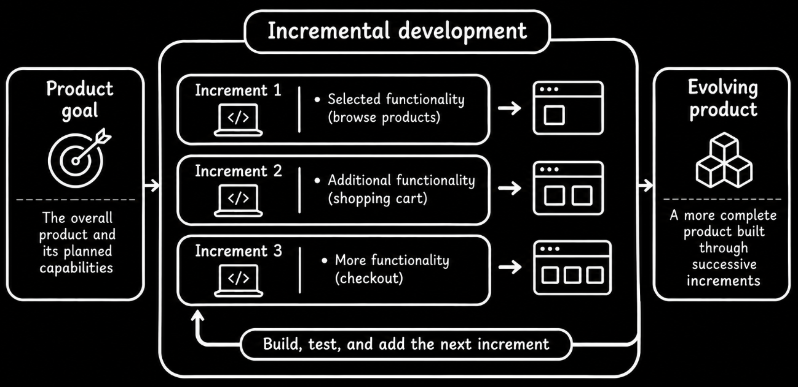

# Level 1

## Table of Contents: Iterative, Incremental, and Agile Approaches

- [How Iterative, Incremental, and Agile Approaches Organize Work](#how-iterative-incremental-and-agile-approaches-organize-work)
- [Iterative Development](#iterative-development)
- [Incremental Development](#incremental-development)
- [Agile Software Development](#agile-software-development)
- [Comparing Iterative, Incremental, and Agile Approaches](#comparing-iterative-incremental-and-agile-approaches)

**Iterative, Incremental, and Agile Approaches Level 1** explains how development work can be organized through repeated cycles, the gradual addition of functionality, and adaptation based on feedback. It examines **Iterative Development** and how a solution is refined over successive iterations, followed by **Incremental Development** and how functionality is built in increments. It then introduces **Agile Software Development** and its emphasis on collaboration, feedback, and responding to change. Finally, it compares these approaches and explains how they can be used together.

## How Iterative, Incremental, and Agile Approaches Organize Work

**Iterative, incremental, and Agile approaches** provide ways to organize development around repeated activities, smaller portions of functionality, and feedback. Requirements, design, implementation, and testing remain relevant, but teams can organize these activities across successive cycles or portions of work rather than relying on a single progression for the entire product. The following diagram illustrates a general feedback pattern that teams can use when combining these approaches, rather than a prescribed lifecycle for every iterative, incremental, or Agile project.

**Iterative development** emphasizes refining a solution through repeated cycles, while **incremental development** emphasizes adding functionality in successive portions. These approaches can be used separately or together. **Agile software development** is guided by values and principles that emphasize collaboration, working software, feedback, and responding to change. Agile teams commonly use both iterative and incremental development to support these goals.

Testing helps teams evaluate their work and decide what to do next. Reviews and test preparation can begin as relevant work products become available, while dynamic tests can be executed when the software and testing prerequisites are ready. The findings provide feedback for subsequent development and testing activities. The following sections examine how each approach organizes this work, beginning with **Iterative Development** and how repeated cycles support the refinement of a solution.

## Iterative Development

**Iterative development** organizes development into repeated cycles called **iterations**, in which a team develops, evaluates, and refines a solution. An initial iteration may produce a simple or incomplete version that helps the team explore requirements or assess a design. Subsequent iterations use what the team has learned to revise earlier decisions and refine the solution as understanding develops. The following diagram illustrates how evaluation and feedback can guide refinement across iterations.

Each iteration includes the development and testing activities relevant to its objectives. Teams may clarify requirements, revise designs, implement changes, and evaluate the results. Although the diagram presents these activities in a sequence, they can overlap or be revisited within an iteration. **Testing provides feedback** about the quality of the work, helping the team identify defects, assess whether relevant requirements are met, and determine where further refinement may be needed.

The findings from an iteration help the team decide what to address next, whether that means revisiting a design, improving existing functionality, or exploring a requirement further. An iteration therefore does not necessarily add functionality or produce a release. This emphasis on refinement distinguishes iterative development from **Incremental Development**, which focuses on adding functionality in successive portions. Teams can also combine the two approaches, as the following section will explain.

## Incremental Development

**Incremental development** organizes development into successive portions of functionality called **increments**, each of which adds to the capabilities of the product. A team develops an initial set of capabilities and extends the product by integrating additional functionality through subsequent increments. For example, an initial increment of an online shop might allow customers to browse products, while later increments add a shopping cart and checkout functionality. The following diagram illustrates how these increments contribute to an evolving product.

Each increment includes the development and testing activities needed to add the selected functionality and integrate it with the existing product. Testing evaluates both the new capabilities and their effect on what has already been developed. For example, when the shopping cart is added, tests can check whether customers can select a product from the catalogue and add it to the cart. **Integration testing** can evaluate interactions between the new and existing parts, while **regression testing** can help detect unintended effects on existing functionality. Test findings can guide corrections and inform subsequent work.

An increment adds functionality, but it does not necessarily result in a separate release to users. Teams may release an increment when it is ready or combine several increments into a release. Incremental development can also be combined with **iterative development** when teams refine existing capabilities while adding new ones. The following section introduces **Agile Software Development** and examines how its values and principles can guide teams using these approaches.

## Agile Software Development

**Agile software development** is an approach guided by the values and principles of the [Manifesto for Agile Software Development](https://agilemanifesto.org/), published in 2001 and commonly called the **Agile Manifesto**. Its four values place greater emphasis on people and their interactions, working software, collaboration with customers, and responding to change than on processes and tools, comprehensive documentation, contract negotiation, and following a plan. Agile recognizes value in all of these elements rather than rejecting those given less emphasis.

The [12 principles behind the Agile Manifesto](https://agilemanifesto.org/principles.html) explain how these values guide software development. The following table summarizes each principle in its original order.

| Principle                     | Explanation                                                                                                                   |
| ----------------------------- | ----------------------------------------------------------------------------------------------------------------------------- |
| **1. Customer value**         | Prioritize customer satisfaction by delivering valuable software early and continuing to deliver value throughout development.|
| **2. Changing requirements**  | Welcome changes to requirements, including late changes, when they can benefit the customer.                                  |
| **3. Frequent delivery**      | Deliver working software regularly, favouring shorter delivery intervals.                                                     |
| **4. Daily collaboration**    | Business representatives and developers work together throughout the project on a daily basis.                                |
| **5. Motivated individuals**  | Give motivated people the support, environment, and trust they need to accomplish the work.                                   |
| **6. Direct communication**   | Prefer face-to-face conversation as an effective way to communicate information within a development team.                    |
| **7. Measuring progress**     | Use working software as the main evidence of development progress.                                                            |
| **8. Sustainable pace**       | Organize development so that everyone involved can maintain the pace over the long term.                                      |
| **9. Technical excellence**   | Maintain attention to technical quality and good design to support the ability to adapt.                                      |
| **10. Simplicity**            | Avoid unnecessary work and focus effort on what is needed.                                                                    |
| **11. Self-organizing teams** | Enable teams to organize their work and contribute to the emergence of effective requirements, architectures, and designs.    |
| **12. Regular improvement**   | Reflect regularly on how the team works and adjust its practices to become more effective.                                    |

Agile does not prescribe a single development model, framework, or set of practices. Teams commonly combine **iterative development** to refine a solution with **incremental development** to add capabilities. For example, a team developing an online shop might make a basic product catalogue available to customers, gather feedback, and use what it learns to decide whether to improve the catalogue or add a shopping cart. Agile values and principles guide how the team makes these decisions and collaborates with stakeholders, rather than determining a fixed sequence of development activities.

Testing supports Agile development by providing timely information about software quality and risks. Testers, developers, and other team members can collaborate to clarify requirements, establish acceptance criteria, and identify test conditions before implementation begins. They can then select appropriate testing activities as the work progresses. For example, feedback about confusing product filters might lead the team to clarify the expected behaviour and evaluate a revised design, while tests of the implemented filters can reveal defects. Test findings and stakeholder feedback provide complementary information for deciding what to address next.

Agile therefore involves more than repeating development activities or adding functionality in portions. Its values and principles guide how teams work together, deliver value, and adapt as they learn. The following section compares **Iterative, Incremental, and Agile Approaches** and explains how their distinct emphases can complement one another.

## Comparing Iterative, Incremental, and Agile Approaches

**Iterative development**, **incremental development**, and **Agile software development** have distinct but complementary emphases. Iterative and incremental development describe ways of organizing development work, while Agile provides values and principles that guide how teams approach that work. The following table compares their characteristics.

| Aspect                      | Iterative development                       | Incremental development                                                         | Agile software development                                                                     |
| --------------------------- | ------------------------------------------- | ------------------------------------------------------------------------------- | ---------------------------------------------------------------------------------------------- |
| **Primary emphasis**        | Refining a solution through repeated cycles | Adding functionality in successive portions                                     | Guiding development through values and principles                                              |
| **Progress**                | The solution is evaluated and refined       | The product gains additional capabilities                                       | Working software is the primary measure of progress                                            |
| **Feedback**                | Informs further refinement                  | Can influence later increments                                                  | Supports collaboration and adaptation throughout development                                   |
| **Testing**                 | Evaluates refinements and their effects     | Evaluates added capabilities and their interactions with existing functionality | Emphasizes timely quality feedback and collaboration throughout development                    |
| **Relationship to releases**| An iteration need not produce a release     | An increment need not be released separately                                    | Encourages frequent delivery of valuable software without prescribing a fixed release schedule |

A team can combine all three approaches when developing the same product. For example, an online shop team might add a shopping cart as an **increment**, then refine how customers update quantities over several **iterations**. The team may also apply **Agile values and principles** by collaborating with stakeholders, using feedback to adjust priorities, and delivering working software frequently. Testing can evaluate the new cart functionality, its interaction with the product catalogue, and the effects of subsequent refinements.

These approaches are therefore not mutually exclusive, and using iterations or increments does not by itself make development Agile. Building on this comparison, [Iterative, Incremental, and Agile Approaches Level 2](../2_level/2_iterative_incremental_agile_approaches.md) examines how teams plan, prepare, perform, and adapt testing as software evolves, functionality is added, and feedback becomes available.
