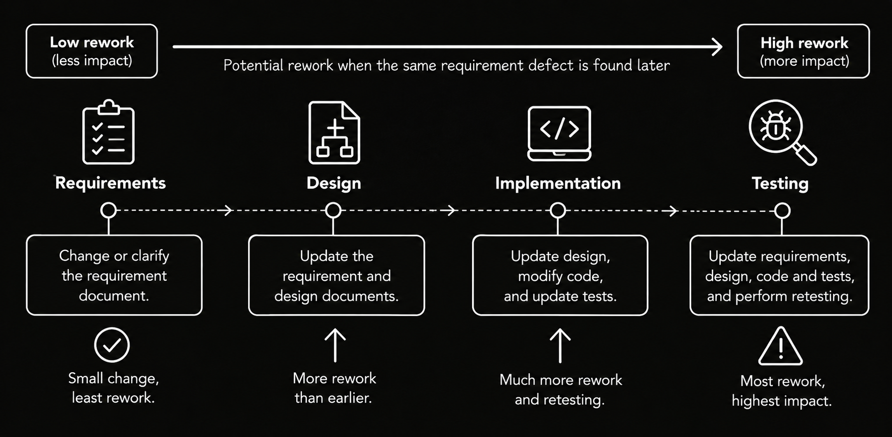
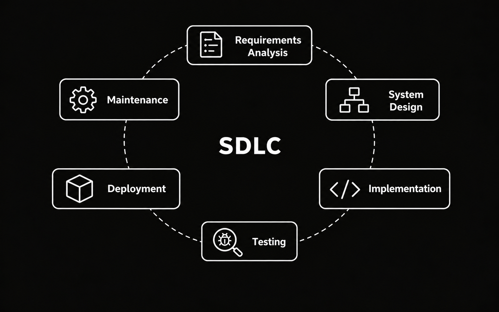
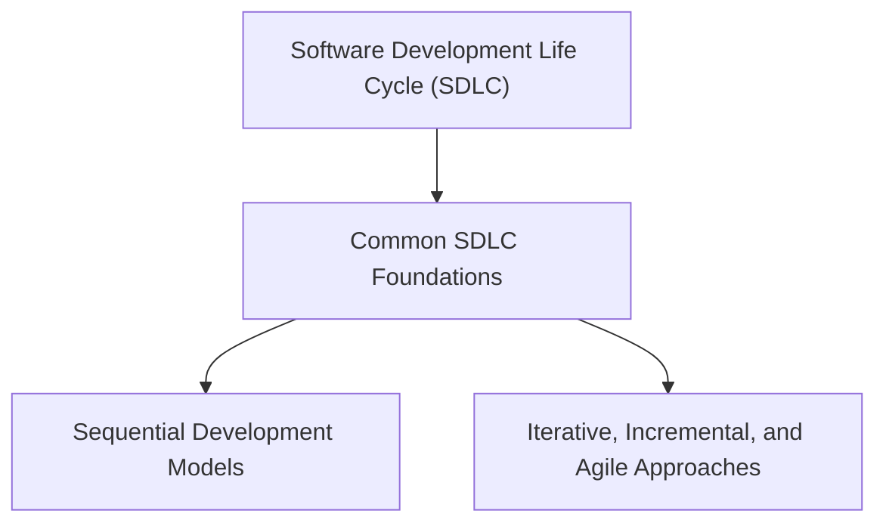

# Overview

In the early years of computing, particularly during the **1950s and 1960s**, software was often developed for specific machines and specialized purposes. Programs were generally smaller than many modern software systems, and development frequently depended on individual programmers or small teams. As computers became more widely used in business, science, and government, software systems grew in size and complexity, making development increasingly difficult to organize and manage.

By the **late 1960s**, these challenges had become a major concern. Software projects encountered delays, rising costs, unreliable results, and difficulties managing requirements. These problems contributed to discussions about the **software crisis**, reflecting concerns about the ability to develop increasingly complex software reliably. An influential contribution came in **1970**, when **Winston W. Royce** published *Managing the Development of Large Software Systems*. His paper examined how large software projects could be organized into development stages and discussed the risks of relying on a strictly sequential process, emphasizing the importance of feedback, early design, and testing **(Royce, 1970)**.

The **Software Development Life Cycle (SDLC)** developed through broader efforts to organize software development into understandable and manageable activities. Rather than treating software creation primarily as a programming task, SDLC provides a framework for coordinating requirements, design, implementation, testing, deployment, and maintenance. Although some software engineering references distinguish the development lifecycle from the broader **software product lifecycle**, which also includes operation, support, evolution, and eventual retirement, this module uses SDLC in its commonly understood, broader sense. Building on the [Software Testing introduction](../index.md) and [Fundamentals of Testing](../fundamentals_of_testing/overview.md), it explains how development activities relate to one another, how testing contributes throughout the lifecycle, and how different approaches organize the work involved.

Organizing these activities also creates opportunities to identify problems before they affect later work. For example, an unclear requirement discovered during a requirements review may only require updating the specification. If the same problem is discovered after implementation, the team may need to revise the design, modify the code, update test cases, and repeat affected tests. Although the effort depends on the defect and project context, identifying problems early can reduce unnecessary rework.

The diagram illustrates how discovering defects later can increase rework, rather than a fixed cost relationship that applies to every defect or project.

To understand how development work is organized, it is useful to examine six common SDLC activities. **Requirements analysis** identifies stakeholder needs, **system design** defines the solution, and **implementation** develops the software. **Testing** evaluates software and related work products to identify defects and provide information about quality. **Deployment** makes the software available in its intended environment, while **maintenance** involves correcting, adapting, and improving it after release.

These activities provide a conceptual overview rather than a mandatory sequence. Depending on the development approach, they may occur as distinct stages, overlap, or repeat as the software evolves. **SDLC phases describe what activities are performed**, whereas **development models describe how those activities are organized and connected**.

Throughout development, teams produce **deliverables** that document decisions, communicate progress, or support subsequent work. Examples include requirements specifications, design documents, software builds, test results, and released versions. Teams may also establish **entry criteria** to determine when an activity is ready to begin and **exit criteria** to determine when it is sufficiently complete. These criteria help teams assess readiness, evaluate completion, and decide how work should proceed. Their specific application to testing is explained further in [Test Management](../test_management/overview.md).

Testing contributes to these activities even before executable software is available. As introduced in [Fundamentals of Testing](../fundamentals_of_testing/overview.md), teams can examine requirements, designs, and other work products to identify unclear expectations, inconsistencies, and potential defects. Test planning and test design can also begin at this stage, preparing tests for later execution. Once executable software becomes available, teams can evaluate its behavior by comparing actual results with expected results, examining individual components, interactions between components, and the complete system.

Testing also continues during deployment and maintenance, when changes may require evaluating affected functionality and checking whether existing behavior has been unintentionally altered. These activities help teams identify defects, assess quality, and make informed decisions as software evolves.

Although SDLC activities are common across software projects, they can be organized in different ways. **Sequential development models** emphasize defined phases and planned transitions between activities. In contrast, **iterative, incremental, and Agile approaches** support repeated development activities, gradual delivery, and adaptation to feedback and changing requirements. These approaches differ in their principles and practices. The following diagram illustrates how this module organizes them around common SDLC foundations.

The common SDLC foundations are introduced in this overview, while the two groups of development approaches are explored in separate modules. [**Sequential Development Models**](./sequential_development_models/overview.md) examines structured development approaches, while [**Iterative, Incremental, and Agile Approaches**](./iterative_incremental_agile_approaches/overview.md) explores development through repeated cycles, gradual delivery, and adaptation. Neither branch is a prerequisite for the other, and both build on the same understanding of software development and testing throughout the lifecycle.
