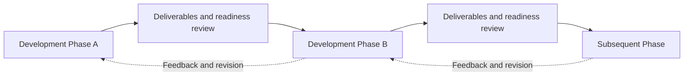
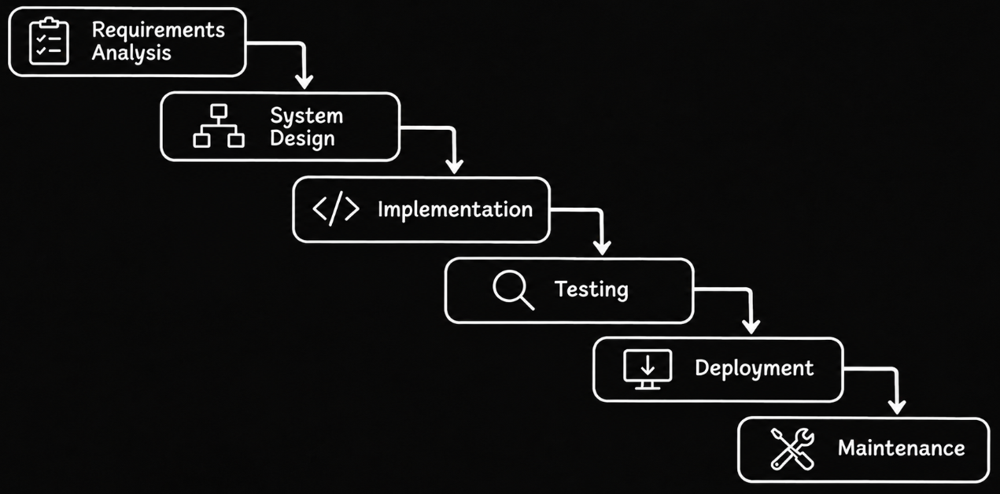
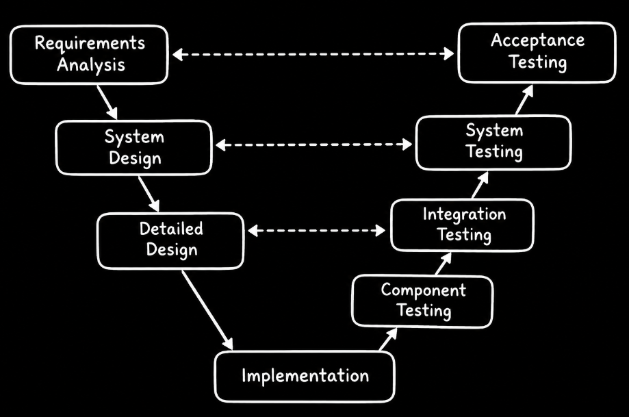

# Level 1

## Table of Contents: Sequential Development Models

- [How Sequential Development Models Organize Work](#how-sequential-development-models-organize-work)
- [Waterfall Model](#waterfall-model)
- [V-Model](#v-model)
- [Comparing Waterfall and V-Model](#comparing-waterfall-and-v-model)

**Sequential Development Models Level 1** explains how work progresses through defined development phases and how deliverables, phase transitions, and feedback connect those phases. It examines the **Waterfall Model** and how testing is organized within its development process, followed by the **V-Model** and the relationship between development activities and corresponding test planning, design, and execution. Finally, it compares how the two models represent development, testing, and feedback.

## How Sequential Development Models Organize Work

**Sequential development models** organize development activities into defined phases with a planned progression between them. Work products from one phase provide a basis for subsequent activities, creating dependencies between requirements, design, implementation, and testing. At **phase transitions**, teams may review deliverables against relevant completion criteria to assess readiness to proceed. The following diagram illustrates this progression, with solid arrows showing the planned flow of work and dashed arrows showing feedback that may require earlier work to be revised.

Planned progression does not prevent **feedback and revision**. For example, a problem discovered during implementation may require a design change, prompting the team to assess which dependent work products and activities need to be updated or repeated. Testing contributes to this feedback throughout development: requirements and designs can be reviewed, and tests can be prepared as relevant work products become available. Dynamic test execution requires the relevant software and testing prerequisites, and its results may also reveal a need to revise earlier work.

The following sections examine two sequential models, beginning with the **Waterfall Model**, which emphasizes progression through development phases, and then the **V-Model**, which makes the relationships between development activities and corresponding testing activities more explicit.

## Waterfall Model

The **Waterfall Model** organizes software development as a planned progression through defined phases. In its simplified linear representation, each phase is completed before the next begins, and its deliverables provide a basis for subsequent work. Agreed requirements guide system design, the design guides implementation, and the resulting software undergoes a dedicated testing phase before deployment. Maintenance addresses corrections and other changes after release. The following diagram illustrates this progression through six common SDLC activities.

Although the diagram shows **testing as a separate phase after implementation**, testing activities can begin earlier: requirements and designs can be reviewed, and tests can be prepared before executable software is available. The diagram also omits **feedback and revision** that may be necessary when defects or changes affect earlier work. Waterfall’s defined phases provide a straightforward structure for planning responsibilities, deliverables, and milestones, particularly when requirements are stable and well understood. However, feedback about the integrated software may arrive relatively late, and revising earlier decisions can require substantial rework in dependent phases.

While Waterfall emphasizes how work progresses from one development phase to the next, it does not explicitly show how testing relates to each phase. The next section examines the **V-Model**, which makes these relationships more visible by connecting development activities with corresponding testing activities.

## V-Model

The **V-Model** is a sequential development model that explicitly relates development activities to corresponding testing activities. It is commonly represented by the letter V, with requirements and design activities descending along the left side, implementation at the bottom, and levels of dynamic testing ascending along the right side. This structure emphasizes that test planning and design can begin alongside the development activities that produce the relevant test basis. The following diagram illustrates the development progression and selected relationships between development activities and test levels.

The dashed connections across the V illustrate how development work products provide a **test basis** for corresponding testing activities. Stakeholder requirements provide a basis for acceptance testing, while system specifications support system testing. Architecture and interface specifications help guide integration testing, and detailed component designs can support component testing. These relationships are not exclusive, as a test level may use several work products as its test basis. By considering testing as these work products become available, teams can identify test conditions, establish expected results, and prepare tests before the relevant software is executable. This supports **traceability** between development work products and tests, while dynamic test execution begins when the relevant software and testing prerequisites are available.

The concepts discussed in [Fundamentals of Software Quality on Verification and Validation](../../../quality_fundamentals/fundamentals_of_software_quality/fundamentals_of_software_quality.md) also apply to the V-Model. Reviews of development work products can support verification, while acceptance testing can provide evidence for validation. However, neither concept is exclusive to one side of the V. Like Waterfall, the V-Model uses a predominantly sequential structure, but it makes the relationships between development and testing more explicit to encourage early test preparation. The following section compares how the two models organize development and testing.

## Comparing Waterfall and V-Model

Both the **Waterfall Model** and the **V-Model** organize development through defined phases in a predominantly sequential progression. Their main distinction is how they represent the relationship between development and testing. Waterfall emphasizes the planned progression of development phases, while the V-Model makes the relationships between development work products and corresponding test levels more explicit. The following table summarizes these characteristics.

| Aspect                      | Waterfall Model                                                                               | V-Model                                                                                                 |
|-----------------------------|-----------------------------------------------------------------------------------------------|---------------------------------------------------------------------------------------------------------|
| **Development progression** | Represents development as a planned sequence of phases.                                       | Represents development activities descending toward implementation and test levels ascending from it.   |
| **Testing organization**    | Commonly represents testing as a dedicated phase after implementation.                        | Explicitly relates development activities and their work products to corresponding test levels.         |
| **Early testing**           | Reviews, test planning, and test design can begin as relevant work products become available. | The relationships across the V emphasize preparing tests alongside the relevant development activities. |
| **Traceability**            | Relationships between requirements, other work products, and tests can be established.        | The model makes relationships that support traceability more explicit.                                  |
| **Feedback and revision**   | Findings may require earlier phases and dependent work products to be revisited.              | Findings may require development work products and corresponding tests to be revised.                   |

These differences concern how the models represent development and testing rather than whether early testing is possible or which model guarantees better quality. In both models, teams must plan, perform, and evaluate testing according to the project context. Building on this comparison, [Sequential Development Models Level 2](../2_level/2_sequential_development_models.md) examines how that work is organized in practice, from planning and using development work products as a test basis through test preparation, execution, feedback, and completion.
