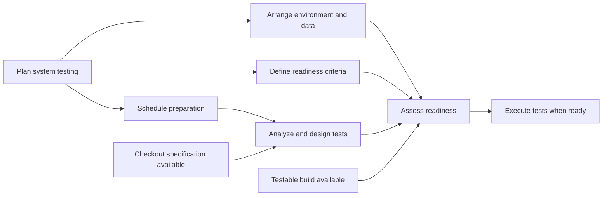

# Level 2

## Table of Contents: Sequential Development Models

- [Planning Testing Alongside Development Activities](#planning-testing-alongside-development-activities)
- [Using Development Work Products as a Test Basis](#using-development-work-products-as-a-test-basis)
- [Preparing and Executing Tests](#preparing-and-executing-tests)
- [Handling Defects, Changes, and Feedback](#handling-defects-changes-and-feedback)
- [Evaluating Test Completion and Handover](#evaluating-test-completion-and-handover)

**Sequential Development Models Level 2** examines how teams organize and carry out testing within Waterfall and the V-Model. It follows testing from early planning and the use of requirements and design work products as a test basis through test preparation and execution. It also examines how defects and changes affect planned work, and how test results, outstanding risks, and completion criteria support decisions about readiness for handover.

## Planning Testing Alongside Development Activities

In **sequential development models**, test planning can begin while requirements and designs are being developed, before executable software is available. Teams can define test objectives, identify product risks, estimate testing effort, and plan the people, environments, and other resources they will need. Planning at this stage also helps teams arrange reviews of development work products and prepare for later testing activities.

The **test plan** establishes the scope and approach for testing and coordinates testing activities with development milestones and dependencies. For example, a team planning system testing for an online shop may use the expected availability of the checkout specification to schedule test analysis and design. It can also arrange a suitable test environment and test data in advance, identify checkout risks that deserve particular attention, and establish criteria for assessing readiness to begin execution. The following diagram illustrates how this preparation can proceed alongside development while test execution depends on a testable build and the other required prerequisites.

In **Waterfall**, the team can plan reviews and test preparation alongside the relevant development phases, even if the main system test execution period is scheduled after implementation. In the **V-Model**, the team can use the relationships between development activities and test levels to plan the corresponding testing work as requirements and designs become available. In both models, the plan may need to change as risks, estimates, dependencies, or schedules change. A delayed build, for example, may require the team to revise its execution schedule without stopping test preparation that can still proceed.

Planning therefore requires the team to identify which development work products testing will depend on and when those work products are expected to become available. The following section examines **Using Development Work Products as a Test Basis** and explains how their content guides test analysis and design.

## Using Development Work Products as a Test Basis
