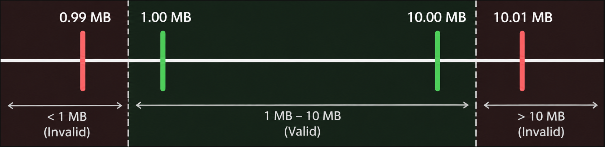

# Black-Box Testing Techniques

## Table of Contents: Black-Box Testing Techniques

- [Equivalence Partitioning](#equivalence-partitioning)
- [Boundary Value Analysis](#boundary-value-analysis)
- [Decision Table Testing](#decision-table-testing)
- [State Transition Testing](#state-transition-testing)
- [Use Case Testing](#use-case-testing)

**Black-box testing techniques** are systematic methods for designing test cases based on the specified or expected behavior of software, without requiring knowledge of its internal implementation. They use requirements, specifications, business rules, and other information from the **test basis** to identify test conditions, select test data, and determine expected results. These techniques help testers select meaningful tests and evaluate how well the expected behavior has been covered without attempting to test every possible situation **(ISTQB, 2024, Section 4.2)**.

Black-box techniques can be applied at different **test levels**, including component, integration, system, and acceptance testing. This chapter introduces five techniques: **Equivalence Partitioning**, **Boundary Value Analysis**, **Decision Table Testing**, **State Transition Testing**, and **Use Case Testing**. Each provides a structured approach to designing tests for different aspects of software behavior, with the choice depending on the testing objectives, available information, and risks. The discussion begins with **Equivalence Partitioning**, which focuses on selecting representative test cases from groups of inputs or conditions expected to behave similarly.

## Equivalence Partitioning

**Equivalence Partitioning (EP)** is a **black-box testing technique** that divides input data or other test conditions into groups expected to be processed in the same way. These groups are called **equivalence partitions** or **equivalence classes**. Rather than testing every possible value, testers select representative values from each identified partition, reducing the number of test cases while maintaining systematic coverage of the defined partitions. Partitions may be **valid**, containing values that satisfy the requirements, or **invalid**, containing values that violate them (ISTQB, 2024, Section 4.2.1).

For example, consider an online registration system that accepts an age between `13` and `100`, inclusive. The input can be divided into three equivalence partitions: values below the permitted range, values within the range, and values above it. Each partition represents a different expected outcome, allowing one representative value to be selected for testing, as shown in the following table.

| Test Case ID | Equivalence Partition | Test Input | Expected Outcome      |
|--------------|-----------------------|------------|-----------------------|
| TCID-001     | Age below `13`        | `10`       | Registration rejected |
| TCID-002     | Age from `13` to `100`| `30`       | Registration accepted |
| TCID-003     | Age above `100`       | `110`      | Registration rejected |

These test cases cover the three identified age partitions without testing every possible age. However, partition coverage does not guarantee that every value behaves correctly, and additional tests may be needed to investigate particular risks or boundary conditions.

Equivalence Partitioning also applies when a **single input has multiple validation rules**. For example, suppose a username must contain between `5` and `10` characters and begin with a letter. The length and format requirements can be partitioned separately, with representative values selected for each valid and invalid partition. When evaluating one rule, the other applicable conditions should remain valid wherever possible so that the result can be associated with the partition being tested. The following table combines these requirements into one set of test cases.

| Test Case ID | Validation Rule | Equivalence Partition         | Test Input        | Valid/Invalid | Expected Outcome  |
|--------------|-----------------|-------------------------------|-------------------|---------------|-------------------|
| TCID-004     | Length          | `5–10` characters             | `user123`         | Valid         | Username accepted |
| TCID-005     | Length          | Fewer than `5` characters     | `abc`             | Invalid       | Username rejected |
| TCID-006     | Length          | More than `10` characters     | `username123`     | Invalid       | Username rejected |
| TCID-007     | Format          | Starts with a letter          | `user123`         | Valid         | Username accepted |
| TCID-008     | Format          | Does not start with a letter  | `1user23`         | Invalid       | Username rejected |
| TCID-009     | Input type      | Non-string input              | `123456` (number) | Invalid       | Username rejected |

When a system processes **multiple inputs**, the same principle can be extended to each field. Consider a registration form containing a username, age, and password. Each field has its own validation requirements, and the resulting partitions can be used to design tests for the complete form. A practical approach is to begin with valid values for all fields and then change one field at a time to exercise its invalid partitions while keeping the remaining inputs valid. The following example uses the previously defined username and age requirements and assumes that the password must contain at least eight characters.

| Test Case ID | Username  | Age   | Password   | Partition Being Tested     | Expected Outcome      |
|--------------|-----------|-------|------------|----------------------------|-----------------------|
| TCID-010     | `user123` | `25`  | `Passw0rd` | All fields valid           | Registration accepted |
| TCID-011     | `abc`     | `25`  | `Passw0rd` | Invalid username length    | Registration rejected |
| TCID-012     | `1user23` | `25`  | `Passw0rd` | Invalid username format    | Registration rejected |
| TCID-013     | `user123` | `10`  | `Passw0rd` | Invalid age below minimum  | Registration rejected |
| TCID-014     | `user123` | `110` | `Passw0rd` | Invalid age above maximum  | Registration rejected |
| TCID-015     | `user123` | `25`  | `Pass1`    | Invalid password length    | Registration rejected |

This approach allows testers to cover the identified partitions across several fields without examining every possible combination of values. Keeping the other fields valid helps isolate the requirement being tested, although additional cases may be necessary when fields depend on one another or when further partitions are identified.

Equivalence Partitioning is particularly useful when requirements define clear categories, ranges, or validation rules. It helps testers select a manageable set of representative test cases, but it does not specifically examine the values at which behavior changes between partitions. These boundaries may contain defects that representative values do not reveal, which leads to **Boundary Value Analysis**, a technique focused on testing values at and around those limits.

## Boundary Value Analysis

**Boundary Value Analysis (BVA)** is a **black-box testing technique** that focuses on values at and around the boundaries of ordered equivalence partitions. While Equivalence Partitioning groups inputs according to expected behavior, Boundary Value Analysis examines the points where that behavior changes. These boundaries are particularly important because defects such as incorrect comparisons and off-by-one errors often occur near minimum and maximum limits. The technique is commonly applied to ordered inputs, including numerical values, dates, and lengths, where neighboring values can be identified (ISTQB, 2024, Section 4.2.2).

Two common approaches are **2-value Boundary Value Analysis (2-value BVA)** and **3-value Boundary Value Analysis (3-value BVA)**. Both use boundaries identified through Equivalence Partitioning, but they differ in how many values are selected around each boundary. In **2-value BVA**, testing focuses on the boundary value and its closest neighboring value from the adjacent partition. This verifies whether the system correctly distinguishes between values on either side of a boundary, as illustrated in the following diagram.



For example, consider a file upload system that accepts files between `1 MB` and `10 MB`, inclusive. Assuming file sizes are evaluated in increments of `0.01 MB`, the lower boundary separates rejected files below `1 MB` from accepted files at or above that limit. Similarly, the upper boundary separates accepted files at or below `10 MB` from rejected files above it. The following test cases examine both sides of these boundaries.

| Test Case ID | Boundary             | Test Value | Valid/Invalid | Expected Outcome |
|--------------|----------------------|------------|---------------|------------------|
| TC001        | Below lower boundary | `0.99 MB`  | Invalid       | Upload rejected  |
| TC002        | At lower boundary    | `1.00 MB`  | Valid         | Upload accepted  |
| TC003        | At upper boundary    | `10.00 MB` | Valid         | Upload accepted  |
| TC004        | Above upper boundary | `10.01 MB` | Invalid       | Upload rejected  |

These test cases verify whether the system applies the correct acceptance and rejection rules at both limits. The neighboring values must reflect the precision supported by the system, since a file size measured in bytes would require different test values from one measured in decimal increments.

While **2-value BVA** examines values on either side of a boundary, **3-value Boundary Value Analysis (3-value BVA)** provides more detailed coverage by selecting three values around each boundary. These include the value immediately below the boundary, the boundary itself, and the value immediately above it. This approach helps reveal defects involving incorrect comparisons or unexpected behavior near the limits, as illustrated in the following diagram.


For example, consider an internal banking application in which transaction processing depends on the transaction amount. Transactions below `100` are rejected, transactions from `100` through `10,000` are processed normally, and transactions above `10,000` require additional approval. These rules create two boundaries where the expected behavior changes. Assuming transaction amounts are whole numbers, the following test cases examine the values immediately below, at, and above each boundary.

| Test Case ID | Boundary             | Test Value | Expected Outcome               |
|--------------|----------------------|------------|--------------------------------|
| TC001        | Below lower boundary | `99`       | Transaction rejected           |
| TC002        | At lower boundary    | `100`      | Transaction processed normally |
| TC003        | Above lower boundary | `101`      | Transaction processed normally |
| TC004        | Below upper boundary | `9,999`    | Transaction processed normally |
| TC005        | At upper boundary    | `10,000`   | Transaction processed normally |
| TC006        | Above upper boundary | `10,001`   | Additional approval required   |

These test cases verify that the application applies the correct business rules immediately before, at, and after each threshold. If transaction amounts support decimal values, the neighboring test values should instead reflect the smallest permitted increment, such as `0.01`.

Boundary Value Analysis complements **Equivalence Partitioning** by examining the limits between partitions rather than relying only on representative values from within them. Together, these techniques help testers cover both general input behavior and the points where defects are more likely to occur. However, some systems determine outcomes through combinations of conditions rather than ordered input ranges. Such behavior can be examined using **Decision Table Testing**, which organizes conditions and their corresponding actions into a structured set of rules.

## Decision Table Testing

Decision Table Testing is a black-box testing technique used to verify system behavior based on different combinations of input conditions and their corresponding outcomes.

In many systems, behavior is not determined by a single input value but by multiple conditions working together. When these conditions interact, the number of possible combinations increases, and it becomes difficult to ensure that all relevant scenarios are tested.

Instead of testing conditions individually, Decision Table Testing focuses on how combinations of conditions affect the final result.

To represent this clearly, a tabular structure is used where conditions and actions are mapped together. This structure is known as a decision table, and it provides a clear way to visualize how different inputs lead to specific outcomes.

Within this table, conditions represent the input variables that influence system behavior, while actions represent the resulting system responses. These are often expressed using a simple notation so that combinations can be easily understood.

Conditions are typically represented using Boolean values. A value of `T` indicates that a condition is satisfied, while `F` indicates that it is not.

In some cases, a condition does not influence the outcome for a specific combination. This is represented using a `–`, which means the value of that condition can be either true or false without affecting the result. It is used when the condition is irrelevant for that particular scenario.

There are also situations where a condition or action is not applicable at all. This is represented using `N/A`, which means that the condition or action does not belong to that scenario or cannot logically occur in that context.

Actions are represented in a similar simplified way. When an action is expected to occur for a given combination of conditions, it is marked with an `X`. When no mark is present, the action should not occur.

This notation makes it possible to describe complex logic in a structured and readable format, especially when multiple conditions interact.

Each row in the table represents a unique combination of conditions and becomes a separate test case. This ensures that all meaningful combinations are considered during testing.

For example, consider a loan approval system where the result depends on multiple factors such as credit score, income level, employment status, and loan amount.

Each combination of these conditions produces a different outcome.

| Test Case ID | Credit Score | Income Level | Employment Status | Loan Amount | Expected Result |
|--------------|--------------|--------------|-------------------|-------------|-----------------|
| TC001        | High         | High         | Employed          | Low         | Loan Approved   |
| TC002        | Low          | High         | Employed          | Low         | Loan Denied     |
| TC003        | High         | Low          | Employed          | High        | Loan Denied     |
| TC004        | High         | High         | Unemployed        | Low         | Loan Denied     |
| TC005        | High         | High         | Employed          | High        | Loan Approved   |
| TC006        | Low          | Low          | Unemployed        | High        | Loan Denied     |

Decision Table Testing is especially useful when system behavior depends on multiple conditions. It ensures that combinations are not missed and provides a clear representation of business rules.

At the same time, as the number of conditions increases, For example, 5 Boolean conditions produce 32 possible combinations. Testing all of them may not be practical. In such cases, techniques such as **pairwise testing** can be used to reduce the number of combinations while still covering the most important interactions between conditions. Pairwise testing ensures that every pair of input parameter values is covered at least once, significantly reducing the total number of tests needed.

Because of this, it is important to focus on meaningful and relevant combinations when designing test cases.

However, not all system behavior is defined only by combinations of inputs. In many cases, the behavior of the system depends on a sequence of events and how the system changes over time.

When the same input produces different results depending on the current state of the system, testing needs to consider these state changes and the transitions between them.

To handle this, testing focuses on how the system moves from one state to another based on specific events.

## State Transition Testing

State Transition Testing is a black-box testing technique used to verify how a system behaves as it moves between different states based on a sequence of events.

In some systems, the same input does not always produce the same result. The outcome depends on the current state of the system and how it has changed over time. Because of this, testing cannot focus only on inputs or combinations of conditions.

Instead, testing must consider how the system transitions from one state to another.

A **state** represents the condition of the system at a specific point in time. For example, a system may be idle, actively processing, or in an error condition. The system begins in an initial state and moves to other states as events occur.

```text
Idle: Not actively heating or cooling.

Heating: Actively increasing temperature.

Cooling: Actively decreasing temperature.

Energy-Saving: Operating with reduced intensity.

Error: A fault condition, such as sensor failure.
```

**Transitions** between states are triggered by events. These events can be user actions, system responses, or external inputs.

```text
Set Heating, Set Cooling, or Set Energy-Saving

Temperature Reached - The desired temperature is reached.

Error Detected and Reset to handle faults.
```

When a transition occurs, the system may also perform specific **actions**.

```text
Start Heating or Start Cooling

Enter Energy - Saving Mode

Display Error or Clear Error
```

A transition represents the movement from one state to another as a result of an event. For example, a system may move from an idle state to a heating state when a heating command is triggered.

To visualize this behavior, state diagrams are used. These diagrams show all possible states and the transitions between them.

In many systems, transitions are not restricted to a fixed order. The system can move between states depending on different independent events.

```text
[Idle] --(Set Heating)--> [Heating]
[Idle] --(Set Cooling)--> [Cooling]
[Idle] --(Set Energy-Saving)--> [Energy-Saving]

[Heating] --(Temperature Reached)--> [Idle]
[Heating] --(Error Detected)--> [Error]

[Cooling] --(Temperature Reached)--> [Idle]
[Cooling] --(Error Detected)--> [Error]

[Energy-Saving] --(Set Heating)--> [Heating]
[Energy-Saving] --(Set Cooling)--> [Cooling]
[Energy-Saving] --(Error Detected)--> [Error]

[Error] --(Reset)--> [Idle]
```

In other cases, the system follows a strict sequence where transitions must happen in a specific order. This is common in workflows where each step depends on the previous one.

```text
[Idle] --(Set Heating)--> [Heating]
[Heating] --(Temperature Reached)--> [Idle]
[Idle] --(Set Cooling)--> [Cooling]
[Cooling] --(Temperature Reached)--> [Idle]
```

To design test cases, this behavior can also be represented in a tabular form. A state table shows the current state, the event, the next state, and the action that should occur.

| Test Case ID | Current State | Event               | Next State | Action         |
|--------------|---------------|---------------------|------------|----------------|
| TC001        | Idle          | Set Heating         | Heating    | Start Heating  |
| TC002        | Heating       | Temperature Reached | Idle       | Stop Heating   |
| TC003        | Cooling       | Error Detected      | Error      | Display Error  |
| TC004        | Error         | Reset               | Idle       | Clear Error    |

Testing focuses on verifying that all states are reachable and that transitions behave correctly.

One important aspect is ensuring that valid transitions produce the correct result. It is also important to verify that invalid transitions are handled properly. For example, moving directly from an idle state to an error state without a triggering event should not be allowed. When an invalid transition is attempted, the system should either ignore the event, remain in the current state or display an appropriate error message.

| Test Case ID | Current State | Event          | Expected Behavior             | PASS/FAIL |
| ------------ | ------------- | -------------- | ----------------------------- | --------- |
| TC005        | Idle          | Error Detected | No transition; remain in Idle |           |
| TC006        | Error         | Set Heating    | No transition; display error  |           |

Coverage in this type of testing can focus on visiting all states, executing all valid transitions, and checking how the system handles invalid transitions.

State Transition Testing is especially useful for systems where behavior depends on sequences of actions or where the system changes over time. This includes workflows, interactive systems, and systems that react to external events.

While this technique focuses on how the system moves between internal states, testing can also be approached from the user's perspective by analyzing how users interact with the system to achieve specific goals.

This leads to **Use Case Testing**, which focuses on validating end-to-end user scenarios.

## Use Case Testing

**Use Case Testing** is a black-box testing technique that focuses on validating the system based on real user interactions and goals.

Instead of analyzing individual inputs or internal system states, this approach looks at how a user interacts with the system to complete a specific task. Each interaction is described as a **use case**, which represents a sequence of steps performed to achieve a meaningful outcome.

A **use case** typically describes how a user starts an interaction, what actions are performed, and what result is expected at the end. It reflects real-world usage and helps ensure that the system behaves correctly from the user’s perspective.

For example, a use case for an online application might describe how a user logs in, navigates through the system, performs an action, and logs out. The focus is not on individual inputs, but on the entire flow of interaction.

To understand how this works, consider a simple example of a login process.

**Main Success Scenario**.

```text
Use Case: User Login

Precondition: User has a registered account

1. User opens the application
2. User enters valid credentials
3. User submits the form
4. System validates the credentials
5. User is redirected to the dashboard

Postcondition: User session is active
```

**Alternative Flow - Invalid Credentials**.

```text
1. User opens the application
2. User enters invalid credentials
3. User submits the form
4. System validates the credentials
5. System displays an error message
6. User remains on the login page

Postcondition: User is not authenticated
```

**Alternative Flow - Account Locked**.

```text
1. User opens the application
2. User enters valid credentials after multiple failed attempts
3. User submits the form
4. System detects account is locked
5. System displays a lockout message with contact support option

Postcondition: User is not authenticated; account remains locked
```

In this scenario, testing verifies that the entire sequence works correctly from start to finish. If any step fails, the use case is considered unsuccessful. Each alternative flow represents a separate test case that must be executed to ensure complete coverage.

Use case testing is especially useful for validating end-to-end workflows, where multiple components and interactions are involved. It ensures that the system supports real user behavior and meets business requirements.

While other techniques focus on inputs, conditions, or internal logic, use case testing focuses on complete user journeys. This makes it valuable for identifying issues that may not appear when testing isolated parts of the system.

Because it reflects real usage, use case testing is often used in system testing and acceptance testing, where the goal is to confirm that the system works as expected in real-world scenarios.
