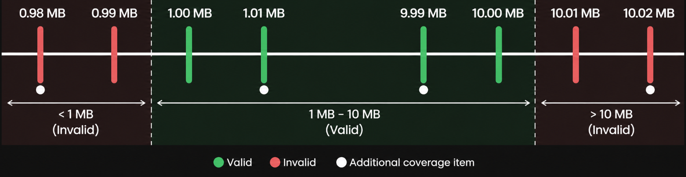

# Black-Box Testing Techniques

## Table of Contents: Black-Box Testing Techniques

- [Equivalence Partitioning](#equivalence-partitioning)
- [Boundary Value Analysis](#boundary-value-analysis)
- [Decision Table Testing](#decision-table-testing)
- [State Transition Testing](#state-transition-testing)
- [Use Case Testing](#use-case-testing)

**Black-box testing techniques** provide systematic approaches to designing test cases based on the specified or expected behavior of software without requiring knowledge of its internal implementation. Within **test case design**, these techniques help testers derive test conditions, select representative test data, determine expected results, and achieve defined coverage objectives using information from the **test basis** **(ISTQB, 2024, Section 4.2)**.

This chapter examines five black-box testing techniques. **Equivalence Partitioning**, **Boundary Value Analysis**, **Decision Table Testing**, **State Transition Testing**, and **Use Case Testing**. Each technique addresses different aspects of software behavior, and its suitability depends on the testing objectives, available information, and product risks. The discussion begins with **Equivalence Partitioning**, which provides a systematic approach to selecting representative values from groups expected to exhibit equivalent behavior.

## Equivalence Partitioning

**Equivalence Partitioning (EP)** is a **black-box testing technique** that divides data or other testable conditions into groups whose elements are expected to be processed in the same way. These groups are called **equivalence partitions** or **equivalence classes**. Partitions within the same partition set must not overlap and must contain at least one element. They may be **valid**, containing values or conditions expected to be accepted or processed as specified, or **invalid**, containing those expected to be rejected or handled as invalid. By selecting representative values from each partition rather than testing every possible value, testers can reduce the number of test cases while maintaining systematic partition coverage **(ISTQB, 2024, Section 4.2.1)**.


In Equivalence Partitioning, test conditions associated with specified system behavior are analyzed to identify **equivalence partitions** that serve as **coverage items**. Representative values are then selected from these partitions to derive test cases. When the identified partitions provide sufficient information for test case design and coverage evaluation, separately documenting test scenarios is not necessary. The relationship between test conditions, test scenarios, and test cases is discussed in [Test Design Fundamentals on Test Conditions and Test Scenarios](../test_design_fundamentals/#test-conditions-and-test-scenarios).

The simplest application of Equivalence Partitioning involves a **single input with a single validation rule**, where acceptance or rejection depends on one requirement. The possible input values are divided into partitions according to their expected behavior, and a representative value is selected from each partition.

!!! example "Single input with a single validation rule"

    Consider an online registration system that accepts an age expressed as a whole number between `13` and `100`, inclusive. Assuming only integer inputs are considered, three equivalence partitions can be identified based on whether the age falls below, within, or above the permitted range.

    | Test Case ID | Equivalence Partition  | Test Input | Valid/Invalid | Expected Outcome      |
    | ------------ | ---------------------- | ---------- | ------------- | --------------------- |
    | TCID-001     | Age below `13`         | `10`       | Invalid       | Registration rejected |
    | TCID-002     | Age from `13` to `100` | `30`       | Valid         | Registration accepted |
    | TCID-003     | Age above `100`        | `110`      | Invalid       | Registration rejected |

**Equivalence partition coverage** measures the proportion of identified equivalence partitions exercised by the tests. To achieve 100% equivalence partition coverage, every identified partition, including both valid and invalid partitions, must be exercised at least once. The broader concept of test coverage is discussed in [Test Management Level 3 on Test Coverage](../../test_managment/3_level/3_test_management.md#test-coverage). Coverage is calculated using the following formula.

$$
\text{EP Coverage} =
\frac{\text{Number of exercised partitions}}
{\text{Total number of identified partitions}}
\times 100\%
$$

In the age validation example, the three test cases are designed to cover all three identified equivalence partitions. Executing these test cases exercises all three partitions, resulting in 100% equivalence partition coverage ($3/3 \times 100\% = 100\%$).

!!! warning "Limitations of equivalence partition coverage"

    Achieving 100% equivalence partition coverage means that every identified partition has been exercised at least once. It does not mean that every possible input value has been tested, that all software behavior has been verified, or that the software is free of defects. This reflects the fundamental testing principles that **exhaustive testing is impossible** and **testing shows the presence, not the absence of defects**. Additional test cases may be necessary to address risks that are not adequately covered by the selected representative values.

When a **single input has multiple validation rules**, separate sets of equivalence partitions can be identified for each requirement. A single test case may exercise several valid partitions simultaneously, while invalid partitions can be tested individually by keeping the other applicable conditions valid wherever possible. This helps isolate the validation requirement being evaluated.

!!! example "Single input with multiple validation rules"

    Suppose a username must be a string containing between `5` and `10` characters and beginning with a letter. The input type, length, and format requirements are partitioned separately, as shown in the following table.

    | Validation Rule | Valid Partition      | Invalid Partitions                                   |
    | --------------- | -------------------- | ---------------------------------------------------- |
    | Input type      | String               | Non-string                                           |
    | Length          | `5–10` characters    | Fewer than `5` characters, more than `10` characters |
    | Format          | Begins with a letter | Does not begin with a letter                         |

    The length and format partitions apply to string inputs. Based on these partition sets, representative values can be selected and combined into test cases. The following table demonstrates how one valid test case can exercise multiple valid partitions, while separate test cases exercise the identified invalid partitions.

    | Test Case ID | Validation Rule            | Equivalence Partition                               | Test Input        | Valid/Invalid | Expected Outcome  |
    | ------------ | -------------------------- | --------------------------------------------------- | ----------------- | ------------- | ----------------- |
    | TCID-004     | Input type, length, format | String of `5–10` characters beginning with a letter | `user123`         | Valid         | Username accepted |
    | TCID-005     | Length                     | Fewer than `5` characters                           | `abc`             | Invalid       | Username rejected |
    | TCID-006     | Length                     | More than `10` characters                           | `username123`     | Invalid       | Username rejected |
    | TCID-007     | Format                     | Does not start with a letter                        | `1user23`         | Invalid       | Username rejected |
    | TCID-008     | Input type                 | Non-string input                                    | `123456` (number) | Invalid       | Username rejected |

!!! info "Input types and testing interfaces"

    The applicability of certain partitions depends on the interface being tested. A conventional browser text field normally provides its value as a string, whereas an **application programming interface (API)** may support different data types. Testing the non-string partition therefore requires an interface through which such values can be supplied.

When a system processes **multiple inputs with individual validation rules**, test cases must account for partitions across different fields rather than focusing on a single input. A practical approach is to establish a valid combination of inputs and then vary individual fields to exercise their invalid partitions while keeping the remaining fields valid wherever possible. This helps isolate individual validation requirements and reduces the possibility of one invalid input masking the behavior associated with another.

!!! example "Multiple inputs with individual validation rules"

    Consider a registration API that accepts a username, age, and password. In addition to the previously defined username and age requirements, assume that the password must contain at least eight characters. For this example, age inputs are limited to integers and password inputs to strings, with only password length being evaluated.

    | Test Case ID | Username          | Age   | Password   | Partition Being Tested        | Expected Outcome      |
    | ------------ | ----------------- | ----- | ---------- | ----------------------------- | --------------------- |
    | TCID-009     | `user123`         | `25`  | `Passw0rd` | All fields valid              | Registration accepted |
    | TCID-010     | `abc`             | `25`  | `Passw0rd` | Username below minimum length | Registration rejected |
    | TCID-011     | `username123`     | `25`  | `Passw0rd` | Username above maximum length | Registration rejected |
    | TCID-012     | `1user23`         | `25`  | `Passw0rd` | Invalid username format       | Registration rejected |
    | TCID-013     | `123456` (number) | `25`  | `Passw0rd` | Invalid username input type   | Registration rejected |
    | TCID-014     | `user123`         | `10`  | `Passw0rd` | Age below minimum             | Registration rejected |
    | TCID-015     | `user123`         | `110` | `Passw0rd` | Age above maximum             | Registration rejected |
    | TCID-016     | `user123`         | `25`  | `Pass1`    | Password below minimum length | Registration rejected |

When multiple sets of equivalence partitions are involved, **Each Choice coverage** requires every partition from each set to be exercised at least once, without requiring every possible combination of partitions to be tested. Both the username validation and registration examples demonstrate this approach across their defined partition sets by combining valid partitions in a single test case and exercising invalid partitions individually. Additional test cases may nevertheless be necessary when dependencies between inputs or specific combinations of values influence system behavior.

Although Equivalence Partitioning provides systematic coverage of identified partitions, representative values may not reveal defects occurring at the boundaries of ordered partitions. These boundaries are examined more closely through **Boundary Value Analysis**, which focuses on testing values at and around the limits of partitions.

## Boundary Value Analysis

**Boundary Value Analysis (BVA)** is a **black-box testing technique** that focuses on values at and around **Boundary Value Analysis (BVA)** is a **black-box testing technique** that examines values at and around the boundaries of ordered equivalence partitions, where defects such as incorrect comparisons and off-by-one errors frequently occur. It is applicable to numerical values, dates, lengths, and other ordered inputs for which boundary values and their neighbors can be identified **(ISTQB, 2024, Section 4.2.2)**.

A **boundary value** is a minimum or maximum value of an ordered equivalence partition. Where two partitions meet, each may have its own boundary value. For example, if an integer input accepts values from `1` to `10`, the upper boundary of the valid partition is `10`, while the lower boundary of the adjacent invalid partition is `11`.

During test design, boundary values and the neighboring values required by the selected BVA approach are identified as **coverage items**. Test cases can be derived directly from these items without separately documenting test scenarios. This relationship is discussed in [Test Design Fundamentals on Test Conditions and Test Scenarios](../test_design_fundamentals/#test-conditions-and-test-scenarios).

Two common approaches are **2-value BVA** and **3-value BVA**. They differ in which neighboring values are selected for each boundary value.

In **2-value BVA**, each boundary value and its closest neighbor in the adjacent partition are selected. This focuses testing on the transition between partitions with different expected behavior.

!!! example "2-value Boundary Value Analysis"

    A file upload system accepts files between `1 MB` and `10 MB`, inclusive, with sizes evaluated in increments of `0.01 MB`. This produces three ordered equivalence partitions consisting of files below the permitted range, files within it, and files above it.

    

    All values in the diagram are expressed in MB, and the diagram is not to scale. Applying 2-value BVA produces four distinct coverage items, from which the following test cases can be derived.

    | Test Case ID | Boundary Position  | Test Value | Valid/Invalid | Expected Outcome |
    |--------------|--------------------|------------|---------------|------------------|
    | TCID-001     | Just below minimum | `0.99 MB`  | Invalid       | Upload rejected  |
    | TCID-002     | Minimum            | `1.00 MB`  | Valid         | Upload accepted  |
    | TCID-003     | Maximum            | `10.00 MB` | Valid         | Upload accepted  |
    | TCID-004     | Just above maximum | `10.01 MB` | Invalid       | Upload rejected  |

In **3-value BVA**, the coverage items for each boundary value are the boundary value itself, its immediately preceding value, and its immediately succeeding value. This examines both sides of each partition boundary value rather than only the neighboring value in the adjacent partition. Coverage items shared by neighboring boundary values are counted only once. The approach can be applied independently and does not require testers to perform 2-value BVA first.

!!! example "3-value Boundary Value Analysis"

    Applying 3-value BVA to the same file upload requirements begins with the four partition boundary values `0.99 MB`, `1.00 MB`, `10.00 MB`, and `10.01 MB`. Each boundary value is considered together with its immediately preceding and succeeding values.

    | Boundary Value | Immediately Before | Boundary Itself | Immediately After |
    |----------------|--------------------|-----------------|-------------------|
    | `0.99 MB`      | `0.98 MB`          | `0.99 MB`       | `1.00 MB`         |
    | `1.00 MB`      | `0.99 MB`          | `1.00 MB`       | `1.01 MB`         |
    | `10.00 MB`     | `9.99 MB`          | `10.00 MB`      | `10.01 MB`        |
    | `10.01 MB`     | `10.00 MB`         | `10.01 MB`      | `10.02 MB`        |

    Several values appear more than once because the boundary values of adjacent partitions are neighbors. Removing these duplicates produces eight distinct coverage items, as illustrated in the following diagram.

    

    All values in the diagram are expressed in MB, and the diagram is not to scale. The complete set of test cases for 3-value BVA is shown below.

    | Test Case ID | Boundary Position            | Test Value | Valid/Invalid | Expected Outcome |
    |--------------|------------------------------|------------|---------------|------------------|
    | TCID-005     | Two increments below minimum | `0.98 MB`  | Invalid       | Upload rejected  |
    | TCID-001     | Just below minimum           | `0.99 MB`  | Invalid       | Upload rejected  |
    | TCID-002     | Minimum                      | `1.00 MB`  | Valid         | Upload accepted  |
    | TCID-006     | Just above minimum           | `1.01 MB`  | Valid         | Upload accepted  |
    | TCID-007     | Just below maximum           | `9.99 MB`  | Valid         | Upload accepted  |
    | TCID-003     | Maximum                      | `10.00 MB` | Valid         | Upload accepted  |
    | TCID-004     | Just above maximum           | `10.01 MB` | Invalid       | Upload rejected  |
    | TCID-008     | Two increments above maximum | `10.02 MB` | Invalid       | Upload rejected  |

    The four test cases from the 2-value example remain part of this set. If they have already been executed under applicable test conditions, only the four additional coverage items remain to be exercised.

!!! info "Input precision and neighboring values"

    Neighboring values depend on the smallest increment relevant to the specified behavior. Integer inputs normally differ by `1`, while the file upload example assumes an increment of `0.01 MB`. If the system validates exact file sizes in bytes, the tests should instead use the specified byte limits and their neighboring byte values. Display precision alone does not establish the increment used for validation.

**Boundary value coverage** measures the proportion of coverage items exercised for the selected approach. Coverage is calculated using the following formula.

$$
\text{BVA Coverage} =
\frac{\text{Number of exercised coverage items}}
{\text{Total number of identified coverage items}}
\times 100\%
$$

**Boundary value coverage** measures the proportion of coverage items exercised for the selected BVA approach. The broader concept of test coverage is discussed in [Test Management Level 3 on Test Coverage](../../test_managment/3_level/3_test_management.md#test-coverage). Coverage is calculated using the following formula.

In the file upload example, executing `TCID-001` through `TCID-004` achieves 100% 2-value BVA coverage ($4/4 \times 100\% = 100\%$) and 50% 3-value BVA coverage ($4/8 \times 100\% = 50\%$). Executing all eight test cases achieves 100% 3-value BVA coverage ($8/8 \times 100\% = 100\%$). Whether the additional coverage is warranted depends on the testing objectives, product risks, and available resources.

The choice of approach depends on the testing objectives, product risks, required coverage, and available resources. **2-value BVA** may be proportionate for straightforward, low-risk validation when the main objective is to check where acceptance changes to rejection. **3-value BVA** provides additional coverage near those transitions and may be worthwhile when failures have greater consequences, boundary defects have occurred previously, or calculations and conversions introduce additional risk. A simple interval does not, by itself, rule out either approach.

!!! example "Choosing between 2-value and 3-value BVA"

    For a low-risk quantity field accepting whole numbers from `1` to `99`, a tester may select `0`, `1`, `99`, and `100` using 2-value BVA to check the permitted limits.

    For a payment system that changes its processing rule at `€100.00`, a tester may choose 3-value BVA and select `€99.98`, `€99.99`, `€100.00`, and `€100.01`. The additional values may be justified by the financial impact of incorrect processing or risks associated with rounding near the threshold.

!!! bug "Detecting an additional boundary defect"

    Suppose the file upload system accepts `1.00 MB` but incorrectly rejects `1.01 MB`. All four 2-value BVA test cases could pass, while `TCID-006` in the 3-value BVA set would reveal the defect.

!!! warning "Limitations of boundary value coverage"

    Achieving 100% coverage for either approach does not establish that every value within the partitions behaves correctly or that all boundary defects have been detected. Additional techniques may be needed to examine other values, input dependencies, and combinations.

While Equivalence Partitioning and Boundary Value Analysis examine inputs and their boundaries, some systems determine outcomes through combinations of conditions. **Decision Table Testing** examines how those combinations determine the expected actions.

## Decision Table Testing

**Decision Table Testing** is a **black-box testing technique** used to design test cases for systems whose behavior depends on combinations of conditions and their corresponding actions. While Equivalence Partitioning and Boundary Value Analysis focus on representative values and partition boundaries, Decision Table Testing examines how conditions work together to determine expected system behavior. It is particularly useful for testing business rules and identifying missing, inconsistent, or contradictory requirements **(ISTQB, 2024, Section 4.2.3)**.


A **decision table** represents conditions and actions in rows, with each column representing a **decision rule**. A rule specifies a combination of condition values and the actions expected for that combination.

During test design, business rules and other test conditions are analyzed to identify the relevant combinations and their expected actions. Each feasible decision rule represents a **coverage item** from which test cases can be derived. When the rules provide sufficient information for test case design and coverage evaluation, separately documenting test scenarios is unnecessary. This relationship is discussed in [Test Design Fundamentals on Test Conditions and Test Scenarios](../test_design_fundamentals/#test-conditions-and-test-scenarios).

In a **limited-entry decision table**, conditions have Boolean values, commonly represented as `T` and `F` or `Yes` and `No`. An **extended-entry decision table** allows conditions to contain values, ranges, or categories instead.

!!! example "Extended-entry decision table"

    A delivery service charges standard members €5 for orders below €50 and provides free delivery for orders of €50 or more. Premium members receive free delivery regardless of the order value.

    | Conditions and Actions | R1        | R2          | R3        | R4          |
    |------------------------|-----------|-------------|-----------|-------------|
    | **Conditions**         |           |             |           |             |
    | Membership status      | Standard  | Standard    | Premium   | Premium     |
    | Order value            | Below €50 | €50 or more | Below €50 | €50 or more |
    | **Actions**            |           |             |           |             |
    | Charge €5 for delivery | X         |             |           |             |
    | Provide free delivery  |           | X           | X         | X           |

Decision tables use notation to represent condition values, expected actions, and their applicability within individual rules. The following table presents commonly used symbols, although notation may vary between projects and tools.

| Symbol | Meaning                                                                  |
|--------|--------------------------------------------------------------------------|
| `T`    | The condition is satisfied.                                              |
| `F`    | The condition is not satisfied.                                          |
| `–`    | The condition value is irrelevant to the expected actions of the rule.   |
| `N/A`  | The condition value is not applicable or feasible within the combination.|
| `X`    | The action is expected to occur.                                         |
| Blank  | The action is not expected to occur.                                     |

A **condition combination** specifies one value for each condition being considered and represents a particular situation in which the system's behavior can be evaluated. Identifying combinations helps determine how conditions work together to influence the expected actions. In the delivery example, knowing that an order is below €50 is not enough to determine its delivery charge because the customer's membership status also matters. Examining both conditions together provides a systematic way to identify the relevant decision rules, determine their expected actions from the requirements, and derive test cases.

All theoretical combinations can be constructed by pairing each possible value of one condition with every possible value of the remaining conditions. This process applies whether the values are expressed as Boolean values, categories, or ranges. The following example uses Boolean conditions to make the construction visible.

!!! example "Identifying combinations of Boolean conditions"

    The delivery service can also be represented using two Boolean conditions. **Condition A** indicates whether the customer is a premium member, while **Condition B** indicates whether the order value is at least €50. For each True or False value of Condition A, Condition B can also be either True or False, producing the four distinct combinations shown in the following diagram.

    ```mermaid
    flowchart LR
        S["Two Boolean conditions"] --> AT["A = T"]
        S --> AF["A = F"]
        AT --> TT["B = T: TT"]
        AT --> TF["B = F: TF"]
        AF --> FT["B = T: FT"]
        AF --> FF["B = F: FF"]
    ```

    Each path selects one value for A and one for B. For example, `TF` means that the customer is a premium member and the order value is below €50. The four combinations can then be placed into separate decision-rule columns, with the expected actions determined from the delivery requirements.

    | Conditions and Actions      | R1 | R2 | R3 | R4 |
    |-----------------------------|----|----|----|----|
    | **Conditions**              |    |    |    |    |
    | A: Premium member           | T  | T  | F  | F  |
    | B: Order value at least €50 | T  | F  | T  | F  |
    | **Actions**                 |    |    |    |    |
    | Provide free delivery       | X  | X  | X  |    |
    | Charge €5 for delivery      |    |    |    | X  |

    Rules `R1` and `R3` both concern orders below €50, but their expected actions differ because the membership condition has a different value. The combinations therefore distinguish two situations that require different expected results.

When **every condition has exactly two possible values**, the theoretical number of combinations can be calculated using the following formula, where $n$ is the number of conditions.

$$
\text{Number of combinations} = 2^n
$$

This formula applies to any number of two-valued conditions. Two conditions produce $2^2 = 4$ combinations, three produce $2^3 = 8$, and four produce $2^4 = 16$. Each additional two-valued condition doubles the total.

When conditions have different numbers of possible values, the **general combination formula** multiplies the number of values defined for each condition.

$$
\text{Number of combinations} =
v_1 \times v_2 \times \cdots \times v_n
$$

Here, $n$ is the number of conditions, and $v_i$ is the number of possible values for condition $i$. The formula also applies when all conditions have two values, in which case it simplifies to $2^n$.

!!! example "Calculating combinations with different numbers of values"

    Suppose a delivery service considers three conditions when determining the available delivery options.

    | Condition            | Possible Values                   | Number of Values |
    |----------------------|-----------------------------------|------------------|
    | Membership status    | Standard, Premium                 | 2                |
    | Order value          | Below €50, €50 or more            | 2                |
    | Delivery destination | Domestic, Regional, International | 3                |

    The theoretical number of combinations is calculated as follows.

    $$
    2 \times 2 \times 3 = 12
    $$

    Each of the four membership and order-value combinations can be paired with three destinations, producing twelve combinations in total. The expected action for each must then be determined from the delivery requirements.

The theoretical total is calculated before considering feasibility or minimization. Combinations that cannot occur under the requirements can be excluded, while combinations with the same expected actions may be represented by one rule when a condition is irrelevant. In the Boolean delivery table, for example, `R3` and `R4` can be combined because premium members receive free delivery at either order value.

**Decision table minimization** reduces the number of decision rules by combining rules when particular condition values do not influence the expected actions. An irrelevant condition can be marked with `–`, indicating that any permitted value for that condition produces the same expected actions within the rule. Minimization therefore allows one rule to represent multiple combinations without changing the specified behavior. The following loan approval example demonstrates how sixteen Boolean combinations can be represented using five decision rules.

!!! example "Decision table for loan approval"

    Consider a loan approval system that requires a credit score of at least `650`, a monthly income of at least `€2,000`, current employment, and a requested loan amount not exceeding `€20,000`. All four conditions must be satisfied for approval. These are illustrative business rules rather than actual lending criteria.

    These requirements define four Boolean conditions and two possible actions. Although four Boolean conditions produce sixteen theoretical combinations ($2^4 = 16$), the expected behavior can be represented using five non-overlapping decision rules in a minimized decision table.

    | Conditions and Actions             | R1 | R2 | R3 | R4 | R5 |
    |------------------------------------|----|----|----|----|----|
    | **Conditions**                     |    |    |    |    |    |
    | Sufficient credit score            | T  | F  | T  | T  | T  |
    | Sufficient monthly income          | T  | –  | F  | T  | T  |
    | Applicant employed                 | T  | –  | –  | F  | T  |
    | Loan amount within permitted limit | T  | –  | –  | –  | F  |
    | **Actions**                        |    |    |    |    |    |
    | Approve loan                       | X  |    |    |    |    |
    | Deny loan                          |    | X  | X  | X  | X  |

    Rule `R1` represents the single combination in which all approval conditions are satisfied. Rule `R2` represents eight combinations because the other three conditions are irrelevant when the credit score is insufficient. Similarly, `R3` represents four combinations, `R4` represents two, and `R5` represents one. Together, the rules account for all sixteen combinations.

    Representative input values can be selected from the corresponding equivalence partitions to satisfy each decision rule and derive the following test cases.

    | Test Case ID | Decision Rule | Credit Score | Monthly Income | Employment Status | Loan Amount | Expected Outcome |
    |--------------|---------------|--------------|----------------|-------------------|-------------|------------------|
    | TCID-001     | R1            | `720`        | `€3,000`       | Employed          | `€15,000`   | Loan approved    |
    | TCID-002     | R2            | `580`        | `€3,000`       | Employed          | `€15,000`   | Loan denied      |
    | TCID-003     | R3            | `720`        | `€1,500`       | Employed          | `€15,000`   | Loan denied      |
    | TCID-004     | R4            | `720`        | `€3,000`       | Unemployed        | `€15,000`   | Loan denied      |
    | TCID-005     | R5            | `720`        | `€3,000`       | Employed          | `€25,000`   | Loan denied      |

    Each test case exercises a different decision rule using concrete input values derived from the specified requirements. For conditions marked with `–`, values satisfying the corresponding approval conditions are selected to help isolate the condition responsible for loan rejection.

!!! note "Irrelevant conditions and infeasible combinations"

    A condition marked with `–` may take any permitted value without changing the expected actions of the rule. In contrast, an infeasible combination contains condition values that cannot occur together under the specified requirements or constraints. Irrelevant conditions may allow multiple decision rules to be combined, whereas infeasible combinations are excluded from the applicable coverage items.

**Decision table coverage** measures the proportion of feasible decision rules exercised by the tests. Each feasible decision rule represents a coverage item. To achieve 100% decision table coverage, every feasible rule in the decision table must be exercised at least once. The broader concept of test coverage is discussed in [Test Management Level 3 on Test Coverage](../../test_managment/3_level/3_test_management.md#test-coverage). Coverage is calculated using the following formula.

$$
\text{Decision Table Coverage} =
\frac{\text{Number of exercised feasible decision rules}}
{\text{Total number of feasible decision rules}}
\times 100\%
$$

In the loan approval example, executing `TCID-001` through `TCID-005` achieves 100% coverage of the minimized table ($5/5 \times 100\% = 100\%$). The same executions cover five of the sixteen combinations in the full table, giving 31.25% coverage of that table ($5/16 \times 100\% = 31.25\%$).

As the number of conditions or their possible values increases, constructing and testing every feasible rule may become impractical. Testers may prioritize rules according to product risks and testing objectives, accounting for untested rules when evaluating coverage.

!!! warning "Limitations of decision table coverage"

    Achieving 100% coverage of a minimized decision table does not mean that every condition combination has been tested. Defects may remain if the implementation incorrectly allows an irrelevant condition to influence the outcome. Additional tests may be needed to examine alternative values or specific combinations.

While Decision Table Testing examines how combinations of conditions determine expected actions, some systems respond differently to the same input depending on their current state and previous events. **State Transition Testing** examines such behavior through states, events, and transitions.

## State Transition Testing

**State Transition Testing** is a **black-box testing technique** used to design test cases for systems whose behavior depends on their current state and the events that occur. Unlike techniques that primarily examine input values or combinations of conditions, State Transition Testing considers how previous events influence subsequent system behavior. This technique is particularly useful for testing workflows, interactive systems, and systems that respond to internal or external events **(ISTQB, 2024, Section 4.2.4)**.


A **state** represents a condition or mode of operation in which a system exists at a particular point in time. A system begins in an initial state and may transition between states as events occur. An **event** is an occurrence that may trigger a transition, such as a user command, a system notification, or an external signal. A **transition** represents movement from a source state to a target state in response to an event, where the source and target states may be the same. An **action** is the behavior performed by the system as part of a transition. A transition may also depend on a **guard condition**, which is a Boolean condition that must be satisfied for the transition to occur.

In State Transition Testing, test conditions associated with state-dependent behavior are analyzed to identify relevant states, events, and transitions. Depending on the selected coverage criterion, states, valid transitions, and invalid transitions serve as **coverage items** from which test cases can be derived. Individual transitions or sequences of transitions may also represent test scenarios. However, when the state transition model provides sufficient information for test case design and coverage evaluation, separately documenting test scenarios is unnecessary. This relationship is discussed in [Test Design Fundamentals on Test Conditions and Test Scenarios](../test_design_fundamentals/#test-conditions-and-test-scenarios).

These elements can be represented using a **state transition diagram**, in which nodes typically represent states and directed arrows represent valid transitions. A transition label may follow the notation `event [guard condition] / action`. For example, `Set Heating [temperature below target] / Start heating` describes a transition that is permitted when the heating command occurs and the guard is satisfied.

!!! example "State transition model for a thermostat"

    Consider a simplified thermostat that controls heating, cooling, and energy-saving operations. It begins in the Idle state and changes its operating state in response to commands, temperature changes, and detected faults.

    | State         | Description                                                    |
    |---------------|----------------------------------------------------------------|
    | Idle          | The system is not actively heating or cooling.                 |
    | Heating       | The system is actively increasing the temperature.             |
    | Cooling       | The system is actively decreasing the temperature.             |
    | Energy-Saving | The system is operating in a reduced-energy mode.              |
    | Error         | The system has detected a fault and suspended normal operation.|

    Transitions between these states are triggered by events originating from user commands or conditions detected by the system. The following events are defined for the thermostat model.

    | Event               | Description                                                      |
    |---------------------|----------------------------------------------------------------- |
    | Set Heating         | The user requests heating operation.                             |
    | Set Cooling         | The user requests cooling operation.                             |
    | Set Energy-Saving   | The user requests energy-saving operation.                       |
    | Temperature Reached | The system detects that the desired temperature has been reached.|
    | Error Detected      | The system detects an operational fault.                         |
    | Reset               | The user requests recovery from an error state.                  |

    The current state and triggering event determine whether a transition is permitted, which state the system enters, and which actions are performed. The following table defines the valid transitions and their associated actions for the simplified thermostat system.

    | Source State  | Event               | Target State  | Associated Action                                  |
    |---------------|---------------------|---------------|----------------------------------------------------|
    | Idle          | Set Heating         | Heating       | Start heating                                      |
    | Idle          | Set Cooling         | Cooling       | Start cooling                                      |
    | Idle          | Set Energy-Saving   | Energy-Saving | Activate energy-saving mode                        |
    | Heating       | Temperature Reached | Idle          | Stop heating                                       |
    | Heating       | Error Detected      | Error         | Stop heating and display error                     |
    | Cooling       | Temperature Reached | Idle          | Stop cooling                                       |
    | Cooling       | Error Detected      | Error         | Stop cooling and display error                     |
    | Energy-Saving | Set Heating         | Heating       | Exit energy-saving mode and start heating          |
    | Energy-Saving | Set Cooling         | Cooling       | Exit energy-saving mode and start cooling          |
    | Energy-Saving | Error Detected      | Error         | Suspend energy-saving operation and display error  |
    | Error         | Reset               | Idle          | Clear error and restore idle operation             |

    All other state and event combinations are considered invalid in this simplified model. Invalid events are rejected without changing the current state or interrupting its existing operation. In the Error state, events other than Reset are rejected and the error indication remains active.

    The diagram shows the defined states and valid transitions. Its labels identify events, the associated actions are documented in the preceding table. No additional guard conditions are defined for this model.

    ```mermaid
    stateDiagram-v2
        direction TB

        state "Energy-Saving" as EnergySaving
        [*] --> Idle
        Idle --> Heating: Set Heating
        Idle --> Cooling: Set Cooling
        Idle --> EnergySaving: Set Energy-Saving
        Heating --> Idle: Temperature Reached
        Cooling --> Idle: Temperature Reached
        EnergySaving --> Heating: Set Heating
        EnergySaving --> Cooling: Set Cooling
        Heating --> Error: Error Detected
        Cooling --> Error: Error Detected
        EnergySaving --> Error: Error Detected
        Error --> Idle: Reset
    ```

    The initial arrow pointing to Idle represents system initialization and is not counted as an event-triggered transition.

While a state transition diagram provides a visual representation of system behavior. A **state table** represents the relationship between current states and events in a tabular format. Rows represent states, columns represent events, and each cell identifies the resulting state and may include an associated action. A state table can explicitly identify invalid transitions as well as valid ones.

!!! example "State table for a thermostat"

    Based on the previously defined thermostat model, the following table identifies the expected target state for each state and event combination in the thermostat model. A cell marked with `–` represents an invalid transition. The associated actions are defined in the preceding example.

    | Current State | Set Heating | Set Cooling | Set Energy-Saving | Temperature Reached | Error Detected | Reset |
    |---------------|-------------|-------------|-------------------|---------------------|----------------|-------|
    | Idle          | Heating     | Cooling     | Energy-Saving     | –                   | –              | –     |
    | Heating       | –           | –           | –                 | Idle                | Error          | –     |
    | Cooling       | –           | –           | –                 | Idle                | Error          | –     |
    | Energy-Saving | Heating     | Cooling     | –                 | –                   | Error          | –     |
    | Error         | –           | –           | –                 | –                   | –              | Idle  |

    With five states and six events, the table contains thirty combinations ($5 \times 6 = 30$), comprising eleven valid and nineteen invalid transitions.

Test cases are derived from the model according to the behavior being examined. A test case targeting an **individual transition** establishes the required source state and any guard conditions, triggers the event, and verifies the resulting state and associated actions. The source state may be prepared directly or reached through preceding events. A test case targeting a **sequence of transitions** follows an ordered path through the model, verifying the expected behavior after each event. The state and relevant data produced by one step become part of the conditions for the next.

The distinction concerns the test objective rather than whether a test contains ordered actions. Individual transition test cases do not require a fixed execution order relative to one another when each establishes its own prerequisites. Within a sequence test case, however, the transitions must occur in the specified order because later steps depend on earlier ones.

!!! example "Test cases for valid state transitions"

    Each test case below targets one permitted transition. Before executing a test case, the tester establishes its specified current state. For example, `TCID-004` requires the thermostat to be in Heating before Temperature Reached is triggered, it does not require `TCID-001` to have been executed as a separate test case first.

    | Test Case ID | Current State | Event               | Expected Next State | Expected Action                                    |
    |--------------|---------------|---------------------|---------------------|----------------------------------------------------|
    | TCID-001     | Idle          | Set Heating         | Heating             | Start heating                                      |
    | TCID-002     | Idle          | Set Cooling         | Cooling             | Start cooling                                      |
    | TCID-003     | Idle          | Set Energy-Saving   | Energy-Saving       | Activate energy-saving mode                        |
    | TCID-004     | Heating       | Temperature Reached | Idle                | Stop heating                                       |
    | TCID-005     | Heating       | Error Detected      | Error               | Stop heating and display error                     |
    | TCID-006     | Cooling       | Temperature Reached | Idle                | Stop cooling                                       |
    | TCID-007     | Cooling       | Error Detected      | Error               | Stop cooling and display error                     |
    | TCID-008     | Energy-Saving | Set Heating         | Heating             | Exit energy-saving mode and start heating          |
    | TCID-009     | Energy-Saving | Set Cooling         | Cooling             | Exit energy-saving mode and start cooling          |
    | TCID-010     | Energy-Saving | Error Detected      | Error               | Suspend energy-saving operation and display error  |
    | TCID-011     | Error         | Reset               | Idle                | Clear error and restore idle operation             |

    Together, these test cases are designed to exercise all five states and all eleven valid transitions defined by the thermostat model.

In addition to verifying valid transitions, State Transition Testing also examines **invalid transitions**, which are attempted when events occur in states from which the corresponding transitions are not permitted. The expected response must be derived from the requirements and may include rejecting the event, maintaining the current state, or performing another specified action.

!!! example "Test cases for invalid state transitions"

    The following test cases verify representative invalid combinations from the thermostat state table. As with the valid transition tests, each case requires its specified current state to be established before the event is attempted.

    | Test Case ID | Current State | Event               | Expected Next State | Expected Action                                   |
    |--------------|---------------|---------------------|---------------------|---------------------------------------------------|
    | TCID-012     | Idle          | Temperature Reached | Idle                | Reject event and maintain idle operation          |
    | TCID-013     | Heating       | Set Cooling         | Heating             | Reject command and continue heating               |
    | TCID-014     | Cooling       | Set Energy-Saving   | Cooling             | Reject command and continue cooling               |
    | TCID-015     | Energy-Saving | Reset               | Energy-Saving       | Reject reset and maintain energy-saving operation |
    | TCID-016     | Error         | Set Heating         | Error               | Reject command and maintain error indication      |

    These test cases are designed to attempt five of the nineteen invalid state and event combinations identified in the state table. Additional test cases would be required to attempt the remaining fourteen invalid transitions.

!!! note "Isolation of invalid transitions"

    It is generally preferable to attempt only one invalid transition per test case. This helps isolate the cause of an unexpected response. Any preceding events needed to establish the source state are setup activities rather than additional invalid transitions under test.

A **sequence test case** is useful when the objective is to verify behavior across consecutive transitions, such as completing a workflow or recovering from an error. Unlike independently prepared transition tests, it preserves the relevant execution history throughout the path.

!!! example "Test case for a sequence of state transitions"

    `TCID-SEQ01` verifies that the thermostat can resume heating after an operational error has been detected and cleared. The test begins in Idle, and its four steps are executed in the specified order without independently preparing the state between steps.

    | Test Case ID | Step | Current State | Event          | Expected Next State | Expected Action                        |
    |--------------|------|---------------|----------------|---------------------|----------------------------------------|
    | TCID-SEQ01   | 1    | Idle          | Set Heating    | Heating             | Start heating                          |
    | TCID-SEQ01   | 2    | Heating       | Error Detected | Error               | Stop heating and display error         |
    | TCID-SEQ01   | 3    | Error         | Reset          | Idle                | Clear error and restore idle operation |
    | TCID-SEQ01   | 4    | Idle          | Set Heating    | Heating             | Start heating                          |

    The final step checks that heating can start again after the preceding error and recovery events. Testing the same transitions individually would not necessarily verify this complete history-dependent behavior.

**State transition coverage** measures the extent to which the elements of a state transition model are exercised by the tests. The coverage items depend on the selected coverage criterion, with three commonly used criteria being **all states coverage**, **valid transitions coverage**, and **all transitions coverage**. Each distinct coverage item is counted only once, regardless of how many times it is exercised or attempted. Coverage is determined by the items exercised or attempted during test execution rather than whether the corresponding test cases pass or fail. The broader concept of test coverage is discussed in [Test Management Level 3 on Test Coverage](../../test_managment/3_level/3_test_management.md#test-coverage).

**All states coverage** measures the proportion of identified states exercised by the tests. To achieve 100% all states coverage, every identified state must be visited at least once. Coverage is calculated using the following formula.

$$
\text{All States Coverage} =
\frac{\text{Number of exercised states}}
{\text{Total number of identified states}}
\times 100\%
$$

In the thermostat example, executing the valid transition test cases (`TCID-001` through `TCID-011`) exercises all five identified states, achieving 100% all states coverage ($5/5 \times 100\% = 100\%$). However, complete all states coverage can also be achieved using fewer transitions. For example, the transitions targeted by `TCID-001`, `TCID-002`, `TCID-003`, and `TCID-005` collectively visit all five states without requiring every valid transition to be exercised.

While all states coverage focuses on visiting the identified states, **valid transitions coverage**, also known as **0-switch coverage**, measures the proportion of identified valid transitions exercised by the tests. To achieve 100% valid transitions coverage, every identified valid transition must be exercised at least once. Coverage is calculated using the following formula.

$$
\text{Valid Transitions Coverage} =
\frac{\text{Number of exercised valid transitions}}
{\text{Total number of identified valid transitions}}
\times 100\%
$$

In the thermostat example, executing the eleven valid transition test cases (`TCID-001` through `TCID-011`) achieves 100% valid transitions coverage ($11/11 \times 100\% = 100\%$). Since every state in the defined model participates in at least one valid transition, these test cases also achieve complete all states coverage.

**All transitions coverage** extends valid transitions coverage by also considering invalid transitions. It measures the proportion of identified valid transitions exercised and invalid transitions attempted by the tests. To achieve 100% all transitions coverage, every identified valid transition must be exercised and every identified invalid transition must be attempted at least once. Coverage is calculated using the following formula.

$$
\text{All Transitions Coverage} =
\frac{\text{Number of exercised valid and attempted invalid transitions}}
{\text{Total number of identified valid and invalid transitions}}
\times 100\%
$$

In the thermostat example, the state table identifies thirty state and event combinations, consisting of eleven valid transitions and nineteen invalid transitions. Executing all sixteen derived test cases (`TCID-001` through `TCID-016`) exercises eleven valid transitions and attempts five invalid transitions, achieving approximately 53.33% all transitions coverage ($16/30 \times 100\% \approx 53.33\%$). Achieving 100% all transitions coverage would require attempting the remaining fourteen invalid transitions.

These calculations assume that all targeted states and valid transitions are exercised and all targeted invalid transitions are attempted during test execution. The choice of coverage criterion depends on the testing objectives, identified risks, and available resources. Although more comprehensive coverage criteria generally require greater testing effort, they allow testers to examine additional aspects of system behavior that may remain untested under less demanding criteria.

!!! warning "Limitations of state transition coverage"

    Achieving complete coverage of individual states or transitions does not guarantee that every possible sequence of transitions has been tested. Defects may depend on previous events, repeated transitions, guard conditions, or particular sequences of state changes. Additional test cases may therefore be necessary to examine behavior that is not adequately covered by the selected state transition coverage criterion.

While State Transition Testing examines system behavior through states, events, and transitions, testing can also focus on the interactions required to achieve a particular user goal. Such behavior can be examined using **Use Case Testing**, which derives test cases from user interactions and their corresponding system responses.

## Use Case Testing

**Use Case Testing** is a **black-box testing technique** used to design test cases based on interactions between actors and a system to achieve specific goals. While the preceding techniques examine input values, combinations of conditions, and transitions between states, Use Case Testing focuses on interaction scenarios and their expected outcomes. This technique is particularly useful for testing business processes and end-to-end workflows involving multiple system functions and components **(ISTQB, CTFL v3.1.1, Section 4.2.5)**.


A **use case** describes the interactions between one or more actors and a system to achieve a particular goal. An **actor** represents a role external to the system under consideration, such as a user, an external application, or another system. The interaction begins with a **trigger**, which represents an event that initiates the use case. **Preconditions** describe the conditions that must be satisfied before the use case begins, while **postconditions** describe the expected state of the system after the interaction concludes.

A particular path through the interactions defined by a use case is referred to as a **use case scenario**. The **main success scenario** describes the sequence of interactions through which the primary actor successfully achieves the intended goal under normal conditions, while **alternative flows** describe variations from this sequence that may lead to the same successful outcome or a different outcome. These variations may include **exception flows**, which describe how the system responds to errors, unsuccessful operations, or other exceptional conditions. By following feasible paths through these flows from the initiating trigger to their corresponding outcomes, complete use case scenarios can be identified and used as a basis for deriving test cases.

Use case scenarios provide a systematic basis for identifying behavior that requires verification and deriving corresponding test cases. A use case scenario may itself serve as a test scenario when selected for testing, while its individual interactions, conditions, and expected outcomes may represent more specific test conditions. Although identifying relevant interaction paths is fundamental to Use Case Testing, separately documenting test conditions and test scenarios is not mandatory when the use case specification provides sufficient information for test case derivation and coverage evaluation. The relationship between these concepts is discussed in [Test Case Design Level 1 on Test Conditions and Test Scenarios](../1_level/1_test_case_design.md#test-conditions-and-test-scenarios).

!!! example "Use case for user login"

    Consider an online application that allows registered users to authenticate using their credentials. The user's goal is to gain authenticated access to the application, as described in the following use case definition.

    | Use Case Element            | Description                                                                             |
    |-----------------------------|---------------------------------------------------------------------------------------- |
    | Use Case ID                 | UC-001                                                                                  |
    | Use Case Name               | User Login                                                                              |
    | Primary Actor               | Registered user                                                                         |
    | Goal                        | Gain authenticated access to the application.                                           |
    | Preconditions               | The user has a registered account, is not authenticated, and can access the application.|
    | Trigger                     | The user opens the login page.                                                          |
    | Successful Postconditions   | An authenticated user session is established, and the dashboard is displayed.           |
    | Unsuccessful Postconditions | No authenticated user session is established, and the user remains on the login page.   |

    The application authenticates users whose credentials are valid and whose accounts are not locked. Successful authentication establishes an authenticated user session and redirects the user to the dashboard. Invalid credentials submitted for an unlocked account result in an authentication error, while login attempts involving a locked account result in a lockout message and an option to contact support. In both unsuccessful scenarios, the user remains on the login page without an authenticated session.

    For this simplified example, the system checks the account's lock status before validating the credentials, and automatic account lockout resulting from repeated unsuccessful login attempts is outside the scope of the use case. Based on these requirements, the interactions required for successful authentication are represented by the following main success scenario.

    **Main Success Scenario (MS1)**

    | Step | Participant | Interaction                                         |
    |------|-------------|-----------------------------------------------------|
    | 1    | User        | Opens the application login page.                   |
    | 2    | System      | Displays the login form.                            |
    | 3    | User        | Enters credentials and submits the form.            |
    | 4    | System      | Verifies that the account is not locked.            |
    | 5    | System      | Determines that the supplied credentials are valid. |
    | 6    | System      | Establishes an authenticated user session.          |
    | 7    | System      | Redirects the user to the dashboard.                |

    Although the main success scenario concludes with authenticated access, the interaction may diverge from this path depending on the account status and credential validity. When the account is unlocked but credential validation fails at Step 5, the system follows an alternative flow that rejects authentication without changing the account's unlocked status.

    **Alternative Flow (AF1) for Invalid Credentials**

    | Step | Participant | Interaction                                                           |
    |------|-------------|-----------------------------------------------------------------------|
    | 1    | System      | Determines at Step 5 of MS1 that the supplied credentials are invalid.|
    | 2    | System      | Displays an authentication error message.                             |
    | 3    | System      | Keeps the user on the login page.                                     |

    When the system determines at Step 4 that the account is locked, a different alternative flow occurs in which authentication is prevented regardless of whether the supplied credentials are valid, and the account remains locked.

    **Alternative Flow (AF2) for a Locked Account**

    | Step | Participant | Interaction                                                                    |
    |------|-------------|------------------------------------------------------------------------------- |
    | 1    | System      | Determines at Step 4 of MS1 that the account is locked.                        |
    | 2    | System      | Displays an account lockout message and provides an option to contact support. |
    | 3    | System      | Keeps the user on the login page.                                              |

    The main success scenario and alternative flows share common interactions before diverging according to the account status and credential validity. The following activity flow diagram illustrates these relationships and represents the feasible interaction paths through the user login use case.

    ```mermaid
    flowchart LR
        A([Start]) --> B[Open login page]
        B --> C[Display login form]
        C --> D[Enter and submit credentials]
        D --> E{Account locked?}

        E -->|Yes| F[Display lockout message and support option]
        F --> G[Remain on login page]
        G --> H([Unsuccessful login - AF2])

        E -->|No| I{Credentials valid?}

        I -->|No| J[Display authentication error]
        J --> K[Remain on login page]
        K --> L([Unsuccessful login - AF1])

        I -->|Yes| M[Establish authenticated session]
        M --> N[Redirect to dashboard]
        N --> O([Successful login - MS1])
    ```

    By following each interaction path from the initiating trigger to its expected outcome, three complete use case scenarios can be identified. These scenarios consist of the main success scenario and two paths that combine its preceding interactions with the corresponding alternative flows.

    | Scenario ID | Description                    | Interaction Path              | Expected Outcome                                           |
    |-------------|--------------------------------|-------------------------------|------------------------------------------------------------|
    | SC-001      | Successful login               | MS1 Steps 1–7                 | Authenticated access is granted.                           |
    | SC-002      | Login with invalid credentials | MS1 Steps 1–4, followed by AF1| Authentication is rejected.                                |
    | SC-003      | Login with a locked account    | MS1 Steps 1–3, followed by AF2| Authentication is prevented because the account is locked. |

    In this example, the identified use case scenarios also serve as test scenarios. Each scenario provides a basis for examining specific test conditions associated with authentication, credential validation, account status, and expected system responses. However, a single use case scenario may encompass multiple more specific testing situations. For example, submitting an incorrect username or an incorrect password may exercise the same interaction path for invalid credentials. Similarly, login attempts involving valid or invalid credentials may exercise the same interaction path when the account is locked. Since the use case specification already defines the relevant interactions and expected behavior, additional test condition or test scenario tables are not necessary for deriving the corresponding test cases.

Test cases are derived from a use case by identifying its feasible scenarios, establishing the required preconditions, selecting appropriate test data, and specifying the interactions and expected system responses. Each test case should verify the relevant intermediate responses and final postconditions rather than focusing exclusively on the final outcome. Depending on the input values, system conditions, and other factors influencing the behavior being evaluated, multiple test cases may be required to examine a single use case scenario.

!!! example "Test cases derived from the user login use case"

    The three previously identified login scenarios provide a basis for deriving test cases that verify successful authentication, rejection of invalid credentials, and prevention of authenticated access to locked accounts. For this example, assume that `user123` is a registered test account with the valid password `Passw0rd`, and that the required account status and other use case preconditions are established before executing each test case.

    | Test Case ID | Scenario ID | Account Status | Username  | Password     | Expected Outcome                                                                                                                                                        |
    |--------------|-------------|----------------|-----------|--------------|------------------------------------------------------------------------------------------------------------------------------------------------------------------------ |
    | TCID-001     | SC-001      | Unlocked       | `user123` | `Passw0rd`   | An authenticated session is established, and the dashboard is displayed.                                                                                                |
    | TCID-002     | SC-002      | Unlocked       | `user123` | `WrongPass1` | An authentication error is displayed, the user remains on the login page, and no authenticated session is established.                                                  |
    | TCID-003     | SC-003      | Locked         | `user123` | `Passw0rd`   | A lockout message and contact support option are displayed, the user remains on the login page, the account remains locked, and no authenticated session is established.|

    Together, these test cases are designed to exercise all three identified login scenarios by following their corresponding interaction paths and verifying the intermediate system responses and defined postconditions.

!!! info "Combining Use Case Testing with other techniques"

    Although Use Case Testing identifies interaction scenarios, it does not necessarily determine all representative input values or combinations of conditions required to test those scenarios thoroughly. Equivalence Partitioning and Boundary Value Analysis can be applied to credential validation requirements, Decision Table Testing can examine combinations of authentication conditions, and State Transition Testing can verify changes between unlocked and locked account states. These complementary techniques provide additional coverage of the behavior associated with the identified use case scenarios.

**Use case scenario coverage** measures the proportion of identified feasible use case scenarios exercised by the tests when scenario coverage is selected as the coverage criterion. Each identified feasible scenario represents a coverage item, and achieving 100% coverage requires exercising every identified feasible scenario at least once. The broader concept of test coverage is discussed in [Test Management Level 3 on Test Coverage](../../test_managment/3_level/3_test_management.md#test-coverage). Coverage is calculated using the following formula.

$$
\text{Use Case Scenario Coverage} =
\frac{\text{Number of exercised feasible use case scenarios}}
{\text{Total number of identified feasible use case scenarios}}
\times 100\%
$$

In the user login example, three feasible use case scenarios have been identified (`SC-001` through `SC-003`). Executing the three derived test cases (`TCID-001` through `TCID-003`) and exercising their corresponding scenarios achieves 100% use case scenario coverage ($3/3 \times 100\% = 100\%$). If only the successful login scenario (`SC-001`) were exercised, the achieved scenario coverage would be approximately 33.33% ($1/3 \times 100\% \approx 33.33\%$), leaving both unsuccessful login scenarios untested.

The effectiveness of Use Case Testing depends on the completeness and accuracy of the use case descriptions. As use cases become more complex, the number of feasible scenarios may increase due to multiple alternative flows, exception conditions, and dependencies between interactions, requiring additional test cases to examine different paths. When exercising every identified scenario is impractical, testers may prioritize scenarios according to business importance, frequency of use, identified risks, and testing objectives.

!!! warning "Limitations of use case scenario coverage"

    Achieving 100% use case scenario coverage does not mean that every possible input value, combination of conditions, or sequence of interactions has been tested. Defects may remain within individual steps or variations of an identified scenario, while scenarios omitted from the use case descriptions are not reflected in the calculated coverage. Additional test design techniques may therefore be necessary to address behavior and risks that are not adequately covered by the defined scenarios.

Use Case Testing is particularly valuable at the system and acceptance test levels, where testing focuses on verifying complete workflows and determining whether the system supports intended user goals and business requirements.

Together, Equivalence Partitioning, Boundary Value Analysis, Decision Table Testing, State Transition Testing, and Use Case Testing provide complementary approaches to deriving test cases from different aspects of specified system behavior. The selection and combination of these techniques depend on the characteristics of the test object, the available test basis, identified risks, and testing objectives. The [Summary](../summary.md) brings together the key concepts and techniques explored throughout this module.
