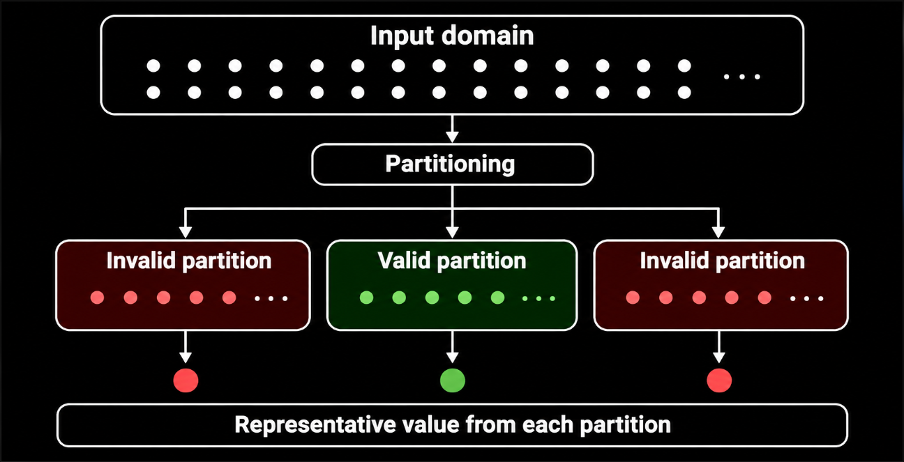
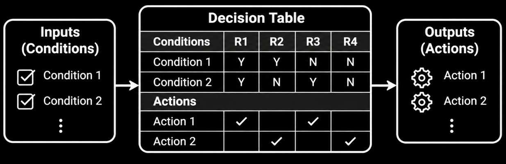
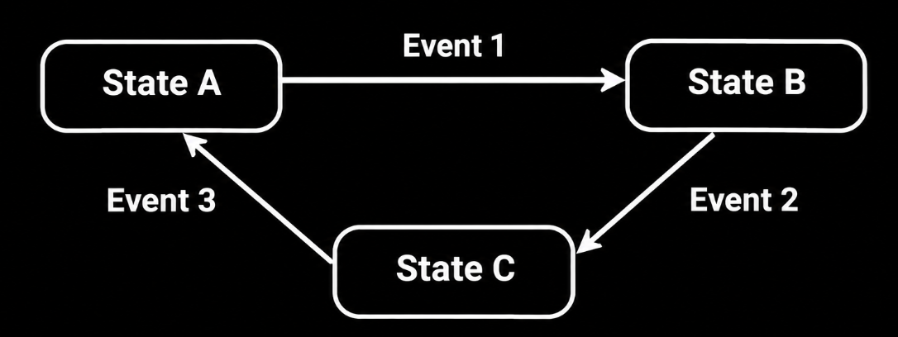
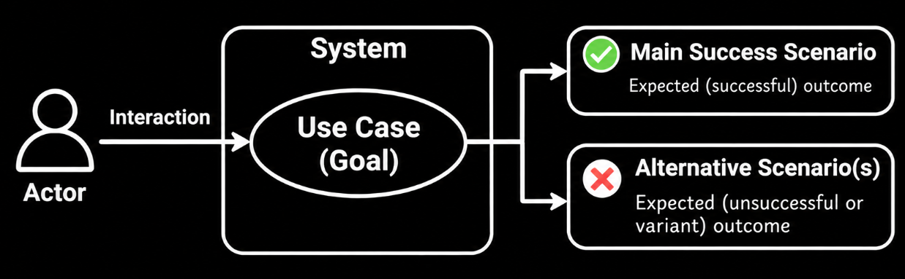

# Black-Box Testing Techniques

## Table of Contents: Black-Box Testing Techniques

- [Equivalence Partitioning](#equivalence-partitioning)
- [Boundary Value Analysis](#boundary-value-analysis)
- [Decision Table Testing](#decision-table-testing)
- [State Transition Testing](#state-transition-testing)
- [Use Case Testing](#use-case-testing)

**Black-box testing techniques** provide systematic approaches to designing test cases based on the specified or expected behavior of software without requiring knowledge of its internal implementation. Within **test case design**, these techniques help testers derive test conditions, select representative test data, determine expected results, and achieve defined coverage objectives using information from the **test basis** **(ISTQB, 2024, Section 4.2)**.

This chapter examines five black-box testing techniques. **Equivalence Partitioning**, **Boundary Value Analysis**, **Decision Table Testing**, **State Transition Testing**, and **Use Case Testing**. Each technique addresses different aspects of software behavior, and its suitability depends on the testing objectives, available information, and product risks. The discussion begins with **Equivalence Partitioning**, which provides a systematic approach to selecting representative values from groups expected to exhibit equivalent behavior.

## Equivalence Partitioning

**Equivalence Partitioning (EP)** is a **black-box testing technique** that divides data or other testable conditions into groups whose elements are expected to be processed in the same way. These groups are called **equivalence partitions** or **equivalence classes**. Partitions within the same partition set must not overlap and must contain at least one element. They may be **valid**, containing values or conditions expected to be accepted or processed as specified, or **invalid**, containing those expected to be rejected or handled as invalid. By selecting representative values from each partition rather than testing every possible value, testers can reduce the number of test cases while maintaining systematic partition coverage **(ISTQB, 2024, Section 4.2.1)**.



In Equivalence Partitioning, test conditions associated with specified system behavior are analyzed to identify **equivalence partitions** that serve as **coverage items**. Representative values are then selected from these partitions to derive test cases. When the identified partitions provide sufficient information for test case design and coverage evaluation, separately documenting test scenarios is not necessary. The relationship between test conditions, test scenarios, and test cases is discussed in [**Test Design Fundamentals on Test Conditions and Test Scenarios**](../test_design_fundamentals/#test-conditions-and-test-scenarios).

The simplest application of Equivalence Partitioning involves a **single input with a single validation rule**, where acceptance or rejection depends on one requirement. The possible input values are divided into partitions according to their expected behavior, and a representative value is selected from each partition.

!!! example "Single input with a single validation rule"

    Consider an online registration system that accepts an age expressed as a whole number between `13` and `100`, inclusive. Assuming only integer inputs are considered, three equivalence partitions can be identified based on whether the age falls below, within, or above the permitted range.

    | Test Case ID | Equivalence Partition  | Test Input | Valid/Invalid | Expected Outcome      |
    | ------------ | ---------------------- | ---------- | ------------- | --------------------- |
    | TCID-001     | Age below `13`         | `10`       | Invalid       | Registration rejected |
    | TCID-002     | Age from `13` to `100` | `30`       | Valid         | Registration accepted |
    | TCID-003     | Age above `100`        | `110`      | Invalid       | Registration rejected |

**Equivalence partition coverage** measures the proportion of identified equivalence partitions exercised by the tests. To achieve 100% equivalence partition coverage, every identified partition, including both valid and invalid partitions, must be exercised at least once. The broader concept of test coverage is discussed in [**Test Management Level 3 on Test Coverage**](../../test_managment/3_level/3_test_management.md#test-coverage). Coverage is calculated using the following formula.

$$
\text{EP Coverage} =
\frac{\text{Number of exercised partitions}}
{\text{Total number of identified partitions}}
\times 100\%
$$

In the age validation example, the three test cases are designed to cover all three identified equivalence partitions. Executing these test cases exercises all three partitions, resulting in 100% equivalence partition coverage ($3/3 \times 100\% = 100\%$).

!!! warning "Limitations of equivalence partition coverage"

    Achieving 100% equivalence partition coverage means that every identified partition has been exercised at least once. It does not mean that every possible input value has been tested, that all software behavior has been verified, or that the software is free of defects. This reflects the fundamental testing principles that **exhaustive testing is impossible** and **testing shows the presence, not the absence of defects**. Additional test cases may be necessary to address risks that are not adequately covered by the selected representative values.

When a **single input has multiple validation rules**, separate sets of equivalence partitions can be identified for each requirement. A single test case may exercise several valid partitions simultaneously, while invalid partitions can be tested individually by keeping the other applicable conditions valid wherever possible. This helps isolate the validation requirement being evaluated.

!!! example "Single input with multiple validation rules"

    Suppose a username must be a string containing between `5` and `10` characters and beginning with a letter. The input type, length, and format requirements are partitioned separately, as shown in the following table.

    | Validation Rule | Valid Partition      | Invalid Partitions                                   |
    | --------------- | -------------------- | ---------------------------------------------------- |
    | Input type      | String               | Non-string                                           |
    | Length          | `5–10` characters    | Fewer than `5` characters, more than `10` characters |
    | Format          | Begins with a letter | Does not begin with a letter                         |

    The length and format partitions apply to string inputs. Based on these partition sets, representative values can be selected and combined into test cases. The following table demonstrates how one valid test case can exercise multiple valid partitions, while separate test cases exercise the identified invalid partitions.

    | Test Case ID | Validation Rule            | Equivalence Partition                               | Test Input        | Valid/Invalid | Expected Outcome  |
    | ------------ | -------------------------- | --------------------------------------------------- | ----------------- | ------------- | ----------------- |
    | TCID-004     | Input type, length, format | String of `5–10` characters beginning with a letter | `user123`         | Valid         | Username accepted |
    | TCID-005     | Length                     | Fewer than `5` characters                           | `abc`             | Invalid       | Username rejected |
    | TCID-006     | Length                     | More than `10` characters                           | `username123`     | Invalid       | Username rejected |
    | TCID-007     | Format                     | Does not start with a letter                        | `1user23`         | Invalid       | Username rejected |
    | TCID-008     | Input type                 | Non-string input                                    | `123456` (number) | Invalid       | Username rejected |

!!! info "Input types and testing interfaces"

    The applicability of certain partitions depends on the interface being tested. A conventional browser text field normally provides its value as a string, whereas an **application programming interface (API)** may support different data types. Testing the non-string partition therefore requires an interface through which such values can be supplied.

When a system processes **multiple inputs with individual validation rules**, test cases must account for partitions across different fields rather than focusing on a single input. A practical approach is to establish a valid combination of inputs and then vary individual fields to exercise their invalid partitions while keeping the remaining fields valid wherever possible. This helps isolate individual validation requirements and reduces the possibility of one invalid input masking the behavior associated with another.

!!! example "Multiple inputs with individual validation rules"

    Consider a registration API that accepts a username, age, and password. In addition to the previously defined username and age requirements, assume that the password must contain at least eight characters. For this example, age inputs are limited to integers and password inputs to strings, with only password length being evaluated.

    | Test Case ID | Username          | Age   | Password   | Partition Being Tested        | Expected Outcome      |
    | ------------ | ----------------- | ----- | ---------- | ----------------------------- | --------------------- |
    | TCID-009     | `user123`         | `25`  | `Passw0rd` | All fields valid              | Registration accepted |
    | TCID-010     | `abc`             | `25`  | `Passw0rd` | Username below minimum length | Registration rejected |
    | TCID-011     | `username123`     | `25`  | `Passw0rd` | Username above maximum length | Registration rejected |
    | TCID-012     | `1user23`         | `25`  | `Passw0rd` | Invalid username format       | Registration rejected |
    | TCID-013     | `123456` (number) | `25`  | `Passw0rd` | Invalid username input type   | Registration rejected |
    | TCID-014     | `user123`         | `10`  | `Passw0rd` | Age below minimum             | Registration rejected |
    | TCID-015     | `user123`         | `110` | `Passw0rd` | Age above maximum             | Registration rejected |
    | TCID-016     | `user123`         | `25`  | `Pass1`    | Password below minimum length | Registration rejected |

When multiple sets of equivalence partitions are involved, **Each Choice coverage** requires every partition from each set to be exercised at least once, without requiring every possible combination of partitions to be tested. Both the username validation and registration examples demonstrate this approach across their defined partition sets by combining valid partitions in a single test case and exercising invalid partitions individually. Additional test cases may nevertheless be necessary when dependencies between inputs or specific combinations of values influence system behavior.

Although Equivalence Partitioning provides systematic coverage of identified partitions, representative values may not reveal defects occurring at the boundaries of ordered partitions. These boundaries are examined more closely through **Boundary Value Analysis**, which focuses on testing values at and around the limits of partitions.

## Boundary Value Analysis

**Boundary Value Analysis (BVA)** is a **black-box testing technique** that focuses on values at and around the boundaries of ordered equivalence partitions. While Equivalence Partitioning groups inputs according to expected behavior, Boundary Value Analysis examines the limits of these partitions, where defects such as incorrect comparisons and off-by-one errors frequently occur. The technique is applicable to ordered partitions, including those based on numerical values, dates, and lengths, where boundary values and their neighboring values can be identified **(ISTQB, 2024, Section 4.2.2)**.

In Boundary Value Analysis, test conditions associated with ordered equivalence partitions are examined to identify **boundary values** and their relevant neighboring values. These values serve as **coverage items** and provide a direct basis for deriving test cases without requiring separately documented test scenarios. The relationship between test conditions, test scenarios, and test cases is discussed in [Test Design Fundamentals on Test Conditions and Test Scenarios](../test_design_fundamentals/#test-conditions-and-test-scenarios).

Two common approaches are **2-value Boundary Value Analysis (2-value BVA)** and **3-value Boundary Value Analysis (3-value BVA)**. Both approaches use boundary values identified through Equivalence Partitioning but differ in the neighboring values selected for each boundary value.

In **2-value BVA**, the coverage items for each boundary value are the boundary value itself and its closest neighboring value belonging to the adjacent partition. This approach verifies whether the system correctly distinguishes between values belonging to neighboring partitions.

!!! example "2-value Boundary Value Analysis"

    Consider a file upload system that accepts files between `1 MB` and `10 MB`, inclusive. Assuming file sizes are evaluated in increments of `0.01 MB`, three ordered equivalence partitions can be identified. These include file sizes below `1 MB`, file sizes from `1 MB` to `10 MB`, and file sizes above `10 MB`. The following diagram illustrates the boundary values associated with the minimum and maximum permitted file sizes.

    

    All values in the diagram are expressed in MB, and the diagram is not to scale. Based on the identified boundary values, four distinct test cases can be derived to verify the transitions between adjacent partitions.

    | Test Case ID | Boundary      | Test Value | Valid/Invalid | Expected Outcome |
    |--------------|---------------|------------|---------------|------------------|
    | TCID-001     | Below minimum | `0.99 MB`  | Invalid       | Upload rejected  |
    | TCID-002     | At minimum    | `1.00 MB`  | Valid         | Upload accepted  |
    | TCID-003     | At maximum    | `10.00 MB` | Valid         | Upload accepted  |
    | TCID-004     | Above maximum | `10.01 MB` | Invalid       | Upload rejected  |

In **3-value BVA**, the coverage items for each boundary value include the boundary value itself, its immediately preceding value, and its immediately succeeding value. Neighboring boundary values may share coverage items, so duplicate values are counted only once when determining the distinct coverage items and deriving test cases. This approach extends the coverage provided by 2-value BVA.

!!! example "3-value Boundary Value Analysis"

    Applying 3-value BVA to the previously defined file upload requirements produces eight distinct coverage items, including the four values already selected through 2-value BVA. The following diagram illustrates these values and highlights the additional coverage items.

    

    As in the previous diagram, all values are expressed in MB, and the diagram is not to scale. The four additional coverage items are used to derive the following test cases.

    | Test Case ID | Boundary Region       | Test Value | Valid/Invalid | Expected Outcome |
    |--------------|-----------------------|------------|---------------|------------------|
    | TCID-005     | Lower boundary region | `0.98 MB`  | Invalid       | Upload rejected  |
    | TCID-006     | Lower boundary region | `1.01 MB`  | Valid         | Upload accepted  |
    | TCID-007     | Upper boundary region | `9.99 MB`  | Valid         | Upload accepted  |
    | TCID-008     | Upper boundary region | `10.02 MB` | Invalid       | Upload rejected  |

    Together, the original and additional test cases cover all eight distinct 3-value BVA coverage items.

**Boundary value coverage** measures the proportion of identified coverage items exercised by the tests. These coverage items depend on whether 2-value BVA or 3-value BVA is applied. To achieve 100% boundary value coverage, every identified coverage item for the selected approach must be exercised at least once. The broader concept of test coverage is discussed in [Test Management Level 3 on Test Coverage](../../test_managment/3_level/3_test_management.md#test-coverage). Coverage is calculated using the following formula.

$$
\text{BVA Coverage} =
\frac{\text{Number of exercised coverage items}}
{\text{Total number of identified coverage items}}
\times 100\%
$$

In the file upload example, executing the first four test cases (`TCID-001` through `TCID-004`) achieves 100% 2-value boundary value coverage ($4/4 \times 100\% = 100\%$). Executing all eight test cases (`TCID-001` through `TCID-008`) achieves 100% 3-value boundary value coverage ($8/8 \times 100\% = 100\%$). Although both approaches achieve complete coverage against their respective criteria, 3-value BVA exercises additional neighboring values.

!!! info "Input precision and neighboring values"

    The selection of neighboring values depends on the data type and smallest increment supported by the system. For integer inputs, neighboring values normally differ by `1`, whereas values evaluated to two decimal places may differ by `0.01`. The precision displayed by a user interface may differ from the precision used internally by the system. Testers must therefore identify the precision relevant to the specified behavior before deriving boundary value test cases.

The choice between **2-value BVA** and **3-value BVA** depends on the testing objectives, identified risks, and available resources. While 2-value BVA generally requires less testing effort, 3-value BVA examines additional neighboring values and can reveal defects that 2-value BVA may miss.

!!! bug "Detecting additional boundary defects"

    Suppose the file upload system incorrectly rejects files of exactly `1.01 MB` while correctly processing all values selected through 2-value BVA.

    | Test Case ID | Test Value | Expected Outcome | Actual Outcome  |
    |--------------|------------|------------------|-----------------|
    | TCID-006     | `1.01 MB`  | Upload accepted  | Upload rejected |

    This defect would remain undetected by the test cases derived using 2-value BVA but would be revealed by the additional test case derived using 3-value BVA.

!!! warning "Limitations of boundary value coverage"

    Complete boundary value coverage does not address every possible value within equivalence partitions or every dependency and combination of inputs. Boundary Value Analysis should therefore be complemented by other test design techniques when additional behavior or identified risks require coverage.

While Equivalence Partitioning and Boundary Value Analysis are useful for examining individual inputs and their boundaries, some systems determine outcomes through combinations of conditions. Such behavior can be examined using **Decision Table Testing**, which organizes conditions and their corresponding actions into a structured set of rules.

## Decision Table Testing

**Decision Table Testing** is a **black-box testing technique** used to design test cases for systems whose behavior depends on combinations of conditions and their corresponding actions. While Equivalence Partitioning and Boundary Value Analysis focus on identifying representative values and examining partition boundaries, Decision Table Testing examines how combinations of conditions determine expected system behavior. This technique is particularly useful for testing business rules and identifying missing, inconsistent, or contradictory requirements **(ISTQB, 2024, Section 4.2.3)**.



A **decision table** represents the relationship between conditions and actions in a structured tabular format. Conditions describe the circumstances that influence system behavior, while actions describe the expected responses. Conditions and actions are represented in rows, and each column represents a **decision rule**, which specifies a combination of condition values and the corresponding expected actions.

In Decision Table Testing, test conditions associated with business rules and specified system behavior are analyzed to identify relevant combinations of condition values and their expected actions. The conditions represented in a decision table describe individual factors influencing system behavior, whereas a test condition may concern an individual business rule, a combination of factors, or the overall behavior being verified. Each feasible decision rule represents a **coverage item** from which test cases can be derived. When these rules provide sufficient information for test case design and coverage evaluation, separately documenting test scenarios is not necessary. The relationship between test conditions, test scenarios, and test cases is discussed in [Test Design Fundamentals on Test Conditions and Test Scenarios](../test_design_fundamentals/#test-conditions-and-test-scenarios).

In a **limited-entry decision table**, conditions are represented using Boolean values, where `T` indicates that a condition is satisfied and `F` indicates that it is not. An **extended-entry decision table** allows conditions to contain multiple values, ranges, or categories rather than being restricted to Boolean values.

!!! example "Extended-entry decision table"

    Consider a delivery service in which the delivery charge depends on the customer's membership status and order value. Standard members receive free delivery for orders of at least `€50`, while premium members receive free delivery regardless of the order value. A delivery charge of `€5` applies to standard members whose orders are below `€50`.

    | Conditions and Actions | R1        | R2          | R3        | R4          |
    |------------------------|-----------|-------------|-----------|-------------|
    | **Conditions**         |           |             |           |             |
    | Membership status      | Standard  | Standard    | Premium   | Premium     |
    | Order value            | Below €50 | €50 or more | Below €50 | €50 or more |
    | **Actions**            |           |             |           |             |
    | Charge €5 for delivery | X         |             |           |             |
    | Provide free delivery  |           | X           | X         | X           |

    Unlike a limited-entry decision table, this table represents conditions using categories and ranges rather than Boolean values.

Decision tables use notation to represent condition values, expected actions, and their applicability within individual rules. The following table presents commonly used symbols, although notation may vary between projects and tools.

| Symbol | Meaning                                                                  |
|--------|--------------------------------------------------------------------------|
| `T`    | The condition is satisfied.                                              |
| `F`    | The condition is not satisfied.                                          |
| `–`    | The condition value is irrelevant to the expected actions of the rule.   |
| `N/A`  | The condition value is not applicable or feasible within the combination.|
| `X`    | The action is expected to occur.                                         |
| Blank  | The action is not expected to occur.                                     |

When all conditions are Boolean, the theoretical number of possible condition combinations can be calculated using the following formula, where $n$ represents the number of conditions.

$$
\text{Number of combinations} = 2^n
$$

For example, three Boolean conditions produce eight possible combinations ($2^3 = 8$), while five Boolean conditions produce thirty-two combinations ($2^5 = 32$). Dependencies and constraints between conditions may make some combinations infeasible, while other combinations may be consolidated when particular condition values do not influence the expected actions.

**Decision table minimization** reduces the number of decision rules by combining rules that produce the same expected actions when particular condition values do not influence the outcome. Such conditions can be represented using the `–` symbol, indicating that either permitted Boolean value produces the same expected actions within that rule. Infeasible combinations can also be excluded when constructing the applicable decision table.

!!! example "Decision table for loan approval"

    Consider a loan approval system in which approval depends on the applicant's credit score, monthly income, employment status, and requested loan amount. For this example, assume that loan approval requires a credit score of at least `650`, a monthly income of at least `€2,000`, current employment, and a requested loan amount not exceeding `€20,000`. All four conditions must be satisfied for the loan to be approved. These are illustrative business rules rather than actual lending criteria.

    These requirements define four Boolean conditions and two possible actions. Although four Boolean conditions produce sixteen possible combinations ($2^4 = 16$), these combinations can be represented using five non-overlapping decision rules in a minimized decision table.

    | Conditions and Actions             | R1 | R2 | R3 | R4 | R5 |
    |------------------------------------|----|----|----|----|----|
    | **Conditions**                     |    |    |    |    |    |
    | Sufficient credit score            | T  | F  | T  | T  | T  |
    | Sufficient monthly income          | T  | –  | F  | T  | T  |
    | Applicant employed                 | T  | –  | –  | F  | T  |
    | Loan amount within permitted limit | T  | –  | –  | –  | F  |
    | **Actions**                        |    |    |    |    |    |
    | Approve loan                       | X  |    |    |    |    |
    | Deny loan                          |    | X  | X  | X  | X  |

    Rule `R1` represents the combination in which all approval conditions are satisfied, while the remaining rules represent situations in which at least one required condition is not satisfied. Representative input values can be selected from the corresponding equivalence partitions to satisfy the conditions specified by each decision rule and derive the following test cases.

    | Test Case ID | Decision Rule | Credit Score | Monthly Income | Employment Status | Loan Amount | Expected Outcome |
    |--------------|---------------|--------------|----------------|-------------------|-------------|------------------|
    | TCID-001     | R1            | `720`        | `€3,000`       | Employed          | `€15,000`   | Loan approved    |
    | TCID-002     | R2            | `580`        | `€3,000`       | Employed          | `€15,000`   | Loan denied      |
    | TCID-003     | R3            | `720`        | `€1,500`       | Employed          | `€15,000`   | Loan denied      |
    | TCID-004     | R4            | `720`        | `€3,000`       | Unemployed        | `€15,000`   | Loan denied      |
    | TCID-005     | R5            | `720`        | `€3,000`       | Employed          | `€25,000`   | Loan denied      |

    Each test case exercises a different decision rule using concrete input values derived from the specified requirements. For conditions marked with `–`, values satisfying the corresponding approval conditions are selected to help isolate the condition responsible for loan rejection.

!!! note "Irrelevant conditions and infeasible combinations"

    A condition marked with `–` may take any permitted value without changing the expected actions of the rule. In contrast, an infeasible combination contains condition values that cannot occur together under the specified requirements or constraints. Irrelevant conditions may allow multiple decision rules to be combined, whereas infeasible combinations are excluded from the applicable coverage items.

**Decision table coverage** measures the proportion of feasible decision rules exercised by the tests. Each feasible decision rule represents a coverage item. To achieve 100% decision table coverage, every feasible rule in the decision table must be exercised at least once. The broader concept of test coverage is discussed in [Test Management Level 3 on Test Coverage](../../test_managment/3_level/3_test_management.md#test-coverage). Coverage is calculated using the following formula.

$$
\text{Decision Table Coverage} =
\frac{\text{Number of exercised feasible decision rules}}
{\text{Total number of feasible decision rules}}
\times 100\%
$$

In the loan approval example, the five test cases (`TCID-001` through `TCID-005`) are designed to cover all five feasible decision rules in the minimized decision table. Executing these test cases achieves 100% decision table coverage ($5/5 \times 100\% = 100\%$). This coverage is measured against the minimized decision table rather than all sixteen original Boolean condition combinations. For comparison, the same five test cases would exercise only five of the sixteen combinations in the full decision table, resulting in 31.25% coverage ($5/16 \times 100\% = 31.25\%$).

As the number of conditions increases, the number of possible combinations can grow significantly, increasing the effort required to construct decision tables and derive test cases. When exercising every feasible decision rule is impractical, testers may prioritize rules according to product risks and testing objectives. Any rules that remain untested should be considered when evaluating the achieved coverage.

!!! warning "Limitations of decision table coverage"

    Achieving 100% coverage of a minimized decision table does not mean that every possible combination of conditions has been tested. Defects may still occur when conditions identified as irrelevant incorrectly influence system behavior. Additional test cases may therefore be necessary to exercise alternative condition values, specific combinations, and other identified risks.

While Decision Table Testing examines how combinations of conditions determine expected actions, some systems produce different outcomes for the same input depending on their current state and previous events. Such behavior can be examined using **State Transition Testing**, which focuses on states, events, and the transitions between them.

## State Transition Testing

**State Transition Testing** is a **black-box testing technique** used to design test cases for systems whose behavior depends on their current state and the events that occur. Unlike techniques that primarily examine input values or combinations of conditions, State Transition Testing considers how previous events influence subsequent system behavior. This technique is particularly useful for testing workflows, interactive systems, and systems that respond to internal or external events **(ISTQB, 2024, Section 4.2.4)**.



A **state** represents a condition or mode of operation in which a system exists at a particular point in time. A system begins in an initial state and may transition between states as events occur. An **event** is an occurrence that may trigger a transition, such as a user command, a system notification, or an external signal. A **transition** represents the movement from a source state to a target state in response to an event, where the source and target states may be the same. An **action** represents the behavior performed by the system as part of a transition. A transition may also depend on a **guard condition**, which is a Boolean condition that must be satisfied for the transition to occur. When a guard condition is specified, the triggering event alone is insufficient to initiate the transition.

In State Transition Testing, test conditions associated with state-dependent behavior are analyzed to identify relevant states, events, and transitions. Depending on the selected coverage criterion, states, valid transitions, and invalid transitions serve as **coverage items** and provide a basis for deriving test cases. Individual transitions or sequences of transitions may also represent test scenarios. However, when the state transition model provides sufficient information for test case design and coverage evaluation, separately documenting test scenarios is not necessary. The relationship between test conditions, test scenarios, and test cases is discussed in [Test Design Fundamentals on Test Conditions and Test Scenarios](../test_design_fundamentals/#test-conditions-and-test-scenarios).

These elements can be represented visually using a **state transition diagram**, in which states are typically represented by nodes and valid transitions by directed arrows. A transition label may follow the notation `event [guard condition] / action`, where the event identifies the trigger, the optional guard condition specifies when the transition is permitted, and the optional action describes the behavior performed during the transition. For example, `Set Heating [temperature below target] / Start heating` represents a transition triggered by a heating command when the current temperature is below the target temperature.

!!! example "State transition model for a thermostat"

    Consider a simplified thermostat system that controls heating, cooling, and energy-saving operations. The system begins in the Idle state and changes its operating state in response to user commands, temperature changes, and detected faults. The following states are defined for this example.

    | State         | Description                                                    |
    |---------------|----------------------------------------------------------------|
    | Idle          | The system is not actively heating or cooling.                 |
    | Heating       | The system is actively increasing the temperature.             |
    | Cooling       | The system is actively decreasing the temperature.             |
    | Energy-Saving | The system is operating in a reduced-energy mode.              |
    | Error         | The system has detected a fault and suspended normal operation.|

    Transitions between these states are triggered by events originating from user commands or conditions detected by the system. The following events are defined for the thermostat model.

    | Event               | Description                                                      |
    |---------------------|----------------------------------------------------------------- |
    | Set Heating         | The user requests heating operation.                             |
    | Set Cooling         | The user requests cooling operation.                             |
    | Set Energy-Saving   | The user requests energy-saving operation.                       |
    | Temperature Reached | The system detects that the desired temperature has been reached.|
    | Error Detected      | The system detects an operational fault.                         |
    | Reset               | The user requests recovery from an error state.                  |

    The current state and triggering event determine whether a transition is permitted, which state the system enters, and which actions are performed. The following table defines the valid transitions and their associated actions for the simplified thermostat system.

    | Source State  | Event               | Target State  | Associated Action                                  |
    |---------------|---------------------|---------------|----------------------------------------------------|
    | Idle          | Set Heating         | Heating       | Start heating                                      |
    | Idle          | Set Cooling         | Cooling       | Start cooling                                      |
    | Idle          | Set Energy-Saving   | Energy-Saving | Activate energy-saving mode                        |
    | Heating       | Temperature Reached | Idle          | Stop heating                                       |
    | Heating       | Error Detected      | Error         | Stop heating and display error                     |
    | Cooling       | Temperature Reached | Idle          | Stop cooling                                       |
    | Cooling       | Error Detected      | Error         | Stop cooling and display error                     |
    | Energy-Saving | Set Heating         | Heating       | Exit energy-saving mode and start heating          |
    | Energy-Saving | Set Cooling         | Cooling       | Exit energy-saving mode and start cooling          |
    | Energy-Saving | Error Detected      | Error         | Suspend energy-saving operation and display error  |
    | Error         | Reset               | Idle          | Clear error and restore idle operation             |

    All other combinations of states and events are considered invalid transitions in this simplified model. Invalid events are rejected without changing the current state or interrupting its existing operation. When the system is in the Error state, events other than Reset are rejected, and the existing error indication remains active.

    The following state transition diagram visually represents the defined states and valid transitions. Transition labels identify the triggering events, while the associated actions are documented in the preceding table. No additional guard conditions are introduced in this simplified model.

    ```mermaid
    stateDiagram-v2
        direction TB

        state "Energy-Saving" as EnergySaving

        [*] --> Idle

        Idle --> Heating: Set Heating
        Idle --> Cooling: Set Cooling
        Idle --> EnergySaving: Set Energy-Saving

        Heating --> Idle: Temperature Reached
        Cooling --> Idle: Temperature Reached

        EnergySaving --> Heating: Set Heating
        EnergySaving --> Cooling: Set Cooling

        Heating --> Error: Error Detected
        Cooling --> Error: Error Detected
        EnergySaving --> Error: Error Detected

        Error --> Idle: Reset
    ```

    The initial arrow pointing to Idle represents system initialization and is not counted as an event-triggered transition.

While a state transition diagram provides a visual representation of system behavior, a **state table** represents the relationship between current states and events in a tabular format. Rows represent states, columns represent events, and each cell identifies the resulting state and may also include an associated action. Unlike a state transition diagram, which typically represents valid transitions, a state table can explicitly identify invalid transitions, providing a more comprehensive basis for deriving test cases.

!!! example "State table for a thermostat"

    Based on the previously defined thermostat model, the following state table identifies the expected target state for each combination of current state and event. A cell marked with `–` represents an invalid transition. The actions associated with valid transitions are defined in the preceding thermostat example.

    | Current State | Set Heating | Set Cooling | Set Energy-Saving | Temperature Reached | Error Detected | Reset |
    |---------------|-------------|-------------|-------------------|---------------------|----------------|-------|
    | Idle          | Heating     | Cooling     | Energy-Saving     | –                   | –              | –     |
    | Heating       | –           | –           | –                 | Idle                | Error          | –     |
    | Cooling       | –           | –           | –                 | Idle                | Error          | –     |
    | Energy-Saving | Heating     | Cooling     | –                 | –                   | Error          | –     |
    | Error         | –           | –           | –                 | –                   | –              | Idle  |

    With five identified states and six defined events, the state table contains thirty state and event combinations ($5 \times 6 = 30$). Of these combinations, eleven represent valid transitions and nineteen represent invalid transitions.

Test cases are derived from the state transition model by establishing the required source state, triggering an event, and verifying the resulting state and associated actions. Depending on the testing objectives, a test case may exercise a single transition or a sequence of transitions. When the required source state cannot be established directly, preceding events must be performed to bring the system into that state before the transition under test is exercised.

!!! example "Test cases for valid state transitions"

    Based on the previously defined valid transitions, associated actions, and state table, the following test cases are derived to verify permitted system behavior. Each test case specifies the required current state, triggering event, expected next state, and expected system action.

    | Test Case ID | Current State | Event               | Expected Next State | Expected Action                                    |
    |--------------|---------------|---------------------|---------------------|----------------------------------------------------|
    | TCID-001     | Idle          | Set Heating         | Heating             | Start heating                                      |
    | TCID-002     | Idle          | Set Cooling         | Cooling             | Start cooling                                      |
    | TCID-003     | Idle          | Set Energy-Saving   | Energy-Saving       | Activate energy-saving mode                        |
    | TCID-004     | Heating       | Temperature Reached | Idle                | Stop heating                                       |
    | TCID-005     | Heating       | Error Detected      | Error               | Stop heating and display error                     |
    | TCID-006     | Cooling       | Temperature Reached | Idle                | Stop cooling                                       |
    | TCID-007     | Cooling       | Error Detected      | Error               | Stop cooling and display error                     |
    | TCID-008     | Energy-Saving | Set Heating         | Heating             | Exit energy-saving mode and start heating          |
    | TCID-009     | Energy-Saving | Set Cooling         | Cooling             | Exit energy-saving mode and start cooling          |
    | TCID-010     | Energy-Saving | Error Detected      | Error               | Suspend energy-saving operation and display error  |
    | TCID-011     | Error         | Reset               | Idle                | Clear error and restore idle operation             |

    Together, these test cases are designed to exercise all five states and all eleven valid transitions defined by the thermostat model.

In addition to verifying valid transitions, State Transition Testing examines how the system handles **invalid transitions**, which are attempted when events occur in states from which the corresponding transitions are not permitted. The expected behavior depends on the specified requirements and may include rejecting the event, maintaining the current state, displaying an error message, or performing another defined recovery action.

!!! example "Test cases for invalid state transitions"

    Based on the thermostat state table and the previously defined requirements for invalid transitions, representative test cases can be derived to verify that unsupported events do not cause unintended state changes or actions.

    | Test Case ID | Current State | Event               | Expected Next State | Expected Action                                   |
    |--------------|---------------|---------------------|---------------------|---------------------------------------------------|
    | TCID-012     | Idle          | Temperature Reached | Idle                | Reject event and maintain idle operation          |
    | TCID-013     | Heating       | Set Cooling         | Heating             | Reject command and continue heating               |
    | TCID-014     | Cooling       | Set Energy-Saving   | Cooling             | Reject command and continue cooling               |
    | TCID-015     | Energy-Saving | Reset               | Energy-Saving       | Reject reset and maintain energy-saving operation |
    | TCID-016     | Error         | Set Heating         | Error               | Reject command and maintain error indication      |

    These test cases are designed to attempt five of the nineteen invalid state and event combinations identified in the state table. Additional test cases would be required to attempt the remaining fourteen invalid transitions.

!!! note "Isolation of invalid transitions"

    When designing test cases for invalid transitions, it is generally preferable to attempt only one invalid transition per test case. Attempting multiple invalid transitions within the same test case may make it difficult to determine which event caused an unexpected state change or system response. Establishing the required source state before each invalid transition attempt helps isolate the behavior being evaluated.

!!! info "Testing sequences of transitions"

    Although individual transition test cases verify the behavior associated with a particular state and event combination, defects may also depend on the sequence of previously executed transitions. For example, a thermostat may correctly enter the Heating and Error states individually but fail to resume heating after an error has been cleared. Such behavior can be examined by designing a test case that exercises a sequence of transitions from Idle to Heating, from Heating to Error, from Error back to Idle, and finally from Idle to Heating again, verifying the expected state and associated actions throughout the sequence.

**State transition coverage** measures the extent to which the elements of a state transition model are exercised by the tests. The coverage items depend on the selected coverage criterion, with three commonly used criteria being **all states coverage**, **valid transitions coverage**, and **all transitions coverage**. Each distinct coverage item is counted only once, regardless of how many times it is exercised or attempted. Coverage is determined by the items exercised or attempted during test execution rather than whether the corresponding test cases pass or fail. The broader concept of test coverage is discussed in [**Test Management Level 3 on Test Coverage**](../../test_managment/3_level/3_test_management.md#test-coverage).

**All states coverage** measures the proportion of identified states exercised by the tests. To achieve 100% all states coverage, every identified state must be visited at least once. Coverage is calculated using the following formula.

$$
\text{All States Coverage} =
\frac{\text{Number of exercised states}}
{\text{Total number of identified states}}
\times 100\%
$$

In the thermostat example, executing the valid transition test cases (`TCID-001` through `TCID-011`) exercises all five identified states, achieving 100% all states coverage ($5/5 \times 100\% = 100\%$). However, complete all states coverage can also be achieved using fewer transitions. For example, the transitions targeted by `TCID-001`, `TCID-002`, `TCID-003`, and `TCID-005` collectively visit all five states without requiring every valid transition to be exercised.

While all states coverage focuses on visiting the identified states, **valid transitions coverage**, also known as **0-switch coverage**, measures the proportion of identified valid transitions exercised by the tests. To achieve 100% valid transitions coverage, every identified valid transition must be exercised at least once. Coverage is calculated using the following formula.

$$
\text{Valid Transitions Coverage} =
\frac{\text{Number of exercised valid transitions}}
{\text{Total number of identified valid transitions}}
\times 100\%
$$

In the thermostat example, executing the eleven valid transition test cases (`TCID-001` through `TCID-011`) achieves 100% valid transitions coverage ($11/11 \times 100\% = 100\%$). Since every state in the defined model participates in at least one valid transition, these test cases also achieve complete all states coverage.

**All transitions coverage** extends valid transitions coverage by also considering invalid transitions. It measures the proportion of identified valid transitions exercised and invalid transitions attempted by the tests. To achieve 100% all transitions coverage, every identified valid transition must be exercised and every identified invalid transition must be attempted at least once. Coverage is calculated using the following formula.

$$
\text{All Transitions Coverage} =
\frac{\text{Number of exercised valid and attempted invalid transitions}}
{\text{Total number of identified valid and invalid transitions}}
\times 100\%
$$

In the thermostat example, the state table identifies thirty state and event combinations, consisting of eleven valid transitions and nineteen invalid transitions. Executing all sixteen derived test cases (`TCID-001` through `TCID-016`) exercises eleven valid transitions and attempts five invalid transitions, achieving approximately 53.33% all transitions coverage ($16/30 \times 100\% \approx 53.33\%$). Achieving 100% all transitions coverage would require attempting the remaining fourteen invalid transitions.

These calculations assume that all targeted states and valid transitions are exercised and all targeted invalid transitions are attempted during test execution. The choice of coverage criterion depends on the testing objectives, identified risks, and available resources. Although more comprehensive coverage criteria generally require greater testing effort, they allow testers to examine additional aspects of system behavior that may remain untested under less demanding criteria.

!!! warning "Limitations of state transition coverage"

    Achieving complete coverage of individual states or transitions does not guarantee that every possible sequence of transitions has been tested. Defects may depend on previous events, repeated transitions, guard conditions, or particular sequences of state changes. Additional test cases may therefore be necessary to examine behavior that is not adequately covered by the selected state transition coverage criterion.

While State Transition Testing examines system behavior through states, events, and transitions, testing can also focus on the interactions required to achieve a particular user goal. Such behavior can be examined using **Use Case Testing**, which derives test cases from user interactions and their corresponding system responses.

## Use Case Testing

**Use Case Testing** is a **black-box testing technique** used to design test cases based on interactions between actors and a system to achieve specific goals. While the preceding techniques examine input values, combinations of conditions, and transitions between states, Use Case Testing focuses on interaction scenarios and their expected outcomes. This technique is particularly useful for testing business processes and end-to-end workflows involving multiple system functions and components **(ISTQB, CTFL v3.1.1, Section 4.2.5)**.



A **use case** describes the interactions between one or more actors and a system to achieve a particular goal. An **actor** represents a role external to the system under consideration, such as a user, an external application, or another system. The interaction begins with a **trigger**, which represents an event that initiates the use case. **Preconditions** describe the conditions that must be satisfied before the use case begins, while **postconditions** describe the expected state of the system after the interaction concludes.

A particular path through the interactions defined by a use case is referred to as a **use case scenario**. The **main success scenario** describes the sequence of interactions through which the primary actor successfully achieves the intended goal under normal conditions, while **alternative flows** describe variations from this sequence that may lead to the same successful outcome or a different outcome. These variations may include **exception flows**, which describe how the system responds to errors, unsuccessful operations, or other exceptional conditions. By following feasible paths through these flows from the initiating trigger to their corresponding outcomes, complete use case scenarios can be identified and used as a basis for deriving test cases.

Use case scenarios provide a systematic basis for identifying behavior that requires verification and deriving corresponding test cases. A use case scenario may itself serve as a test scenario when selected for testing, while its individual interactions, conditions, and expected outcomes may represent more specific test conditions. Although identifying relevant interaction paths is fundamental to Use Case Testing, separately documenting test conditions and test scenarios is not mandatory when the use case specification provides sufficient information for test case derivation and coverage evaluation. The relationship between these concepts is discussed in [Test Case Design Level 1 on Test Conditions and Test Scenarios](../1_level/1_test_case_design.md#test-conditions-and-test-scenarios).

!!! example "Use case for user login"

    Consider an online application that allows registered users to authenticate using their credentials. The user's goal is to gain authenticated access to the application, as described in the following use case definition.

    | Use Case Element            | Description                                                                             |
    |-----------------------------|---------------------------------------------------------------------------------------- |
    | Use Case ID                 | UC-001                                                                                  |
    | Use Case Name               | User Login                                                                              |
    | Primary Actor               | Registered user                                                                         |
    | Goal                        | Gain authenticated access to the application.                                           |
    | Preconditions               | The user has a registered account, is not authenticated, and can access the application.|
    | Trigger                     | The user opens the login page.                                                          |
    | Successful Postconditions   | An authenticated user session is established, and the dashboard is displayed.           |
    | Unsuccessful Postconditions | No authenticated user session is established, and the user remains on the login page.   |

    The application authenticates users whose credentials are valid and whose accounts are not locked. Successful authentication establishes an authenticated user session and redirects the user to the dashboard. Invalid credentials submitted for an unlocked account result in an authentication error, while login attempts involving a locked account result in a lockout message and an option to contact support. In both unsuccessful scenarios, the user remains on the login page without an authenticated session.

    For this simplified example, the system checks the account's lock status before validating the credentials, and automatic account lockout resulting from repeated unsuccessful login attempts is outside the scope of the use case. Based on these requirements, the interactions required for successful authentication are represented by the following main success scenario.

    **Main Success Scenario (MS1)**

    | Step | Participant | Interaction                                         |
    |------|-------------|-----------------------------------------------------|
    | 1    | User        | Opens the application login page.                   |
    | 2    | System      | Displays the login form.                            |
    | 3    | User        | Enters credentials and submits the form.            |
    | 4    | System      | Verifies that the account is not locked.            |
    | 5    | System      | Determines that the supplied credentials are valid. |
    | 6    | System      | Establishes an authenticated user session.          |
    | 7    | System      | Redirects the user to the dashboard.                |

    Although the main success scenario concludes with authenticated access, the interaction may diverge from this path depending on the account status and credential validity. When the account is unlocked but credential validation fails at Step 5, the system follows an alternative flow that rejects authentication without changing the account's unlocked status.

    **Alternative Flow (AF1) for Invalid Credentials**

    | Step | Participant | Interaction                                                           |
    |------|-------------|-----------------------------------------------------------------------|
    | 1    | System      | Determines at Step 5 of MS1 that the supplied credentials are invalid.|
    | 2    | System      | Displays an authentication error message.                             |
    | 3    | System      | Keeps the user on the login page.                                     |

    When the system determines at Step 4 that the account is locked, a different alternative flow occurs in which authentication is prevented regardless of whether the supplied credentials are valid, and the account remains locked.

    **Alternative Flow (AF2) for a Locked Account**

    | Step | Participant | Interaction                                                                    |
    |------|-------------|------------------------------------------------------------------------------- |
    | 1    | System      | Determines at Step 4 of MS1 that the account is locked.                        |
    | 2    | System      | Displays an account lockout message and provides an option to contact support. |
    | 3    | System      | Keeps the user on the login page.                                              |

    The main success scenario and alternative flows share common interactions before diverging according to the account status and credential validity. The following activity flow diagram illustrates these relationships and represents the feasible interaction paths through the user login use case.

    ```mermaid
    flowchart LR
        A([Start]) --> B[Open login page]
        B --> C[Display login form]
        C --> D[Enter and submit credentials]
        D --> E{Account locked?}

        E -->|Yes| F[Display lockout message and support option]
        F --> G[Remain on login page]
        G --> H([Unsuccessful login - AF2])

        E -->|No| I{Credentials valid?}

        I -->|No| J[Display authentication error]
        J --> K[Remain on login page]
        K --> L([Unsuccessful login - AF1])

        I -->|Yes| M[Establish authenticated session]
        M --> N[Redirect to dashboard]
        N --> O([Successful login - MS1])
    ```

    By following each interaction path from the initiating trigger to its expected outcome, three complete use case scenarios can be identified. These scenarios consist of the main success scenario and two paths that combine its preceding interactions with the corresponding alternative flows.

    | Scenario ID | Description                    | Interaction Path              | Expected Outcome                                           |
    |-------------|--------------------------------|-------------------------------|------------------------------------------------------------|
    | SC-001      | Successful login               | MS1 Steps 1–7                 | Authenticated access is granted.                           |
    | SC-002      | Login with invalid credentials | MS1 Steps 1–4, followed by AF1| Authentication is rejected.                                |
    | SC-003      | Login with a locked account    | MS1 Steps 1–3, followed by AF2| Authentication is prevented because the account is locked. |

    In this example, the identified use case scenarios also serve as test scenarios. Each scenario provides a basis for examining specific test conditions associated with authentication, credential validation, account status, and expected system responses. However, a single use case scenario may encompass multiple more specific testing situations. For example, submitting an incorrect username or an incorrect password may exercise the same interaction path for invalid credentials. Similarly, login attempts involving valid or invalid credentials may exercise the same interaction path when the account is locked. Since the use case specification already defines the relevant interactions and expected behavior, additional test condition or test scenario tables are not necessary for deriving the corresponding test cases.

Test cases are derived from a use case by identifying its feasible scenarios, establishing the required preconditions, selecting appropriate test data, and specifying the interactions and expected system responses. Each test case should verify the relevant intermediate responses and final postconditions rather than focusing exclusively on the final outcome. Depending on the input values, system conditions, and other factors influencing the behavior being evaluated, multiple test cases may be required to examine a single use case scenario.

!!! example "Test cases derived from the user login use case"

    The three previously identified login scenarios provide a basis for deriving test cases that verify successful authentication, rejection of invalid credentials, and prevention of authenticated access to locked accounts. For this example, assume that `user123` is a registered test account with the valid password `Passw0rd`, and that the required account status and other use case preconditions are established before executing each test case.

    | Test Case ID | Scenario ID | Account Status | Username  | Password     | Expected Outcome                                                                                                                                                        |
    |--------------|-------------|----------------|-----------|--------------|------------------------------------------------------------------------------------------------------------------------------------------------------------------------ |
    | TCID-001     | SC-001      | Unlocked       | `user123` | `Passw0rd`   | An authenticated session is established, and the dashboard is displayed.                                                                                                |
    | TCID-002     | SC-002      | Unlocked       | `user123` | `WrongPass1` | An authentication error is displayed, the user remains on the login page, and no authenticated session is established.                                                  |
    | TCID-003     | SC-003      | Locked         | `user123` | `Passw0rd`   | A lockout message and contact support option are displayed, the user remains on the login page, the account remains locked, and no authenticated session is established.|

    Together, these test cases are designed to exercise all three identified login scenarios by following their corresponding interaction paths and verifying the intermediate system responses and defined postconditions.

!!! info "Combining Use Case Testing with other techniques"

    Although Use Case Testing identifies interaction scenarios, it does not necessarily determine all representative input values or combinations of conditions required to test those scenarios thoroughly. Equivalence Partitioning and Boundary Value Analysis can be applied to credential validation requirements, Decision Table Testing can examine combinations of authentication conditions, and State Transition Testing can verify changes between unlocked and locked account states. These complementary techniques provide additional coverage of the behavior associated with the identified use case scenarios.

**Use case scenario coverage** measures the proportion of identified feasible use case scenarios exercised by the tests when scenario coverage is selected as the coverage criterion. Each identified feasible scenario represents a coverage item, and achieving 100% coverage requires exercising every identified feasible scenario at least once. The broader concept of test coverage is discussed in [**Test Management Level 3 on Test Coverage**](../../test_managment/3_level/3_test_management.md#test-coverage). Coverage is calculated using the following formula.

$$
\text{Use Case Scenario Coverage} =
\frac{\text{Number of exercised feasible use case scenarios}}
{\text{Total number of identified feasible use case scenarios}}
\times 100\%
$$

In the user login example, three feasible use case scenarios have been identified (`SC-001` through `SC-003`). Executing the three derived test cases (`TCID-001` through `TCID-003`) and exercising their corresponding scenarios achieves 100% use case scenario coverage ($3/3 \times 100\% = 100\%$). If only the successful login scenario (`SC-001`) were exercised, the achieved scenario coverage would be approximately 33.33% ($1/3 \times 100\% \approx 33.33\%$), leaving both unsuccessful login scenarios untested.

The effectiveness of Use Case Testing depends on the completeness and accuracy of the use case descriptions. As use cases become more complex, the number of feasible scenarios may increase due to multiple alternative flows, exception conditions, and dependencies between interactions, requiring additional test cases to examine different paths. When exercising every identified scenario is impractical, testers may prioritize scenarios according to business importance, frequency of use, identified risks, and testing objectives.

!!! warning "Limitations of use case scenario coverage"

    Achieving 100% use case scenario coverage does not mean that every possible input value, combination of conditions, or sequence of interactions has been tested. Defects may remain within individual steps or variations of an identified scenario, while scenarios omitted from the use case descriptions are not reflected in the calculated coverage. Additional test design techniques may therefore be necessary to address behavior and risks that are not adequately covered by the defined scenarios.

Use Case Testing is particularly valuable at the system and acceptance test levels, where testing focuses on verifying complete workflows and determining whether the system supports intended user goals and business requirements.

Together, Equivalence Partitioning, Boundary Value Analysis, Decision Table Testing, State Transition Testing, and Use Case Testing provide complementary approaches to deriving test cases from different aspects of specified system behavior. The selection and combination of these techniques depend on the characteristics of the test object, the available test basis, identified risks, and testing objectives. The [Summary](../summary.md) brings together the key concepts and techniques explored throughout this module.
