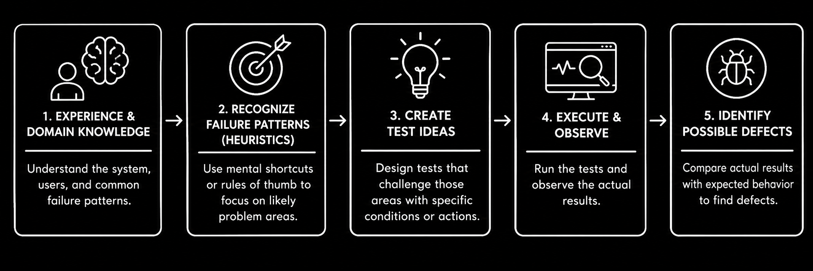
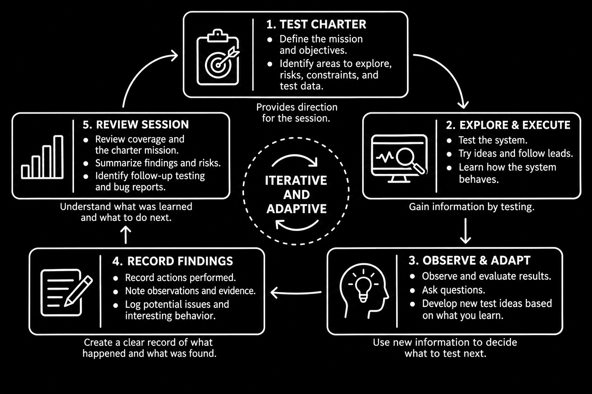

# Experience-Based Testing Techniques

## Table of Contents: Experience-Based Testing Techniques

- [Error Guessing](#error-guessing)
- [Exploratory Testing](#exploratory-testing)
- [Checklist-Based Testing](#checklist-based-testing)
- [Ad-Hoc Testing](#ad-hoc-testing)

**Experience-based testing techniques** use a tester's experience, domain knowledge, and observations to identify potential defects and develop test ideas. They are particularly useful when requirements are incomplete or changing, when testing must begin quickly, or when unexpected behavior requires further investigation.

The main approaches covered here are **error guessing**, **exploratory testing**, **checklist-based testing**, and **ad-hoc testing**. Each offers different forms of guidance and flexibility, allowing testers to choose an approach based on testing objectives, risks, and available information. The discussion begins with **error guessing**, which uses knowledge of common failure patterns to anticipate where defects may occur.

## Error Guessing

**Error guessing** is an experience-based test technique in which testers anticipate potential defects using past experience, domain knowledge, and familiarity with common failure patterns. Rather than following a formal procedure for deriving test cases, testers identify situations where the software might behave incorrectly and develop tests to investigate them.

A **heuristic** is a practical rule of thumb that helps guide testing decisions. In error guessing, heuristics help testers recognize conditions that may reveal defects, such as missing inputs, unexpected values, invalid formats, repeated actions, or interrupted operations. These conditions provide ideas for tests that can be executed and evaluated against expected behavior. The following diagram illustrates this process.

For example, consider a registration form containing **Name**, **Email**, **Age**, and **Password** fields. A tester could apply common error-guessing heuristics to identify situations worth investigating.

| Heuristic                              | Test idea                                                            | Possible defect                                                                       |
| -------------------------------------- | -------------------------------------------------------------------- | ------------------------------------------------------------------------------------- |
| **Null or empty inputs**               | Submit the form with the required Name field empty.                  | The form accepts incomplete data.                                                     |
| **Boundary values**                    | Enter `0`, `-1`, or an unusually large value for Age.                | Values outside the permitted age range are accepted or cause unexpected behavior.     |
| **Special characters**                 | Enter symbols, emojis, or markup-like text in the Name field.        | The input is displayed incorrectly or handled unexpectedly.                           |
| **Data type mismatches**               | Attempt to enter letters in the Age field.                           | The application accepts invalid data or fails to handle it correctly.                 |
| **Invalid formats**                    | Enter `user@`, `user@.com`, or `user name@example.com`.              | An invalid email address is accepted.                                                 |
| **Limit violations**                   | Enter a password just below the required minimum length.             | The password is incorrectly accepted.                                                 |
| **Repeated actions**                   | Submit the registration form several times quickly.                  | Duplicate accounts or unintended requests are created.                                |
| **Timeout and interruption scenarios** | Disconnect from the network while registration is being processed.   | The application becomes stuck or leaves registration in an inconsistent state.        |

These heuristics are starting points rather than a mandatory checklist. Testers select those relevant to the feature and its risks, then use the results to identify further test ideas. Although some examples involve boundaries or input formats, they represent experience-based heuristics rather than formal applications of systematic test design techniques.

A more structured application of error guessing is sometimes called a **fault attack**, in which testers deliberately target known fault patterns using a prepared list or catalog. These patterns may come from previous defects or recurring implementation mistakes. For example, if an application has previously created duplicate records after repeated submissions, a tester could investigate similar behavior across different workflows by submitting forms twice, refreshing pages during processing, or retrying operations after timeouts.

!!! note "Experience-Based Testing and Coverage"

    Error guessing can reveal defects that predefined tests might overlook, but its effectiveness depends on the tester's knowledge and experience. Because it does not provide a systematic way to measure coverage, it should be complemented by other test design techniques when broader or demonstrable coverage is required.

While error guessing focuses on anticipating likely problems, **exploratory testing** combines learning, test design, and execution, allowing testers to adapt their investigations as new information becomes available.

## Exploratory Testing

**Exploratory testing** is an approach in which testers design and execute tests while learning about the software. Rather than following only predefined test cases, they use observations and discoveries to guide further investigation, allowing testing to evolve as their understanding develops **(ISTQB, 2024, Section 4.4.2)**. This approach is particularly useful when requirements are incomplete, the software is unfamiliar, or unexpected behavior requires investigation.

Although exploratory testing is flexible, it is guided by testing objectives, known risks, and available information rather than random actions. Testers also use **[test oracles](../../fundamentals_of_testing/2_level/2_level_fundamentals_of_testing.md)** to evaluate whether observed behavior meets expectations. To provide direction without restricting the investigation, exploratory testing can be guided by a **test charter**, which defines the mission of a testing session and identifies the features or risks that deserve attention without prescribing every action.

The following diagram illustrates the main activities involved in a structured exploratory testing session. Although shown in sequence, these activities can overlap and repeat as new information emerges.

For example, a tester might use the following charter to investigate how an online store handles payment failures during checkout.

| Element                    | Description                                                                                     |
| -------------------------- | ----------------------------------------------------------------------------------------------- |
| **Mission**                | Explore how the checkout process handles payment failures.                                      |
| **Areas to explore**       | Payment form, discount code application, and order confirmation.                                |
| **Risks to investigate**   | Invalid payment details, duplicate submissions, and interrupted transactions.                   |
| **Test data**              | Approved test payment methods representing valid, expired, and declined payments.               |
| **Session duration**       | 90 minutes.                                                                                     |
| **Notes to capture**       | Actions performed, unexpected behavior, error messages, and questions requiring investigation.  |

During the session, the tester might begin with invalid payment details and then investigate related behavior based on the application's response. For example, an unexpected error message could lead to further tests involving repeated submissions or network interruptions. This illustrates how the charter provides direction without restricting the investigation to a fixed sequence.

Exploratory testing is often organized into **time-boxed sessions**, during which testers focus on a particular mission for a defined period. **Session-Based Test Management (SBTM)** is a structured approach that uses charters, session notes, and debriefs to make exploratory testing easier to manage and review, although exploratory testing itself does not require SBTM or a fixed session duration.

As testing progresses, the tester records relevant actions and observations to document what was examined and identify behavior that may require further investigation. Notes from the checkout session might look like the following.

| Time  | Action performed                                 | Observation                                                      | Potential issue? |
| ----- | ------------------------------------------------ | ---------------------------------------------------------------- | ---------------- |
| 10:00 | Entered an expired test card.                    | The application displayed the expected error message.            | No               |
| 10:15 | Clicked **Pay** twice rapidly.                   | Two payment transactions were created instead of one.            | Yes              |
| 10:30 | Simulated a network interruption during payment. | The page remained on a loading indicator without recovering.     | Yes              |

These notes help testers review their findings and investigate unexpected results, but an observation should not automatically be treated as a confirmed defect. Testers need to establish the expected behavior and collect enough information to explain or reproduce a potential issue. After a structured session, they may review their findings in a **debrief** with a test lead, another tester, or a relevant stakeholder to clarify unresolved questions, assess remaining risks, and decide whether further testing is needed. This decision depends on the testing objectives, available time, and value of additional investigation.

Exploratory testing can also be performed through **pair testing**, in which two people collaborate during testing. One person may interact with the software while the other observes, questions assumptions, suggests additional tests, or records findings. They can exchange roles during the activity. Although pair testing is not limited to exploratory testing, it can be particularly useful when investigating unfamiliar or complex behavior.

When testing requires more consistent guidance without prescribing detailed steps, **checklist-based testing** provides a lightweight way to organize the areas that need examination.

## Checklist-Based Testing

**Checklist-based testing** is an experience-based test technique that uses a predefined list of conditions, features, risks, or quality characteristics to guide testing. A checklist helps testers examine important areas consistently without prescribing every step of a scripted test case. It identifies what should be examined while allowing testers to use their judgment to determine how each item should be tested **(ISTQB, 2024, Section 4.4.3)**.

For example, when testing a responsive user interface, a checklist might include the following items.

| Description                                                                                     | Status     | Notes |
|-------------------------------------------------------------------------------------------------|------------|-------|
| Verify that the layout adjusts correctly at relevant screen sizes.                              | Not Tested |       |
| Check that elements do not overlap or become misaligned.                                        | Not Tested |       |
| Verify that navigation remains usable on supported screen sizes.                                | Not Tested |       |
| Verify that the hamburger menu appears and works correctly where the design requires it.        | Not Tested |       |
| Confirm that images resize appropriately and maintain their intended aspect ratio.              | Not Tested |       |
| Verify that supported media elements remain usable and playable.                                | Not Tested |       |

Each item can be marked as **Pass**, **Fail**, **Not Tested**, or **N/A (Not Applicable)** depending on its outcome. **Not Tested** means the item has not yet been evaluated, while **N/A** indicates that it does not apply to the situation being tested. An item should only be marked as passed after the relevant behavior has been checked.

Checklist-based testing can support both **functional and non-functional testing**, covering areas such as application behavior, usability, compatibility, and accessibility. Checklist items should be specific enough to guide investigation while remaining flexible about how the checks are performed. They should also be reviewed and updated as the product changes, new risks emerge, or previous testing reveals additional concerns.

As testers work through a checklist, they should record relevant outcomes and observations, including items that could not be evaluated. These records help explain what was examined, identify potential defects, and guide further testing.

!!! tip "Checklists Are Testing Guides"

    Completing every checklist item does not guarantee that all possible defects have been found. The effectiveness of checklist-based testing depends on the relevance of the items, the conditions investigated, and the tester's judgment.

When an investigation requires little preparation and no predefined testing guidance, **ad-hoc testing** offers a more informal approach.

## Ad-Hoc Testing

**Ad-hoc testing** is an informal approach in which testers investigate software without predefined test cases, charters, or checklists. Although it lacks a planned structure, testing can still be purposeful, guided by product knowledge, immediate observations, and awareness of potential risks.

For example, a tester might navigate through a checkout process in an unusual order, refresh a confirmation page during processing, repeatedly resize the interface, or enter unexpected values to observe how the application responds. These activities require little preparation and can provide quick feedback during informal investigations or after small changes.

The main limitations of ad-hoc testing are that **coverage and repeatability** can be difficult to assess. Without predefined guidance, important areas may be overlooked, and testers may struggle to explain what was examined. Recording significant observations and documenting the steps, test data, environment, and relevant system state when a potential defect is discovered can help others investigate and reproduce the behavior. However, ad-hoc testing is generally more suitable as a complementary approach than as the sole method when demonstrable coverage, traceability, or audit evidence is required, particularly in safety-critical or regulated systems.

The experience-based techniques covered in this section rely on testers knowledge, observations, and judgment to develop test ideas. Other families of test techniques provide different perspectives. You can explore **[Black-Box Testing](../black_box_testing/black_box_testing.md)** to learn how tests are derived from specified behavior without examining internal implementation, or **[White-Box Testing](../white_box_testing/white_box_testing.md)** to understand techniques based on the software's internal structure. These topics can be explored in either order, depending on your learning objectives.
