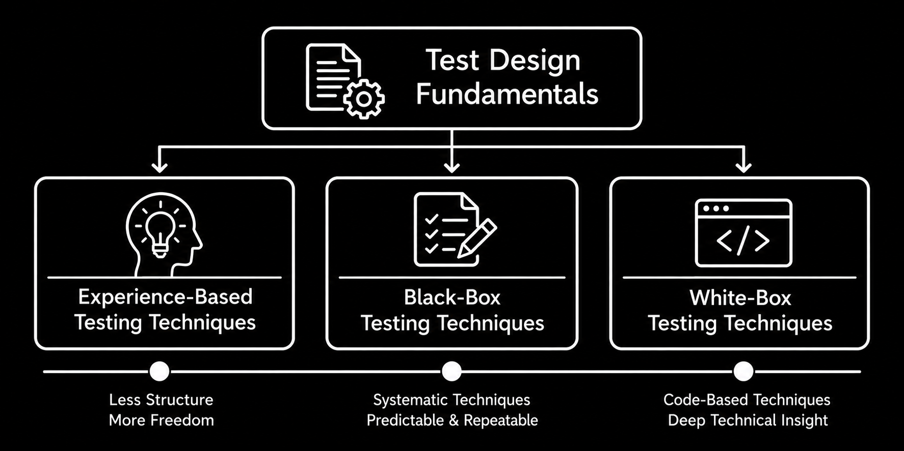

# Overview

Test case design is the process of developing tests to determine what should be tested and how software behavior should be verified. It uses requirements, testing objectives, risks, and other available information to identify relevant test conditions and develop test cases with appropriate test data. Because testing every possible situation is rarely practical, test design techniques help testers select meaningful tests to achieve appropriate coverage **(ISTQB, 2024, Sections 1.4 and 4.1)**.

The **Test Case Design** module covers both the foundations of designing tests and three complementary families of techniques. These are **experience-based**, **black-box**, and **white-box testing techniques**, each offering a different way to identify useful tests.

Designing effective tests begins with understanding the **test basis**, which provides the information needed to identify **test conditions**, develop **test cases**, and select appropriate **test data**. **Test scenarios** can also help describe and organize situations to be tested, although they are not required in every test design process. These fundamentals support all three technique families, regardless of how individual tests are derived.

The three families of test design techniques differ primarily in how tests are derived. **Experience-based testing techniques** draw on a tester's knowledge, experience, and understanding of potential problems. **Black-box testing techniques** use requirements, specifications, and expected behavior without relying on knowledge of the software's internal implementation. **White-box testing techniques**, in contrast, derive tests from knowledge of the software's internal structure and implementation **(ISTQB, 2024, Sections 4.2–4.4)**. Structural coverage measures can then help evaluate how thoroughly that structure has been exercised. White-box techniques are often applied by developers because they require knowledge of the code, although testers may also use them. For testers who do not work directly with source code, understanding their purpose and the coverage they provide is still valuable.

These techniques are not mutually exclusive. For example, a tester might use a black-box technique to select representative inputs, a white-box technique to examine which parts of the code have been exercised, and experience-based techniques to investigate additional risks. Combining approaches can provide a broader understanding of software quality than relying on a single technique. The choice depends on the testing objectives, available information, risks, and characteristics of the software.

The following topics explore these concepts in more detail. Start with [Test Design Fundamentals](./test_design_fundamentals/test_design_fundamentals.md) to understand how test cases are developed and what information is needed to design them. Once you understand these foundations, you can explore [Experience-Based Testing Techniques](./experience_based_testing_techniques/experience_based_testing_techniques.md) and [Black-Box Testing Techniques](./black_box_testing_techniques/black_box_testing_techniques.md) to learn approaches commonly used in software testing. [White-Box Testing Techniques](./white_box_testing_techniques/white_box_testing_techniques.md) provides an introduction to code-based testing and structural coverage, which is useful to understand even when developers perform most of that testing.
