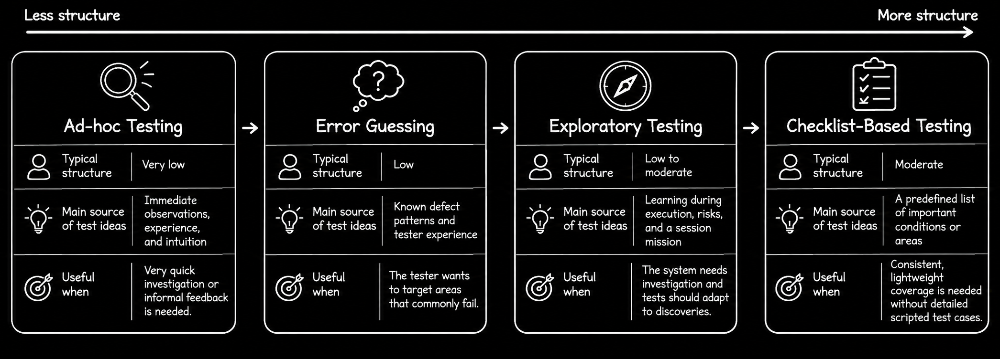

# Summary

This summary reviews the key concepts from **Experience-Based Testing Techniques** within the **Test Case Design** module, focusing on how testers use experience, domain knowledge, observations, and judgment to develop test ideas and investigate potential defects.

## Table of Contents: Test Case Desig Summary

- [Experience-Based Testing Techniques](#experience-based-testing-techniques)
- [Knowledge Check](#knowledge-check)

## Experience-Based Testing Techniques

**Experience-based testing techniques** help testers develop test ideas using their knowledge, previous experience, and observations. They are particularly useful when requirements are incomplete, the software is unfamiliar, or testing needs to adapt to new information. The approaches covered here are **error guessing**, **exploratory testing**, **checklist-based testing**, and **ad-hoc testing**, each offering a different way to guide investigation.

**Error guessing** uses experience and known failure patterns to anticipate where defects may occur. Testers apply **heuristics**, or practical rules of thumb, to identify conditions worth investigating. A more structured variation, sometimes called a **fault attack**, uses prepared catalogs of known fault patterns to guide testing.

While error guessing focuses on anticipating potential failures, **exploratory testing** combines **test design, execution, and learning**. Testers adapt their investigations based on observed behavior rather than relying entirely on predefined test cases. A **test charter** may provide a focused mission, while **Session-Based Test Management (SBTM)** offers additional organization through time-boxed sessions, notes, and debriefs. Exploratory testing can also involve **pair testing**, where two people collaborate to investigate software behavior.

When more consistent guidance is needed, **checklist-based testing** uses predefined items to direct attention toward important features, conditions, or risks without prescribing detailed test steps. It supports both **functional and non-functional testing** while allowing testers to decide how each item should be investigated.

For investigations requiring little preparation, **ad-hoc testing** provides a more informal approach without predefined test cases, charters, or checklists. It can offer quick feedback based on immediate observations and tester judgment, but its limited structure makes **coverage and repeatability** more difficult to assess.

The following diagram compares the approaches according to their typical degree of structure, sources of test ideas, and situations where they may be useful. The arrangement is illustrative rather than a strict hierarchy, since the amount of structure can vary depending on how each approach is applied.

These approaches are **complementary rather than mutually exclusive**. For example, exploratory testing can incorporate error-guessing heuristics or checklist items. Choosing an appropriate approach depends on testing objectives, risks, available information, and the need for repeatability or documented evidence. Although experience-based techniques can reveal important problems, they do not automatically establish systematic test coverage.

## Knowledge Check
