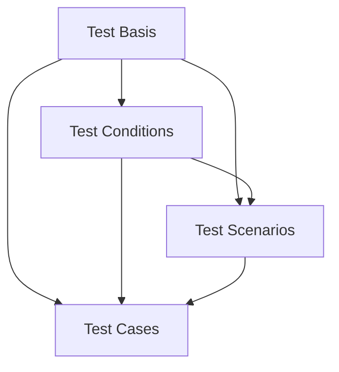

# Test Design Fundamentals

## Table of Contents: Test Design Fundamentals

- [Requirements as Test Basis](#requirements-as-test-basis)
- [Test Conditions and Test Scenarios](#test-conditions-and-test-scenarios)
- [Test Case Structure](#test-case-structure)

This chapter introduces the fundamental concepts used to develop test cases. It begins with **requirements as a test basis**, examining the sources of information used to understand expected system behavior. It then explores **test conditions and test scenarios**, including their relationships, documentation approaches, and role in test case derivation. The chapter also covers **test case structure**, focusing on the information needed to support consistent test execution and evaluation. Together, these concepts establish a structured approach to test design, beginning with the information from which testing objectives and expected behavior are derived.

## Requirements as Test Basis

**Requirements** describe what a system should do and how it is expected to behave, including its functionality, business rules, constraints, and expected outcomes. In test design, they provide a foundation for determining what should be tested and how correct behavior can be evaluated. However, requirements are not the only source of information used to design tests. The **test basis** includes the information used to identify test conditions and derive test cases. Common sources include **requirements documentation**, **user stories**, and **use cases**, which describe expected functionality, business rules, and user interactions.

**Design documents** may provide additional details about system components, interfaces, interactions, and data models. The **source code**, configuration files, and **API contracts** may also provide useful information about system behavior, inputs, outputs, and constraints. However, implementation details should not automatically be treated as correct expected behavior, particularly when investigating potential defects.

Other sources can establish additional testing expectations and help guide test design. **Compliance standards** and **industry regulations** may define requirements that must be verified, particularly in regulated environments. **User manuals** and **operational guides** describe the intended use of the system and help identify realistic user interactions. **Risk analysis** helps identify areas that require greater testing attention based on the likelihood and impact of potential failures. The role of risk assessment in prioritizing testing is explored in [Test Management Level 4 on Risk Management and Risk-Based Testing](../../test_management/level_4.md#risk-management-and-risk-based-testing).

Examining these sources together helps testers develop a clearer understanding of the system and establish reliable testing objectives. During test analysis, information from the test basis is examined to identify testable aspects of the system, known as **test conditions**. These conditions provide a foundation for test case design and may, where appropriate, be examined through more specific **test scenarios**. Establishing relationships between the test basis, test conditions, scenarios, and test cases also supports traceability and coverage evaluation. The following section examines these concepts and their relationships in greater detail.

## Test Conditions and Test Scenarios

A **test condition** is a testable aspect of a system identified as a basis for testing, such as a function, business rule, system state, transaction, or quality characteristic. A **test scenario** describes a particular situation, behavior, or sequence of interactions to be examined during testing. Test conditions identify **what requires verification**, while scenarios provide **context for evaluating that behavior**.

Test conditions may concern **functional behavior**, **business rules**, **input validation**, **system states**, **error handling**, **access control**, or **quality characteristics** such as performance and security. Both test conditions and test scenarios may be defined at different levels of detail. Consequently, a sufficiently specific test condition may also describe a situation that can serve as a test scenario. These concepts are related and may overlap rather than always representing distinct levels of test documentation.

!!! example "Identifying test conditions and test scenarios"

    Consider a requirement (`REQ-001`) for a login feature specifying that registered users with unlocked accounts can authenticate with valid credentials, invalid credentials must be rejected, and locked accounts must be prevented from authenticating regardless of credential validity. Successful authentication redirects the user to the dashboard, while unsuccessful authentication results in an appropriate authentication error or account lockout message. Analyzing this requirement allows testers to identify multiple test conditions associated with credential validity and account status.

    | Test Condition ID | Test Condition                                              |
    |-------------------|-------------------------------------------------------------|
    | COND-001          | Authentication with valid credentials for unlocked accounts |
    | COND-002          | Rejection of invalid credentials                            |
    | COND-003          | Prevention of authentication for locked accounts            |

    Each test condition may be examined through one or more test scenarios representing particular situations in which the specified behavior needs to be verified. For the purpose of illustrating these relationships, the following table identifies scenarios using concise descriptive names. These scenarios may subsequently be expressed through more detailed documentation formats.

    | Scenario ID | Test Condition ID | Test Scenario Name                                            |
    |-------------|-------------------|---------------------------------------------------------------|
    | SC-001      | COND-001          | Successful login to an unlocked account with valid credentials|
    | SC-002      | COND-002          | Login to an unlocked account with an incorrect password       |
    | SC-003      | COND-002          | Login with an incorrect username                              |
    | SC-004      | COND-003          | Login to a locked account with valid credentials              |
    | SC-005      | COND-003          | Login to a locked account with invalid credentials            |

    These scenarios can subsequently provide a basis for deriving test cases containing concrete test data, execution steps, and expected results. The following diagram illustrates one possible relationship between a requirement, its associated test conditions, test scenarios, and derived test cases.

    ```mermaid
    flowchart TD
        REQ001["REQ-001<br/>Authentication"]

        REQ001 --> COND001["COND-001<br/>Valid credentials"]
        REQ001 --> COND002["COND-002<br/>Invalid credentials"]
        REQ001 --> COND003["COND-003<br/>Locked account"]

        COND001 --> SC001["SC-001"]
        COND002 --> SC002["SC-002"]
        COND002 --> SC003["SC-003"]
        COND003 --> SC004["SC-004"]
        COND003 --> SC005["SC-005"]

        SC001 --> TC001["TCID-001"]
        SC002 --> TC002["TCID-002"]
        SC003 --> TC003["TCID-003"]
        SC004 --> TC004["TCID-004"]
        SC005 --> TC005["TCID-005"]
    ```

A single requirement may contain multiple testable aspects and therefore be associated with several test conditions. A test condition may be examined through multiple test scenarios, and a scenario may provide a basis for deriving multiple test cases. These relationships are not necessarily hierarchical or one-to-one. A test condition may be associated with multiple requirements, a scenario may address several test conditions, and a test case may exercise multiple scenarios or conditions.

Establishing these relationships supports **requirements traceability** and **test coverage evaluation** by making it possible to determine which aspects of the specified behavior have been addressed by the designed and executed tests. Linking a test case to a requirement does not necessarily demonstrate that every testable aspect of that requirement has been exercised.

!!! info "Test conditions and test scenarios as documentation artifacts"

    The relationships illustrated in the previous example represent one possible approach to organizing test design information rather than a mandatory documentation structure. Although identifying what requires verification is fundamental to testing, separately documenting test conditions and test scenarios is not always necessary.

    A sufficiently detailed test condition may provide enough information to derive test cases directly. Similarly, requirements, use cases, acceptance criteria, and other test-basis information may already describe specific situations that can be used as a basis for test case design.

    Black-box testing techniques can also identify specific coverage items, such as equivalence partitions, boundary values, decision rules, state transitions, and use case scenarios, from which test cases can be systematically derived. Creating additional test scenario documentation is useful when it improves understanding, organization, traceability, or coverage evaluation, but it should not introduce unnecessary duplication.

The following diagram illustrates possible test case derivation paths. The arrows represent derivation relationships rather than mandatory documentation stages.



Test scenarios and test cases can examine **positive** or **negative conditions**. **Positive testing** verifies that the system behaves as expected under valid or permitted conditions, while **negative testing** verifies that it responds correctly to invalid, unexpected, or prohibited conditions. Successful login with valid credentials for an unlocked account is an example of a **positive scenario**, whereas rejection of invalid credentials or prevention of authentication for a locked account represents a **negative scenario**. A negative test passes when the system handles the tested condition correctly, rather than when the test itself fails. Not every scenario requires an explicit positive or negative classification, particularly when such a distinction does not contribute to the testing objectives.

Test scenarios may be documented in different formats and at different levels of detail depending on their purpose. Common approaches include using **descriptive scenario names**, **concise scenario statements**, and the **Given–When–Then structure**. These approaches represent different ways of expressing the same scenario rather than mandatory stages of test scenario documentation.

The simplest approach is to use **descriptive scenario names** that briefly identify the situation or behavior being examined. As demonstrated in the preceding login example, these names can be sufficient for organizing scenarios, associating them with test conditions, and establishing traceability when the relevant expectations are available from the associated test-basis information. The following examples demonstrate this approach using three of the previously identified login scenarios.

```text
# SC-001: Successful login (Positive)
Successful login to an unlocked account with valid credentials

# SC-002: Incorrect password (Negative)
Login to an unlocked account with an incorrect password

# SC-003: Locked account (Negative)
Login to a locked account with valid credentials
```

When the behavior requiring verification needs to be expressed more explicitly, scenarios can be documented using **concise scenario statements**. These often begin with expressions such as **“Verify that”**, **“Ensure that”**, **“Check that”**, or **“Test that”**. **“Verify that”** emphasizes confirming whether behavior matches expectations, **“Ensure that”** emphasizes a condition that should be satisfied, **“Check that”** introduces a particular aspect to examine, and **“Test that”** expresses the intention to evaluate a behavior or outcome. These expressions are generally interchangeable and do not represent separate testing techniques. The same three login scenarios can be expressed using this documentation style as follows.

```text
# SC-001: Successful login (Positive)
Verify that a user can log in with valid credentials when the account is unlocked.

# SC-002: Incorrect password (Negative)
Check that authentication is rejected when an incorrect password is entered for an unlocked account.

# SC-003: Locked account (Negative)
Ensure that a locked account cannot authenticate even when valid credentials are supplied.
```

A more structured approach to documenting test scenarios is the **Given–When–Then** structure, commonly used in **Behavior-Driven Development (BDD)** to describe expected system behavior through concrete examples. BDD encourages developers, testers, and business stakeholders to develop a shared understanding of how the system should behave, while Given–When–Then provides a consistent format for expressing those expectations. Within this structure, **Given** establishes the initial context or preconditions, **When** describes the action or event being performed, and **Then** specifies the expected outcome. Additional keywords such as **And** and **But** allow further or contrasting preconditions, actions, and expected outcomes to be expressed without repeating the corresponding Given, When, or Then keyword.

The broader purpose of BDD and its role in development are explored in [Software Development Lifecycle and Testing Level 3 on Testing Approaches in Software Development](../../software_development_lifecycle_and_testing/level_3.md#testing-approaches-in-software-development). To demonstrate how the Given–When–Then structure is applied in practice, the following examples express the same three login scenarios using this format.

```gherkin
Scenario: SC-001 Successful login
  Given the user has an unlocked account
  And the user is on the login page
  When the user submits valid credentials
  Then the user is authenticated
  And the dashboard is displayed

Scenario: SC-002 Incorrect password
  Given the user has an unlocked account
  And the user is on the login page
  When the user submits a valid username
  And an incorrect password
  Then an authentication error is displayed
  And the user remains unauthenticated

Scenario: SC-004 Locked account
  Given the user has a locked account
  And the user is on the login page
  When the user submits valid credentials
  Then an account lockout message is displayed
  And the user remains unauthenticated
```

Given–When–Then scenarios can be developed from requirements, user stories, and **acceptance criteria** to make expected behavior understandable to technical and non-technical stakeholders. They may also support automation when connected to executable step definitions, although writing a scenario in this format does not automatically make it executable. The technical implementation of automated BDD scenarios is addressed in [Quality Engineering](../../../quality_engineering/).

All three documentation approaches help communicate the behavior being verified but differ in how explicitly they describe the situation, context, actions, and expected outcomes. Descriptive scenario names support concise identification and organization, scenario statements express the intended verification more explicitly, and the Given–When–Then structure separates the initial context, actions, and expected outcomes. The appropriate format and level of detail depend on the characteristics of the test object, testing objectives, complexity, and traceability needs. There is no requirement to document the same scenario using multiple formats unless doing so serves a specific purpose.

Identified test conditions, scenarios, and other test-basis information provide a foundation for deriving **test cases** that contain the information necessary for consistent execution and verification. The next section explains how test cases are structured and documented.

## Test Case Structure

A **test case** specifies the conditions, inputs, actions, and expected results used to verify a particular aspect of system behavior. It translates a testing objective into information that allows a test to be executed and its outcome evaluated consistently. As discussed in the preceding section, test cases may be developed from **test scenarios** or derived directly from **test conditions**, requirements, and other test-basis information. Individual test cases receive **Test Case IDs** for identification and tracking and may include references to associated requirements, test conditions, or scenarios. Maintaining these relationships supports **traceability**, which is explored in [Test Management Level 3 on Requirements Traceability](../../test_management/level_3.md#requirements-traceability).

A structured test case typically includes an identifier, description, preconditions, test data, test steps, and expected results. Depending on the testing objective and documentation requirements, it may also include **traceability references** and **postconditions**. Expected results should be determined using reliable sources, as explained in [Fundamentals of Testing Level 2 on Test Oracles](../../fundamentals_of_testing/2_level/2_fundamentals_of_testing.md#test-oracles). **Actual results**, by contrast, are recorded during execution and compared with expected results, as covered in [Test Execution Level 1 on Expected and Actual Results](../../test_execution/level_1.md#expected-results-vs-actual-results). The common elements of a structured test case are outlined in the following table.

| Element                     | Purpose                                                                 |
|-----------------------------|-------------------------------------------------------------------------|
| **Test Case ID**            | Unique identifier for tracking and referencing                          |
| **Description**             | Behavior or condition being verified                                    |
| **Traceability References** | Associated requirements, test conditions, or scenarios, when applicable |
| **Preconditions**           | Required conditions or system state before execution                    |
| **Test Data**               | Input values or data needed for testing                                 |
| **Test Steps**              | Actions to perform during execution, when applicable                    |
| **Expected Result**         | Observable behavior or outcome expected from the system                 |
| **Postconditions**          | Expected system state after execution, when applicable                  |

!!! example "Structured test case for successful login"

    Test case `TCID-001` can be derived from the previously identified successful login scenario (`SC-001`) and documented as follows.

    | Field                 | Value                                                                                          |
    |-----------------------|----------------------------------------------------------------------------------------------- |
    | **Test Case ID**      | TCID-001                                                                                       |
    | **Requirement ID**    | REQ-001                                                                                        |
    | **Test Condition ID** | COND-001                                                                                       |
    | **Scenario ID**       | SC-001                                                                                         |
    | **Description**       | Verify successful login with valid credentials for an unlocked account                         |
    | **Preconditions**     | The user has a registered and unlocked account, is not authenticated, and is on the login page |
    | **Test Data**         | Username `name123`, Password `SecurePass123`                                                   |
    | **Test Steps**        | 1. Enter the username. 2. Enter the password. 3. Submit the login form.                        |
    | **Expected Result**   | The user is authenticated and redirected to the dashboard                                      |
    | **Postconditions**    | An authenticated user session is active                                                        |

The example demonstrates how a structured test case documents the information needed to verify a specific aspect of system behavior. Traceability references establish relationships with associated requirements, test conditions, and scenarios when required by the project's documentation and traceability needs. As with test scenarios, test case descriptions may use expressions such as **“Verify that”**, **“Ensure that”**, **“Check that”**, or **“Test that”** to communicate the behavior requiring verification.

The documentation format and level of detail depend on the testing objectives and project requirements. Test cases may be represented through **structured templates**, **concise descriptions**, or **automated test scripts**. A complex user workflow may require detailed preconditions, test data, execution steps, and expected results, while a simple input-and-output check may need only the input values and expected outcome. The selected format should provide sufficient information to support consistent test execution and evaluation without introducing unnecessary documentation.

Regardless of the documentation format, test cases should be as **independent and repeatable** as practical. **Independence** means that a test does not rely on another test succeeding, while **repeatability** means that it produces consistent results under the same relevant conditions. For example, a login test should use an account prepared during setup rather than depend on a separate registration test. Required data, setup actions, and system conditions should therefore be documented to support reliable and consistent execution.

Beyond documenting test cases, test design involves selecting meaningful conditions, inputs, and expected outcomes. Different **test design techniques** support this process, including **black-box techniques**, which focus on externally observable behavior, **white-box techniques**, which examine the internal structure of software, and **experience-based techniques**, which draw on testers' knowledge, skills, and experience. These approaches are explored in [Black-Box Testing Techniques](../../black_box_testing_techniques/), [White-Box Testing Techniques](../../white_box_testing_techniques/), and [Experience-Based Testing Techniques](../../experience_based_testing_techniques/).
