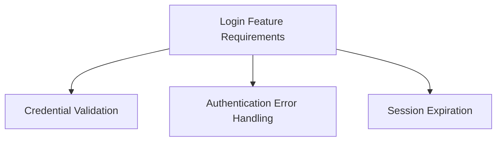
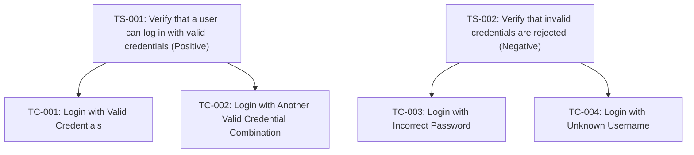

# Test Design Fundamentals

## Table of Contents: Test Design Fundamentals

- [Requirements as Test Basis](#requirements-as-test-basis)
- [Test Conditions and Test Scenarios](#test-conditions-and-test-scenarios)
- [Test Case Structure](#test-case-structure)

This chapter introduces the fundamental concepts used to develop test cases. It begins with **requirements as a test basis**, which provide the information needed to understand expected system behavior, and then examines how **test conditions and test scenarios** help identify and organize what needs to be verified. It also covers **test case structure**, including the information needed to execute tests consistently. Together, these concepts establish a structured approach to test design, beginning with the sources from which testing objectives are derived.

## Requirements as Test Basis

**Requirements** describe what a system should do and how it is expected to behave, including its functionality, business rules, constraints, and expected outcomes. In test design, they provide a foundation for determining what should be tested and how correct behavior can be evaluated. However, requirements are not the only source of information used to design tests. The **test basis** includes the information used to identify test conditions and derive test cases. Common sources include **requirements documentation**, **user stories**, and **use cases**, which describe expected functionality, business rules, and user interactions.

**Design documents** may provide additional details about system components, interfaces, interactions, and data models. The **source code**, configuration files, and **API contracts** may also provide useful information about system behavior, inputs, outputs, and constraints. However, implementation details should not automatically be treated as correct expected behavior, particularly when investigating potential defects.

Other sources can establish additional testing expectations. **Compliance standards** and **industry regulations** may define requirements that must be verified, particularly in regulated environments. **User manuals** and **operational guides** describe how the system is intended to be used and can help identify realistic user interactions. **Risk analysis** helps identify areas that may require greater testing attention based on factors such as the likelihood and impact of potential failures. Risk assessment and its use in prioritizing testing are covered in [Test Management Level 4](../../test_management/level_4.md#risk-management-and-risk-based-testing).

Examining these sources together helps testers develop a clearer understanding of the system and establish reliable testing objectives. This information can then be analyzed to identify **test conditions** and, where appropriate, develop **test scenarios** that support the creation of detailed test cases.

## Test Conditions and Test Scenarios

A **test condition** is an aspect of a system that can be verified through testing, such as a function, business rule, system state, or quality characteristic. A **test scenario** describes a particular situation, behavior, or sequence of interactions to be examined during testing. Test conditions identify **what requires verification**, while scenarios provide **context for evaluating that behavior**. These concepts may overlap, and scenarios can be high-level or more detailed depending on their purpose. Conditions may concern **functional behavior**, **business rules**, **input validation**, **system states**, **error handling**, **access control**, or **quality characteristics** such as performance and security.

For example, requirements for a login feature may specify that users can authenticate with valid credentials, invalid credentials must be rejected, and inactive sessions must expire after a configured timeout. Analyzing these requirements allows testers to identify conditions related to **credential validation**, **authentication error handling**, and **session expiration**, as illustrated in the following diagram.



These conditions can be examined through scenarios involving successful login, rejected login attempts, and automatic logout after inactivity. A single condition may be covered by multiple scenarios, while one scenario may address several conditions. Organizing tests in this way can help identify coverage gaps and unnecessary duplication, although **separately documenting scenarios is not mandatory**. Test cases may also be derived directly from test conditions or other test-basis information.

Test scenarios and test cases can examine **positive** or **negative conditions**. **Positive testing** verifies that the system behaves as expected under valid or permitted conditions, while **negative testing** verifies that it responds correctly to invalid, unexpected, or prohibited conditions. Successful login with valid credentials is an example of a **positive scenario**, whereas rejection of invalid credentials is a **negative scenario**. A negative test passes when the system handles the tested condition correctly, rather than when the test itself fails. Not every scenario requires an explicit positive or negative classification, particularly when verifying behavior such as session expiration.

One common way of documenting scenarios is to use concise statements describing behavior that needs verification. These often begin with **“Verify that”**, **“Ensure that”**, **“Check that”**, or **“Test that”**. **“Verify that”** emphasizes confirming whether behavior matches expectations, **“Ensure that”** emphasizes a condition that should be satisfied, **“Check that”** introduces a particular aspect to examine, and **“Test that”** expresses the intention to evaluate a behavior or outcome. These expressions are generally interchangeable and do not represent separate testing techniques. The following examples demonstrate this documentation style.

```text
# Scenario 1: Successful login (Positive)
Verify that a user can log in with valid credentials.

# Scenario 2: Session expiration
Ensure that the session expires after the configured inactivity timeout.

# Scenario 3: Invalid credentials (Negative)
Check that an appropriate error message appears when invalid credentials are entered.
```

Another way to document test scenarios is through the **Given–When–Then** structure, commonly used in **Behavior-Driven Development (BDD)** to describe expected system behavior through concrete examples. BDD encourages developers, testers, and business stakeholders to develop a shared understanding of how the system should behave, while Given–When–Then provides a consistent format for expressing those expectations. **Given** establishes the initial context or preconditions, **When** describes the action or event being performed, and **Then** specifies the expected outcome. The broader purpose of BDD and its role in development are explored in [Software Development Lifecycle and Testing Level 3 on Testing Approaches in Software Development](../../software_development_lifecycle_and_testing/level_3.md#testing-approaches-in-software-development). The same login scenarios can be expressed using this structure in the following examples.

```gherkin
# Scenario 1: Successful login (Positive)
Given the user is on the login page
When the user enters valid credentials and submits the login form
Then the user is redirected to the dashboard

# Scenario 2: Session expiration
Given the user is logged in
When the configured inactivity timeout is reached
Then the user is logged out

# Scenario 3: Invalid credentials (Negative)
Given the user is on the login page
When the user enters invalid credentials and submits the login form
Then an appropriate error message is displayed
And the user remains unauthenticated
```

Given–When–Then scenarios can be developed from requirements, user stories, and **acceptance criteria** to make expected behavior understandable to technical and non-technical stakeholders. They may also support automation when connected to executable step definitions, although writing a scenario in this format does not automatically make it executable. The technical implementation of automated BDD scenarios is addressed in [Quality Engineering](../../../quality_engineering/).

Both documentation approaches help communicate the behavior being verified, but they differ in how explicitly they describe the context, actions, and outcomes. Depending on the testing approach, scenarios may be developed into more detailed **test cases** that provide the information needed for consistent execution and verification. However, test cases can also be derived directly from test conditions or other test-basis information without separately documented scenarios. The next section explains how test cases are structured and documented.

## Test Case Structure

A **test case** specifies the conditions, inputs, actions, and expected results used to verify a particular aspect of system behavior. It translates a testing objective into information that allows a test to be executed and its outcome evaluated consistently. Test cases may be developed from **test scenarios** or derived directly from **test conditions**, requirements, and other test-basis information. When tests are organized around scenarios, a single scenario may be associated with **multiple test cases**, each examining different inputs, conditions, or expected outcomes. Scenarios may receive **Scenario IDs**, while individual test cases receive **Test Case IDs** for identification and tracking. However, **separately documented scenarios are optional**, and organizing tests around scenarios does not automatically guarantee coverage. Maintaining relationships between requirements and tests supports **traceability**, which is explored in [Test Management Level 3 on Requirements Traceability](../../test_management/level_3.md#requirements-traceability).

The following diagram illustrates how positive and negative login scenarios can be associated with multiple test cases, each examining a particular variation of the behavior being verified.



A structured test case typically includes an identifier, description, preconditions, test data, test steps, and expected results. **Postconditions** may also be included when the system state after execution is important. Expected results should be determined using reliable sources, as explained in [Fundamentals of Testing Level 2 on Test Oracles](../../fundamentals_of_testing/2_level/2_fundamentals_of_testing.md#test-oracles). **Actual results**, by contrast, are recorded during execution and compared with expected results, as covered in [Test Execution Level 3 on Expected and Actual Results](../../test_execution/level_3.md#expected-and-actual-results). The common elements of a structured test case are outlined in the following table.

| Element             | Purpose                                                    |
|---------------------|------------------------------------------------------------|
| **Test Case ID**    | Unique identifier for tracking and referencing             |
| **Description**     | Behavior or condition being verified                       |
| **Preconditions**   | Required conditions or system state before execution       |
| **Test Data**       | Input values or data needed for testing                    |
| **Test Steps**      | Actions to perform during execution, when applicable       |
| **Expected Result** | Observable behavior or outcome expected from the system    |
| **Postconditions**  | Expected system state after execution, when applicable     |

For example, **TC-001** from the successful login scenario can be documented as follows.

| Field              | Value                                                                    |
|--------------------|--------------------------------------------------------------------------|
| **Test Case ID**   | TC-001                                                                   |
| **Scenario ID**    | TS-001                                                                   |
| **Description**    | Verify login with valid credentials                                      |
| **Preconditions**  | User account exists, is active, and the login page is accessible         |
| **Test Data**      | Username: `name123`, Password: `SecurePass123`                           |
| **Test Steps**     | 1. Enter the username; 2. Enter the password; 3. Submit the login form   |
| **Expected Result**| User is authenticated and redirected to the dashboard                    |
| **Postconditions** | An authenticated user session is active                                  |

The example demonstrates how a test case documents the information needed to verify one variation of a scenario. The **Scenario ID** provides an optional reference to the associated scenario, while the **Test Case ID** identifies the individual test case. Their use in execution records will be covered later in [Test Execution Level 3 on Test Execution Records and Evidence](../../test_execution/level_3.md#test-execution-records-and-evidence). Test case descriptions may also use expressions such as **“Verify that”** or **“Check that”**, following the writing conventions introduced earlier, whether or not scenarios are documented separately.

The documentation format and amount of information required depend on the testing objective and project requirements. Tests may be represented through **structured templates**, concise descriptions, or **automated test scripts**. A multi-step user workflow may require several documented actions, while a simple input-and-output check may need only the inputs and expected result. Regardless of the format, test cases should be as **independent and repeatable** as practical. **Independence** means a test does not rely on another test succeeding, while **repeatability** means it produces consistent results under the same relevant conditions. For example, a login test should use an account prepared during setup rather than depend on a separate registration test. Required data, setup actions, and system conditions should therefore be documented to support reliable execution.

Beyond documentation, test design involves selecting meaningful conditions, inputs, and expected outcomes. Different **test design techniques** help testers derive and select test cases, including **black-box techniques**, such as equivalence partitioning and boundary value analysis, **white-box techniques**, which examine the internal structure of software, and **experience-based techniques**, which draw on testers' knowledge, skills, and experience. These approaches are explored in [Black-Box Testing Techniques](../../black_box_testing_techniques/), [White-Box Testing Techniques](../../white_box_testing_techniques/), and [Experience-Based Testing Techniques](../../experience_based_testing_techniques/).
