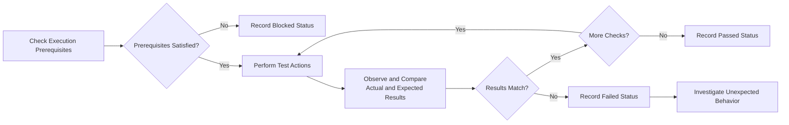
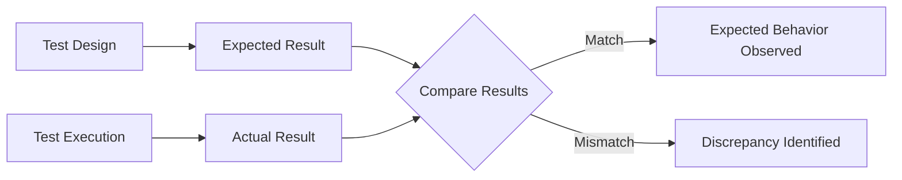

# Level 1

## Table of Contents: Test Execution

- [Test Execution Workflow](#test-execution-workflow)
- [Expected Results vs. Actual Results](#expected-results-vs-actual-results)
- [Test Execution Statuses](#test-execution-statuses)

**Test Execution Level 1** introduces the fundamental activities involved in performing tests and evaluating their outcomes. It explains how **actual results** are compared with **expected results** and how **test execution statuses** communicate the outcome of each run. The chapter begins with the **test execution workflow**, which places these activities in context by showing how tests are prepared, performed, evaluated, and recorded.

## Test Execution Workflow

The **test execution workflow** describes how tests are prepared, performed, evaluated, and recorded to determine whether software behaves as expected. A consistent workflow helps ensure that tests are conducted under suitable conditions and that their results can be interpreted reliably. This begins with satisfying the necessary **execution prerequisites**, which may include access to the software, a suitable **test environment**, prepared **test data**, and sufficient information to perform the intended checks.

Once these prerequisites are satisfied, a tester or automated tool performs the test actions and compares the observed **actual results** with the **expected results**. A test case may contain several verification points, so these comparisons can take place throughout execution rather than only after all actions are complete. The evaluated results then provide the basis for recording the outcome of that run according to the project's reporting conventions. These activities form part of the broader testing process described by ISTQB **(ISTQB, 2024, Section 1.4.1)**. The following diagram illustrates the workflow and its possible outcomes.

Although the diagram shows a failed outcome as soon as a check is unsuccessful, testing may continue to gather further observations, depending on the test objectives and execution approach. The results and relevant circumstances are then documented for that particular run to support investigation and reporting. Central to evaluating these observations is the comparison of **expected and actual results**, which the next section examines in more detail.

## Expected Results vs. Actual Results

An essential part of test execution is comparing **expected results** with **actual results** to determine whether software behaves as intended. An **expected result** describes the behavior or outcome that should occur according to requirements, specifications, or other relevant sources of information, while an **actual result** describes what is observed during execution. To make this comparison meaningful, expected results must be clear and observable. They may specify a displayed message, a change in application state, a calculated value, or another verifiable outcome. For example, submitting valid login credentials may be expected to authenticate the user and provide access to their account. The following diagram illustrates how expected results established during test design are compared with actual results observed during execution.

However, expected behavior does not always involve accepting an action or completing an operation successfully. Software must also respond appropriately to invalid or unsupported conditions, which is why testing includes both **positive testing** and **negative testing**. Positive testing examines software behavior under valid conditions, while negative testing examines its response to invalid or unsupported ones. In either case, the result is evaluated by comparing the observed behavior with the defined expectation, rather than simply determining whether the application accepted or rejected an action.

!!! example "Comparing Expected and Actual Results"

    The following table illustrates comparisons across positive and negative checkout tests in an online shopping application. It uses **TS001** and **TC001** from the checkout example introduced in the **Test Case Design** module, together with illustrative identifiers **TS002** and **TC002** for a negative checkout test. The **Test Condition** column identifies the aspect of functionality being verified, while the scenario and test case identifiers connect each execution to its corresponding test specifications. Projects may organize their testing around test conditions, test scenarios, or test cases without maintaining all three as separate documentation artifacts.

    | Execution   | Scenario ID | Test Case ID | Test Condition                            | Expected Result                                              | Actual Result                                                | Comparison |
    | ----------- | ----------- | ------------ | ----------------------------------------- | ------------------------------------------------------------ | ------------------------------------------------------------ |----------- |
    | Execution 1 | TS001       | TC001        | Successful checkout processing            | Checkout confirmation is displayed                           | Checkout confirmation is displayed                           | Match      |
    | Execution 2 | TS001       | TC001        | Successful checkout processing            | Checkout confirmation is displayed                           | Payment error message is displayed                           | Mismatch   |
    | Execution 3 | TS002       | TC002        | Required-field validation during checkout | Checkout is prevented and a validation message is displayed  | Checkout is prevented and a validation message is displayed  | Match      |
    | Execution 4 | TS002       | TC002        | Required-field validation during checkout | Checkout is prevented and a validation message is displayed  | Checkout completes without validation                        | Mismatch   |

    The first two rows show separate executions of the same positive test case, while the last two show executions of a negative test case. Both types can produce matching or mismatching results. The table is a simplified educational example rather than a prescribed format for recording execution results.

Because the same test case can produce different actual results across executions, each run is evaluated separately to determine its **test execution status**. A **mismatch** between expected and actual results contributes to that evaluation, but further investigation may be needed to establish whether it indicates a software defect. The next section explains how execution statuses communicate the outcome of each run.

## Test Execution Statuses

A **test execution status** communicates the state or outcome of a particular test run, distinguishing tests that satisfied their expectations from those that revealed discrepancies or could not be completed. Consistent status reporting helps testers and stakeholders monitor progress and identify results requiring attention. The three common outcome statuses are **passed**, **failed**, and **blocked**, as summarized in the following table.

| Status      | Meaning                                                                                                             | Example                                                                           |
| ----------- | ------------------------------------------------------------------------------------------------------------------- | --------------------------------------------------------------------------------- |
| **Passed**  | All required checks were completed and their actual results met the expected results.                               | A customer completes checkout and receives the expected confirmation message.     |
| **Failed**  | One or more required checks did not meet their expected results.                                                    | A customer submits valid payment information but receives an unexpected error.    |
| **Blocked** | The test could not be performed or completed because a necessary prerequisite or dependency was unavailable.        | The checkout test cannot proceed because the payment service is unavailable.      |

A **passed** status means that all required checks succeeded during the execution, not that the functionality is free of defects. If a required check does not meet its expectation, the execution may be recorded as **failed** according to the agreed reporting rules, although investigation may still be needed to identify the cause. These rules also determine the overall status when a test contains multiple checks, since passing one check does not establish that the entire test passed. A **blocked** status instead indicates that a missing prerequisite prevented the intended evaluation. For example, an unavailable payment service may block a successful checkout test, but if the test is intended to evaluate how the application handles that unavailability, the observed response must be compared with the expected result.

Projects and test management tools may use different status terminology, including **not run** and **in progress** to describe execution states rather than outcomes. Whatever terms are used, a status belongs to a **particular execution**, so a test that fails and later passes after a correction has two separate results. Preserving those results helps teams monitor progress and investigate changes over time, as explored further in [Level 3 Recording Test Execution Results](../3_level/3_test_execution.md#recording-test-execution-results).

The **test execution workflow** applies to both manual and automated execution, with actual results evaluated against expected results and an outcome recorded for each run. Whether a tester or an automated tool performs these activities does not change what a **passed**, **failed**, or **blocked** status communicates. The choice of execution approach instead depends on the testing objective and the evidence needed to evaluate it. **[Test Execution Level 2](../2_level/2_test_execution.md)** examines when manual or automated execution is appropriate, the limitations of both approaches, and how they can be selected and combined.
