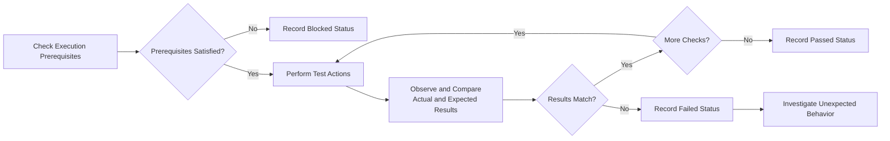
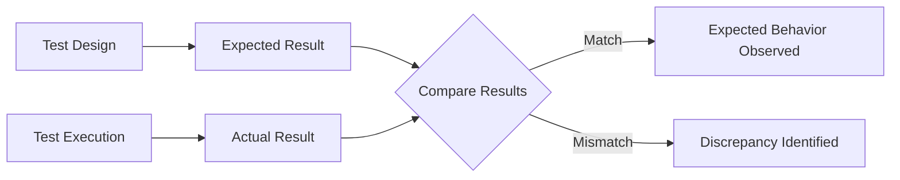

# Level 1

## Table of Contents: Test Execution

- [Test Execution Workflow](#test-execution-workflow)
- [Expected Results vs. Actual Results](#expected-results-vs-actual-results)
- [Test Execution Statuses](#test-execution-statuses)
- [Manual and Automated Test Execution](#manual-and-automated-test-execution)

**Test Execution Level 1** introduces the fundamental activities involved in performing tests and evaluating their outcomes. It explains the **test execution workflow**, how **expected and actual results** are compared, and how **execution statuses** communicate outcomes. It also introduces **manual and automated test execution** and the main differences between these approaches.

## Test Execution Workflow

The **test execution workflow** describes how tests are prepared, performed, evaluated, and recorded to determine whether software behaves as expected. Following a consistent workflow helps ensure that tests are conducted under suitable conditions and that their results can be interpreted reliably. Before execution begins, the necessary **execution prerequisites** must be satisfied. These may include access to the software, a suitable **test environment**, prepared **test data**, and sufficient information to perform the intended checks. Once these conditions are met, a tester or automated tool carries out the test actions and compares the observed **actual results** with the **expected results**. Because a test case may contain multiple verification points, individual checks can be evaluated throughout execution rather than only after all actions are completed. These activities form part of the broader testing process described by ISTQB **(ISTQB, 2024, Section 1.4.1)**.

The results of these checks provide the basis for determining the overall execution outcome according to the project's reporting conventions. An execution is generally recorded as **passed** when all required checks meet expectations or **failed** when one or more checks do not. If an essential prerequisite prevents the intended evaluation, the execution may instead be recorded as **blocked**. The following diagram illustrates how these activities and possible outcomes fit together.



The diagram represents a simplified workflow in which an unsuccessful check leads to a failed outcome. In practice, testing may continue after a failed check to gather additional observations, depending on the test objectives and execution approach. Once execution is complete, the relevant results and circumstances are documented for that particular test run to support investigation and reporting.

!!! example "Executing a Login Test"

    Consider a test case that verifies whether a user can log in with valid credentials. After preparing an account with known credentials, the tester opens the login page, enters the username and password, and submits the form. The tester then verifies that the application authenticates the user and redirects them to the appropriate page.

    These are two required checks within the same test case. If both succeed, the execution is recorded as **passed**. If either fails, the execution is recorded as **failed**, and the unexpected behavior is documented for investigation.

The login example demonstrates how individual checks contribute to the overall execution outcome. Each check involves comparing the behavior that should occur with what actually happens, making the distinction between **expected and actual results** fundamental to test execution. The next section examines this comparison in more detail.

## Expected Results vs. Actual Results

An essential part of test execution is comparing **expected results** with **actual results** to determine whether software behaves as intended. An **expected result** describes the behavior or outcome that should occur according to requirements, specifications, or other relevant sources of information, while an **actual result** describes what is observed during execution. To make this comparison meaningful, expected results must be clear and observable. They may specify a displayed message, a change in application state, a calculated value, or another verifiable outcome. For example, submitting valid login credentials may be expected to authenticate the user and provide access to their account. The following diagram illustrates how expected results established during test design are compared with actual results observed during execution.



However, expected behavior does not always involve accepting an action or completing an operation successfully. Software must also respond appropriately to invalid or unsupported conditions, which is why testing includes both **positive testing** and **negative testing**. Positive testing examines software behavior under valid conditions, while negative testing examines its response to invalid or unsupported ones. In either case, the result is evaluated by comparing the observed behavior with the defined expectation, rather than simply determining whether the application accepted or rejected an action.

!!! example "Comparing Expected and Actual Results"

    The following table illustrates comparisons across positive and negative checkout tests in an online shopping application. It uses **TS001** and **TC001** from the checkout example introduced in the **Test Case Design** module, together with illustrative identifiers **TS002** and **TC002** for a negative checkout test. The **Test Condition** column identifies the aspect of functionality being verified, while the scenario and test case identifiers connect each execution to its corresponding test specifications. Projects may organize their testing around test conditions, test scenarios, or test cases without maintaining all three as separate documentation artifacts.

    | Execution   | Scenario ID | Test Case ID | Test Condition                            | Expected Result                                              | Actual Result                                                | Comparison |
    | ----------- | ----------- | ------------ | ----------------------------------------- | ------------------------------------------------------------ | ------------------------------------------------------------ |----------- |
    | Execution 1 | TS001       | TC001        | Successful checkout processing            | Checkout confirmation is displayed                           | Checkout confirmation is displayed                           | Match      |
    | Execution 2 | TS001       | TC001        | Successful checkout processing            | Checkout confirmation is displayed                           | Payment error message is displayed                           | Mismatch   |
    | Execution 3 | TS002       | TC002        | Required-field validation during checkout | Checkout is prevented and a validation message is displayed  | Checkout is prevented and a validation message is displayed  | Match      |
    | Execution 4 | TS002       | TC002        | Required-field validation during checkout | Checkout is prevented and a validation message is displayed  | Checkout completes without validation                        | Mismatch   |

    The first two rows show separate executions of the same positive test case, while the last two show executions of a negative test case. Both types can produce matching or mismatching results. The table is a simplified educational example rather than a prescribed format for recording execution results.

As illustrated in the example, the same test case can be executed multiple times, producing different actual results while retaining its originally specified expected results. Comparing them helps determine whether the software behaved as expected during a particular test run without changing the original test specification. However, a **mismatch** does not automatically confirm a software defect. It may result from an incorrect expectation, unsuitable test data, an environmental issue, or a problem in the software itself. Identifying the cause requires considering the test inputs, preconditions, and system state, since these factors can influence which behavior should be expected. Evaluating an unexpected result therefore requires more than identifying a difference. Testers must also assess the reliability of the expectation, the execution conditions, and the available evidence before drawing conclusions (Kaner, Bach, & Pettichord, 2002).

Once the required comparisons have been evaluated, testers document any discrepancies and relevant execution circumstances to support further investigation. More detailed guidance on recording these findings is provided in [Level 3 Recording Test Execution Results](../3_level/3_test_execution.md#recording-test-execution-results). The evaluated results also provide the basis for assigning an appropriate **test execution status**, which communicates the outcome of that particular run. The next section explains these statuses and how they are interpreted.

## Test Execution Statuses

A **test execution status** communicates the state or outcome of a particular test run, distinguishing tests that satisfied their expectations from those that revealed discrepancies or could not be completed. Consistent status reporting helps testers and stakeholders monitor progress and identify results requiring attention. The three common outcome statuses are **passed**, **failed**, and **blocked**, as summarized in the following table.

| Status      | Meaning                                                                                                             | Example                                                                           |
| ----------- | ------------------------------------------------------------------------------------------------------------------- | --------------------------------------------------------------------------------- |
| **Passed**  | All required checks were completed and their actual results met the expected results.                               | A customer completes checkout and receives the expected confirmation message.     |
| **Failed**  | One or more required checks did not meet their expected results.                                                    | A customer submits valid payment information but receives an unexpected error.    |
| **Blocked** | The test could not be performed or completed because a necessary prerequisite or dependency was unavailable.        | The checkout test cannot proceed because the payment service is unavailable.      |

A **passed** status indicates that the required checks succeeded during that execution, but does not guarantee that the functionality is free of defects. A **failed** status indicates that at least one check did not meet its expectation, although investigation may still be needed to identify the cause. When a test case contains multiple checks, its overall status follows the agreed reporting rules, since passing an individual check does not necessarily mean the entire test has passed. A **blocked** status, by contrast, indicates that a missing prerequisite prevented the intended evaluation. For example, an unavailable test environment may prevent the tester from accessing the checkout page. However, if the test specifically examines how the application handles an unavailable service, the observed response should be evaluated against the expected result rather than automatically classified as blocked.

!!! example "Different Statuses Across Test Executions"

    Consider test case **TC001**, which verifies successful checkout using valid information. During its first execution, the checkout process completes and the expected confirmation message appears, so the execution is recorded as **passed**.

    During a later execution, the same test case produces an unexpected payment error and is recorded as **failed**. When the test is attempted again, the test environment is unavailable, preventing the checkout process from being evaluated, so that execution is recorded as **blocked**.

    The following diagram illustrates how three separate executions of the same test case can produce different statuses.

    ```mermaid
    flowchart TD
        A["Test Case TC001"]

        A --> B["Execution 1"]
        A --> C["Execution 2"]
        A --> D["Execution 3"]

        B --> E["Passed"]
        C --> F["Failed"]
        D --> G["Blocked"]
    ```

    Each execution has its own status because the observed behavior or execution conditions differ, even though the test case remains the same.

Status terminology and reporting rules may vary between projects and test management tools. Some teams also use **not run** or **in progress** to describe tests that have not started or are still being performed. Unlike passed, failed, and blocked, these indicate the state of execution rather than a completed test outcome. Regardless of the terminology, a status belongs to a **particular execution**, not permanently to the test case itself. A test may fail during one run and pass after a correction, or a previously passed test may fail under changed conditions. Recording these outcomes separately helps teams monitor progress and investigate changes over time, as explored further in [Level 3 Recording Test Execution Results](../3_level/3_test_execution.md#recording-test-execution-results).

Because execution statuses describe outcomes rather than how tests are performed, they apply to both human-performed and automated tests. The next section introduces **manual and automated test execution** and compares the characteristics of each approach.

## Manual and Automated Test Execution

Software tests can be performed **manually** by human testers or **automatically** using software tools and executable scripts. Both approaches evaluate software behavior against defined expectations, but they differ in how actions are performed, how results are assessed, and how much human involvement is required.

**Manual test execution** involves performing and evaluating tests under direct human control. Testers may interact with graphical interfaces, command-line tools, or APIs, using supporting utilities such as browser developer tools or API clients when needed. Using these tools does not itself make testing automated, since the tester remains responsible for directing the actions and interpreting the observations. Manual testing may follow **predefined test cases**, where actions and expected results are established in advance, or involve **exploratory testing**, where testers investigate the software, develop checks, and execute them as part of the same activity. During exploratory testing, expectations may emerge through investigation rather than being fully specified beforehand. In either approach, testers document relevant observations and findings while applying human judgment and adapting their actions when necessary. Exploratory testing is also described in the **(ISTQB, 2024, Section 4.4.2)**.

**Automated test execution** uses software tools and executable scripts to perform test actions and evaluate specified conditions with limited direct human intervention. Automated tests may interact with graphical interfaces, send API requests, or inspect application state, using programmed checks called **assertions** to determine whether observed results meet expected conditions. An **automated test script** implements these actions and checks, whereas a **test case** defines the conditions and expected results to be verified. Their relationship is not necessarily one-to-one, since scripts may implement individual test cases, combine related checks, or reuse shared actions across several tests. A script may complete its execution while reporting a failed assertion, so completing automated execution does not necessarily mean that the test has passed. Although the actions and checks are automated, testers and developers remain responsible for designing appropriate checks, preparing test data and environments, maintaining scripts, and investigating unexpected results. The role of testing tools and the benefits and risks of automation are also discussed by the **(ISTQB, 2024, Sections 6.1–6.2)**.

!!! example "Manual and Automated Checkout Testing"

    Consider test case **TC001**, which verifies successful checkout using valid information in an online shopping application. Both approaches use the same functional preconditions and expected results, although automation may require additional technical preparation.

    During **manual execution**, the tester navigates to checkout, enters the required customer and payment information, submits the order, and observes the application's responses. The tester verifies that the expected confirmation appears and records any unexpected behavior.

    During **automated execution**, a script performs the corresponding actions using prepared test data and checks whether the required conditions are satisfied. The automation tool reports the check results for review and investigation when necessary.

    Both approaches evaluate the same functionality, but differ in how the actions and checks are performed.

The checkout example illustrates how the same test case can be executed through different approaches. Beyond the way actions and checks are performed, manual and automated execution also differ in their repeatability, flexibility, execution effort, and typical applications. These characteristics are compared in the following table.

| Aspect                   | Manual Test Execution                                                                                                 | Automated Test Execution                                                                                                 |
| ------------------------ | --------------------------------------------------------------------------------------------------------------------- | ------------------------------------------------------------------------------------------------------------------------ |
| **Execution**            | A human tester performs test actions directly.                                                                        | Software tools and scripts perform predefined actions.                                                                   |
| **Result evaluation**    | The tester observes and evaluates software behavior.                                                                  | Programmed checks and assertions evaluate specified conditions.                                                          |
| **Human involvement**    | Requires direct involvement during execution.                                                                         | Requires human involvement in design, preparation, maintenance, and investigation, but generally less during execution.  |
| **Repeatability**        | Repeated execution requires human effort and may vary between runs.                                                   | Programmed checks can be executed consistently across multiple runs.                                                     |
| **Execution speed**      | Often slower for repetitive tests.                                                                                    | Often faster for repeated checks once automation is established.                                                         |
| **Flexibility**          | Testers can adapt their actions and investigate unexpected behavior.                                                  | Execution generally follows predefined actions and checks.                                                               |
| **Initial effort**       | Often requires less automation-related setup, although preparing tests, data, and environments still requires effort. | Requires effort to develop and configure automated checks.                                                               |
| **Typical applications** | Exploratory testing, usability evaluation, and checks requiring human judgment.                                       | Regression testing, repetitive functional checks, and frequent verification of stable behavior.                          |

Automated execution is particularly useful for **regression testing**, where previously tested functionality is checked again after software changes to identify unintended effects. However, automation requires ongoing maintenance and can evaluate only the conditions covered by its implemented checks. Although specialized tools can assess certain visual and accessibility characteristics, some usability concerns and unexpected behaviors still require broader human judgment. Effective automation therefore depends not only on repeating checks but also on maintaining their reliability, relevance, and usefulness as the software and testing objectives evolve **(Graham & Fewster, 2012)**. For these reasons, **manual and automated test execution are complementary**, and teams often combine them to address different testing needs.

Building on the introduction to manual and automated execution, [Level 2](../2_level/2_test_execution.md) focuses on practical decisions about when to use each approach, which tests may be unsuitable for automation, and how to evaluate the trade-offs involved.
