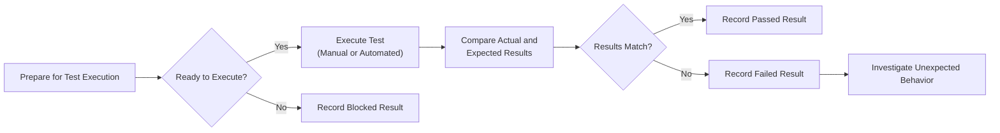

# Overview

Software testing involves more than identifying what should be tested and designing test cases. Tests must also be performed to observe how the software behaves and determine whether the results meet expectations. **Test execution** involves running tests, comparing **actual results** with **expected results**, and recording their outcomes. It provides evidence about software behavior and helps identify failures that may indicate underlying defects **(ISTQB, 2024, Section 1.4.1)**.

Tests can be executed **manually** or **automatically**, depending on the testing objectives, the behavior being examined, and the available resources. In manual execution, a tester performs the test activities and evaluates the observed behavior. In automated execution, tools or scripts perform predefined actions and checks. Both approaches can contribute to effective testing, and they may be used together.

Regardless of the approach, test execution involves checking that the necessary conditions are available, performing the test, evaluating the observed behavior, and recording the outcome. The following diagram illustrates this basic process, including situations in which a test cannot proceed.

Meaningful test execution requires suitable conditions, including access to the software, an appropriate **test environment**, relevant **test data**, and defined expectations. If these conditions are not met, a test may be unable to proceed or complete as intended.

During execution, observed results are evaluated and outcomes are recorded. Tests may receive statuses such as **passed**, **failed**, or **blocked**, depending on the circumstances and reporting conventions. An unexpected result may require further investigation, since a failed test does not necessarily identify the underlying defect or establish that the software itself is at fault. Broader activities such as monitoring testing progress and managing defects are covered in [Test Management](../test_managment/overview.md).

This module explores test execution across three levels. [Level 1](./1_level/1_test_execution.md) explains how execution outcomes are evaluated and recorded, along with the fundamental differences between manual and automated execution. [Level 2](./2_level/2_test_execution.md) examines how to select an appropriate execution approach, including automation suitability and strategies. [Level 3](./3_level/3_test_execution.md) focuses on preparing, performing, recording, and following up on test execution activities.
