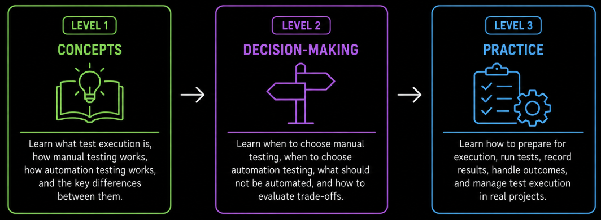

# Overview

Software testing involves more than identifying what should be tested and designing test cases. Tests must also be performed to observe how the software behaves and determine whether the results meet expectations. **Test execution** involves running tests, comparing **actual results** with **expected results**, and recording the outcomes. It provides evidence about software behavior and helps identify failures that may indicate underlying defects **(ISTQB, 2024, Section 1.4.1)**.

How tests are performed depends on the testing objectives, the behavior being examined, and the resources available. Tests can be executed **manually** or **automatically**. In manual execution, a tester performs actions, observes the software's behavior, and evaluates the results. In automated execution, tools or scripts perform predefined actions or checks and report their outcomes.

Both approaches support test execution, but they are suitable for different situations. **Manual execution** is particularly useful when human observation, investigation, or judgment is needed, while **automated execution** is often suitable for repeatable checks. Choosing an approach involves considering the testing objectives, execution effort, and maintenance needs. Neither approach is universally preferable, and both may be combined within the same testing effort.

Regardless of the approach, tests need suitable conditions to produce meaningful results. This may include access to the software, an appropriate **test environment**, the necessary **test data**, and a way to determine expected behavior. These requirements help testers perform checks consistently and investigate unexpected behavior.

As tests are performed, their outcomes are evaluated and recorded. A test may be reported as **passed**, **failed**, **blocked**, or assigned another status depending on the reporting conventions used. Unexpected results may require investigation, and a failed test does not necessarily reveal the underlying defect or its location. Recorded results support further investigation and retesting. Broader activities such as monitoring testing progress and managing defects are covered in the [Test Management overview](../test_management/overview.md).

The following topics explore test execution at different levels of detail. [Level 1](./1_level/1_test_execution.md) introduces the fundamentals of test execution, [Level 2](./2_level/2_test_execution.md) examines how to choose between manual and automated execution, including automation strategies, and [Level 3](./3_level/3_test_execution.md) covers preparing, performing, and recording tests. You can explore these topics in any order depending on your existing knowledge and learning objectives.
