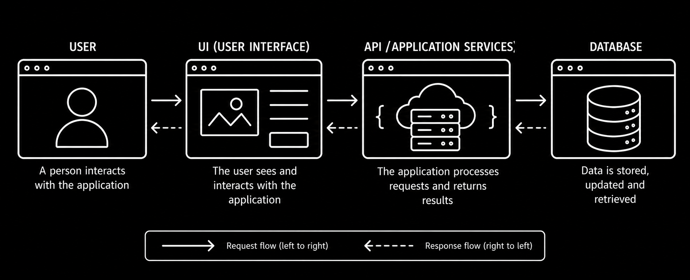
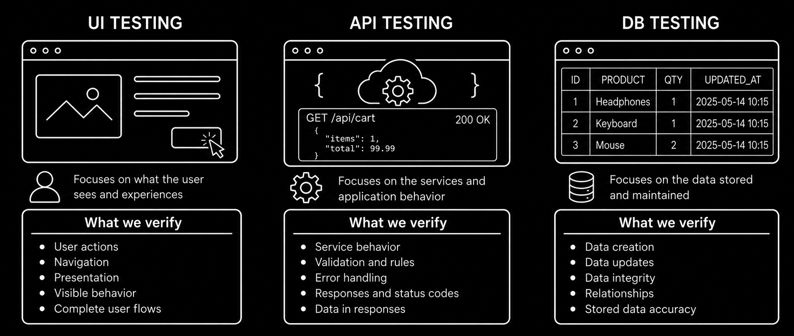

# Overview

A software application can consist of multiple technical layers that work together to deliver functionality to users. Testing can examine an application through different points of interaction, depending on **what behavior needs to be verified and where that behavior can be observed most effectively**. In many applications, these include the **user interface (UI)**, **application programming interface (API)**, and **database (DB)**, although not every application uses or exposes all three.

The **UI layer** represents what users see and interact with, allowing testers to evaluate user actions, navigation, and visible behavior. The **API layer** provides access to application services without going through the interface, making it possible to examine requests, responses, validation, and error handling directly. Depending on the application, API interactions may use HTTP or other communication protocols. The **database layer** provides insight into how information is stored and maintained, helping testers verify data accuracy, consistency, and changes resulting from application operations.

These layers often work together. A user action in the interface may trigger an API request that processes the operation and reads or modifies data in a database before returning a result to the user. This represents a common application architecture rather than a structure followed by every software system.

The diagram shows how information moves between the different application layers. For example, when a user adds a product to a shopping cart, the interface may send a request to an API that processes the operation and updates stored data. The result can then be returned through the API and displayed in the interface.

The same application can also be examined from different testing perspectives. **UI testing** focuses on user interactions and visible behavior, **API testing** examines application operations through requests and responses, and **database testing** verifies stored data and its integrity. The following diagram illustrates what testers can verify through each perspective.

Choosing where to test depends on the behavior being investigated and the information needed to evaluate it. For example, unexpected behavior in the user interface may be caused by an issue in the interface itself, an API operation, or the underlying data. Testing at different points can help identify the source of the issue, while practical considerations such as accessibility, dependencies, and execution effort influence which approach is most suitable.

The following topics explore these testing perspectives in more detail. Depending on what you want to explore, you can choose [Test Layer UI](./test_layer_ui/test_layer_ui.md) to learn about testing through the user interface, [Test Layer API](./test_layer_api/test_layer_api.md) to understand how application behavior is verified through requests and responses, or [Test Layer DB](./test_layer_db/test_layer_db.md) to explore stored data and database behavior. These topics can be explored in any order based on your interests and testing objectives.
