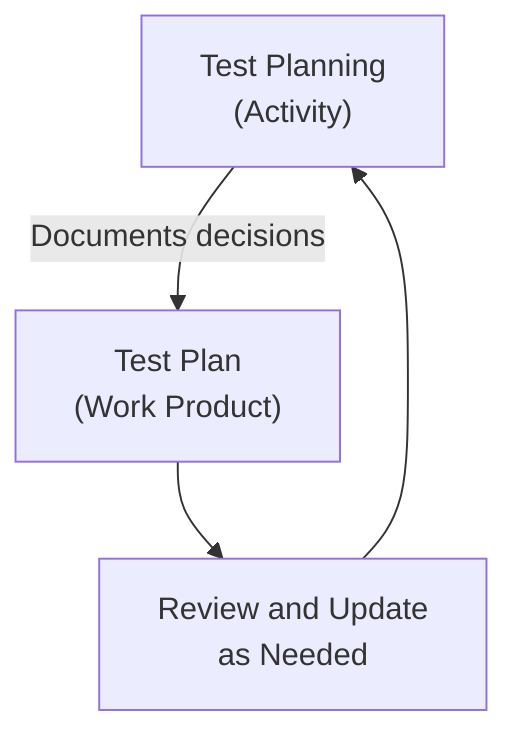

# Level 1

## Table of Contents: Test Management

- [Test Planning and Test Plans](#test-planning-and-test-plans)
- [Test Scope and Objectives](#test-scope-and-objectives)
- [Testing Roles and Responsibilities](#testing-roles-and-responsibilities)
- [Test Environment and Resources](#test-environment-and-resources)
- [Test Schedule and Milestones](#test-schedule-and-milestones)
- [Entry and Exit Criteria](#entry-and-exit-criteria)

**Test Management Level 1** introduces the fundamentals of **test planning** and how planning decisions are documented in a **test plan**. It covers **test scope and objectives**, **roles and responsibilities**, **test environments and resources**, **test schedules and milestones**, and **entry and exit criteria**. Together, these elements establish how testing is organized, supported, and coordinated, beginning with the relationship between test planning and test plans.

## Test Planning and Test Plans

**Test planning** is the activity of defining how testing will be organized and carried out to achieve its objectives. As introduced in [Test Process and Activities](../../fundamentals_of_testing/1_level/1_fundamentals_of_testing.md#test-process-and-activities), it is one of the main activities within the test process. Planning involves determining what needs to be tested, which approaches will be used, who will perform the activities, and what resources, environments, and timeframes are required. It also considers product risks, project constraints, and the information stakeholders need to evaluate testing progress and results.

A **test plan** documents the decisions made during test planning and provides a reference for managing the testing effort **(ISTQB, 2024, Section 5.1.1)**. The distinction is that **test planning is an activity**, while a **test plan is a work product** that records its outcomes. As discussed in [Testware and Deliverables](../../fundamentals_of_testing/1_level/1_fundamentals_of_testing.md#testware-and-deliverables), a test plan is a form of testware and may also be a deliverable when required by stakeholders. Depending on the project's needs, it may cover an entire project, a testing level, a release, or an iteration, and may be maintained as a formal document or within project management tools.

The contents of a test plan depend on the project's size, complexity, risks, and documentation requirements. Common elements include **test scope and objectives**, the **testing approach**, **roles and responsibilities**, **test environments and resources**, **test schedules and milestones**, and **entry and exit criteria**. The plan may also describe risks, dependencies, assumptions, expected deliverables, and arrangements for monitoring and communicating testing progress and results. As testing progresses, these planning decisions may need to be reviewed and updated, as illustrated in the following diagram.

The relationship between test planning and the test plan becomes clearer when applied to a specific project. The following example illustrates how planning decisions are documented for an online shopping application.

!!! example "Test Planning for an Online Shopping Application"

    When planning testing for an online shopping application, a team may focus on account registration, product search, shopping cart functionality, and payment processing for an upcoming release. The test plan can document these priorities, identify the people responsible, specify the required environments and data, and establish a schedule. It may also define the conditions for starting testing and the criteria used to assess whether its objectives have been met.

Test planning continues as the project develops. Changes in requirements, emerging risks, or unexpected problems may require the team to revise its decisions. For example, repeated failures in payment processing may justify additional testing effort or schedule adjustments. Although a test plan cannot guarantee that every defect will be discovered, it provides a shared reference for coordinating activities and communicating significant changes. One of its first considerations is defining **test scope and objectives**, which establish the boundaries and intended outcomes of testing.

## Test Scope and Objectives

**Test scope** and **test objectives** establish what will be tested and what the testing effort is expected to achieve. **Test scope** identifies the features, components, behaviors, and other aspects of a system included in a particular testing effort. As introduced in [System Under Test (SUT)](../../fundamentals_of_testing/1_level/1_fundamentals_of_testing.md#system-under-test-sut), testing requires establishing boundaries around the software and its relevant interactions. Scope may also specify the testing types, quality characteristics, and configurations to be covered. Since not every possible condition can be tested, teams prioritize areas based on factors such as **business criticality**, **regulatory requirements**, **new or modified functionality**, and **areas with a history of defects**.

These boundaries are commonly expressed through **in scope** and **out of scope**. In-scope items are included in the current testing effort, while out-of-scope items are excluded. Exclusions may involve functionality not yet implemented, lower-priority features, or activities assigned to another team. The test plan should clarify whether excluded functionality will be tested separately or remain untested during the current effort, since an exclusion does not necessarily mean that the functionality is unimportant or will never be tested. Clearly defining these boundaries also helps manage **scope creep**, which occurs when additional work is introduced beyond the agreed scope without appropriate review. Changes to scope should therefore be assessed for their effects on resources, schedules, and testing objectives.

While scope establishes what will be tested, **test objectives** describe what testing aims to accomplish. As discussed in [Test Objectives](../../fundamentals_of_testing/1_level/1_fundamentals_of_testing.md#test-objectives), testing may seek to evaluate requirements, identify defects, achieve specified coverage, reduce risks, and provide information about product quality. During planning, these broader purposes are translated into objectives relevant to the particular system, release, and testing effort. Objectives should be **clear and assessable**, with measurable criteria where appropriate. For example, an objective may be to evaluate payment processing under supported payment conditions, with a related exit criterion requiring that no known critical payment defects remain unresolved. The objective describes what testing aims to achieve, while the criterion helps determine whether an agreed condition for completion has been satisfied.

!!! example "Scope and Objectives for an Online Shopping Application"

    For an upcoming release of an online shopping application, the team may define account registration, product search, shopping cart functionality, and payment processing as **in scope**, while excluding a recommendation feature planned for a later release. Within this scope, the team may establish objectives such as evaluating whether customers can register accounts, find products, update their shopping carts, and complete purchases using supported payment methods.

With the scope and objectives established, the team can identify the **roles and responsibilities** needed to organize and carry out the planned testing activities.

## Testing Roles and Responsibilities

**Testing roles and responsibilities** define how testing-related work is assigned among project participants to ensure that activities are coordinated, responsibilities are understood, and results are communicated effectively. A distinction is commonly made between **test management responsibilities**, which focus on planning, organizing, and monitoring testing, and **testing responsibilities**, which involve preparing, executing, and evaluating tests. These responsibilities may be distributed among different individuals or combined within the same role, depending on the team's structure and development approach **(ISTQB, 2024, Section 1.4.3)**. The following table summarizes common testing-related roles and their responsibilities.

| Role                                 | Common Testing-Related Responsibilities                                                                                          |
| ------------------------------------ | -------------------------------------------------------------------------------------------------------------------------------- |
| **Test Manager / Test Lead**         | Plans and coordinates testing, allocates resources, monitors progress and risks, and communicates testing status.                |
| **Tester**                           | Designs and executes tests, prepares test data, evaluates results, and documents findings.                                       |
| **Developer**                        | Performs developer-level testing, investigates defects, implements corrections, and supports technical testing activities.       |
| **Business Analyst / Product Owner** | Clarifies requirements and expected behavior, helps establish priorities, and supports acceptance-related decisions.             |
| **Other Stakeholders**               | Provide relevant information, review testing outcomes, and support decisions concerning quality and release readiness.           |

These roles represent common arrangements rather than a mandatory organizational structure. In smaller teams, one person may perform several roles, while larger projects may distribute responsibilities among specialists. Regardless of how the work is organized, team members should understand who is responsible for coordinating activities, completing assigned tasks, and communicating results.

!!! example "Testing Responsibilities for an Online Shopping Application"

    Consider a team preparing to test an upcoming release of an online shopping application. The **test lead** coordinates the testing effort and monitors progress, while the **tester** prepares and executes tests covering account registration, product search, shopping cart functionality, and payment processing. During testing, a **developer** investigates an unexpected payment error and implements a correction when a defect is confirmed. The **product owner** clarifies the expected checkout behavior and helps assess the issue's importance to the release. Their contributions support the same testing objectives while addressing different responsibilities.

Once responsibilities are assigned, the team must ensure that the people involved have access to the **test environments and resources** needed to perform their work.

## Test Environment and Resources

A **test environment** consists of the hardware, software, configurations, and supporting systems used to execute tests, while **testing resources** include the people, tools, data, infrastructure, time, and other assets needed to support testing activities. Depending on the system under test, an environment may include servers, operating systems, databases, browsers, mobile devices, networks, and external services. It should be suitable for the testing objectives and sufficiently representative of the conditions being evaluated. For example, testing an online shopping application may require supported browsers, prepared customer and product records, and access to a payment service configured for testing. Identifying these requirements during planning helps prevent delays and unreliable results caused by unavailable or unsuitable environments and resources.

Test environments may be **dedicated** to testing or **shared** with other development activities. Dedicated environments provide greater control over configurations and test data, while shared environments may be more economical but introduce dependencies and interruptions. Differences between test and production environments should also be considered because they can influence results and limit which behaviors can be evaluated reliably. Environment management also involves appropriate access controls and data protection, particularly when personal or sensitive information is involved. Teams may use synthetic, anonymized, or otherwise protected test data to reduce unnecessary exposure of real user information.

Alongside the technical environment, teams must ensure that personnel with suitable skills, testing tools, prepared data, sufficient time, and access to relevant documentation or supporting services are available. Planning these resources helps establish whether the testing effort can be carried out within the project's constraints. The following table summarizes common environment components and testing resources.

| Category                             | Examples                                                             | Purpose                                                                             |
| ------------------------------------ | -------------------------------------------------------------------- | ----------------------------------------------------------------------------------- |
| **Hardware and infrastructure**      | Servers, computers, mobile devices, and network connections          | Provide the technical infrastructure required to run and access the software.       |
| **Software and configurations**      | Operating systems, browsers, databases, and application settings     | Establish the software conditions under which tests are performed.                  |
| **Supporting systems and services**  | Payment services, authentication services, and external integrations | Enable testing of functionality that depends on other systems.                      |
| **Test data**                        | Customer accounts, product records, and payment test data            | Provide the inputs and system states required for test execution.                   |
| **Testing tools**                    | Test management tools, API clients, and automation frameworks        | Support test preparation, execution, monitoring, and reporting.                     |
| **Personnel and time**               | Testers, developers, technical support, and allocated testing time   | Provide the skills, effort, and availability needed to complete testing activities. |

Before execution begins, teams must assess **test environment readiness** by confirming that the required application build is deployed, relevant configurations are in place, supporting services are accessible, and suitable test data is available. These checks help prevent avoidable interruptions, although they do not guarantee that every test will succeed. The following example illustrates how environment preparation and readiness checks support testing activities in practice.

!!! example "Preparing the Test Environment for an Online Shopping Application"

    Consider a team preparing to test account registration, product search, shopping cart functionality, and payment processing for an upcoming release of an online shopping application. The team arranges access to an environment containing the required application build, supported browsers, a database with prepared customer and product records, and a payment service configured for testing.

    Before execution, the team verifies that the application and necessary services are accessible and that suitable test data is available. If the payment service is unavailable, payment-related tests may need to be postponed, while tests that do not depend on that service may still proceed.

The availability of environments and resources influences when testing activities can begin and how they can be organized. These dependencies must therefore be considered when establishing the **test schedule and milestones**, which are examined in the next section.

## Test Schedule and Milestones

A **test schedule** outlines the planned timing and sequence of testing activities, while **test milestones** identify significant points used to assess progress. The schedule may cover test analysis and design, environment and data preparation, test execution, defect investigation, retesting, and reporting. It can specify planned start and completion dates, estimated durations, responsible individuals or teams, and dependencies between activities. The level of detail depends on the project's size, complexity, development approach, and reporting requirements, but its purpose is to help teams coordinate work and establish realistic expectations about when testing activities should occur.

An important consideration in scheduling is **dependencies**, which are conditions or activities that must be satisfied before other work can proceed. For example, test execution may require an available software build, a configured environment, prepared test data, and completed test cases. Some activities can overlap, while others must follow a particular sequence. Identifying these relationships helps teams recognize potential delays and understand how changes to one activity may affect subsequent work.

A **test milestone** represents a significant event or achievement within the testing effort, unlike an activity that requires work over a period of time. Examples include completing test preparation, confirming environment readiness, or finishing a planned testing cycle. Milestones provide reference points for reviewing progress, although reaching one does not necessarily mean that all testing objectives have been achieved. The following table illustrates how common testing activities may be associated with milestones.

| Testing Activity                       | Example Planned Work                                                     | Related Milestone                 |
| -------------------------------------- | ------------------------------------------------------------------------ | --------------------------------- |
| **Test preparation**                   | Analyze requirements, design test cases, and prepare test data.          | Test preparation completed        |
| **Environment preparation**            | Configure the environment and verify access to required services.        | Test environment ready            |
| **Test execution**                     | Execute planned tests and evaluate actual results against expectations.  | Planned test execution completed  |
| **Defect investigation and retesting** | Investigate reported issues and repeat affected tests after corrections. | Planned retesting completed       |
| **Test completion and reporting**      | Review execution outcomes and communicate the results of testing.        | Testing cycle completed           |

The sequence shown is illustrative rather than mandatory, since testing activities may overlap and milestones may recur across iterations or releases. Their timing indicates planned progress rather than whether testing has satisfied its completion requirements. The following example demonstrates how schedules and milestones can be used to coordinate testing while responding to changing project conditions.

!!! example "Scheduling Testing for an Online Shopping Application"

    Consider a team preparing to test an upcoming release of an online shopping application. The schedule includes preparing test cases and data, configuring the environment, executing tests for account registration, product search, shopping cart functionality, and payment processing, investigating unexpected results, and completing necessary retesting.

    The team identifies **test environment readiness** as a milestone before execution and establishes another milestone for completing the planned testing cycle. If the payment service becomes unavailable, payment-related tests may be delayed while other tests continue. The team adjusts the affected activities and communicates the revised schedule to stakeholders.

A test schedule provides direction but does not guarantee that activities will finish on their original dates. Changes in requirements, unexpected defects, environment problems, or resource limitations may require adjustments, making it important to monitor progress and communicate significant delays. However, completing activities according to the schedule does not necessarily mean that testing is ready to begin or that its objectives have been achieved. These decisions also depend on **entry and exit criteria**, which are examined in the next section.

## Entry and Exit Criteria

**Entry criteria** and **exit criteria** define the conditions used to assess whether testing is ready to begin and whether its agreed completion requirements have been satisfied. Unlike schedules and milestones, which focus on planned timing and progress, these criteria address readiness and outcomes. **Entry criteria** describe the prerequisites for starting a testing activity or testing level, such as the availability of an appropriate software build, an accessible test environment, prepared test data, required test cases, and suitable personnel. For example, system testing may require the application to be deployed in the designated environment and the necessary data to be available before execution begins. Establishing these conditions helps teams identify missing prerequisites that could interrupt testing or affect the reliability of its results.

**Exit criteria** describe the conditions used to assess whether a testing activity or testing level can be considered complete. They may address planned test execution, coverage objectives, execution results, unresolved defects, and reporting requirements. For example, a team may require all planned critical tests to be executed and no known critical defects to remain unresolved before considering a testing cycle complete. Both entry and exit criteria should be relevant to the testing objectives and sufficiently clear to evaluate **(ISTQB, 2024, Section 5.1.3)**. The following table illustrates how these conditions may be defined for different aspects of testing.

| Area                      | Example Entry Criterion                                                    | Example Exit Criterion                                                                     |
| ------------------------- | -------------------------------------------------------------------------- | ------------------------------------------------------------------------------------------ |
| **Software availability** | The required application build is available for testing.                   | The planned testing activities for the build have been completed.                          |
| **Test environment**      | The environment is configured and accessible.                              | Environment-related issues affecting the planned testing have been addressed or documented.|
| **Test preparation**      | Required test cases and test data are prepared.                            | Planned tests have been executed according to the agreed completion requirements.          |
| **Test results**          | Relevant prerequisites for executing tests are satisfied.                  | Required execution results have been recorded and reviewed.                                |
| **Defect status**         | Known issues that would prevent the planned testing have been addressed.   | No unresolved defects exceed the agreed severity or priority threshold.                    |
| **Reporting**             | The team has the information needed to begin the activity.                 | Required testing reports or summaries have been prepared and communicated.                 |

The criteria shown are illustrative rather than mandatory, and their selection depends on testing objectives, project risks, available resources, and the importance of the functionality being evaluated. They may apply to an entire testing level, a testing cycle, or an individual activity. The following example demonstrates how entry and exit criteria can be applied to an online shopping application.

!!! example "Entry and Exit Criteria for Online Shopping Application Testing"

    Consider a team preparing to test account registration, product search, shopping cart functionality, and payment processing for an upcoming release of an online shopping application.

    The team establishes **entry criteria** requiring the application build to be deployed, the environment to be accessible, the necessary customer and product data to be prepared, and the required test cases to be available.

    Its **exit criteria** require the planned critical tests to be executed, their results to be recorded, and no known critical defects to remain unresolved. If a critical payment defect still prevents customers from completing purchases, the agreed exit criteria may remain unmet even after the scheduled testing period ends.

Entry and exit criteria should be reviewed as project conditions change. When entry criteria are unmet, affected activities may be postponed or performed with documented limitations following a risk assessment. When exit criteria remain unmet, further testing or corrective work may be necessary. Testing may also be stopped because of time, budget, or other constraints, but outstanding conditions and associated risks must be reported rather than treated as satisfied. Even when exit criteria are met, this does not guarantee defect-free software or automatically authorize a release. **Testing completion** and **release decisions** are distinct: testing provides information about quality and remaining risks, while release decisions may also consider business priorities, operational readiness, and other project constraints.

Together, these planning elements provide a foundation for organizing and coordinating testing activities. Building on this foundation, **[Level 2](../2_level/2_test_management.md)** introduces **defect management**, explaining how defects are reported, classified, tracked, prioritized, and reviewed throughout testing.
