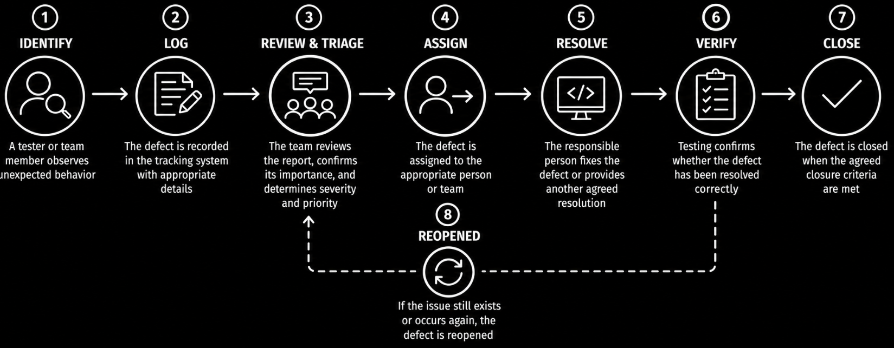
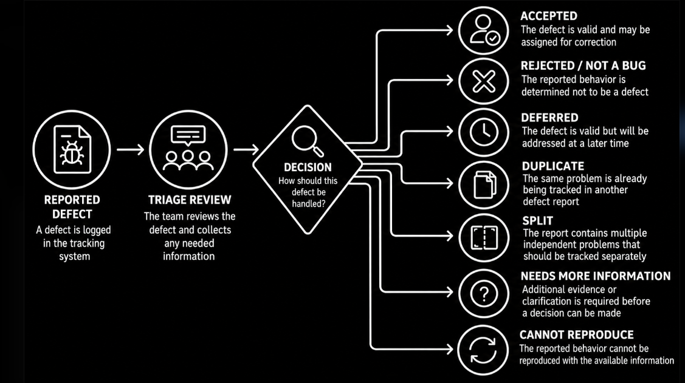

# Level 1

## Table of Contents: Test Management

- [Defect Management](#defect-management)
- [Defect Life Cycle](#defect-life-cycle)
- [Severity and Priority](#severity-and-priority)
- [Writing a Good Defect Report](#writing-a-good-defect-report)
- [Defect Triage](#defect-triage)
- [Basic Defect Metrics](#basic-defect-metrics)

**Test Management Level 1** introduces the fundamentals of managing software defects throughout testing and development. Identifying a problem is only the beginning; it must also be documented, evaluated, tracked, and handled appropriately so that its impact is understood and the necessary actions can be taken.

This module covers the **defect life cycle**, **severity and priority**, **defect reporting**, **defect triage**, and **basic defect metrics**. Together, these topics establish how defect information is organized, communicated, and used to support decisions about corrective actions and testing progress. The starting point is **defect management**, which provides the overall process connecting these activities.

## Defect Management

**Defect management** is the systematic process of identifying, documenting, reviewing, prioritizing, tracking, and resolving defects discovered in software. Its purpose is to ensure that reported problems are properly evaluated and managed until an agreed outcome is reached. A **defect**, often called a **bug**, is a flaw in a software product that can cause it to behave differently from what is required or expected. An **anomaly** is an observed condition that differs from expectations and requires investigation before it can be confirmed as a defect.

Defects can originate from incorrect or incomplete requirements, design problems, coding mistakes, configuration issues, or integration problems. **Defect categories** and **root cause tags** may be used to classify problems according to their source, with common categories including **Requirements**, **Design**, **Code**, **Environment**, and **Data**. These classifications help identify recurring problem areas and support quality improvement.

Defect management applies to both **functional and non-functional problems**. For example, a defect may prevent a payment from being completed, cause slow response times, expose information to unauthorized users, or make an interface difficult to use with assistive technology. Managing these problems systematically helps prevent them from being overlooked and provides **traceability** from discovery through investigation, resolution, verification, and closure. This progression is represented by the **defect life cycle**, which describes how defects move through different stages until an agreed outcome is reached.

## Defect Life Cycle

The **defect life cycle** describes the stages a defect passes through from discovery until an agreed outcome is reached. It helps establish the defect's current status, responsibility for the next action, and the conditions required for closure. A typical defect is first **identified** and **logged** in a defect-tracking system, then **reviewed and triaged** to determine its importance and how it should be handled. Once assigned, the defect is investigated and **resolved**, after which the resolution is **verified** through testing. If the problem has been successfully addressed and the agreed closure criteria are satisfied, the defect can be **closed**.

If verification shows that the problem still exists, the defect may be **reopened** and returned for further investigation or correction. Depending on the workflow, it may move back to **In Progress** while additional work is performed. A previously closed defect may also be reopened if the same problem reappears.

Defect-tracking tools commonly use statuses such as **New**, **In Progress**, **Resolved**, **Closed**, and **Reopened** to represent a defect's progress. Additional statuses may include **Rejected** or **Not a Bug** when a report is not accepted as a defect, **Deferred** when a valid defect will be addressed later, and **Cannot Reproduce** when the reported behavior cannot be reproduced with the available information. In the latter case, additional evidence or clarification may be requested. Exact status names and transitions vary between organizations, and the activities shown in the diagram do not necessarily correspond to separate tracking statuses.

Responsibilities also depend on the agreed workflow. Developers commonly investigate reported defects and implement fixes, while testers identify problems, document their observations, and verify resolutions. Test leads, product representatives, development leads, or triage participants may contribute to decisions about defect handling. Responsibility for closing a defect depends on the project's agreed closure criteria.

Verification is an important stage because marking a defect as resolved does not necessarily mean that the problem has been corrected. **Confirmation testing** checks whether the original defect has been fixed, while **regression testing** may be needed to identify unintended effects on related functionality. If verification fails, the defect report should be updated with relevant evidence, such as the tested build or version, reproduction steps, actual results, screenshots, videos, or logs. This information should describe the remaining problem objectively and support further investigation.

Some defects may also require **escalation**, particularly when a serious issue remains unresolved beyond an agreed timeframe, blocks important testing or delivery activities, or cannot be resolved through normal triage decisions. Escalation should follow the project's agreed process and communicate the defect's impact, current status, blocking issue, and required decision or action. These decisions depend partly on the defect's **severity and priority**, which help determine its impact and urgency.

## Severity and Priority

**Severity** describes how strongly a defect affects the system or its users. It focuses on the technical and functional impact of the defect.

| Severity     | Meaning                                                                                   | Example                                       |
| ------------ | ----------------------------------------------------------------------------------------- | --------------------------------------------- |
| **Critical** | Causes a severe impact, such as a system outage, data loss or serious security exposure   | Unauthorized access to sensitive user data    |
| **High**     | Breaks major or important functionality                                                   | Users cannot complete a payment               |
| **Medium**   | Affects functionality, but the impact is limited or a reasonable workaround exists        | A filter works only after it is applied twice |
| **Low**      | Has minor impact and often affects appearance or usability rather than core functionality | Button text is slightly misaligned            |

**Priority** describes how urgently a defect should be fixed. It focuses on the application and delivery importance of resolving the defect.

| Priority     | Meaning                                                                                                | Example                                                            |
| ------------ | ------------------------------------------------------------------------------------------------------ | ------------------------------------------------------------------ |
| **Critical** | Must be addressed immediately because it blocks essential application operations, testing or release   | A defect prevents the production system from starting              |
| **High**     | Should be fixed as soon as possible because it significantly affects the product or planned release    | A defect blocks an important feature required for the next release |
| **Medium**   | Should be fixed, but does not require immediate action                                                 | A commonly used feature has an acceptable temporary workaround     |
| **Low**      | Can be addressed later because it has little effect on current application or release goals            | A minor visual issue in a rarely used part of the application      |

The responsibility for assigning severity and priority depends on the organization's **defect management process**. **Severity** is commonly proposed when a defect is reported, based on its technical and functional impact, and may be reviewed with developers, technical leads, or other participants during defect triage. **Priority** is generally determined or confirmed by a **product owner**, **product manager**, **business representative**, **business analyst**, or the **triage team**, depending on the organization. Customer impact, release goals, application risks, deadlines, and regulatory requirements can influence these decisions. Developers and technical leads may also provide information about technical dependencies, complexity, and resolution effort, while final responsibility follows the team's agreed process.

Although severity and priority are related, they are **not the same**. A defect with **low severity** may have **high priority** when it affects release readiness. For example, an incorrect company name on the application's home page may not affect functionality but may need to be corrected before release. Conversely, a defect with **high severity** may have **lower priority** if it affects a rarely used or disabled feature that is not included in the upcoming release. Priority may also increase when a defect blocks testing or development work, affects an important customer, or must be resolved before a regulatory or release deadline.

Understanding the distinction between severity and priority helps support consistent decisions about which defects should be addressed first. These decisions depend on accurate information about each problem, making a clear and complete **defect report** essential to effective defect management.

## Writing a Good Defect Report

A good **defect report** provides enough information for another team member to understand, investigate, and reproduce a problem without unnecessary clarification. Before creating a new report, the tester should search the defect-tracking system for similar issues using relevant keywords, error messages, or feature names. If the same problem has already been reported, the team's duplicate-handling process should be followed rather than creating an unnecessary duplicate record. When a new report is needed, it should include the relevant information outlined in the following table.

| Field                     | Purpose                                                                                                                      | Typical Entry                                              | Importance                                     |
| ------------------------- | ---------------------------------------------------------------------------------------------------------------------------- | ---------------------------------------------------------- | ---------------------------------------------- |
| **Unique Identifier**     | Uniquely identifies the defect                                                                                               | Automatically generated                                    | Required                                       |
| **Title**                 | Provides a short and specific summary of the problem                                                                         | Manually entered                                           | Essential                                      |
| **Description**           | Clearly explains the observed problem                                                                                        | Manually entered                                           | Essential                                      |
| **Steps to Reproduce**    | Provides precise steps for reproducing the defect                                                                            | Manually entered                                           | Essential when reproducible                    |
| **Expected Result**       | Describes what should happen                                                                                                 | Manually entered                                           | Essential                                      |
| **Actual Result**         | Describes what actually happens                                                                                              | Manually entered                                           | Essential                                      |
| **Severity**              | Indicates the technical or functional impact of the defect                                                                   | Manually selected or assessed                              | Usually required by the process                |
| **Priority**              | Indicates how urgently the defect should be addressed                                                                        | Manually selected or assigned during triage                | Process-dependent                              |
| **Environment Details**   | Records relevant information such as the operating system, browser, device, application version, build, or configuration     | Manually entered or automatically captured                 | Essential when relevant to reproduction        |
| **Evidence**              | Provides supporting information such as screenshots, videos, logs, or error messages                                         | Manually attached or automatically collected               | As needed                                      |
| **Reporter and Assignee** | Identifies who reported the defect and who is responsible for handling it                                                    | Reporter usually automatic; assignee manual or automatic   | Reporter required; assignee workflow-dependent |
| **Status**                | Shows the defect's current state in its life cycle                                                                           | Initially automatic; subsequently updated through workflow | Required                                       |
| **Important Dates**       | Records relevant dates, such as when the defect was reported, updated, resolved, or closed                                   | Usually automatically recorded                             | Required for tracking                          |

The exact fields, mandatory requirements, and automatic behavior vary between organizations and defect-tracking tools. Some information, such as the **Unique Identifier**, **Reporter**, **Status**, and **Important Dates**, is commonly generated or maintained by the system, while other fields require input from the tester or decisions made during the defect management process.

Regardless of how the information is entered, **Steps to Reproduce** should be specific enough for another person to follow and observe the same problem when it is reproducible. The **Expected Result** should describe the intended behavior, while the **Actual Result** should explain what happened instead. Common reporting problems include vague titles, missing reproduction steps, incomplete environment details, insufficient evidence, and incorrectly assessed severity or priority. These weaknesses can delay investigation and create misunderstandings, while well-documented reports provide the information needed for effective **defect triage**, where the team reviews reported problems and determines how they should be handled.

## Defect Triage

**Defect triage** is the process of reviewing reported defects and deciding how they should be handled based on their impact, urgency, and relevance to the project. Triage does not always result in an immediate fix. Depending on the review, a defect may be **accepted** for correction, **rejected** as **Not a Bug**, **deferred** until a later time, identified as a **duplicate**, or **split** into separate issues. A report may also be returned because it **needs more information** or marked as **Cannot Reproduce** when the reported behavior cannot be reproduced with the available information.

Triage participants and procedures vary between organizations and projects. Reviews may involve a **test lead**, **development lead**, **product manager**, **product owner**, or other relevant specialists who contribute different perspectives on technical impact, business importance, release requirements, and available resources. Triage may take place during scheduled meetings or as part of the team's regular workflow, with more frequent reviews during periods of high release activity.

Effective defect triage supports consistent decisions, clear ownership, and visibility into the status of reported problems. It helps teams determine which defects require attention before testing can be considered complete or a release can proceed. The outcomes of these decisions also contribute to **basic defect metrics**, which provide information about unresolved problems and defect resolution progress.

## Basic Defect Metrics

**Defect metrics** provide information about reported problems, helping teams monitor testing progress and identify issues that may require attention. At **Test Management Level 1**, the focus is on understanding a few basic metrics rather than performing advanced defect analysis. Common examples include the number of **open defects**, which indicates how many reported problems remain unresolved, and **closed defects**, which shows how many have reached an agreed closure state. Teams may also monitor **defect age**, which measures how long a defect has remained unresolved. Older defects may require additional attention, particularly when they have high severity or priority.

Although these metrics provide useful insights, they do not determine product quality on their own. They should be interpreted alongside test results, product risks, defect severity and priority, and the team's agreed completion or release criteria. Understanding how to interpret this information completes the foundation of **Test Management Level 1**, connecting defect reporting, tracking, triage, and resolution with informed test management decisions.
