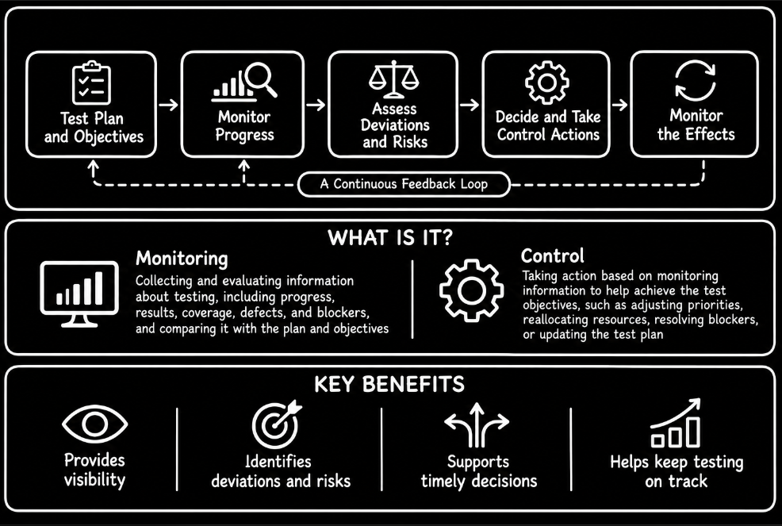
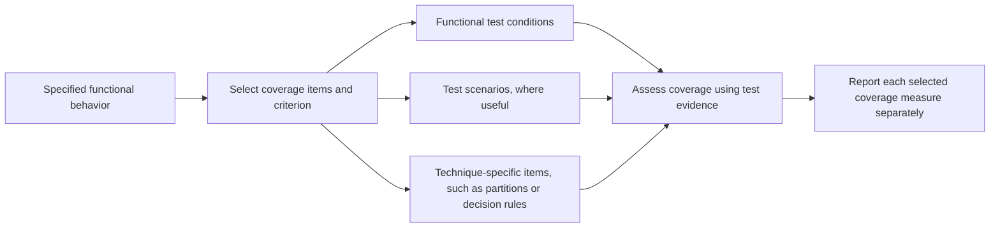
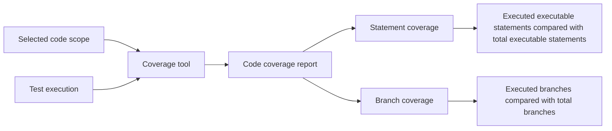

# Level 3

## Table of Contents: Test Management

- [Test Monitoring and Control](#test-monitoring-and-control)
- [Test Metrics and Progress Tracking](#test-metrics-and-progress-tracking)
- [Test Coverage](#test-coverage)
- [Requirements Traceability](#requirements-traceability)
- [Test Reporting](#test-reporting)
- [Test Closure](#test-closure)

**Test Management Level 3** examines how teams monitor testing progress, evaluate results, and use evidence to guide testing decisions. It explains how metrics, coverage information, and requirements traceability help teams assess progress against the test plan, identify gaps, and determine when corrective action is needed. It also examines how teams report testing status and results, communicate outstanding defects and risks, and evaluate and document the completion of testing activities.

## Test Monitoring and Control

**Test monitoring and control** help teams assess progress towards test objectives and decide when adjustments are needed. They apply throughout the testing process. Monitoring involves collecting and evaluating information about testing, including comparing actual progress against the test plan, while control uses that information to guide actions needed to meet the test objectives **(ISTQB, 2024, Sections 1.4.1 and 5.3)**. Together, they form a feedback loop in which teams can monitor the effects of their decisions and make further adjustments when necessary.

**Test monitoring** involves collecting and evaluating information about testing against the test plan, objectives, and relevant criteria. During preparation, a team might monitor whether test cases, environments, and test data will be ready when needed. During execution, it might examine test results, coverage, unresolved defects, and blocked tests. This information helps the team assess both progress and the risks that remain. For example, checkout testing for an online shop might be progressing according to schedule while tests of a high-risk payment function remain blocked. The number of completed tests alone would not reveal the significance of that gap.

**Test control** involves taking action in response to monitoring information to help achieve the test objectives. If an environment problem blocks payment testing, the team might escalate the issue, revise the execution schedule, or prioritize other tests that can proceed. It can then monitor whether the environment becomes available and reassess the effect of the delay on the remaining work. If the proposed response changes the agreed testing scope or leaves a significant risk unaddressed, the team communicates the implications and seeks the appropriate decision or agreement from stakeholders. Control may also require updates to the test plan.

Dashboards, defect tracking systems, and status trackers can make monitoring information accessible, but their usefulness depends on accurate, timely data and its interpretation. The following section examines **Test Metrics and Progress Tracking** and explains how teams use defined measures to evaluate and communicate testing progress.

## Test Metrics and Progress Tracking

**Test metrics** are quantitative measures that support test monitoring and control by helping teams evaluate testing progress, results, and risks against their objectives. Teams select metrics according to the questions they need to answer, such as whether test preparation is on schedule, how much planned execution remains, or whether unresolved defects affect an important capability **(ISTQB, 2024, Section 5.3.1)**. **Progress tracking** involves examining relevant measures over time and comparing actual progress with the test plan.

Metrics can describe different aspects of testing. During preparation, a team might track how many test cases are ready for execution or whether required environments and test data are available. During execution, it might track the current status of planned test cases alongside defect severity, priority, and status. Consistent interpretation requires a defined scope, reporting period, and counting method. For example, a report should distinguish the number of test cases executed from the number of execution attempts, since one test case may be run several times. Teams should also account for changes to the planned test set when comparing results across reporting periods.

Teams can summarize metrics in a **test progress report** to communicate progress, deviations from the plan, and significant impediments **(ISTQB, 2024, Section 5.3.2)**. The following example illustrates how execution metrics can help a team assess progress at a planned milestone. Test reporting is examined later in this level.

!!! example "Calculating and interpreting test execution metrics"

    An online shop has **100 planned system test cases**, of which 80 were expected to be executed by the reporting milestone. The table shows the current status of each planned test case, with each case counted once.

    | Test status | Number of test cases |
    |-------------|----------------------|
    | Passed      | 65                   |
    | Failed      | 5                    |
    | Blocked     | 10                   |
    | Not yet run | 20                   |
    | **Total**   | **100**              |

    For this example, blocked tests count as not executed. The team has executed **70 of 100 test cases**, giving execution progress of **70 percent**. This is **10 test cases behind the plan**. The pass rate among executed tests is approximately **93 percent**, calculated from 65 passed cases out of 70 executed cases.

    The figures do not explain the significance of the remaining work. The 10 blocked cases depend on an unavailable payment environment, so the team needs to assess the associated risk alongside the five failed cases. Comparing these measures at the next milestone will help the team determine whether progress is recovering.

Metrics are most useful when they are timely and interpreted alongside information about risks, defects, and impediments. Execution progress and pass rate do not establish release readiness or show which requirements, risks, or parts of the software have been tested. The following section examines **Test Coverage** and how teams assess the extent of testing.

## Test Coverage

**Test coverage** measures the extent to which selected **coverage items**, such as requirements, test conditions, test scenarios, or code statements, have been addressed by testing. By defining the items in scope and the criterion each must meet to count as covered, a team can assess coverage and identify gaps. Different coverage measures use different items or criteria, allowing teams to answer specific questions about what their testing has addressed.

**Requirements coverage** measures the proportion of requirements in scope that meet a defined coverage criterion. During test preparation, a team may assess how many requirements are addressed by designed test cases. During execution, it may assess how many requirements meet a specified execution criterion, such as having at least one associated test exercise relevant behavior. A requirement can meet the test design criterion before any associated test is executed, and it can meet the execution criterion even if a test fails. Neither measure establishes that every test condition derived from the requirement has been exercised or that the requirement has been satisfied.

**Functional coverage** assesses the extent to which selected aspects of specified functional behavior have been addressed by testing. A team may measure coverage of identified functional test conditions or, where useful, selected test scenarios. It may also use [Black-Box Testing Techniques](../../test_case_design/black_box_testing_techniques/) to identify more specific coverage items, such as equivalence partitions, boundary values, decision rules, or state transitions, use cases. For example, testing a discount condition may involve exercising the identified partitions for eligible and ineligible cart totals. Each measure uses its own coverage items and counting criterion, so coverage of selected conditions, scenarios, or partitions is calculated and interpreted separately.

The diagram illustrates two possible functional coverage measures. Test cases may be derived directly from test conditions or through scenarios when scenarios are useful. The dashed arrows identify possible coverage items, while the execution records provide evidence of which items have been exercised.

**Code coverage** measures the proportion of specified code elements that have been exercised during execution. Different measures use different coverage items, such as executable statements for statement coverage or branches for branch coverage. These measures are examined in [White-Box Testing Techniques](../../test_case_design/white_box_testing_techniques/). A coverage tool can record which elements are executed while tests run, including tests designed using black-box techniques. Code coverage does not establish that all requirements or functional behavior have been tested, nor does it establish that the executed code is correct.

Statement coverage and branch coverage are separate measurements of the selected code scope. Each uses its own set of coverage items, so a percentage reported for one measure cannot be treated as the percentage for the other.

To calculate a coverage percentage, the team divides the number of distinct items meeting its criterion by the total number of applicable items in scope and multiplies by 100. Each item is counted once for that measure, even if several tests cover it. Teams can present the results in a **test coverage summary**, such as a table or dashboard included in a test progress report. The summary should make the scope, reporting point, specific measures, and counting criteria clear so that readers can interpret the figures.

!!! example "Test coverage summary for an online shop"

    At a system testing milestone, an online shop team has **20 requirements** in scope and has separately identified **eight checkout scenarios**. Its coverage summary distinguishes the coverage area from the specific measure and counting criterion used.

    | Coverage area | Specific measure | Counting criterion | Covered | Total | Coverage |
    |---|---|---|---|---|---|
    | Requirements coverage | Requirements addressed by test design | At least one designed test case addresses the requirement | 20 | 20 | 100% |
    | Requirements coverage | Requirements exercised during execution | At least one associated test has exercised relevant specified behavior | 15 | 20 | 75% |
    | Functional coverage | Selected checkout scenarios exercised | A test has exercised the defined scenario | 6 | 8 | 75% |
    | Code coverage | Statement coverage | An executable statement in the selected code scope has been executed | Not measured | Not established | N/A |

    All 20 requirements are addressed by designed test cases, but **five requirements** have not yet met the execution criterion. The team has also exercised six of its eight selected checkout scenarios, leaving **two scenarios** unexercised. Although both execution measures are 75 percent, they describe different sets of items. Neither figure means that 75 percent of all online shop functionality has been tested.

    A test associated with the payment requirement failed after exercising the relevant behavior. The requirement therefore counts toward execution coverage under the stated criterion, but the failure remains visible in the test results and requires investigation.

    The team uses the summary to identify gaps, then checks the underlying records to determine which requirements and scenarios need attention. Statement coverage has not been measured, and its total number of coverage items has not been established. The team therefore reports no percentage rather than treating the missing measurement as zero coverage.

Coverage figures should be supported by evidence showing which items met the defined criterion. Depending on the measure, this evidence may come from test design records, execution results, or a **code coverage report**. Teams use the underlying evidence to identify uncovered items and assess their significance.

Even **100 percent coverage** means only that every item in scope met the selected criterion. It does not establish that the software is correct or that testing is complete. Teams evaluate coverage alongside test results, product risks, and completion criteria when deciding whether further testing is needed or remaining risks can be accepted. The following section examines how **Requirements Traceability** supports coverage assessment.

## Requirements Traceability

Test coverage shows how much of the system has been tested, but it does not clearly show the relationship between **requirements** and **test cases**. A system may appear to have good coverage, but it may still be unclear which specific requirements have been validated.

To make this relationship explicit, a structured mapping approach is used.

A **traceability matrix** links **requirements** to **test cases** and provides a clear view of how testing aligns with defined requirements.

Each requirement is identified using a **unique identifier** and is connected to one or more **test cases**. This mapping makes it possible to see which requirements are **covered** and which are not.

The matrix typically includes information such as **requirement identifiers**, **requirement descriptions**, related **test scenarios**, **test case identifiers** and the **status** of coverage or execution.

By organizing this information in a structured way, the traceability matrix helps ensure that testing is **complete** and aligned with what needs to be validated.

Traceability can be viewed in different directions, depending on how requirements and test cases are connected.

**Forward traceability** focuses on moving from requirements to test cases. It ensures that every requirement is linked to at least one test case, so nothing defined in the requirements is left untested.

**Backward traceability** works in the opposite direction. It connects test cases back to their original requirements, ensuring that every test has a clear purpose and is not created without a reason.

When both directions are used together, it forms **bidirectional traceability**. This provides full visibility between requirements and testing, making it possible to see both what is tested and why it is tested.

The traceability matrix also helps identify **gaps**. If a requirement has no linked test cases, it means it has not been tested. If a test case is not linked to any requirement, it may be unnecessary or incorrectly designed.

In addition, traceability supports **change management**. When requirements change, the matrix helps identify which test cases are affected and need to be updated.

For small projects, traceability can be maintained in spreadsheets. For larger efforts, teams use test management tools such as Jira, TestRail or Quality Center.

The traceability matrix ensures that testing is connected to requirements in a clear and structured way, improving **coverage visibility** and supporting more **reliable quality evaluation**.

To communicate this information effectively to stakeholders, it is necessary to present testing results in a clear and structured form.

## Test Reporting

Once testing activities are measured using metrics, the results must be communicated in a clear and structured way. Raw data alone is not enough. Stakeholders need to understand what the data means and how it reflects the current state of the system.

Test reporting is the process of presenting testing results, progress and quality status to stakeholders. It transforms collected data and metrics into meaningful information that supports decision making.

Test reports provide visibility into what has been tested, what defects have been identified and what risks remain. They help teams and stakeholders understand whether the system is ready for release or if further testing is required.

Reporting is not only about listing numbers. It includes interpreting results and highlighting important information, such as critical defects, delays or areas of concern. This ensures that attention is focused on the most important issues.

Test reporting also supports communication between different roles. Developers, testers, managers and product owners rely on reports to stay aligned and to make informed decisions about the project.

Without clear reporting, testing results may be misunderstood or ignored. Important issues may not be communicated effectively, leading to incorrect assumptions about software quality.

Test reporting ensures that testing outcomes are visible, understandable and useful for decision making throughout the project.

Reports can be presented in different forms depending on the level of detail required. During testing, teams often use **detailed test reports** (also called **test execution reports**) are produced daily or per test cycle. They include **test execution tables** showing case-by-case results, defect information and current progress. These support day-to-day team decisions. These reports help the team understand what is happening during testing and support day-to-day decisions.

At a higher level, **test summary reports** are produced weekly or at milestone gates. They provide an overall view of total test cases, pass and fail rates, identified defects and overall quality status. Stakeholders use these to assess release readiness.

By using both detailed and summary reports, teams can ensure that information is available for both operational decisions and high-level evaluation.

To understand how testing is progressing over time and whether activities are on track, it is necessary to continuously follow the state of testing execution.

## Test Progress Tracking

While test reporting provides a summary of testing results, it is also necessary to continuously follow how testing is progressing over time. Testing is not a single event, but an ongoing process that evolves as execution continues.

Test progress tracking focuses on observing the state of testing activities and understanding how much work has been completed and what remains.

Progress tracking includes monitoring the execution of test cases, identifying how many have been completed and evaluating the rate at which testing is moving forward. It also involves tracking defects, including how many have been found, fixed, and remain unresolved.

Key metrics for progress tracking include, **test execution rate** test cases completed per day, **defect find rate** defects identified per day, **defect resolution rate** defects fixed per day, **schedule variance** planned vs. actual completion percentage.

By tracking progress, teams can determine whether testing is on schedule and whether objectives are likely to be achieved within the planned timeframe. It helps identify delays, bottlenecks or areas where additional attention is required.

If progress falls behind by more than 10% of the schedule, or if critical defects block more than 20% of test cases, escalation to the Test Lead or project manager is typically required.

Progress tracking also supports better planning during execution. If testing is slower than expected or if defect resolution is delayed, adjustments can be made to keep testing aligned with project goals.

Without progress tracking, it is difficult to understand the current state of testing or to predict whether testing will be completed on time. Teams may lose visibility into what has been done and what still needs to be addressed.

Test progress tracking ensures that testing activities remain transparent and measurable throughout execution, allowing teams to make informed decisions as testing continues.

Once testing activities are completed and progress has been fully evaluated, it is necessary to formally conclude the testing process.

## Test Closure

Once testing activities are completed and progress has been evaluated, it is necessary to formally conclude the testing process. Testing does not end simply when execution stops. It must be reviewed and finalized in a structured way.

Test closure begins when **exit criteria** are met here is examples **all planned tests executed**, **coverage targets achieved** and **critical defects resolved** or **formally accepted**.

Test closure is the process of completing all testing activities and evaluating the overall results of testing. It ensures that testing has been carried out according to the plan and that all objectives have been addressed.

During test closure, the results of testing are analyzed to understand what has been achieved. This includes reviewing executed test cases, identified defects and the current state of the system.

Test closure provides an opportunity to assess the quality of the software and determine whether it is ready for release. Any remaining risks or unresolved issues are identified and communicated to stakeholders.

In addition, test closure includes documenting the outcomes of testing. This may involve creating summary reports, capturing key metrics and recording lessons learned during the testing process.

Closure also includes handoff activities: transferring remaining known issues to support teams, archiving test assets for future reuse, and releasing test environments. Lessons learned are an important part of test closure. They help teams understand what worked well and what can be improved in future testing activities.

The formal artifacts produced during closure include **test summary report** overall quality status and results, **test closure report** confirmation that exit criteria were met and handoffs completed and **lessons learned document** insights for future projects.

Without proper closure, valuable information may be lost and it may be unclear whether testing was sufficient. There would be no clear conclusion about the quality of the system.

Test closure ensures that testing is completed in a controlled and structured way, providing a final evaluation of software quality and supporting continuous improvement in future projects.