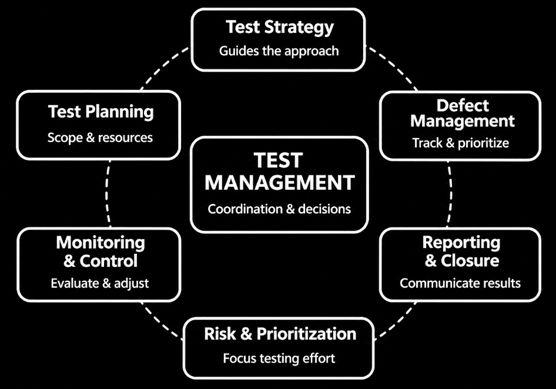

# Overview

**Test management** involves planning, organizing, monitoring, and controlling software testing activities to ensure that testing is coordinated and supports informed decisions about software quality. It helps teams define testing objectives, allocate resources, manage product risks, track progress, handle defects, and communicate testing results to stakeholders **(ISTQB, 2024, Section 5)**. While **test execution** focuses on performing tests and evaluating their outcomes, test management addresses how testing activities are prepared, coordinated, evaluated, and completed throughout the software development lifecycle.

The way testing is managed depends on the project's size, complexity, risks, and development approach. As introduced in [Software Development Lifecycle & Testing](../software_development_lifecycle_and_testing/overview.md), **sequential development models** typically organize work into defined phases and may use more formal test plans, schedules, and reporting structures. **Iterative, incremental, and Agile approaches** organize development through repeated activities, gradual delivery, and adaptation to feedback, often requiring test planning, monitoring, and coordination to be revisited throughout development. In continuous delivery environments, these activities may be integrated into ongoing development and delivery workflows. Regardless of the approach, test management does not necessarily require a dedicated test manager or extensive documentation. Responsibilities may be shared among testers, developers, and other team members, provided that testing objectives, progress, risks, and results remain sufficiently visible.

A central part of test management is **test planning**, which establishes what testing should achieve, what is included in its scope, who is responsible for different activities, and which environments, resources, and schedules are needed. **Test monitoring and control** help teams evaluate progress and make adjustments when necessary. **Defect management** supports the documentation, investigation, prioritization, and resolution of identified problems, while **test reporting and closure** help communicate results and conclude testing activities. These responsibilities are guided by **test strategy**, **risk-based testing**, **estimation**, and coordination with stakeholders.

The diagram illustrates the main responsibilities of test management and their relationships rather than a fixed sequence. Planning may be revised as risks change, defect trends may influence testing priorities, and monitoring results may reveal the need for additional resources or schedule adjustments. The appropriate level of management depends on the project context, but its purpose remains consistent. Keep testing purposeful, transparent, and responsive to changing circumstances.

The following levels explore these responsibilities in greater detail. [**Level 1**](./1_level/1_level_test_managment.md) introduces **test planning fundamentals**, including test plans, scope, objectives, responsibilities, environments, resources, schedules, and entry and exit criteria. [**Level 2**](./2_level/2_level_test_managment.md) covers **defect management**, including the defect life cycle, severity and priority, defect reporting, triage, and basic defect metrics. [**Level 3**](./3_level/3_level_test_managment.md) examines **test monitoring and control**, progress metrics, coverage, requirements traceability, reporting, and closure. [**Level 4**](./4_level/4_level_test_managment.md) develops the broader management perspective through test strategy, risk-based testing, prioritization, estimation, resource allocation, reporting strategy, escalation, and stakeholder coordination. You can explore these levels according to your existing knowledge and learning objectives, although progressing from the fundamentals to the more advanced topics provides a structured learning path.
