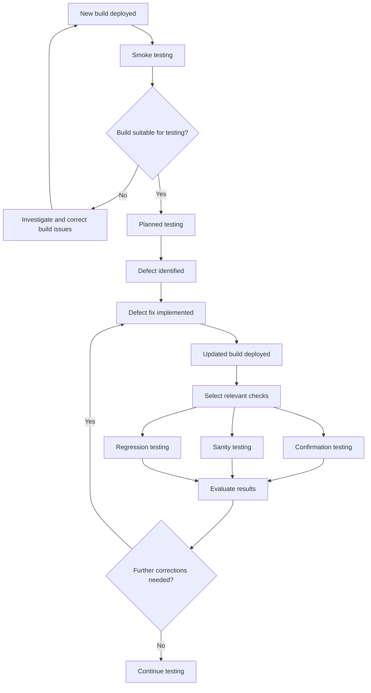

# Build and Change-Related Testing

## Table of Contents: Build and Change-Related Testing

- [Smoke Testing](#smoke-testing)
- [Sanity Testing](#sanity-testing)
- [Confirmation Testing (Retesting)](#confirmation-testing-retesting)
- [Regression Testing](#regression-testing)
- [Build and Change-Related Testing Workflow](#build-and-change-related-testing-workflow)

Software changes introduce new functionality, correct defects, and improve existing behavior, but they can also introduce unexpected problems. **Build and change-related testing** covers testing activities performed when a new **software build** or modification becomes available. These changes may include defect fixes, feature updates, enhancements, configuration changes, or upgrades.

These activities help evaluate the readiness of new builds, verify intended changes, confirm defect fixes, and detect unintended effects on existing functionality. The appropriate combination depends on the nature of the change, its potential impact, project risks, and available test coverage.

## Smoke Testing

**Smoke testing** is a small set of tests performed on a new software build to quickly verify that its **most critical functionality works** and that the build is stable enough for further testing. It is typically performed after deployment to an available test environment. Common checks include application startup, system access, basic navigation, and critical features. For example, in an application with account functionality, smoke tests might verify that the application loads, the login page is accessible, a user can log in successfully, and the main application area opens.

Smoke testing provides **broad but shallow coverage**, focusing on major problems rather than examining features in detail. If the smoke tests **pass**, more detailed testing can proceed. If they **fail**, the build is generally returned for investigation or correction because significant failures may prevent meaningful further testing.

Because smoke tests repeatedly check critical functionality across builds, they are well suited to **automation**. In **continuous integration and continuous delivery (CI/CD) workflows**, automated smoke tests may run after deployment and act as a quality gate before further testing begins. Manual execution is also possible when appropriate. Once a build passes these initial checks, testing can focus on specific areas affected by recent changes through more targeted checks, such as sanity testing.

## Sanity Testing

**Sanity testing** is a focused check performed after a **specific change**, such as a minor feature update, configuration change, or defect fix. Unlike smoke testing, which assesses the general stability of a build, sanity testing concentrates on the **changed area and closely related functionality**. Its purpose is to establish whether the change works as intended before investing in more extensive testing.

Sanity testing typically involves a limited selection of relevant tests rather than executing a large test suite. For example, after changes to account registration, it might verify that registration can be completed, input validation works, and users can access the application after creating an account. These checks provide quick confidence in the affected functionality without necessarily repeating the exact steps that originally revealed a defect. When the objective is specifically to verify that a reported defect has been corrected, **confirmation testing** is used.

The distinction between smoke and sanity testing is not applied uniformly across all organizations. Some teams use the terms interchangeably, so their intended scope and purpose should be defined within the project's testing strategy. Unlike these broader checks, confirmation testing specifically verifies whether a previously reported defect has been corrected.

## Confirmation Testing (Retesting)

**Confirmation testing**, also called **retesting**, verifies that a previously reported **defect has been fixed**. It involves repeating the **same test cases or reproduction steps** that originally revealed the defect and comparing the actual results with the expected behavior. Where practical, testing should be performed in the **same environment in which the defect was originally observed**, or in a representative equivalent environment. This is particularly important when the problem depends on a specific browser, operating system, device, configuration, or other environmental condition.

For example, suppose selecting **Create Account** after entering valid registration information previously produced an error instead of creating an account. After the fix is delivered, confirmation testing repeats the original conditions and reproduction steps. If registration now completes as expected and the original problem no longer occurs, the defect fix can be considered confirmed.

Confirmation testing has a **narrow scope**, focusing on the specific defect. A successful result does not establish that the change has left other functionality unaffected. Identifying such unintended effects is the purpose of **regression testing**.

## Regression Testing

**Regression testing** verifies that changes to software or its environment have not introduced unintended adverse effects on **previously established behavior or quality characteristics**. It may be performed after defect fixes, feature updates, enhancements, configuration changes, upgrades, migrations, or other modifications. For example, a change to account registration may also affect login, account verification, profile creation, or functionality that shares authentication or account-management components. Regression testing examines relevant existing behavior to detect these unintended effects.

Regression testing does not necessarily require rerunning every existing test. Its scope depends on the **nature of the change, affected areas, and associated risks**. **Full regression testing** executes the complete regression suite and may be appropriate for major releases or changes with broad impact. **Partial regression testing** focuses on the changed area and related functionality, while **risk-based regression testing** prioritizes tests based on business importance, technical impact, previous defects, and the likelihood of regression.

Regression suites are well suited to **test automation** because the same tests are executed repeatedly as the application evolves. Automated testing can provide faster feedback, while manual testing remains useful when human observation, exploratory investigation, or functionality unsuitable for automation is involved. Regression testing can also cover relevant **non-functional characteristics**, such as performance, security, usability, and compatibility, when changes may affect them.

As the application evolves, regression suites should be reviewed and maintained to preserve relevant coverage. Tests covering obsolete behavior may need to be updated or removed, while new tests can be added for important functionality and previously discovered defects. This helps keep the suite effective without unnecessarily increasing execution time. While each testing activity serves a distinct purpose, they can also be combined to assess builds and changes throughout the development cycle.

## Build and Change-Related Testing Workflow

Smoke, sanity, confirmation, and regression testing may be combined within the same development cycle, although their selection and order depend on the situation. The following workflow illustrates how these activities may be selected when a defect is discovered and corrected during testing.

The diagram shows how an initial build assessment can lead to planned testing, defect correction, and the selection of relevant verification activities. **Confirmation testing** is appropriate when a reported defect needs to be verified, while **sanity and regression testing** are selected according to the scope and risk of the change. Failed checks may require further corrections and another updated build, while successful results allow testing to continue. This workflow is **illustrative rather than mandatory**. Additional smoke testing may be appropriate after an updated deployment, and not every change requires all three verification activities.

Together, **smoke, sanity, confirmation, and regression testing** provide complementary ways to manage the risks associated with new builds and software changes. Each activity contributes to a different aspect of testing, from assessing build readiness to verifying corrections and detecting unintended effects. Selecting and combining these activities according to the scope and risk of a change helps maintain software quality while keeping testing efforts focused and efficient. These activities form part of the broader testing practices discussed in the [Types of Testing Summary](../../summary.md).