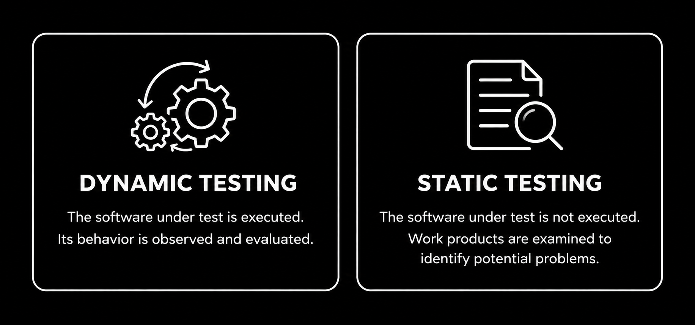

# Overview

Software testing can be classified in different ways depending on what is being examined and how testing is performed. One important distinction is whether the software under test is executed. **Dynamic testing** evaluates software by executing it and observing its behavior, while **static testing** examines software work products without executing the software under test **(ISTQB, 2024, Sections 2.2.2 and 3.1)**. These approaches complement each other because some problems can be identified by examining requirements, designs, or code, while others become visible only when the software runs.

Testing can also be classified by its objectives. A common distinction is between **functional testing** and **non-functional testing** **(ISTQB, 2024, Section 2.2.2)**. Functional testing addresses the question *"What does the software do?"* by evaluating whether software performs its required functions correctly. For example, it may verify that users can register an account, sign in with valid credentials, or submit a form successfully. **Non-functional testing**, on the other hand, addresses the question *"How well does the software work?"* by evaluating whether software meets its quality requirements. An account registration feature, for instance, may work correctly but still respond too slowly when many users access it simultaneously. Beyond these objectives, dynamic testing may also focus on evaluating new software builds, checking the effects of changes, or verifying that software works in its intended environment. These activities may involve both functional and non-functional concerns, depending on what is being evaluated.

Static testing examines work products such as **requirements**, **user stories**, **design documents**, **source code**, and **test documentation** to identify defects, inconsistencies, and other quality issues. These work products may describe functional behavior or non-functional quality requirements, and both can be examined without executing the software under test. For example, reviewing a login requirement may reveal that it does not explain what should happen when a user enters an incorrect password, allowing the team to clarify the expected behavior before implementation. Two common approaches are **reviews**, in which work products are examined to identify problems, and **static analysis**, which uses tools to detect potential issues **(ISTQB, 2024, Section 3.1)**. Since static testing does not require a running application, it can begin early in development.

The following topics explore these testing activities in more detail. You can begin with [Build and Change-Related Testing](./dynamic_testing/build_and_change_related_testing/build_and_change_related_testing.md) or [Installation and Configuration Testing](./dynamic_testing/installation_and_configuration_testing/installation_and_configuration_testing.md) to learn about different purposes of dynamic testing, or explore [Reviews](./static_testing/reviews/reviews.md) and [Static Analysis](./static_testing/static_analysis/static_analysis.md) to understand the main approaches to static testing. For a deeper understanding of the quality characteristics evaluated during non-functional testing, you can also explore [Quality Attributes and Evaluation](../../../software_quality/quality_attributes_and_evaluation/index.md). You can choose where to begin based on which aspect of software testing you would like to explore further.
