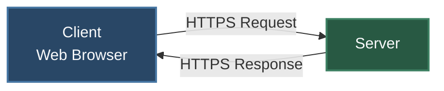
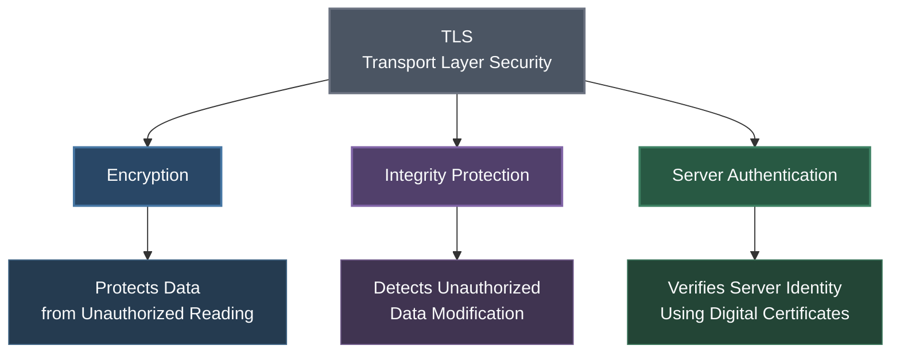
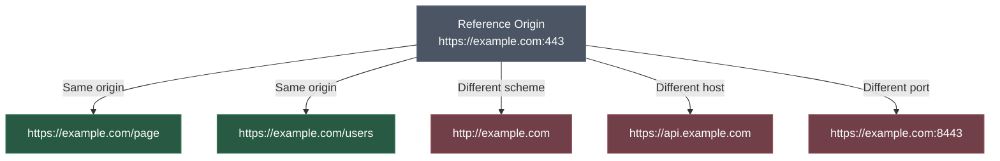
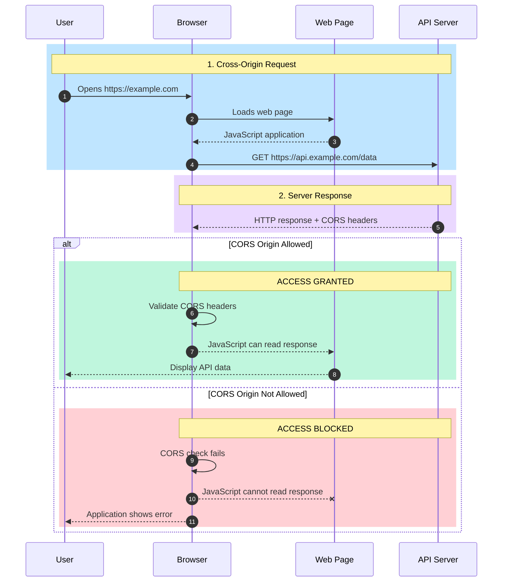

# Level 1

## Table of Contents: Web Security

- [HTTP and HTTPS](#http-and-https)
- [TLS, Encryption, and Server Authentication](#tls-encryption-and-server-authentication)
- [Origins and the Same Origin Policy](#origins-and-the-same-origin-policy)
- [Cross Origin Requests and CORS](#cross-origin-requests-and-cors)

**Web Security Level 1** introduces the fundamental concepts used to protect communication between web browsers and servers. It covers how web applications secure data during transmission and how browser security rules control interactions between different websites. These concepts provide a foundation for understanding both secure network communication and cross-origin access, beginning with the differences between HTTP and HTTPS.

## HTTP and HTTPS

**HTTP (Hypertext Transfer Protocol)** is used for communication between clients and servers, allowing browsers to send requests and receive responses. However, standard HTTP does not protect this communication through encryption, meaning information transmitted across the network may be exposed to interception or modification. **HTTPS (Hypertext Transfer Protocol Secure)** addresses these risks by using **TLS (Transport Layer Security)** to secure HTTP communication.

HTTPS follows the same request and response model as HTTP, but the information exchanged between the client and server is protected during transmission. Websites using HTTPS have URLs beginning with the `https` scheme, such as `https://example.com`. The following diagram illustrates how a browser and server communicate over a protected HTTPS connection.

While HTTPS provides secure HTTP communication, TLS is the underlying protocol responsible for its security properties. The following section explains how TLS uses encryption, integrity protection, and server authentication to protect communication between clients and servers.

## TLS, Encryption, and Server Authentication

**TLS (Transport Layer Security)** is the protocol used to secure communication between a client and server. It provides **encryption**, which protects transmitted data from being read by unauthorized parties, and **integrity protection**, which allows the communicating systems to detect unauthorized modifications during transmission. TLS also supports **server authentication** through digital certificates, helping clients verify that they are communicating with the intended server.

A **digital certificate** associates a server's identity, such as its domain name, with a public key. Browsers validate certificates using trusted certificate authorities to help establish that the server is authorized to represent the requested domain. Together, encryption, integrity protection, and server authentication allow TLS to secure HTTP communication through HTTPS, as illustrated in the following diagram.

TLS replaced the older **SSL (Secure Sockets Layer)** protocols. Although the term SSL is still sometimes used, modern HTTPS relies on TLS. However, a valid HTTPS connection does not guarantee that a website itself is trustworthy or free from security vulnerabilities. It protects the connection rather than the overall behavior of the application. For additional background, see the [MDN HTTPS glossary entry](https://developer.mozilla.org/en-US/docs/Glossary/HTTPS) and the [MDN TLS glossary entry](https://developer.mozilla.org/en-US/docs/Glossary/TLS).

While TLS protects communication between clients and servers, browsers also enforce security rules governing how websites interact with resources from other origins. Understanding these restrictions begins with the concept of an origin, introduced in the following section.

## Origins and the Same-Origin Policy

An **origin** identifies where a web resource comes from and is defined by three parts of its URL, the **scheme** (such as `https`), the **host** (such as `example.com`), and the **port** (such as `443`). Two URLs belong to the same origin when all three components match, regardless of their paths. For example, `https://example.com/page` and `https://example.com/users` share the same origin because only their paths differ. Changing the scheme, host, or port creates a different origin, as illustrated in the following diagram.

The **Same-Origin Policy** is a browser security mechanism that restricts how documents and scripts from one origin can access resources belonging to another. These restrictions help protect sensitive information by preventing websites from freely reading data associated with other origins. However, the policy does not block every cross-origin request, as browsers permit certain interactions while restricting access to their responses. For a more detailed explanation, see the [MDN Same-origin policy guide](https://developer.mozilla.org/en-US/docs/Web/Security/Defenses/Same-origin_policy).

Because web applications often need to communicate with resources hosted on different origins, browsers provide a controlled way to allow certain cross-origin interactions through **Cross-Origin Resource Sharing (CORS)**, which is introduced in the following section.

## Cross-Origin Requests and CORS

A **cross-origin request** occurs when a web page requests a resource from an origin different from its own. For example, a website hosted at `https://example.com` might request data from an API at `https://api.example.com`. Although browsers can send these requests, the Same-Origin Policy may prevent the website's scripts from reading the responses. To allow legitimate access, **CORS (Cross-Origin Resource Sharing)** provides an HTTP-based mechanism through which servers specify which origins are permitted to access their resources from browser scripts. These permissions are communicated through HTTP headers that browsers evaluate before allowing scripts to read the responses. CORS therefore works alongside the Same-Origin Policy rather than disabling its restrictions, as illustrated in the following diagram.

The diagram shows a simplified cross-origin request in which the browser checks the server's CORS permissions before allowing the requesting web page to read the response. If the origin is permitted, the browser makes the response available to the page's JavaScript. Otherwise, the browser prevents the script from accessing it. For further details, see the [MDN CORS guide](https://developer.mozilla.org/en-US/docs/Web/HTTP/Guides/CORS).

!!! note "CORS and Access Control"

    CORS controls whether browser scripts can access certain cross-origin responses. It does not replace server-side authentication or authorization, and it does not restrict requests made by non-browser clients.

The concepts introduced in **Web Security Level 1** provide a foundation for understanding how web communication and browser interactions are protected. HTTPS and TLS secure communication between clients and servers, while the Same-Origin Policy and CORS govern access to resources across different origins. The next stage, [**Web Security Level 2**](../2_level/2_level_web_security.md), builds on this knowledge by examining web security mechanisms and their practical applications in greater detail.
